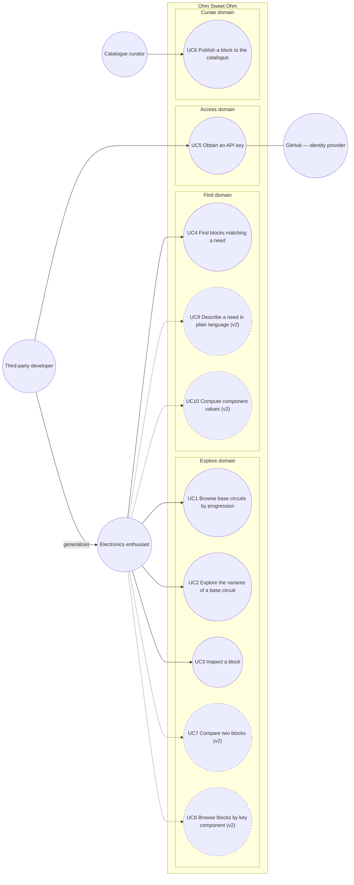

# Use case diagram — catalogue — who wants what from Ohm Sweet Ohm

> **Feature**: issue #1 — use-case diagram (milestone M0)
> **Source specs**: [docs/FRAMING.md](../../../FRAMING.md) § Decisions, [docs/WORKPLAN.md](../../../WORKPLAN.md) § M0–M5
> **Related ADRs**: none yet
> **Decisions captured**: base circuits + variant trees, structured filters first, anonymous read + API keys, curated catalogue imported from KiCad

## Context

This diagram states the actor-initiated goals of the whole product. It covers v1 goals in full
and shows v2 goals (dashed) so the v1 model leaves room for them. It does not show how the
system is built: the web front-end, API and importer split belongs to the component diagram.

## Diagram

## Use case specifications (v1)

### UC1 — Browse base circuits by progression (planned, M2)

- **Primary actor**: Electronics enthusiast.
- **Precondition**: none.
- **Minimal guarantee**: no data is altered.
- **Success guarantee**: the enthusiast sees the base circuits ordered from simplest to most complex, each with its difficulty level.
- **Main success scenario**:
  1. The enthusiast asks for the list of base circuits.
  2. The system lists them in progression order, with name, difficulty and number of variants.
  3. The enthusiast picks a base circuit (continues with UC2).
- **Extensions**:
  - 2a. The catalogue is empty: the system says so; the use case ends with the minimal guarantee.

### UC2 — Explore the variants of a base circuit (planned, M2)

- **Primary actor**: Electronics enthusiast.
- **Precondition**: none.
- **Minimal guarantee**: no data is altered.
- **Success guarantee**: the enthusiast sees a block, its direct variants and what each variant changes, and can move up or down the variant tree.
- **Main success scenario**:
  1. The enthusiast opens a block.
  2. The system shows the block and the path from its base circuit (breadcrumb).
  3. The system lists its direct variants, each with a short description of the change and the specs that differ from the block.
  4. The enthusiast opens a variant or goes back up the path; steps 2–4 repeat.
- **Extensions**:
  - 1a. The block does not exist: the system reports it; the use case ends with the minimal guarantee.
  - 3a. The block has no variant: the system says so and keeps the path to go back up.

### UC3 — Inspect a block (planned, M1)

- **Primary actor**: Electronics enthusiast.
- **Precondition**: none.
- **Minimal guarantee**: no data is altered.
- **Success guarantee**: the enthusiast has the information needed to judge whether to build the block.
- **Main success scenario**:
  1. The enthusiast opens a block.
  2. The system shows the rendered schematic, the typed specs with units, the difficulty, the key components, the cited source and the validation status (tested or theoretical).
- **Extensions**:
  - 1a. The block does not exist: the system reports it; the use case ends with the minimal guarantee.
  - 2a. The block involves hazardous voltage: the system shows a safety warning before the schematic.
  - 2b. The schematic rendering is unavailable: the system shows every other piece of information and says the schematic is missing.

### UC4 — Find blocks matching a need (planned, M3)

- **Primary actor**: Electronics enthusiast.
- **Precondition**: none.
- **Minimal guarantee**: no data is altered; an invalid criterion is reported, never silently ignored.
- **Success guarantee**: the enthusiast gets the blocks whose specs satisfy every criterion given.
- **Main success scenario**:
  1. The enthusiast states criteria: base circuit, numeric ranges on specs (with units), difficulty, key component, keywords.
  2. The system returns the matching blocks, each with the specs that matched.
  3. The enthusiast inspects one (continues with UC3).
- **Extensions**:
  - 1a. A criterion uses an unknown parameter or an incompatible unit: the system rejects the request and explains which criterion is invalid.
  - 2a. No block matches: the system says so and keeps the criteria so they can be relaxed.

### UC5 — Obtain an API key (planned, M4)

- **Primary actor**: Third-party developer.
- **Supporting actor**: GitHub, as identity provider.
- **Precondition**: none.
- **Minimal guarantee**: no key is issued without being recorded; a GitHub account never holds more than one active key; anonymous read access keeps working.
- **Success guarantee**: the developer holds exactly one active key, tied to their GitHub account, that raises their read quota.
- **Main success scenario**:
  1. The developer signs in with their GitHub account.
  2. The developer requests a key.
  3. The system issues the key and shows it once.
  4. The developer uses it on read requests and benefits from the higher quota.
- **Extensions**:
  - 1a. GitHub sign-in fails or is refused: no key is issued; the use case ends with the minimal guarantee.
  - 2a. The account already holds an active key: the system revokes it and issues a new one (rotation), so the quota stays attached to the account and a new key never resets it.
  - 4a. The developer exceeds the quota: the system refuses further requests until the quota window resets and says when.

### UC6 — Publish a block to the catalogue (planned, M1)

- **Primary actor**: Catalogue curator.
- **Precondition**: the curator has write access to the catalogue repository.
- **Minimal guarantee**: an invalid block never reaches the catalogue; the published catalogue stays unchanged.
- **Success guarantee**: the block and its rendered schematic are available to readers, and, for a variant, its link to its parent block.
- **Main success scenario**:
  1. The curator adds a block: a KiCad schematic and its metadata (base circuit, parent block if it is a variant, typed specs, difficulty, key components, source, validation status).
  2. The system validates the metadata against the parameters defined for the base circuit.
  3. The system renders the schematic.
  4. The system publishes the block, replacing any previous version of it.
- **Extensions**:
  - 2a. The metadata is invalid (unknown parameter, wrong unit, missing parent, cycle in the variant tree): the system reports every error; the use case ends with the minimal guarantee.
  - 3a. Rendering fails: the system reports it; the use case ends with the minimal guarantee.

## Notes

- **Actor generalization**: a third-party developer is an enthusiast who reaches the same goals
  through the API, so they inherit UC1–UC4. The web front-end and the API are channels, not
  actors.
- **No «include» between UC2, UC4 and UC3**: moving from a list to a block is navigation, not a
  UML relationship.
- **UC6 covers variants**: declaring a variant is publishing a block with a parent, so there is
  no separate use case for it.
- **v2 goals** (dashed) are named so the v1 class diagram can leave room for them; they get
  textual specifications when they are scheduled.
- **Next**: the domain class diagram (issue #2) must provide every concept named here — block,
  base circuit, parent link, typed spec, unit, difficulty, key component, source, validation
  status, hazard flag — and, for UC5, developer account and API key.
- **No per-block license in v1**: the whole catalogue is under CC BY-SA 4.0
  ([FRAMING.md](../../../FRAMING.md) § Licensing); a per-schematic license comes back only if
  third-party schematics are imported.
- **Quota per account, not per key**: rotation (UC5 extension 2a) keeps the quota attached to the
  GitHub account, so requesting a new key never bypasses it.
