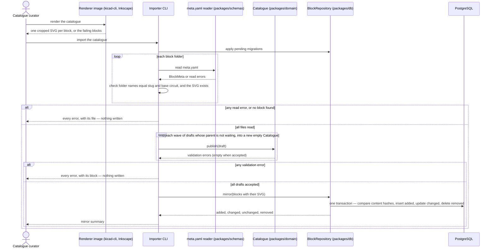

# Sequence diagram — catalogue — publish catalogue blocks (UC6)

> **Feature**: issue #16 — catalogue importer (milestone M1)
> **Use case**: UC6 Publish a block to the catalogue, [01-use-case.md](01-use-case.md)
> **Source specs**: [catalogue-format.md](../../specs/catalogue-format.md),
> [04-class.md](04-class.md)
> **Related ADRs**: [ADR-0002 schematic rendering](../../decisions/0002-schematic-rendering.md)
> **Decisions captured**: the database mirrors the `catalogue/` folder (git is the source of
> truth); mirror by comparison keeping first publication dates; empty catalogue refused; rendered
> SVGs stored in a separate table, written in the same transaction as their block

## Context

How the blocks of the `catalogue/` folder reach the database. Rendering runs first, in the
renderer image (KiCad and Inkscape), then the importer reads the metadata and the rendered SVGs,
builds the whole catalogue from the files alone, checks every domain rule and makes the database
an exact mirror of the folder in one transaction: added, changed and removed blocks. The diagram covers one import
run; it does not cover how the API later serves the blocks.

## Diagram

## Notes

- **Mirror of the folder**: the catalogue is built from the files alone, never merged with the
  database, so a block deleted or renamed in git disappears from the database. Readers see either
  the old or the new catalogue, never a mix, thanks to the transaction.
- **All or nothing**: files are all read, then all drafts published in memory, and only a fully
  valid catalogue is written. A failed import leaves the database unchanged.
- **Empty catalogue refused**: an import that finds no block stops before writing, so a wrong path
  can never wipe the database.
- **By comparison**: a content hash per block tells changed from unchanged blocks, so unchanged
  blocks are not rewritten and keep their first publication date; the summary lists every added,
  changed and removed block, like a plan, in the CI logs.
- **Idempotent**: running the import again with the same files changes nothing.
- **Parents first, in waves**: each wave publishes the drafts whose parent is already published or
  absent (the domain then reports it), so a variant and its parent can arrive in the same import;
  drafts left when a wave is empty form parent cycles and are reported as such.
- **Symbolic links are followed**: a linked block folder is imported, never skipped and then
  removed by the mirror. Two concurrent imports queue on a database lock.
- **Rendering stays outside the importer**: the importer only reads the SVGs produced by
  `scripts/render-catalogue.sh` (ADR-0002); it never calls KiCad.
- **SVGs in a separate table** (`block_schematics`): the catalogue loaded in memory by the API
  never carries the schematics; the API reads one SVG when a page asks for it.
