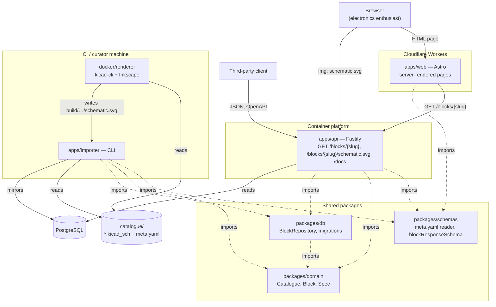

# Component diagram — catalogue — how Ohm Sweet Ohm is built

> **Feature**: issue #18 — web page (milestone M1); covers the whole M1 slice
> **Source specs**: [docs/WORKPLAN.md](../../../WORKPLAN.md) § Repository layout,
> [01-use-case.md](01-use-case.md)
> **Related ADRs**: [ADR-0001 in-memory search](../../decisions/0001-in-memory-search.md),
> [ADR-0002 schematic rendering](../../decisions/0002-schematic-rendering.md),
> [ADR-0003 Astro on Cloudflare](../../decisions/0003-web-astro-cloudflare.md)
> **Decisions captured**: the web app depends on the shared schemas only, never on the database
> or the domain; the browser loads schematics straight from the API; the catalogue folder in git
> is the source of truth, mirrored into PostgreSQL by the importer

## Context

The use-case diagram says what actors want; this diagram says which parts deliver it and which
part may depend on which. The dependency rule holds everywhere: the domain imports nothing, the
database and the API import the domain, the web app imports only the API contract.

## Diagram

Solid arrows are runtime calls; dotted arrows are compile-time imports.

## Notes

- **Web depends on the contract only**: `apps/web` imports `blockResponseSchema` from
  `packages/schemas` and validates every API response with it. It never imports `packages/db`
  or `packages/domain`, so the front-end can be deployed and versioned apart from the API.
- **Schematics bypass the Worker**: the page points `` at the API, which serves the SVG
  as an inert image (sandboxed CSP, `nosniff`, ETag). The Worker never handles SVG bytes.
- **Two runtimes, one contract**: the web app runs in `workerd` (Cloudflare Workers), the API in
  Node.js on a container platform; they share nothing but HTTP and the Zod schema.
- **The folder is the source of truth**: the importer mirrors `catalogue/` into PostgreSQL
  (ADR-0002, [02-sequence-publish-blocks.md](02-sequence-publish-blocks.md)); the API only reads.
- **Hosting providers** for the API and the database are decided in issue #19.
