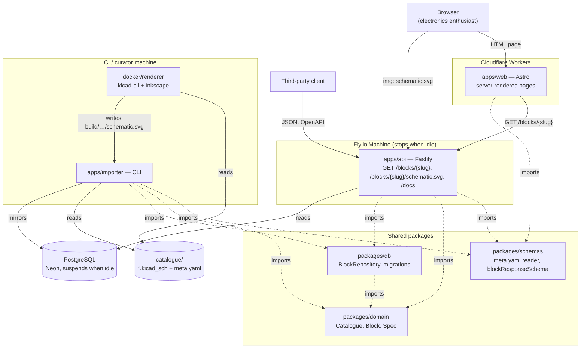
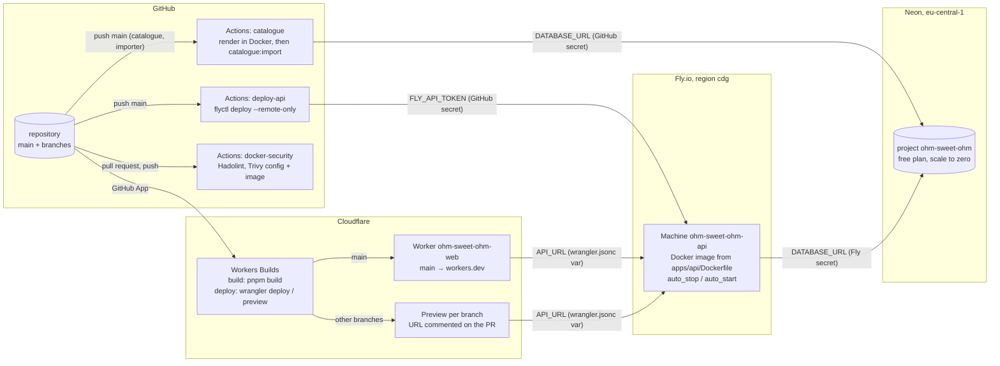

# Component diagram — catalogue — how Ohm Sweet Ohm is built

> **Feature**: issue #18 — web page (milestone M1); covers the whole M1 slice
> **Source specs**: [docs/WORKPLAN.md](../../../WORKPLAN.md) § Repository layout,
> [01-use-case.md](01-use-case.md)
> **Related ADRs**: [ADR-0001 in-memory search](../../decisions/0001-in-memory-search.md),
> [ADR-0002 schematic rendering](../../decisions/0002-schematic-rendering.md),
> [ADR-0003 Astro on Cloudflare](../../decisions/0003-web-astro-cloudflare.md),
> [ADR-0004 staging hosting](../../decisions/0004-staging-hosting.md)
> **Decisions captured**: the web app depends on the shared schemas only, never on the database
> or the domain; the browser loads schematics straight from the API; the catalogue folder in git
> is the source of truth, mirrored into PostgreSQL by the importer; the API runs on a Fly.io
> Machine that stops when idle, the database is a Neon project, the web previews come from
> Workers Builds (issue #19)

## Context

The use-case diagram says what actors want; this diagram says which parts deliver it and which
part may depend on which. The dependency rule holds everywhere: the domain imports nothing, the
database and the API import the domain, the web app imports only the API contract.

## Diagram

Solid arrows are runtime calls; dotted arrows are compile-time imports.

## Deployment view (staging, issue #19)

Which pipeline puts each component where, and which secret each hop needs. Staging is the
disposable preview of a pull request for the web app; the API and the database are one
long-lived staging deployment shared by every preview (ADR-0004).

- **Nothing secret in git**: the Fly deploy token and the Neon connection string live in GitHub
  Actions secrets and in Fly secrets; `API_URL` is a public origin in `wrangler.jsonc`; Workers
  Builds authenticates through Cloudflare's GitHub App, so no Cloudflare token is held in GitHub.
- **Idle costs nothing in compute**: the Fly Machine stops after a few minutes without requests
  and restarts on the next one; Neon suspends its compute after 5 minutes and wakes on the next
  connection. The API then checks the catalogue version only while it serves requests, which keeps
  Neon's free compute hours.
- **Import on merge**: the catalogue workflow renders the schematics in Docker, then runs the
  importer against the Neon database; the API sees the new catalogue within 5 seconds.

## Notes

- **Web depends on the contract only**: `apps/web` imports `blockResponseSchema` from
  `packages/schemas` and validates every API response with it. It never imports `packages/db`
  or `packages/domain`, so the front-end can be deployed and versioned apart from the API.
- **Schematics bypass the Worker**: the page points `` at the API, which serves the SVG
  as an inert image (sandboxed CSP, `nosniff`, ETag). The Worker never handles SVG bytes.
- **Two runtimes, one contract**: the web app runs in `workerd` (Cloudflare Workers), the API in
  Node.js on a container platform; they share nothing but HTTP and the Zod schema.
- **The folder is the source of truth**: the importer mirrors `catalogue/` into PostgreSQL
  (ADR-0002, [02-sequence-publish-blocks.md](02-sequence-publish-blocks.md)); the API only reads.
- **Hosting providers**: Fly.io for the API, Neon for the database, Workers Builds for the web
  previews (ADR-0004, deployment view above).
