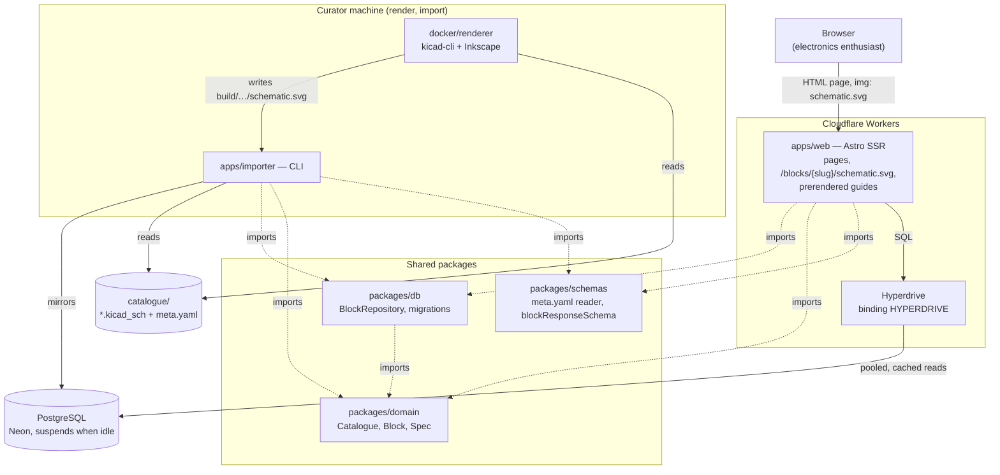
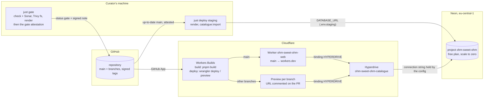

# Component diagram — catalogue — how Ohm Sweet Ohm is built

> **Feature**: issue #18 — web page (milestone M1); covers the whole M1 slice
> **Source specs**: [docs/WORKPLAN.md](../../../WORKPLAN.md) § Repository layout,
> [01-use-case.md](01-use-case.md)
> **Related ADRs**: [ADR-0001 in-memory search](../../decisions/0001-in-memory-search.md),
> [ADR-0002 schematic rendering](../../decisions/0002-schematic-rendering.md),
> [ADR-0003 Astro on Cloudflare](../../decisions/0003-web-astro-cloudflare.md),
> [ADR-0004 staging hosting](../../decisions/0004-staging-hosting.md) (API part superseded),
> [ADR-0005 Worker reads Neon through Hyperdrive](../../decisions/0005-worker-reads-neon-through-hyperdrive.md)
> **Decisions captured**: the Worker reads the catalogue straight from PostgreSQL through
> Hyperdrive and serves the schematic itself, same origin; there is no API server and no Fly.io
> since 2026-11-23 (ADR-0005); the catalogue folder in git is the source of truth, mirrored into
> PostgreSQL by the importer; the database is a Neon project, the web previews come from Workers
> Builds (issue #19)

## Context

The use-case diagram says what actors want; this diagram says which parts deliver it and which
part may depend on which. The dependency rule holds everywhere: the domain imports nothing, the
database imports the domain, the web app imports the database and the shared schemas.

## Diagram

Solid arrows are runtime calls; dotted arrows are compile-time imports.

## Deployment view (issue #19, amended by ADR-0005)

Which pipeline puts each component where, and which secret each hop needs. The Worker and the
database are one long-lived deployment: staging and production are the same Worker and the same
Neon project, and each branch gets a web preview that reads the same catalogue (ADR-0005).
Since #68 the checks and the catalogue import run on the curator's machine (`just gate`,
`just deploy staging`, `docs/deploy.md`); no GitHub workflow is left.

- **Nothing secret in git**: the Neon connection string lives in the git-ignored `.env.staging`
  and in the Hyperdrive config at Cloudflare; the Hyperdrive id in `wrangler.jsonc` is not a
  secret; Workers Builds authenticates through Cloudflare's GitHub App, so no Cloudflare token is
  held in GitHub.
- **Idle costs nothing**: Neon suspends its compute after 5 minutes and wakes on the next
  connection; the Worker opens one connection per read and closes it.
- **Import on staging deploy**: `just deploy staging` renders the schematics in Docker and runs
  the importer against the Neon database; the Worker sees the new catalogue within 5 seconds of
  its version check, plus the Hyperdrive cache delay. It refuses anything but an up-to-date,
  attested `main`.
- **Migrations belong to the importer**: the Worker assumes the schema is there.
- **Liveness**: `just nightly` fetches `/` and `/blocks/led-resistor-basic` on the production
  Worker (`scripts/check-live.sh`).

## Notes

- **One runtime**: the web app runs in `workerd` (Cloudflare Workers); an isolate-wide
  `CatalogueCache` reloads the catalogue only when its version changes, checked at most every
  5 s.
- **Schematics from the Worker**: the page points `` at the same origin; the Worker
  serves the SVG as an inert image (sandboxed CSP, `nosniff`, content-hash ETag).
- **No public JSON API**: removed with `apps/api` (ADR-0005); the third-party client of the
  use-case diagram has no entry point until a route is added.
- **The folder is the source of truth**: the importer mirrors `catalogue/` into PostgreSQL
  (ADR-0002, [02-sequence-publish-blocks.md](02-sequence-publish-blocks.md)); the Worker only
  reads.
- **Hosting providers**: Cloudflare (Workers, Workers Builds, Hyperdrive) and Neon (ADR-0005,
  deployment view above).
