# Class diagram — catalogue — domain model of blocks, variants and typed specs

> **Feature**: issue #2 — domain class diagram and typed parameters (milestone M0)
> **Source specs**: [base-circuits-parameters.md](../../specs/base-circuits-parameters.md),
> [01-use-case.md](01-use-case.md)
> **Related ADRs**: [ADR-0001 in-memory search](../../decisions/0001-in-memory-search.md)
> **Decisions captured**: fully object-oriented domain, base circuit without parent and variant
> with exactly one parent (UC6), match mode fixed per parameter, hazard declared by the curator,
> no per-block license in v1

## Context

This diagram models the catalogue domain: base circuits, blocks and their variant tree, typed
specs, publication (UC6) and search (UC4). Classes own their behaviour and invariants. It shows
no infrastructure: the `meta.yaml` reader and the HTTP API turn raw input into `BlockDraft`,
`RawSpec` and `SearchCriteria`, and every domain rule is checked by the classes below. The
access domain of UC5 (developer account, API key) is modelled in M4.

## Diagram

```mermaid
classDiagram
  direction LR

  class Catalogue {
    +baseCircuitsByProgression() BaseCircuit[]
    +rootOf(baseCircuit: BaseCircuit) Block | undefined
    +variantCountOf(baseCircuit: BaseCircuit) number
    +findBlock(slug: string) Block | undefined
    +childrenOf(block: Block) Block[]
    +definitionOf(key: string) ParameterDefinition | undefined
    +search(criteria: SearchCriteria) SearchResult
    +publish(draft: BlockDraft) ValidationError[]
  }

  class BaseCircuit {
    -slug: string
    -name: string
    -order: number
    +definitionOf(key: string) ParameterDefinition | undefined
    +specsFrom(raw: RawSpec[]) SpecsResult
  }

  class Block {
    -slug: string
    -name: string
    -description: string
    -changeSummary: string [0..1]
    -difficulty: Difficulty
    -validationStatus: ValidationStatus
    -hazardous: boolean
    +isVariant() boolean
    +path() Block[]
    +specFor(key: string) Spec | undefined
    +diffFromParent() SpecDiff[]
  }

  class BlockDraft {
    <<value object>>
    -slug: string
    -name: string
    -description: string
    -changeSummary: string [0..1]
    -baseCircuitSlug: string
    -parentSlug: string [0..1]
    -difficulty: Difficulty
    -validationStatus: ValidationStatus
    -hazardous: boolean
  }

  class RawSpec {
    <<value object>>
    -key: string
    -min: number [0..1]
    -max: number [0..1]
    -quantity: Quantity [0..1]
    -text: string [0..1]
  }

  class ParameterDefinition {
    <<abstract>>
    -key: string
    -label: string
    -required: boolean
    +createSpec(raw: RawSpec)* Spec | ValidationError
  }
  class NumericParameterDefinition {
    -quantity: Quantity
    -matchMode: MatchMode
    +createSpec(raw: RawSpec) Spec | ValidationError
  }
  class EnumParameterDefinition {
    -allowedValues: string[]
    +createSpec(raw: RawSpec) Spec | ValidationError
  }

  class Spec {
    <<abstract>>
    +satisfiesRange(requested: SpecRange) boolean
    +satisfiesValues(values: string[]) boolean
    +differsFrom(other: Spec)* boolean
  }
  class NumericSpec {
    <<value object>>
    +satisfiesRange(requested: SpecRange) boolean
    +differsFrom(other: Spec) boolean
  }
  class EnumSpec {
    <<value object>>
    -value: string
    +satisfiesValues(values: string[]) boolean
    +differsFrom(other: Spec) boolean
  }

  class SpecRange {
    <<value object>>
    -min: number
    -max: number
    +contains(other: SpecRange) boolean
    +equals(other: SpecRange) boolean
  }

  class SearchCriteria {
    -difficulties: Difficulty[]
    -keyComponent: string [0..1]
    -keywords: string[]
    +validateAgainst(definitionOf: KeyLookup) ValidationError[]
    +match(block: Block) SearchMatch | undefined
  }
  class Criterion {
    <<abstract>>
    -key: string
    +isSatisfiedBy(spec: Spec)* boolean
  }
  class NumericCriterion {
    <<value object>>
    -quantity: Quantity
    +isSatisfiedBy(spec: Spec) boolean
  }
  class EnumCriterion {
    <<value object>>
    -values: string[]
    +isSatisfiedBy(spec: Spec) boolean
  }

  class SearchMatch {
    <<value object>>
  }
  class SearchResult {
    <<value object>>
    -ok: boolean
  }
  class SpecsResult {
    <<value object>>
    -ok: boolean
  }
  class SpecDiff {
    <<value object>>
    -key: string
  }
  class ValidationError {
    <<value object>>
    -field: string
    -message: string
  }
  class KeyComponent {
    <<value object>>
    -partNumber: string
    -role: string
  }
  class Source {
    <<value object>>
    -title: string
    -url: string [0..1]
  }
  class SchematicAsset {
    <<value object>>
    -kicadPath: string
    -svgPath: string
  }
  class Formula {
    <<value object>>
    -name: string
    -expression: string
    -description: string
  }

  class Difficulty {
    <<enumeration>>
    BEGINNER
    INTERMEDIATE
    ADVANCED
  }
  class ValidationStatus {
    <<enumeration>>
    TESTED
    THEORETICAL
  }
  class MatchMode {
    <<enumeration>>
    COVERS
    WITHIN
  }
  class Quantity {
    <<enumeration>>
    VOLTAGE
    CURRENT
    RESISTANCE
    FREQUENCY
    POWER
    COUNT
  }

  Catalogue "1" *-- "1..*" BaseCircuit : baseCircuits
  Catalogue "1" *-- "0..*" Block : blocks
  BaseCircuit "1" *-- "1..*" ParameterDefinition : parameters
  BaseCircuit "1" *-- "0..*" Formula : formulas
  Block "0..*" --> "1" BaseCircuit : baseCircuit
  Block "0..*" --> "0..1" Block : parent
  Block "1" *-- "1..*" Spec : specs
  Block "1" *-- "0..*" KeyComponent : keyComponents
  Block "1" *-- "1" Source : source
  Block "1" *-- "1" SchematicAsset : schematic
  BlockDraft "1" *-- "1..*" RawSpec : rawSpecs
  BlockDraft "1" *-- "0..*" KeyComponent : keyComponents
  BlockDraft "1" *-- "1" Source : source
  BlockDraft "1" *-- "1" SchematicAsset : schematic
  Spec "0..*" --> "1" ParameterDefinition : definition
  ParameterDefinition <|-- NumericParameterDefinition
  ParameterDefinition <|-- EnumParameterDefinition
  Spec <|-- NumericSpec
  Spec <|-- EnumSpec
  NumericSpec "1" *-- "1" SpecRange : range
  SearchCriteria "0..*" --> "0..1" BaseCircuit : baseCircuit
  SearchCriteria "1" *-- "0..*" Criterion : criteria
  Criterion <|-- NumericCriterion
  Criterion <|-- EnumCriterion
  NumericCriterion "1" *-- "1" SpecRange : requested
  SearchMatch "0..*" --> "1" Block : block
  SearchResult "1" *-- "0..*" SearchMatch : matches
  SearchResult "1" *-- "0..*" ValidationError : errors
  SpecsResult "1" *-- "0..*" Spec : specs
  SpecsResult "1" *-- "0..*" ValidationError : errors
  SearchMatch "0..*" --> "0..*" Spec : matchedSpecs
  SpecDiff "0..*" --> "0..1" Spec : parentSpec
  SpecDiff "0..*" --> "0..1" Spec : childSpec
  Catalogue ..> BlockDraft : reads
  ParameterDefinition ..> Spec : «create»
  Block ..> SpecDiff : «create»
  SearchCriteria ..> SearchMatch : «create»
  Catalogue ..> SearchCriteria : validates and applies
```

## Responsibilities and invariants

| Class | Owns | Invariants it enforces |
| --- | --- | --- |
| `Catalogue` | Base circuits and blocks; listing (UC1) of base circuits that have a root block only, navigation (UC2), search (UC4), publication (UC6) | Unique block slugs; at most one root block per base circuit; a parent exists and belongs to the same base circuit; no cycle in a variant tree; a parameter key has the same definition kind in every base circuit (numeric: same quantity and match mode; enum: same allowed values); publication replaces a block only when the resulting catalogue, including the replaced block's existing children, satisfies every invariant above |
| `BaseCircuit` | Its parameter definitions and design formulas; building specs from raw input | Every raw key is defined; no duplicate key; every required key is present; each value is checked by its definition |
| `ParameterDefinition` | Turning one raw value into a typed spec | Numeric: the raw quantity, when given, equals the definition's quantity; `min ≤ max`; a `COUNT` is a positive integer. Enum: the value is allowed |
| `Block` | Its specs, its position in the variant tree, its diff against its parent (UC2, UC3) | A variant has a `changeSummary`; a root block has none |
| `Spec` | Matching a requested range or values (UC4) and comparing itself with another spec (UC2) | `COVERS`: the spec range contains the requested range. `WITHIN`: the requested range contains the spec range. Enum: the value is one of the requested values. A numeric spec never satisfies values and an enum spec never satisfies a range |
| `SearchCriteria` | Validating a request against the catalogue's key lookup and matching one block | Unknown key, incompatible quantity, wrong criterion kind or an enum value outside the allowed values is an error, never ignored; a block matches only if every criterion is satisfied; a block lacking a targeted spec does not match |
| `SpecRange` | A closed interval in SI units | `min ≤ max` |

## Notes

- **Raw input in, domain objects out**: `BlockDraft` and `RawSpec` carry slugs and untyped
  values, so the domain itself reports unknown parameters, wrong types, a missing parent or a
  cycle (UC6 extension 2a). Zod only checks the file and payload shapes at the boundary.
- **Matching lives in the spec**: a spec knows its definition and therefore its match mode, so
  it is the expert. Each `Criterion` subclass calls the typed method that fits it
  (`satisfiesRange` or `satisfiesValues`), so no class downcasts.
- **Units at publication**: the `meta.yaml` reader parses a value such as `20 mA` into SI
  numbers plus a quantity; the definition rejects a quantity that differs from its own (UC6 2a).
- **Explicit results**: `SearchResult` and `SpecsResult` say whether the operation succeeded, so
  an empty list of matches is never confused with an empty list of errors.
- **`KeyLookup`** is the function `(key) => ParameterDefinition | undefined` supplied by
  `Catalogue.definitionOf`, so `SearchCriteria` does not depend on the whole catalogue.
- **Open-ended requests** use a point or a bounded range, never infinity: "at least 1 A" on a
  `COVERS` parameter is the point `[1, 1]`; "at most 3.3 V" on a `WITHIN` parameter is
  `[0, 3.3]`.
- **Keywords** search the block name, description, change summary and key component part numbers.
- **Search runs in memory** over the whole catalogue (ADR-0001): one implementation of the match
  rules, unit-tested in the domain.
- **A base circuit without a root block is not listed** (UC1): its parameters can be defined
  before its schematic is drawn, and it appears once its root block is published.
- **The root block is the base circuit's own schematic**: the base circuit page (UC1, UC2) uses
  it for the difficulty and as the root of the variant tree. `BaseCircuit` holds definitions,
  `Block` holds values.
- **Formulas are displayed, not evaluated** in v1 (UC3); the v2 calculator (UC10) will evaluate
  them.
- **Hazard is declared, not computed**: deriving it from voltages would need AC/DC and context
  rules that v1 does not have.
- **Associations carry role names** instead of repeating them as attributes, so each
  relationship is stated once.
- **Not modelled yet**: the access domain of UC5 (M4) and the v2 use cases UC7–UC10.
