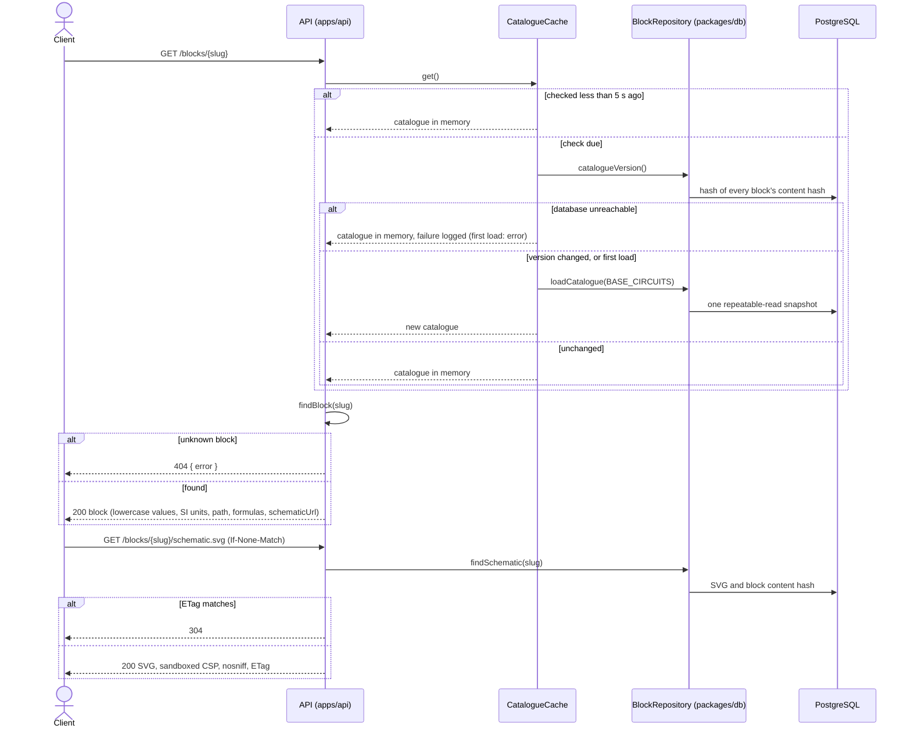

# Sequence diagram — catalogue — inspect a block (UC3)

> **Feature**: issue #17 — public read API (milestone M1)
> **Use case**: UC3 Inspect a block, [01-use-case.md](01-use-case.md)
> **Source specs**: [04-class.md](04-class.md),
> [02-sequence-publish-blocks.md](02-sequence-publish-blocks.md)
> **Related ADRs**: [ADR-0001 in-memory search](../../decisions/0001-in-memory-search.md)
> **Decisions captured**: catalogue kept in memory and its version checked at most every 5 s;
> the cached catalogue keeps being served when the database is unreachable; lowercase values and
> SI units with their symbol in the API; schematics read one at a time, never kept in memory

## Context

How a client (the web page, or any API user) reads a block and its schematic. The catalogue is
loaded once into memory and only reloaded after an import changed it.

## Diagram

## Notes

- **Freshness**: an import is visible within 5 seconds; the version check costs under a
  millisecond, a full reload about 2 ms for 25 blocks and 16 ms for 1,000 (measured).
- **Outage**: a failed check or reload is logged and the catalogue in memory keeps being served;
  a dropped database connection never crashes the process. Only the very first load can fail.
- **SVG safety**: schematics are served as images that cannot run code, whatever a contributed
  file contains (`Content-Security-Policy: sandbox`, no script, `nosniff`).
- **Errors**: every error answers `{ error }`; server errors never expose their cause.
