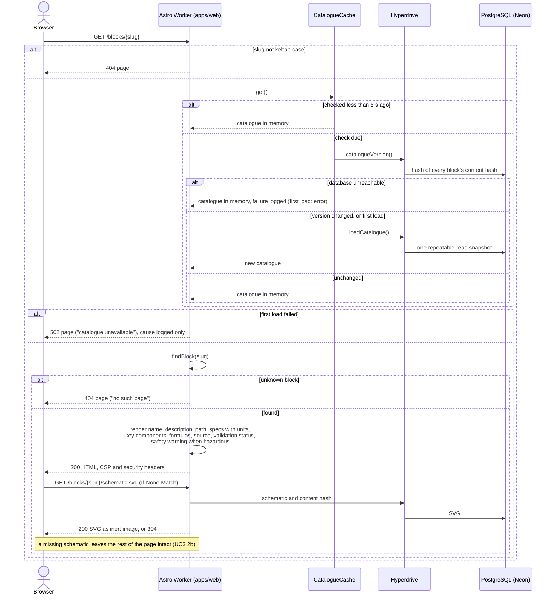

# Sequence diagram — catalogue — view a block page (UC3, web)

> **Feature**: issue #18 — web page (milestone M1)
> **Use case**: UC3 Inspect a block, [01-use-case.md](01-use-case.md)
> **Source specs**: [05-sequence-inspect-block.md](05-sequence-inspect-block.md) (retired API
> side, kept for history), `packages/schemas/src/block-response.ts`
> **Related ADRs**: [ADR-0003 Astro on Cloudflare](../../decisions/0003-web-astro-cloudflare.md),
> [ADR-0005 Worker reads Neon through Hyperdrive](../../decisions/0005-worker-reads-neon-through-hyperdrive.md)
> **Decisions captured**: the page is rendered on demand in the Worker, which reads the catalogue
> from Neon through Hyperdrive; the block is validated against the shared schema before
> rendering; the schematic is served by the Worker itself, same origin; an unknown block is a 404
> page, an unreachable database a 502 page that exposes nothing

## Context

How the enthusiast's browser gets a block page. Since ADR-0005 there is no API server: the
Worker keeps the catalogue in memory, reloads it when its version changes (checked at most every
5 s) and finds the block by slug.

## Diagram

## Notes

- **On demand**: no catalogue page is prerendered (only the troubleshooting guides are, ADR-0003
  amendment of 2026-11-18), so an import is visible on the site within the 5 s version check plus
  the Hyperdrive query cache delay, with no redeploy.
- **One connection per read**: the Worker opens a connection through Hyperdrive, reads, closes it;
  the cache is per isolate.
- **Outage**: a failed check or reload is logged and the catalogue in memory keeps being served;
  only the very first load of an isolate can fail.
- **Errors expose nothing**: 404 and 502 pages carry a human sentence; the cause goes to the
  Worker logs only.
- **Schematic from the Worker**: sandboxed CSP, `nosniff` and a content-hash ETag with
  `Cache-Control: public, no-cache`; the page's own CSP allows images from `'self'` only.
- **No client JavaScript**: the page is plain HTML and CSS; the first island (React) arrives with
  the calculator (M4).
