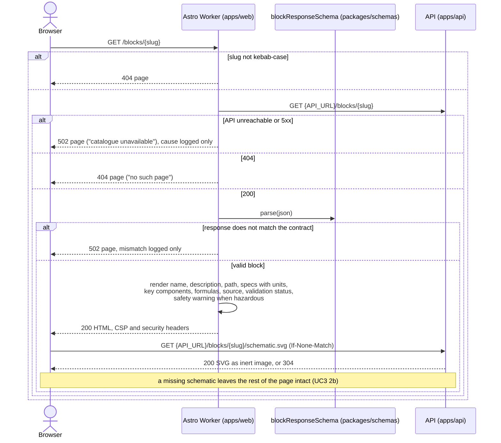

# Sequence diagram — catalogue — view a block page (UC3, web)

> **Feature**: issue #18 — web page (milestone M1)
> **Use case**: UC3 Inspect a block, [01-use-case.md](01-use-case.md)
> **Source specs**: [05-sequence-inspect-block.md](05-sequence-inspect-block.md) (API side),
> `packages/schemas/src/block-response.ts`
> **Related ADRs**: [ADR-0003 Astro on Cloudflare](../../decisions/0003-web-astro-cloudflare.md)
> **Decisions captured**: the page is rendered on demand in the Worker; the API response is
> validated against the shared schema before rendering; the schematic is loaded by the browser
> from the API as an image; an unknown block is a 404 page, an unreachable API a 502 page that
> exposes nothing

## Context

How the enthusiast's browser gets a block page. [05-sequence-inspect-block.md](05-sequence-inspect-block.md)
already shows what the API does behind `GET /blocks/{slug}`; this diagram starts at the browser
and treats the API as one participant.

## Diagram

## Notes

- **On demand**: no page is prerendered, so an import is visible on the site within the API's
  5 s freshness window, with no redeploy of the front-end.
- **Validation at the boundary**: the Worker trusts nothing from the network; a response that
  drifts from `blockResponseSchema` is a server error on the web side, never a half-rendered page.
- **Errors expose nothing**: 404 and 502 pages carry a human sentence; the cause (network error,
  schema mismatch, API status) goes to the Worker logs only.
- **Schematic loaded by the browser**: the Worker never reads SVG bytes. The API's sandboxed CSP,
  `nosniff` and ETag apply unchanged; the page's own CSP allows images from the API origin.
- **`API_URL`** is a server-side variable of the Worker, validated as a URL at build and start
  (`astro:env/server`); it never reaches the client bundle. The browser still sees the API origin
  in the ``, which is public by design.
- **No client JavaScript**: the page is plain HTML and CSS; the first island (React) arrives with
  the calculator (M4).
