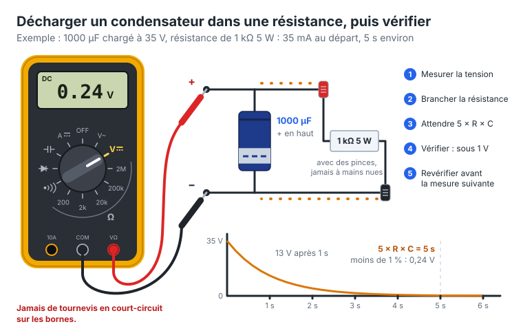
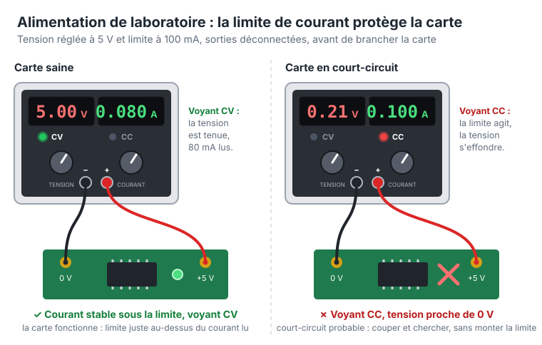

# 00 Sécurité à l'établi basse tension

Les règles à appliquer avant toute mesure des fiches suivantes : le périmètre basse tension, la mise hors tension, la décharge des condensateurs, l'alimentation limitée en courant, l'énergie des batteries, la chaleur et l'électricité statique.

## En bref

Ces fiches ne valent que si **aucune tension ne dépasse 50 V continu ni 25 V alternatif, nulle part sur la carte**. Dans ce périmètre, le danger principal n'est plus l'électrocution mais l'**énergie** : un court-circuit sur une batterie ou un gros condensateur brûle, fait fondre des fils et peut mettre le feu. On travaille hors tension dès que possible, on décharge les condensateurs à travers une résistance et on vérifie au voltmètre, et on remet sous tension par une alimentation dont le courant est limité.

> **Sécurité** : si la carte, ou une partie de la carte, dépasse 50 V continu ou 25 V alternatif, **arrêtez-vous là** : ces fiches ne s'appliquent pas. Un appareil dont l'alimentation secteur est intégrée se confie à un professionnel, en attendant la fiche secteur et isolement.

## Le périmètre : 50 V continu, 25 V alternatif

**Pourquoi ces seuils** : le courant qui traverse le corps dépend de sa résistance, et cette résistance **chute quand la tension monte**. Sous quelques volts et du bout des doigts, la peau sèche oppose des centaines de kΩ. Selon la norme CEI 60479-1, avec une grande surface de contact (main serrée sur une pièce métallique), l'impédance entre deux mains n'est plus que de quelques kΩ dès 25 V, et baisse encore quand la tension monte ; à 50 V alternatif, le courant atteint alors le seuil de non-lâcher (environ 10 mA), où les muscles se contractent et la main ne peut plus lâcher. Le seuil alternatif (valeur efficace, soit 35 V crête) est plus bas que le seuil continu parce que le courant alternatif à 50 Hz est plus dangereux à intensité égale. Ces limites sont plus prudentes que la très basse tension des normes d'installation (50 V alternatif, 120 V continu) : elles reprennent la valeur alternative retenue pour les lieux humides (25 V), restent sous leur valeur continue (60 V) et laissent une marge pour la peau mouillée ou une coupure.

**Partout sur la carte, pas seulement à l'entrée** : un appareil sur pile ou sur adaptateur peut fabriquer en interne bien plus que sa tension d'entrée.

| Exemple | Tension interne | Pourquoi |
| --- | --- | --- |
| Flash d'appareil photo (même jetable sur pile AA) | environ 300 V | condensateur de flash chargé par un élévateur, garde sa charge appareil éteint |
| Onduleur de rétroéclairage à tube (CCFL, anciens écrans) | 500 à 1500 V alternatifs, 1 à 2 kV à l'amorçage | transformateur élévateur |
| Équipement PoE (Power over Ethernet) | jusqu'à 57 V continu | norme IEEE 802.3 |
| Batterie 48 V (vélo électrique, stockage) | 54,6 V en fin de charge | 13 éléments lithium à 4,2 V |
| Allumeur, tube Geiger, ioniseur, taser | centaines à milliers de volts | élévateur dédié |

Si un composant porte un marquage de tension élevée (condensateur de 160 V, 250 V, 400 V), un transformateur inattendu ou un avertissement « high voltage », considérer la carte comme hors périmètre et s'arrêter là (ligne « oui ou je ne sais pas » de l'arbre) : ne pas la mesurer ni la décharger avec la méthode de cette fiche, prévue pour 50 V au plus. Seul un schéma ou la fiche technique peut lever le doute. Règle rapide pour les batteries : plus de 11 éléments lithium en série dépassent 50 V en fin de charge (12 éléments Li-ion « 44 V » : 50,4 V ; 16 éléments LiFePO4 « 48 V » : 58,4 V).

> **Variac et transformateur d'isolement** : un Variac (autotransformateur réglable) **n'isole pas** du secteur. Sa sortie reste reliée électriquement au réseau, même réglée à quelques volts : selon le sens de la prise (non polarisée en France), une borne de sortie est à 230 V par rapport à la terre quel que soit le réglage, et une erreur de réglage remet 230 V entre les bornes. Un transformateur d'isolement supprime la référence à la terre mais ne rend pas inoffensif le contact entre ses deux bornes de sortie. Les deux relèvent du travail sur secteur : fiche secteur et isolement, à venir.

## Travailler hors tension

La plupart des mesures (ohmmètre, bipeur, mode diode, capacimètre : fiche [01](../01_multimetre/README.md)) se font carte **hors tension**. Hors tension veut dire :

1. **Débrancher** l'adaptateur, le câble USB, le câble réseau (PoE) : un interrupteur peut ne couper qu'une partie de la carte.
2. **Retirer les piles et batteries**, y compris la pile bouton de l'horloge, et une batterie interne par son connecteur. Si elle est soudée et ne peut pas être déconnectée, la carte n'est pas hors tension : la traiter comme alimentée (voltmètre seulement), ou dessouder une languette de la batterie (fer bref sur la languette ou le fil, sans chauffer l'élément) et isoler ses bornes.
3. **Attendre** que les condensateurs se déchargent par la carte, puis **vérifier au voltmètre** (section suivante) : une LED éteinte ne prouve rien.

## Décharger un condensateur

Un condensateur garde sa charge carte débranchée, parfois des heures ou des jours quand rien ne le décharge. Énergie stockée : *E = ½ × C × V²*. Elle croît avec le carré de la tension.

| Condensateur | Énergie | Ce qu'un court-circuit produit |
| --- | --- | --- |
| 100 µF sous 12 V | 7 mJ | petite étincelle |
| 1000 µF sous 35 V | 0,6 J | étincelle, piqûre sur la pointe ou la piste |
| 10 000 µF sous 50 V | 12,5 J | arc, pastille arrachée, éclat de métal fondu |

**Méthode** :

1. Mesurer la tension aux bornes du condensateur (voltmètre continu, calibre adapté).
2. Choisir une résistance : le courant de décharge de départ vaut *V / R*, la puissance de départ *V² / R*, et la tension tombe à moins de 1 % en environ *5 × R × C*. Une valeur de 100 Ω à 1 kΩ et une puissance de 2 à 5 W conviennent dans ce périmètre. Exemple : 1000 µF sous 35 V dans 1 kΩ : 35 mA et 1,2 W au départ, déchargé en environ 5 s. Pire cas du périmètre : 50 V dans 100 Ω, soit 0,5 A et 25 W au départ, douze fois la puissance d'une résistance de 2 W ; c'est acceptable pour une résistance bobinée ou cimentée de 5 W tant que l'énergie reste de l'ordre de la dizaine de joules ; avec une 2 W, prendre 1 kΩ. Un supercondensateur sort de cette méthode (1 F sous 5,5 V : 15 J, plus de 15 minutes dans 1 kΩ) : fiche [24](../24_supercondensateur/README.md). Une résistance de 1/4 W suffit sous 0,1 J environ ; au-delà, la chaleur se concentre au début de la décharge et une résistance trop petite chauffe ou casse.
3. Tenir la résistance avec des pinces crocodile ou des pointes isolées, jamais à mains nues, et la maintenir le temps calculé.
4. **Vérifier au voltmètre** que la tension est tombée sous 1 V environ.
5. Revérifier avant la mesure suivante : un électrolytique aluminium peut remonter jusqu'à 10 à 15 % de sa tension après décharge (absorption diélectrique).

**Jamais de tournevis** en court-circuit sur les bornes : le pic de courant abîme le condensateur et les pistes, projette du métal fondu et, sur un condensateur hors périmètre, fait un arc violent. Certains réparateurs le font par habitude ; ce n'est pas une méthode.

## L'alimentation de laboratoire limitée en courant

Pour remettre une carte sous tension pendant un dépannage, une alimentation de laboratoire dont on règle **la tension et la limite de courant** remplace avantageusement l'adaptateur d'origine : un court-circuit dans la carte fait chuter la tension au lieu de brûler une piste.

**Régler** :

1. Sorties **déconnectées** de la carte, régler la **tension** à la valeur nominale de la carte (lue sur l'adaptateur ou le schéma), jamais au-dessus.
2. Régler la **limite de courant** : selon l'appareil, afficher la consigne (touche de réglage), ou tourner le bouton de courant au minimum, court-circuiter les cordons de sortie, puis monter jusqu'à la valeur voulue. Le voyant **CC** (courant constant) s'allume en court-circuit : la limite fonctionne.
3. **Partir bas** : environ 50 à 100 mA pour une petite carte logique ou un module à microcontrôleur, quelques centaines de mA pour une carte avec moteur, relais ou rétroéclairage. Ce sont des points de départ, pas des valeurs de fonctionnement : le courant de la carte en marche se lit sur sa fiche technique, son adaptateur ou une carte saine.
4. Sortie coupée (ou alimentation éteinte si elle n'a pas de touche OUTPUT), connecter la carte, mettre la sortie en marche et **regarder l'afficheur de courant** pendant les premières secondes.

**Lire** :

- Voyant **CC** allumé, tension proche de 0 V : court-circuit probable. Couper, et chercher (fiche 92) avant d'augmenter la limite.
- Voyant **CC** allumé, tension partielle, rien ne chauffe : la limite est trop basse pour cette carte (un régulateur à découpage sous-alimenté tire même davantage et reste bloqué ainsi). Remonter la limite par paliers en surveillant la chaleur, sans dépasser le courant nominal de l'adaptateur d'origine.
- Courant stable sous la limite, voyant CC éteint : la carte fonctionne ; laisser la limite juste au-dessus du courant mesuré.
- Un composant qui chauffe pendant ce temps (section Chaleur) signale où passe le courant.

Respecter la **polarité** : une inversion peut détruire la carte, et un condensateur tantale inversé peut prendre feu, même avec une limite basse. Brancher toujours le moins (noir) en premier.

## Les batteries : faible tension, énergie élevée

Une batterie de quelques volts ne présente pas de risque d'électrocution, mais elle peut débiter **des dizaines à des centaines d'ampères** dans un court-circuit, et rien ne la limite.

- **Lithium (Li-ion, LiPo, 18650)** : un court-circuit chauffe l'élément jusqu'à l'emballement thermique : gaz, flammes, projection, difficile à éteindre. Ne jamais percer, écraser ni chauffer un élément ; un élément gonflé ne se recharge plus et part au recyclage. Isoler les bornes (adhésif) dès qu'on déconnecte une batterie.
- **Plomb (batterie de voiture, de moto, d'onduleur)** : des centaines d'ampères ; une clé, une bague ou un bracelet métallique entre les bornes rougit en secondes et brûle profondément. Retirer bagues et montre ; la batterie dégage de l'hydrogène en charge : pas d'étincelle à proximité.
- **Piles bouton** : avalées, elles brûlent les tissus en quelques heures : à ranger hors de portée des enfants.

> **Ampèremètre** : la douille 10 A de nombreux multimètres premier prix **n'a pas de fusible**. Un cordon oublié dans cette douille, posé sur une batterie, la met en court-circuit franc (fiche [01](../01_multimetre/README.md), « Piège du mode courant »). Ne jamais mesurer le courant de court-circuit d'une batterie.

## La chaleur

- **Fer à souder** : la panne est à 300 à 400 °C. Le reposer toujours dans son support, jamais sur l'établi ; le débrancher en quittant le poste.
- **Composants chauds** : une résistance de puissance, un régulateur linéaire ou un transistor peuvent dépasser 100 °C en fonctionnement normal, et restent chauds après la coupure.
- **Trouver le point chaud** : de préférence un thermomètre à thermocouple ou une caméra thermique (fiche 03), ou une seule goutte d'alcool isopropylique qui s'évapore vite sur le point chaud ; l'alcool est très inflammable : pas de fer ni d'étincelle à proximité.
- **Test au doigt**, en dernier recours, seulement dans ce périmètre basse tension, carte de préférence coupée juste avant : approcher d'abord le dos du doigt sans toucher (on sent la chaleur rayonnée), puis effleurer **brièvement**, jamais saisir. Un composant qu'on ne peut pas toucher plus d'une seconde est trop chaud pour la plupart des composants ; un régulateur linéaire ou une résistance de puissance peut l'être normalement (comparer avec une carte saine).
- **Fumée, odeur de brûlé, gonflement** : couper l'alimentation tout de suite, avant de chercher d'où ça vient.

## L'électricité statique (ESD)

Ce risque concerne les **composants**, pas l'opérateur : une décharge électrostatique de quelques centaines à quelques milliers de volts, insensible au doigt, peut détruire ou affaiblir un MOSFET, un circuit CMOS ou un microcontrôleur, parfois sans symptôme immédiat.

- Toucher une masse (le châssis métallique de l'alimentation reliée à la terre, un tapis antistatique) avant de manipuler une carte.
- Bracelet antistatique relié à la terre **à travers sa résistance intégrée de 1 MΩ** : elle limite le courant si la main touche une tension. Ne jamais remplacer le bracelet par un fil direct.
- Ranger les composants sensibles dans leur sachet antistatique ou sur mousse conductrice ; éviter les vêtements synthétiques et l'air très sec.

## Arbre de décision : puis-je mesurer cette carte ?

```mermaid
flowchart TD
  A[Carte à dépanner] --> B{Alimentation secteur intégrée, ou plus de 50 V DC / 25 V AC quelque part ?}
  B -- oui ou je ne sais pas --> X[Arrêt : hors périmètre, fiche secteur à venir ou professionnel]
  B -- non --> C{Mesure prévue}
  C -- voltmètre sous tension --> D[Alimentation limitée en courant, limite basse, polarité vérifiée]
  D --> E{Voyant CC allumé ou composant chaud ?}
  E -- oui --> F[Couper ; 0 V : court-circuit, fiche 92 ; tension partielle sans chaleur : remonter la limite par paliers]
  E -- non --> G[Mesurer, une seule pointe tenue, l'autre en pince crocodile]
  C -- ohmmètre, bipeur, diode, capacité --> H[Débrancher, retirer piles et batteries]
  H --> I[Mesurer la tension des gros condensateurs]
  I --> J{Moins de 1 V ?}
  J -- non --> K[Décharger par une résistance adaptée, jamais un tournevis]
  K --> I
  J -- oui --> L[Mesurer hors tension, fiche 01]
```

## Aide-mémoire d'établi

- Plus de 50 V continu ou 25 V alternatif **n'importe où** sur la carte : stop.
- Flash photo, onduleur de rétroéclairage, PoE, batterie 48 V : hors périmètre même sur pile.
- Variac = pas d'isolement.
- Hors tension = débranché + piles retirées + condensateurs vérifiés au voltmètre.
- Décharge : résistance de 100 Ω à 1 kΩ, 2 à 5 W, pendant *5 × R × C* ; jamais de tournevis ; revérifier.
- Alimentation : tension réglée à vide, limite de courant basse (50 à 100 mA pour une petite carte), surveiller CC et courant.
- Batterie : bornes isolées, pas de bague, pas de mesure de courant de court-circuit.
- Douille 10 A souvent sans fusible : cordon rouge en V/Ω avant toute mesure de tension.
- Doigt : effleurer brièvement, jamais saisir ; fumée = couper d'abord.
- ESD : toucher la masse ; bracelet à travers 1 MΩ, jamais un fil direct.

## Sources

- CEI 60479-1, *Effets du courant sur l'homme et les animaux domestiques — Partie 1 : aspects généraux* (impédance du corps en fonction de la tension, seuils de fibrillation en courant continu et alternatif) ; norme payante, résumée par la plupart des cours de sécurité électrique.
- CEI 61140, *Protection contre les chocs électriques* (classes de très basse tension), pour situer les seuils de ces fiches, plus prudents.
- Fluke, *ABCs of multimeter safety*, note d'application (catégories de mesure, fusibles des entrées courant, cordons) ; à chercher sous ce titre sur fluke.com.
- Keysight, *Understanding Constant Voltage and Constant Current Operation* et le guide d'utilisation de ses alimentations E36100 (modes tension constante et courant constant, réglage de la limite) ; à chercher sous ces titres sur keysight.com.
- Battery University, *BU-304a: Safety Concerns with Li-ion* (court-circuit, emballement thermique) — <https://batteryuniversity.com/article/bu-304a-safety-concerns-with-li-ion>
- Battery University, *BU-703: Health Concerns with Batteries* (hydrogène des batteries au plomb, piles bouton avalées) — <https://batteryuniversity.com/article/bu-703-health-concerns-with-batteries>
- IEEE 802.3 (af, at, bt), alimentation par Ethernet (tension de sortie jusqu'à 57 V).
- EEVblog forum, section *Beginners*, nombreux fils sur la décharge des condensateurs et les flashs d'appareils photo jetables (environ 300 V) — <https://www.eevblog.com/forum/beginners/>
- ESD Association, ANSI/ESD S1.1 (bracelets : résistance série de 1 MΩ) et ANSI/ESD S20.20 (programme de protection ESD).
