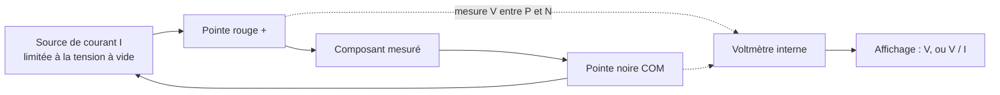
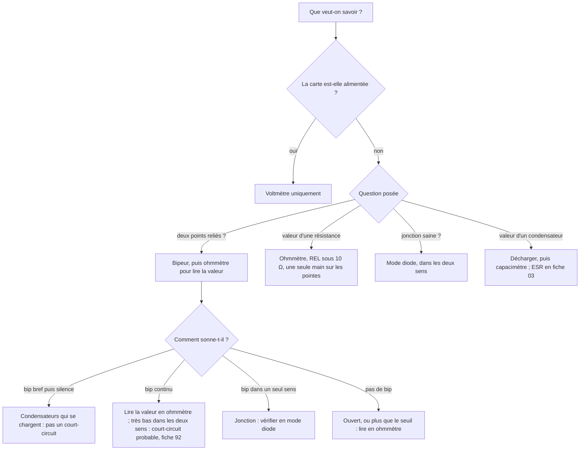

# 01 Comprendre son multimètre

Ce que chaque mode du multimètre injecte dans le composant, et pourquoi ce composant réagit comme il réagit : la fiche de base à laquelle renvoient toutes les autres.

## En bref

En voltmètre, l'appareil écoute presque sans rien consommer. En ohmmètre, en bipeur, en mode diode et en capacimètre, il **injecte** un courant connu et mesure la tension qui en résulte. Presque toutes les lectures « bizarres » s'expliquent par ce courant et par la tension à vide qui le pousse.

> **Sécurité** : ohmmètre, bipeur, mode diode et capacimètre se font **hors tension**, carte débranchée, condensateurs déchargés (fiche [00](../00_securite/README.md)) ; seul le voltmètre (et l'ampèremètre, fiche 91) se branche sur une carte alimentée, par une alimentation limitée en courant, à 50 V continu (25 V alternatif) au plus partout sur la carte. Un multimètre laissé en mode courant (douille A ou mA) est un court-circuit : voir l'encadré « Piège du mode courant ».

## Le principe commun

Un multimètre numérique est d'abord un voltmètre. Les autres modes ajoutent devant ce voltmètre une source de courant :

- ohmmètre : courant fixe *I*, l'appareil affiche *R = V / I* ;
- mode diode : courant d'environ 1 mA, l'appareil affiche directement la tension *V* ;
- bipeur : mode ohmmètre sur un petit calibre, plus une alarme sous un seuil ;
- capacimètre : courant connu, l'appareil chronomètre la montée de tension.

La source est limitée par une **tension à vide** (ce que l'appareil sort pointes en l'air). C'est elle qui décide si une jonction de semi-conducteur conduit, si une LED s'allume, et jusqu'où un condensateur se charge.

La pointe rouge est le **+** de la source en ohmmètre, en bipeur et en mode diode sur la quasi-totalité des multimètres numériques (l'inverse de nombreux appareils à aiguille).

## Ordres de grandeur par classe d'appareil

Fourchettes typiques, tirées des mesures comparées de HKJ (lygte-info.dk) et des manuels cités en Sources ; elles varient d'un modèle à l'autre, d'où l'exercice plus bas.

| Grandeur | Premier prix (moins de 30 €) | Milieu de gamme | Haut de gamme |
| --- | --- | --- | --- |
| Impédance d'entrée en voltmètre | 1 à 10 MΩ | 10 MΩ | 10 MΩ, mode basse impédance en option |
| Tension à vide en ohmmètre | de 0,3 V à 3 V | de 0,5 V à 3 V | de 0,5 V à quelques volts |
| Tension aux bornes à pleine échelle | jusqu'à la tension à vide | souvent moins de 1 V | souvent moins de 0,5 V |
| Courant de test, petit calibre (200 à 600 Ω) | 0,2 à 1 mA | 0,5 à 1 mA | 0,5 à 1 mA |
| Courant de test, calibre MΩ | quelques dizaines à quelques centaines de nA | idem | idem |
| Tension à vide en mode diode | 1,5 à 3 V | 2 à 3,3 V | 2,5 à 4 V |
| Courant en mode diode | 0,3 à 1,5 mA | environ 1 mA | environ 1 mA |
| Seuil du bipeur | 30 à 100 Ω | 20 à 50 Ω | 10 à 50 Ω, parfois réglable |
| Temps de réponse du bipeur | de 100 ms à plus de 250 ms | moins de 100 ms | quelques ms, parfois « verrouillé » |

## Voltmètre

**Ce qu'il injecte** : presque rien. Il se place en parallèle et présente une résistance d'entrée de 1 à 10 MΩ selon l'appareil (fiche technique, ou exercice plus bas).

**Pourquoi ça compte** : sur un point à haute impédance (pont diviseur de quelques MΩ, entrée flottante, grille de MOSFET), cette résistance d'entrée forme un diviseur avec le circuit et la lecture baisse. Un fil non relié capte au contraire des tensions « fantômes » de quelques volts en alternatif, qui disparaissent avec une charge de quelques kΩ (mode basse impédance des appareils qui en ont un).

**Seuils et temps de réponse** : en continu, 2 à 3 mesures par seconde ; une tension qui bouge plus vite (découpage, signal logique) est moyennée et la lecture ne prouve rien de son allure (fiche 03, oscilloscope). En alternatif, seuls les appareils « True RMS » lisent juste une forme non sinusoïdale, et seulement dans leur bande passante.

## Ohmmètre

**Ce qu'il injecte** : un courant qui diminue quand le calibre monte, sous une tension à vide de quelques centaines de mV à environ 3 V selon l'appareil.

**Pourquoi un composant réagit ainsi** :

- **Jonction de semi-conducteur** : ce qui compte est la tension aux bornes du composant pendant la mesure, environ *I × R* et au plus la tension à vide. Une jonction au silicium en parallèle commence à conduire quand cette tension approche 0,4 à 0,5 V, donc surtout en haut de calibre, et la résistance lue chute. Exemple : 1 mA sur 100 Ω ne donne que 0,1 V, la jonction reste bloquée ; 100 µA sur 10 kΩ donne 1 V, elle conduit. Un appareil dont la tension à vide reste sous 0,4 V ne fait jamais conduire de jonction au silicium ; d'anciens appareils avaient un calibre « basse puissance » conçu pour cela, devenu rare comme calibre séparé : les appareils haut de gamme limitent souvent la tension à pleine échelle de tous leurs calibres (fiche 02).
- **Condensateur** : la lecture part de presque zéro puis monte pendant que le condensateur se charge, jusqu'à « OL » ou jusqu'à sa résistance de fuite. Inverser les pointes recommence la montée.
- **Valeurs élevées** : au-delà de quelques MΩ, la mesure devient lente et sensible aux fuites (flux de soudure, humidité, doigts).

**Résistance des cordons et fonction REL** : les cordons et leurs contacts ajoutent 0,1 à 0,5 Ω. Pour mesurer sous 10 Ω, court-circuiter les pointes, appuyer sur **REL** (ou **Δ**) pour soustraire cette valeur, puis mesurer. Sans REL, noter la valeur pointes court-circuitées et la retrancher.

**Doigts sur les pointes** : le corps présente entre deux mains quelques centaines de kΩ à quelques MΩ, plus bas avec la peau humide. Tenir les deux pointes à mains nues met cette résistance en parallèle : une résistance de 1 MΩ lue 500 kΩ n'a rien de défectueux. Tenir au plus une pointe, ou utiliser des pinces crocodile.

## Bipeur (continuité)

**Ce qu'il injecte** : le même courant que l'ohmmètre sur son petit calibre, environ 0,2 à 1 mA.

**Seuil** : l'alarme sonne sous une résistance fixée par le fabricant, en général entre 10 et 100 Ω. Un bipeur ne distingue donc pas un vrai court-circuit (0,1 Ω) d'une résistance de 47 Ω : il répond « faible », pas « nul ». Pour trancher, lire la valeur en ohmmètre.

**Temps de réponse** : sur un appareil lent, un contact bref (pointe qui glisse sur une pastille) ne sonne pas. Les modèles rapides ou « verrouillés » maintiennent le son quelques instants après un contact fugitif.

**Pourquoi un condensateur bipe puis se tait** : déchargé, il se comporte comme un court-circuit ; le bipeur sonne. Il se charge ensuite sous le courant de test, sa tension monte et la résistance apparente dépasse le seuil. Ordre de grandeur : avec 1 mA et un seuil de 50 Ω, le bip s'arrête quand le condensateur atteint environ 50 mV, soit après *t = C × V / I* : 5 ms pour 100 µF (bip inaudible), 50 ms pour 1000 µF (inaudible aussi sur un bipeur lent), une demi-seconde pour 10 000 µF. Un rail d'alimentation chargé de gros condensateurs « bipe brièvement » sans être en court-circuit. Un rail qui bipe sans fin est suspect, sans plus : un rail basse tension chargé de circuits intégrés peut lire sous le seuil en étant sain. Lire sa valeur en ohmmètre et la comparer à une carte saine (fiche 93).

**Pourquoi une jonction peut biper** : si la tension à vide du bipeur dépasse la tension directe de la jonction (dès 0,15 V pour une Schottky) et que le seuil du bipeur est élevé, une jonction en sens passant peut sonner : une Schottky à 1 mA se lit comme 150 à 400 Ω : elle ne sonne que sur un bipeur qui compare une tension, ou pour une grosse Schottky dont la chute à 1 mA tombe vers 0,1 V. Inverser les pointes : un vrai court-circuit bipe dans les deux sens.

## Mode diode

**Ce qu'il injecte** : environ 1 mA sous une tension à vide de 1,5 à 4 V. L'affichage donne directement la **tension aux bornes**, en volts ou en mV, pas une résistance.

**Ce qu'on lit** :

| Composant, sens passant | Lecture typique à environ 1 mA |
| --- | --- |
| Diode de redressement au silicium | 0,5 à 0,7 V |
| Diode Schottky | 0,15 à 0,4 V |
| Jonction base-émetteur d'un transistor | 0,5 à 0,7 V (plus bas pour un transistor de puissance) |
| LED rouge | 1,6 à 1,9 V, souvent faiblement allumée |
| LED bleue ou blanche | 2,6 à 3 V : « OL » si la tension à vide ou l'affichage du mode diode (souvent 2 V au plus) est trop bas |
| Court-circuit | proche de 0 V |
| Ouvert, ou diode en inverse | OL |

Un « Vf » lu ici vaut pour 1 mA environ : il est plus bas que la tension directe à courant nominal donnée par la fiche technique. Ce qui compte est la comparaison : avec une pièce saine, avec l'autre sens, avec la même diode sur une carte identique.

**Seuils** : certains appareils bipent brièvement entre 0,3 et 0,8 V environ (jonction saine) et en continu sous quelques dizaines de mV (court-circuit).

## Capacimètre

**Ce qu'il injecte** : un courant connu qui charge le condensateur, puis l'appareil mesure le temps de montée de la tension (ou le décharge et recommence).

**Temps de réponse** : une fraction de seconde pour les nF, plusieurs secondes à une dizaine de secondes pour les grosses valeurs, et le calibre maximal (souvent entre 100 µF et quelques dizaines de mF) borne ce qu'on peut lire.

**Limites** :

- **Décharger le condensateur avant** : une charge résiduelle fausse la mesure et peut endommager l'entrée.
- La valeur affichée ne dit rien de la **résistance série équivalente (ESR)**, la panne la plus courante des électrolytiques : un condensateur à la bonne capacité peut être hors d'usage (fiche 03, mesure ESR).
- **En circuit**, tout ce qui est en parallèle (autres condensateurs, résistances, jonctions) fausse la lecture (fiche 02).
- Sous quelques dizaines de pF, la capacité des cordons domine : utiliser REL cordons en l'air.

## Piège du mode courant

> En mode courant, l'appareil insère entre les douilles A (ou mA) et COM un **shunt** de quelques milliohms à quelques ohms : c'est un fil. Laisser le cordon rouge dans la douille A puis toucher une alimentation « pour lire la tension » court-circuite la source. Sur beaucoup d'appareils premier prix, la douille 10 A n'a **aucun fusible**. Sur une batterie (plomb, lithium) ou une alimentation non limitée, le court-circuit débite des dizaines à des centaines d'ampères : cordons qui fondent, brûlure, arc, incendie de la batterie. Remettre le cordon rouge dans la douille V/Ω **avant** chaque mesure de tension, et remplacer un fusible grillé par un fusible de même calibre et de même pouvoir de coupure, jamais par un fil. La mesure de courant elle-même relève de la fiche 91.

## Exercice : mesurer son propre appareil

Les fourchettes ci-dessus valent pour une classe d'appareils ; ce qui compte à l'établi, ce sont celles **de votre** multimètre. Il faut un second multimètre, ou à défaut une résistance connue.

1. Multimètre A en mode ohmmètre, calibre manuel (touche RANGE) le plus bas. Multimètre B en voltmètre continu. Relier rouge de A au rouge de B, noir au noir. Lire la **tension à vide** sur B. Répéter pour chaque calibre de A, en mode bipeur et en mode diode. Sur les calibres MΩ, la lecture est sous-estimée par la résistance d'entrée de B ; au passage, A affiche cette résistance d'entrée.
2. **Courant de test** : placer une résistance connue *R* entre les pointes de A (100 Ω en ohmmètre petit calibre, 1 kΩ en mode diode) et lire la tension *V* à ses bornes sur B : *I = V / R* (environ 1 mA attendu).
3. Mode bipeur : mesurer en ohmmètre des résistances de 10, 22, 47, 100, 150 et 220 Ω, puis les toucher en bipeur : la plus forte qui bipe encadre le **seuil** (certains appareils ont un seuil différent à l'allumage et à l'extinction).
4. Condensateur électrolytique de 1000 µF en bipeur, borne + sur la pointe rouge, déchargé avant chaque essai : noter si le bip est audible, puis recommencer avec 100 µF.
5. Noter les résultats sur une étiquette collée au dos de l'appareil.

Ce qu'on en tire : une tension à vide d'ohmmètre au-dessus de 0,4 V peut faire conduire les jonctions en circuit en haut de calibre ; une tension à vide ou un affichage de mode diode sous 3 V ne permet pas de tester une LED bleue ou blanche.

## Arbre de décision : quel mode pour quelle question

## Aide-mémoire d'établi

- Voltmètre : seul mode sous tension ; 1 à 10 MΩ en parallèle.
- Ohmmètre, bipeur, diode, capacité : carte hors tension, condensateurs déchargés.
- Rouge = + de la source en ohmmètre, en bipeur et en mode diode.
- Ohmmètre : une jonction en parallèle conduit dès que *I × R* approche 0,4 à 0,5 V.
- Sous 10 Ω : REL pointes court-circuitées.
- Au-dessus de 100 kΩ : une seule main sur les pointes.
- Bipeur = « moins de 10 à 100 Ω », pas « 0 Ω » : lire la valeur.
- Bip bref puis silence = condensateur qui se charge.
- Mode diode = tension à environ 1 mA ; comparer, pas lire dans l'absolu.
- Cordon rouge en douille V/Ω avant toute mesure de tension.

## Sources

- Keysight, *Tip 8: Continuity test* (34401A : source de 1 mA, seuil par défaut de 10 Ω réglable) — <https://www.keysight.com/us/en/lib/resources/training-materials/tip-8-continuity-test-409096.html>
- Fluke, *How to measure resistance with a digital multimeter* (mesure hors tension, influence des chemins parallèles) — <https://www.fluke.com/en-gb/learn/blog/digital-multimeters/how-to-measure-resistance>
- Fluke 87V, fiche produit (mode diode, calibre 3 V ; mode relatif pour soustraire les cordons) — <https://www.fluke.com/en-us/product/electrical-testing/digital-multimeters/fluke-87v>
- Fluke 12, manuel, *Testing diodes* (bip bref pour une jonction saine, continu pour un court-circuit) — <https://www.manualslib.com/manual/511878/Fluke-12.html?page=15>
- UNI-T UT8805E, manuel (continuité : 1 mA, tension à vide sous 8 V, seuil réglable) — <https://manualshive.com/en/manual/uni-t/ut8805e/838987?page=24>
- EEVblog forum, *Multimeters with low ohms function* (calibres « basse puissance » conçus pour ne pas faire conduire les jonctions ; tensions de test relevées sur divers appareils) — <https://www.eevblog.com/forum/testgear/multimeters-with-low-ohms-function/>
- EEVblog forum, *EEVblog 1622 – Don't make this multimeter mistake* (ohmmètre = voltmètre plus source de courant) — <https://www.eevblog.com/forum/blog/eevblog-1622-dont-make-this-multimeter-mistake>
- HKJ (lygte-info.dk), *Multimeter and component testing* (mesures comparées du courant et de la tension de test de nombreux appareils) — <https://lygte-info.dk/info/DMMComponentTesting%20UK.html>
- Corps humain : la valeur de quelques centaines de kΩ à quelques MΩ entre deux doigts, sous moins de 3 V, est un ordre de grandeur à vérifier soi-même (ohmmètre sur le calibre 20 MΩ, une pointe dans chaque main). La norme CEI 60479-1 donne au contraire quelques kΩ seulement à partir de 25 V, peau sèche et grande surface de contact : la résistance du corps chute quand la tension monte.
- All About Circuits, *Lessons in Electric Circuits*, vol. 1, ch. 8 « Ohmmeter usage » et vol. 3, ch. 3 « Meter check of a diode » — <https://www.allaboutcircuits.com/textbook/>
