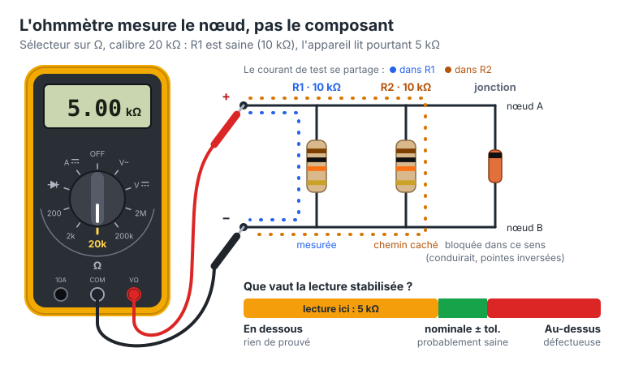
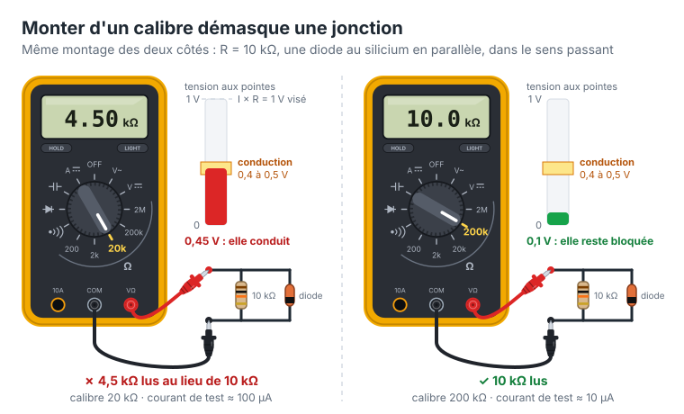
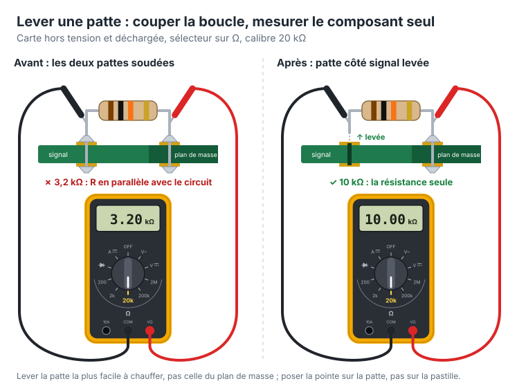
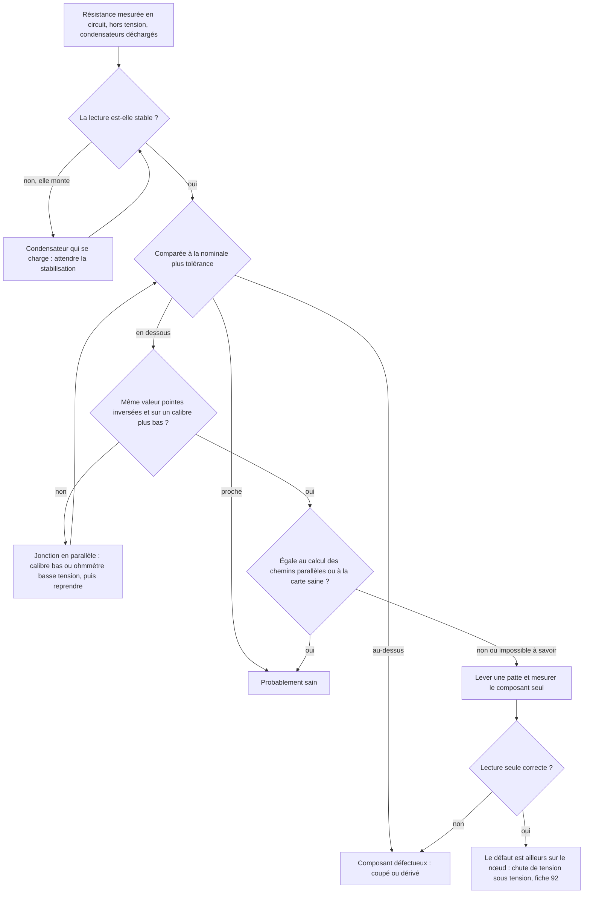

# 02 Pièges de la mesure en circuit

Pourquoi un composant soudé sur la carte ne se mesure pas comme un composant seul, comment reconnaître une lecture faussée par le reste du circuit, et quand il faut lever une patte.

## En bref

En circuit, l'ohmmètre mesure le composant **et tout ce qui est branché en parallèle** : résistances, jonctions de semi-conducteurs, condensateurs. Ces chemins ne peuvent que **faire baisser** la lecture. D'où la règle centrale : une valeur stabilisée **au-dessus** de la valeur nominale (tolérance comprise) est concluante, le composant est défectueux ; une valeur **en dessous** ne prouve rien tant qu'on n'a pas écarté les chemins parallèles. Pour trancher : inverser les pointes, raisonner sur le schéma, comparer avec une carte saine, ou lever une patte. Sous tension, le voltmètre complète ces mesures par la chute de tension aux bornes des composants.

> **Sécurité** : ohmmètre, bipeur, mode diode et capacimètre se font **hors tension**, piles retirées, condensateurs déchargés et vérifiés au voltmètre ; les mesures sous tension se font par une alimentation limitée en courant, et seulement si aucune tension ne dépasse 50 V continu ni 25 V alternatif sur la carte (fiche [00](../00_securite/README.md)). Le fonctionnement de chaque mode du multimètre est expliqué en fiche [01](../01_multimetre/README.md).

## Les chemins parallèles : une lecture trop basse ne prouve rien

Les deux pointes touchent deux **nœuds** du circuit, pas deux pattes d'un composant isolé. Tout ce qui relie ces deux nœuds se retrouve en parallèle du composant mesuré, et une résistance en parallèle donne toujours une valeur plus faible que la plus faible des deux : *R = R1 × R2 / (R1 + R2)*.

| Composant mesuré | En parallèle sur la carte | Lecture |
| --- | --- | --- |
| 10 kΩ | rien | 10 kΩ |
| 10 kΩ | 10 kΩ | 5 kΩ |
| 10 kΩ | 1 kΩ | 0,91 kΩ |
| 10 kΩ ouverte (coupée) | 22 kΩ | 22 kΩ |

La dernière ligne montre le piège inverse : une résistance coupée ne lit pas forcément « OL », elle lit le chemin parallèle. Sa lecture reste pourtant **au-dessus** de 10 kΩ, ce qui suffit à la condamner.

**Règle de lecture** (valeur stabilisée, multimètre vérifié, cordons soustraits sous 10 Ω) :

- **Au-dessus de la nominale plus la tolérance** : composant défectueux (coupé ou dérivé), quel que soit le reste du circuit. C'est la seule conclusion qu'une mesure en circuit donne à coup sûr.
- **Proche de la nominale** : très probablement sain ; un chemin parallèle de valeur bien plus élevée ne change presque rien.
- **En dessous de la nominale** : ambigu. Le composant peut être sain et shunté, ou bien en court-circuit. Suivre l'arbre de décision.

**Raisonner sur le schéma** : quand on l'a, repérer tout ce qui relie les deux nœuds et calculer la valeur attendue en parallèle. Une lecture égale à ce calcul est normale.

## Les jonctions qui conduisent

Une diode, une jonction de transistor ou les diodes de protection internes d'un circuit intégré peuvent se trouver entre les deux nœuds. L'ohmmètre les fait conduire quand la tension à ses pointes approche 0,4 à 0,5 V (le mécanisme et ses ordres de grandeur sont en fiche [01](../01_multimetre/README.md), « Ohmmètre »).

Comment le reconnaître :

- **Inverser les pointes** : une résistance seule lit la même valeur dans les deux sens. Une lecture qui change avec la polarité signale une jonction (ou un condensateur qui se charge, section suivante). La lecture la plus haute des deux est la plus proche de la résistance seule, sans la garantir.
- **Changer de calibre** : sur le calibre le plus bas, la tension aux pointes reste faible et la jonction ne conduit pas ; sur un calibre plus élevé, la lecture s'effondre. Une lecture qui dépend du calibre au-delà de la précision de l'appareil signale une jonction.
- **Mode diode entre les mêmes nœuds** : une lecture de 0,3 à 0,7 V dans un sens confirme qu'une jonction est en parallèle.

## Les condensateurs qui se chargent

Un condensateur entre les deux nœuds se charge sous le courant de l'ohmmètre : la lecture part bas et **monte** jusqu'à la valeur des chemins résistifs (fiche [01](../01_multimetre/README.md), « Ohmmètre » et « Bipeur »). Sur un rail d'alimentation chargé de plusieurs centaines de µF, la montée dure plusieurs secondes sur les calibres élevés.

- **Attendre que la lecture se stabilise** avant de la comparer à quoi que ce soit ; une lecture qui monte n'est pas un court-circuit.
- Inverser les pointes recommence la montée : la première valeur lue après inversion n'a pas de sens.
- Le **capacimètre** en circuit lit la somme des condensateurs en parallèle, faussée par les résistances et les jonctions qui les déchargent : une valeur en circuit n'est qu'un indice. Une capacité nettement **inférieure** à celle du seul condensateur mesuré reste toutefois suspecte, car les autres condensateurs en parallèle ne peuvent que l'augmenter ; l'ESR se mesure en fiche 03.
- Décharger les condensateurs avant chaque série de mesures (fiche [00](../00_securite/README.md)) : une charge résiduelle fait lire n'importe quoi à l'ohmmètre, et une lecture négative ou qui descend en est le signe.

## Ohmmètre basse tension : la tension à pleine échelle

Pour mesurer une résistance sans faire conduire les jonctions, il faut que la tension aux pointes reste sous environ 0,3 V pendant la mesure. Deux caractéristiques comptent (relevées par l'exercice de la fiche [01](../01_multimetre/README.md)) :

- la **tension à vide**, atteinte pointes en l'air ou sur une valeur hors calibre ;
- la **tension à pleine échelle**, atteinte quand la résistance mesurée remplit le calibre. Un appareil dont la tension à pleine échelle reste sous 0,3 V sur tous ses calibres ne fait pas conduire de jonction au silicium tant que la lecture n'est pas hors calibre.

Les appareils qui proposent un calibre « basse puissance » (*low power ohms*) ou qui limitent la tension à pleine échelle sont les plus fiables en circuit. Sur un appareil premier prix, préférer le calibre manuel le plus bas qui affiche encore la valeur, et vérifier la polarité. Une diode Schottky ou une jonction au germanium conduit dès 0,15 à 0,2 V : même un ohmmètre basse tension peut la faire conduire.

## Quand lever une patte

Lever une patte (dessouder une seule broche pour isoler le composant) coûte du temps et fatigue la pastille. On le fait quand :

- la lecture est **en dessous** de la nominale et que ni l'inversion des pointes, ni le schéma, ni une carte saine ne permettent de trancher ;
- on veut une mesure qu'aucun chemin parallèle ne doit fausser : capacité ou ESR exacte, fuite d'un condensateur, gain d'un transistor ;
- plusieurs composants identiques sont en parallèle (condensateurs de découplage, MOSFET en parallèle) et on cherche lequel est en court-circuit : la mesure ne peut pas les distinguer sans les séparer.

**Quelle patte** : pour un composant à deux bornes, lever l'une ou l'autre suffit à couper la boucle ; choisir celle qui se dessoude le plus facilement, c'est-à-dire **pas celle reliée à un plan de masse ou d'alimentation**, qui absorbe la chaleur. Pour un transistor, lever la patte commune aux chemins suspects (souvent la base ou la grille) suffit en général à isoler ses jonctions ; un circuit intégré se teste sous tension ou se remplace, pas en levant ses broches.

**Le geste** :

1. Carte hors tension, condensateurs déchargés (fiche [00](../00_securite/README.md)).
2. **Traversant** : retirer la soudure du côté pastille (pompe ou tresse), chauffer la pastille et soulever la patte de quelques millimètres avec une pince, sans tirer sur une pastille froide : elle s'arrache avec sa piste.
3. **CMS** (composant monté en surface, résistance ou condensateur 0603, 0805…) : chauffer une seule extrémité et la soulever à la pince, ou retirer le composant (deux fers, pince chauffante ou air chaud) et le mesurer seul.
4. Mesurer entre la patte levée et l'autre borne du composant, **pas** la pastille.
5. Ressouder, puis vérifier la continuité entre la patte et la piste.

## Mesurer la chute de tension sous tension

Le voltmètre est le seul mode qui se branche sur une carte alimentée (fiche [01](../01_multimetre/README.md)), et les chemins parallèles ne le gênent pas : il lit la tension qui existe réellement entre deux points. Carte alimentée par une alimentation limitée en courant (fiche [00](../00_securite/README.md)), une seule pointe tenue :

| Où mesurer | Lecture attendue | Ce qu'un écart signale |
| --- | --- | --- |
| Aux bornes d'une résistance | *V = R × I*, à comparer au schéma ou à une carte saine | 0 V : aucun courant (circuit coupé en amont ou en aval, ou résistance en court-circuit) ; tension trop haute : trop de courant, ou résistance dérivée vers le haut |
| Aux bornes d'un fusible, d'un interrupteur fermé, d'un connecteur | quelques mV | Plusieurs centaines de mV : contact résistant ou fusible fatigué ; tension d'alimentation complète : ouvert |
| Le long d'une piste ou d'un plan de masse | quelques mV | Des dizaines de mV sur une piste fine : un courant anormal y passe ; la tension diminue en approchant du court-circuit (fiche 92) |
| Base-émetteur d'un transistor bipolaire au silicium qui conduit | 0,6 à 0,7 V | Nettement plus haut : jonction ouverte ; 0 V alors qu'il devrait conduire : pas de commande, ou jonction en court-circuit |
| Aux bornes d'une diode qui conduit | 0,6 à 1 V (silicium), 0,2 à 0,5 V (Schottky) | Proche de 0 V : diode en court-circuit, ou aucun courant |

La chute de tension évite de dessouder un fil pour insérer un ampèremètre : le courant dans une résistance de valeur connue vaut *I = V / R*.

## Comparer avec une carte saine

Quand on dispose d'une carte identique qui fonctionne (ou d'un canal identique sur la même carte : voie gauche et voie droite d'un amplificateur, phases d'un régulateur), les mêmes chemins parallèles existent des deux côtés : la comparaison neutralise le piège. Mesurer les **mêmes points**, avec le **même appareil**, sur le **même calibre**, dans la **même polarité**, les deux cartes hors tension et déchargées. Un écart net (au-delà de quelques pour cent sur une résistance) désigne la zone à examiner. Méthode complète : fiche 93.

## Arbre de décision : que vaut cette lecture en circuit ?

## Aide-mémoire d'établi

- En circuit, l'ohmmètre mesure le nœud, pas le composant.
- Les chemins parallèles ne font que baisser la lecture : au-dessus de la nominale = défectueux.
- En dessous de la nominale : rien de prouvé.
- Inverser les pointes : valeur différente = jonction ou condensateur.
- Lecture qui monte = condensateur qui se charge : attendre.
- Jonctions : calibre bas, ohmmètre à tension à pleine échelle sous 0,3 V ; Schottky dès 0,15 V.
- Lever la patte la plus facile à dessouder, jamais tirer une pastille froide ; mesurer la patte, pas la pastille.
- Sous tension, le voltmètre lit la vraie chute : *I = V / R*, quelques mV sur un contact fermé.
- Carte saine : mêmes points, même appareil, même calibre, même polarité.

## Sources

- Fluke, *How to measure resistance with a digital multimeter* (mesure hors tension, chemins parallèles, lever une patte) — <https://www.fluke.com/en-gb/learn/blog/digital-multimeters/how-to-measure-resistance>
- EEVblog forum, *Multimeters with low ohms function* (calibres basse puissance, tensions de test relevées sur divers appareils) — <https://www.eevblog.com/forum/testgear/multimeters-with-low-ohms-function/>
- HKJ (lygte-info.dk), *Multimeter and component testing* (tension à vide et tension à pleine échelle de nombreux appareils) — <https://lygte-info.dk/info/DMMComponentTesting%20UK.html>
- All About Circuits, *Lessons in Electric Circuits*, vol. 1, ch. 8 « Ohmmeter usage » (mesure hors tension, chemins parallèles) et vol. 3, ch. 3 « Meter check of a diode » — <https://www.allaboutcircuits.com/textbook/>
- Fluke, *Voltage drop testing*, note d'application (chute de tension aux bornes des contacts et des connexions sous charge) ; à chercher sous ce titre sur fluke.com.
- Diodes Inc. et Vishay, fiches techniques de diodes Schottky de signal (BAT54, BAT85 : tension directe de 0,2 à 0,4 V à 1 mA).
