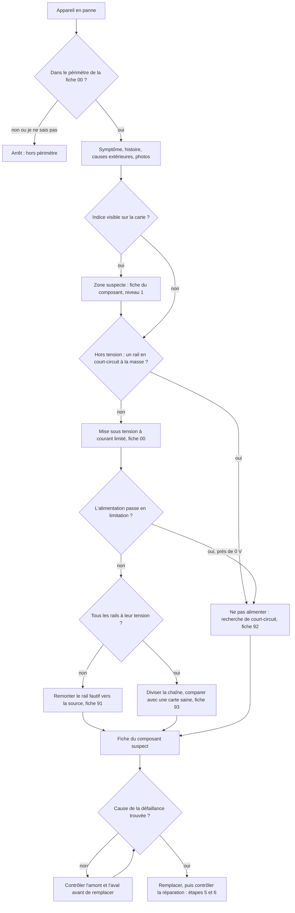

# 03 Méthode de dépannage d'une carte

L'ordre dans lequel chercher une panne sur une carte : ce qu'on fait avant de toucher, ce qu'on contrôle hors tension, comment on remet sous tension, et quelle fiche ouvrir à chaque étape.

## En bref

Une panne se trouve en **réduisant la zone suspecte**, pas en mesurant les composants un par un. L'ordre compte : on écoute le symptôme, on écarte les causes extérieures, on regarde, on mesure **hors tension** la résistance de chaque rail d'alimentation, et seulement ensuite on alimente, par une alimentation limitée en courant. Sous tension, on contrôle les rails avant les signaux. Le composant fautif se confirme en dernier, avec sa fiche, et on cherche **pourquoi** il a lâché avant de le remplacer.

> **Sécurité** : cette méthode ne vaut que dans le périmètre de la fiche [00](../00_securite/README.md) : 50 V continu (25 V alternatif) au plus, partout sur la carte. Une carte dont l'alimentation secteur est intégrée est **hors périmètre**, même débranchée : son condensateur de filtrage peut garder plusieurs centaines de volts. Une carte basse tension sortie d'un appareil secteur n'entre dans le périmètre que séparée de sa carte d'alimentation et alimentée par l'alimentation de laboratoire. Dans le doute, l'arbre de la fiche 00 répond « arrêt ».

## Les règles de la méthode

- **Ne pas aggraver** : pas de remise sous tension « pour voir » sur l'adaptateur d'origine, pas de fusible neuf essayé sans avoir cherché la cause (fiche [13](../13_fusible/README.md)).
- **Une hypothèse, une mesure** : dire ce qu'on s'attend à lire avant de poser les pointes. Une lecture sans valeur attendue ne prouve rien.
- **Le plus probable et le plus simple d'abord** : une cause fréquente qui se contrôle en une minute passe avant une cause rare qui demande de dessouder.
- **Ce qui marche innocente** : une fonction qui marche met hors de cause tout ce dont elle dépend (alimentation commune, horloge, connecteur).
- **Un changement à la fois**, et on note chaque mesure : la mémoire se trompe au bout d'une heure.
- **Une panne peut en cacher une autre** : un composant détruit en a souvent entraîné ou subi un second.
- **Vérifier son appareil** : pile du multimètre, cordons, fusibles des entrées courant (page [i1](../i1_multimetre/README.md)) ; pointes en court-circuit avant une série de mesures à l'ohmmètre.

## Étape 1 — Recueillir le symptôme et l'histoire

Avant d'ouvrir l'appareil, répondre à cinq questions. Elles orientent toute la suite.

| Question | Ce que la réponse oriente |
| --- | --- |
| Que fait l'appareil, que ne fait-il plus ? Totalement mort, une fonction morte, comportement erratique ? | mort : alimentation et protection ; une fonction : son rail ou son étage ; erratique : alimentation bruitée, contact, condensateur |
| La panne est-elle permanente ou intermittente ? Dépend-elle de la chaleur, d'un choc, de la position d'un câble ? | intermittente : soudures, connecteurs, composant sensible à la température |
| Que s'est-il passé juste avant ? Chute, liquide, mauvais adaptateur, inversion de polarité, orage, branchement à chaud ? | chute : soudures et composants lourds ; liquide : corrosion ; surtension ou inversion : protections d'entrée, puis ce qui est derrière |
| A-t-il déjà été ouvert ou réparé ? | une intervention récente est le premier suspect : composant remplacé, soudure, nappe mal remise |
| A-t-il déjà eu cette panne ? | une panne qui revient désigne une cause non traitée |

Si l'appareil vient de quelqu'un d'autre, c'est cette personne qui connaît l'histoire : lui poser les questions, et faire reproduire la panne si c'est sans risque.

## Étape 2 — Écarter les causes extérieures

Une bonne part des « pannes de carte » sont ailleurs. À contrôler avant de démonter :

- l'**adaptateur** : tension à vide et, mieux, en charge ; polarité de la fiche ; un adaptateur d'une autre marque ;
- le **câble** et les **connecteurs** d'alimentation ;
- les **piles** et la **batterie** : tension, contacts oxydés ;
- le **fusible** accessible et l'**interrupteur** (fiche [13](../13_fusible/README.md)) ;
- le **réglage** ou la configuration : un appareil en veille, verrouillé ou mal réglé n'est pas en panne.

## Étape 3 — Documenter avant de toucher

- **Photographier** les deux faces de la carte, chaque connecteur avec le sens de sa nappe, la position des cavaliers et des vis.
- **Relever** les références des circuits intégrés et la tension marquée sur les condensateurs : un marquage au-delà du périmètre arrête le dépannage (fiche [00](../00_securite/README.md)).
- **Chercher** le schéma, le manuel de service, les fiches techniques des circuits principaux. Sans schéma, repérer au moins les rails : l'entrée, chaque régulateur et sa tension de sortie.
- **Identifier la masse** : le point où poser la pointe noire pour toute la suite.

## Étape 4 — Regarder, sentir

Carte hors tension et déchargée (fiche [00](../00_securite/README.md)). L'inspection trouve une grande part des pannes sans aucune mesure : composant brûlé, fissuré ou gonflé, soudure fissurée, corrosion après un liquide, piste coupée, connecteur mal enfoncé, trace d'une réparation antérieure. Les indices propres à chaque composant sont au niveau 1 de sa fiche ; la méthode d'inspection complète est en fiche 90.

Un indice visible désigne une **zone**, pas encore une cause : une résistance brûlée a obéi à un courant trop fort, que quelque chose d'autre a laissé passer (fiche [10](../10_resistance/README.md)).

## Étape 5 — Contrôler les rails hors tension

**Avant toute mise sous tension**, mesurer la résistance entre chaque rail d'alimentation et la masse. C'est l'étape qui évite d'alimenter un court-circuit.

1. Carte débranchée, piles retirées, condensateurs déchargés et vérifiés au voltmètre (fiche [00](../00_securite/README.md)).
2. Pointe noire sur la masse, pointe rouge sur le rail : l'entrée d'alimentation d'abord, puis la sortie de chaque régulateur.
3. Attendre que la lecture se stabilise : les condensateurs du rail se chargent (fiche [02](../02_pieges_en_circuit/README.md)).

| Lecture entre le rail et la masse | Suite |
| --- | --- |
| Bip continu, moins de 1 Ω environ | court-circuit franc : **ne pas alimenter**, chercher le composant en court-circuit (fiche 92) |
| Quelques ohms à quelques centaines d'ohms, stable | douteux : comparer avec une carte saine ou le schéma ; certains rails lisent normalement quelques ohms (fiche [20](../20_condensateur_ceramique/README.md)) |
| Lecture qui monte, puis valeur élevée | pas de court-circuit franc : passer à l'étape 6 |

Le détail de cette mesure et ses limites sont en fiche [20](../20_condensateur_ceramique/README.md), « Hors tension : le rail entier se mesure d'un coup ».

## Étape 6 — Première mise sous tension, courant limité

Jamais sur l'adaptateur d'origine tant que la panne n'est pas comprise : alimentation de laboratoire, tension nominale, limite de courant basse. Le réglage et la lecture des voyants CV et CC sont en fiche [00](../00_securite/README.md), « L'alimentation de laboratoire limitée en courant ».

Regarder le courant pendant les premières secondes, une main prête à couper :

- **limitation immédiate, tension proche de 0 V** : court-circuit, couper et passer à la fiche 92 ;
- **limitation, tension partielle, rien ne chauffe** : la limite est peut-être trop basse pour le démarrage ; la remonter par paliers, comme le dit l'arbre de la fiche [00](../00_securite/README.md) ;
- **courant anormalement faible ou nul** : rien ne démarre, la panne est sur le chemin de l'alimentation (fusible, interrupteur, régulateur, signal de mise en marche) ;
- **courant plausible et stable** : la carte s'alimente, passer aux rails.

Fumée, odeur de brûlé, composant qui chauffe : couper d'abord, chercher ensuite.

## Étape 7 — Contrôler les rails sous tension

Les rails passent **avant** les signaux : aucun signal n'est juste sur une alimentation fausse. Au voltmètre continu (fiche [01](../01_multimetre/README.md)), pointe noire sur la masse, dans l'ordre où le courant circule : entrée, après la protection (fusible, diode, interrupteur), puis sortie de chaque régulateur.

| Rail | Où chercher |
| --- | --- |
| Absent, entrée du régulateur présente | régulateur, son signal de mise en marche, ou court-circuit en sortie |
| Absent, entrée absente aussi | remonter vers la source : fusible, interrupteur, connecteur, piste |
| Trop bas | surcharge en aval, régulateur en limitation, chute dans un contact résistant (fiche [02](../02_pieges_en_circuit/README.md), « Mesurer la chute de tension sous tension ») |
| Correct au voltmètre, appareil instable | ondulation : condensateurs du rail (fiche [22](../22_condensateur_electrolytique/README.md)), à voir à l'oscilloscope (page [i2](../i2_oscilloscope/README.md)) |

La méthode complète, mesure de courant comprise, est en fiche 91.

## Étape 8 — Réduire la zone : diviser pour régner

Rails corrects, panne toujours là : la carte est une **chaîne d'étages**, de l'entrée vers la sortie. On mesure ce qui entre et ce qui sort d'un étage ; un étage dont l'entrée est correcte et la sortie fausse contient la panne, ou en subit une en aval qui le charge.

- **Partir du milieu** de la chaîne plutôt que d'un bout : chaque mesure élimine la moitié de ce qui reste.
- **Comparer** avec une carte saine ou avec une voie identique de la même carte : mêmes points, même appareil, même calibre (fiche [02](../02_pieges_en_circuit/README.md), « Comparer avec une carte saine »).
- **Échanger** deux éléments identiques et amovibles (modules, cartes filles, câbles), seulement si la panne n'est pas destructrice : si la panne suit l'élément, il est en cause. Un court-circuit ou un composant qui chauffe interdit l'échange, qui détruirait la pièce saine.

Le traçage de signal et la comparaison complète sont en fiche 93.

## Étape 9 — Confirmer le composant, trouver la cause

La zone est réduite à quelques composants : ouvrir la fiche de chacun (menu du [README](../README.md)), dans l'ordre de leur fréquence de panne. La mesure en circuit a ses pièges ; une lecture ambiguë se tranche en levant une patte (fiche [02](../02_pieges_en_circuit/README.md)).

Avant de remplacer, répondre à la question « **pourquoi a-t-il lâché ?** » : la colonne « Ce que la panne implique ailleurs » de chaque fiche donne les composants en amont et en aval à contrôler. Remplacer sans cette réponse, c'est souvent détruire la pièce neuve. Une pièce neuve n'est pas garantie bonne : la mesurer avant de la souder.

## Étape 10 — Contrôler la réparation

1. **Regarder** la soudure refaite : pas de pont, pas de bille, pastille intacte ; continuité entre chaque patte et sa piste.
2. **Refaire l'étape 5** : résistance du rail hors tension.
3. **Refaire l'étape 6** : mise sous tension à courant limité, courant comparé à celui attendu.
4. **Vérifier toutes les fonctions**, pas seulement celle qui était en panne, puis laisser fonctionner le temps que la panne mettait à apparaître.
5. Seulement alors, remettre l'adaptateur d'origine.

## Les pannes intermittentes

Une panne qui va et vient se cherche en la **provoquant**, appareil alimenté à courant limité et mesure en place :

- **tapoter** la carte et les composants avec un outil isolant, **bouger** doucement les connecteurs et les câbles : une panne sensible aux chocs désigne une soudure, un contact, un porte-fusible ;
- **noter** si elle dépend de la température : à froid, après quelques minutes, seulement à chaud (fiche [22](../22_condensateur_electrolytique/README.md)) ;
- **enregistrer** la mesure dans le temps (mode MIN/MAX du multimètre, oscilloscope en déclenchement unique : page [i2](../i2_oscilloscope/README.md)) pour savoir ce qui a bougé en premier.

## Quand s'arrêter

- La carte sort du périmètre de la fiche [00](../00_securite/README.md).
- Le défaut est sous un boîtier à billes (BGA) ou dans une couche interne de la carte.
- La panne demande un instrument qu'on n'a pas : noter ce qui a été mesuré, pour reprendre plus tard ou confier la carte.
- Le coût de la pièce ou le risque d'aggraver dépasse la valeur de l'appareil.
- La fatigue : après une heure sans progrès, faire une pause et reprendre les notes depuis le début.

## Arbre de décision : par où continuer ?

## Aide-mémoire d'établi

1. Périmètre : 50 V continu, 25 V alternatif, pas d'alimentation secteur intégrée. Sinon stop.
2. Symptôme, histoire, dernière intervention.
3. Adaptateur, câble, piles, fusible, réglages.
4. Photos des deux faces et des connecteurs ; schéma ; repérer la masse et les rails.
5. Regarder et sentir, carte déchargée.
6. Hors tension : résistance de chaque rail à la masse. Moins de 1 Ω : ne pas alimenter.
7. Alimentation de laboratoire, limite de courant basse, œil sur le courant.
8. Rails au voltmètre, de l'entrée vers les régulateurs, avant tout signal.
9. Couper la chaîne par le milieu ; comparer avec une carte saine.
10. Trouver pourquoi le composant a lâché, puis remplacer ; refaire 6 et 7 avant l'adaptateur d'origine.

## Sources

- All About Circuits, *Lessons in Electric Circuits*, volume « EE Reference », chapitre 8 « Troubleshooting — Theory and Practice » :
  - *Questions to Ask Before Proceeding* (histoire du système, pannes habituelles) — <https://www.allaboutcircuits.com/textbook/reference/chpt-8/questions-to-ask-before-proceeding/>
  - *General Troubleshooting Tips* (panne déjà survenue, modification récente, ce qui fonctionne innocente ce dont il dépend, hypothèse la plus probable d'abord) — <https://www.allaboutcircuits.com/textbook/reference/chpt-8/general-troubleshooting-tips/>
  - *Specific Troubleshooting Techniques* (échange d'éléments identiques et ses risques, découpage en étages, enregistrement d'un signal pour les pannes intermittentes) — <https://www.allaboutcircuits.com/textbook/reference/chpt-8/specific-troubleshooting-techniques/>
  - *Likely Failures in Proven Systems* (erreur d'utilisation, connexions, alimentation, puis composants actifs et passifs) — <https://www.allaboutcircuits.com/textbook/reference/chpt-8/likely-failures-in-proven-systems/>
  - *Potential Pitfalls* (pièce neuve non garantie, appareil de mesure à vérifier, pannes multiples, fatigue) — <https://www.allaboutcircuits.com/textbook/reference/chpt-8/potential-pitfalls/>
- Les valeurs et procédures de mesure viennent des fiches citées à chaque étape, qui portent leurs propres sources : [00](../00_securite/README.md) (périmètre, alimentation limitée), [02](../02_pieges_en_circuit/README.md) (mesure en circuit, chute de tension, carte saine), [13](../13_fusible/README.md) (remise sous tension après un fusible fondu), [20](../20_condensateur_ceramique/README.md) (résistance d'un rail hors tension).
