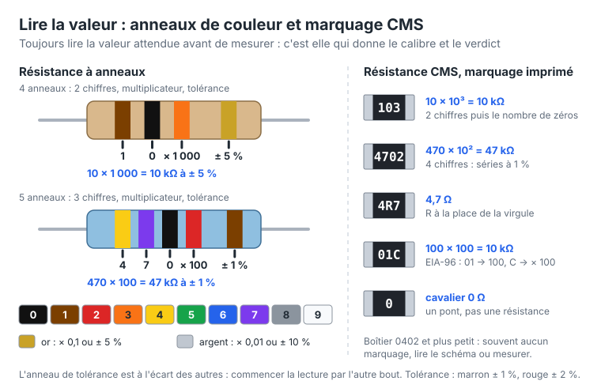
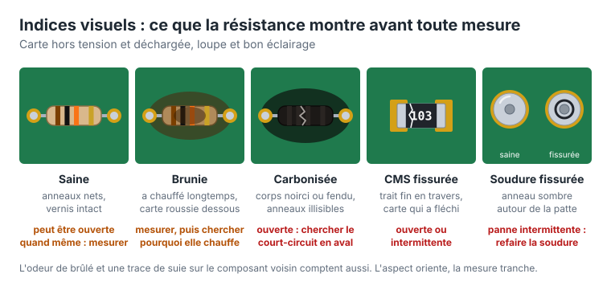
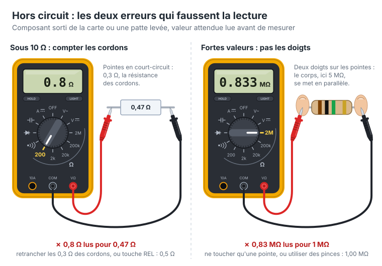
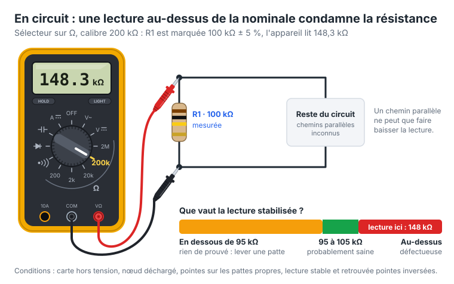
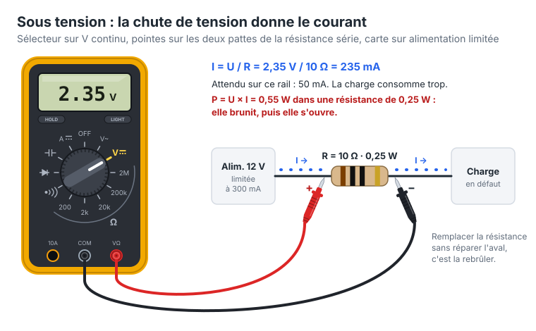
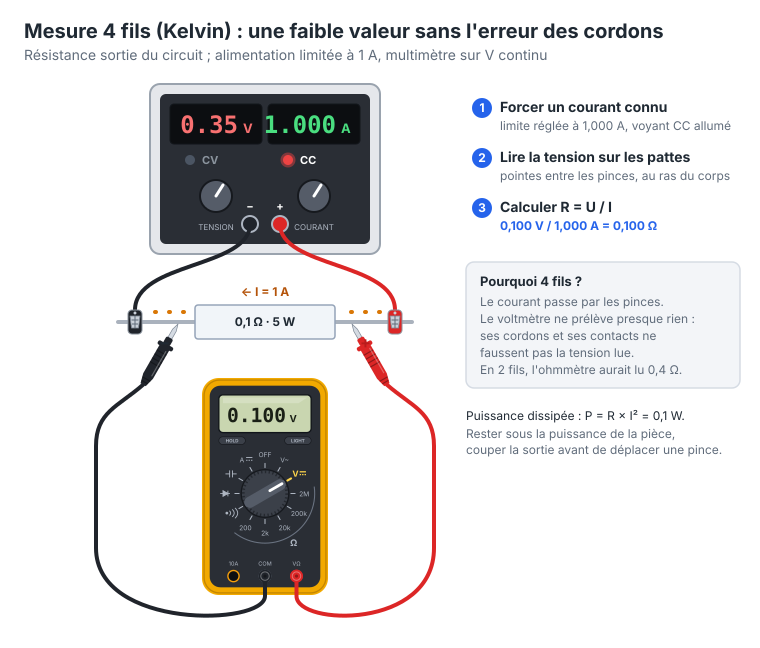
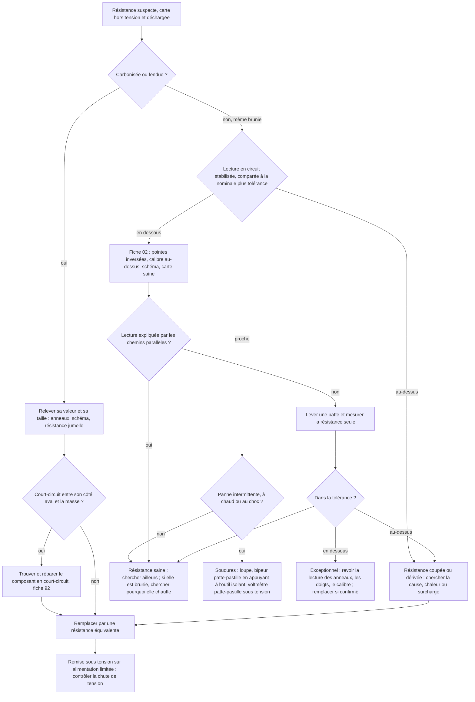

# 10 Résistance

Savoir si une résistance soudée sur une carte est saine, coupée ou dérivée, retrouver sa valeur quand elle a brûlé, et trouver ce qui l'a tuée avant de la remplacer.

## En bref

Une résistance ne tombe presque jamais en panne seule : elle **s'ouvre** ou **dérive vers le haut**, le plus souvent parce qu'un autre composant, en aval, lui a fait dissiper trop de puissance. Elle ne se met pratiquement jamais en court-circuit. La mesure qui tranche est l'ohmmètre, hors tension : une lecture stabilisée **au-dessus** de la valeur marquée plus la tolérance la condamne, même en circuit (fiche [02](../02_pieges_en_circuit/README.md)). Une résistance brûlée est un **symptôme** : chercher le court-circuit en aval avant de la remplacer.

> **Sécurité** : mesures hors tension → carte débranchée, piles retirées, condensateurs déchargés et vérifiés au voltmètre ; mesures sous tension → alimentation limitée en courant, 50 V continu (25 V alternatif) au plus partout sur la carte (fiche [00](../00_securite/README.md)). Une résistance de puissance ou une résistance en surcharge peut dépasser 100 °C et reste chaude plusieurs minutes après la coupure : ne pas la toucher pour « voir si elle chauffe ».

## Identifier le composant

| Type | Aspect | Où on le trouve |
| --- | --- | --- |
| Couche carbone | corps beige, 4 anneaux, ± 5 % | cartes anciennes, usage général |
| Couche métallique | corps bleu ou vert, 5 anneaux, ± 1 % | usage général et précision |
| Bobinée, vitrifiée ou en boîtier céramique (« ciment ») | cylindre vert ou gris, ou bloc blanc rectangulaire, valeur imprimée en clair (5W 0R47 J) | puissance : alimentations, charges, mesure de courant |
| CMS (composant monté en surface) à couche épaisse | pavé noir à terminaisons argentées, code à 3 ou 4 caractères | partout sur les cartes récentes |
| Shunt de mesure de courant | CMS ou barrette métallique de très faible valeur (R010 = 10 mΩ) | à côté d'un MOSFET, d'un régulateur, d'un connecteur de batterie |
| Réseau de résistances | boîtier en ligne à 5–10 broches (SIP) ou CMS à 8 terminaisons | bus logiques, tirages (*pull-up*) |
| Cavalier 0 Ω | CMS marqué « 0 » ou « 000 », ou corps beige à un seul anneau noir | pont entre deux pistes, option de câblage |
| Résistance fusible | ressemble à une résistance ordinaire, souvent de faible valeur à l'entrée d'un rail | fiche 13 |

### Lire la valeur

- **Anneaux** : les premiers anneaux sont des chiffres, l'avant-dernier le multiplicateur, le dernier la tolérance. L'anneau de tolérance est plus écarté des autres ; commencer par l'autre bout. Dans le doute entre deux lectures d'une résistance à 4 anneaux, une seule tombe en général sur une valeur normalisée (séries E12 et E24 : 10, 12, 15, 18, 22, 27, 33, 39, 47, 56, 68, 82 et leurs intermédiaires). Sur une 5 anneaux à 1 %, la série E96 est trop dense pour trancher : mesurer.
- **Couleurs altérées par la chaleur** : le rouge vire au marron, l'orange au rouge ou au marron, le jaune pâlit. Sur une résistance qui a chauffé, confirmer la lecture par la mesure ou le schéma.
- **CMS à 3 ou 4 caractères** : deux ou trois chiffres significatifs puis le nombre de zéros ; un R tient lieu de virgule (4R7 = 4,7 Ω, R010 = 0,010 Ω).
- **CMS au code EIA-96** (séries à 1 % en boîtier 0603) : deux chiffres désignent une valeur dans une table de 96 valeurs (01 = 100, 02 = 102… 96 = 976), suivis d'une lettre multiplicatrice (A = × 1, B = × 10, C = × 100, D = × 1 000 ; X = × 0,1, Y = × 0,01). 01C = 100 × 100 = 10 kΩ. Ne pas le lire comme un code à 3 chiffres.
- **Boîtier 0402 et plus petit** : le plus souvent sans marquage. Valeur par le schéma, une carte saine ou la mesure.

### Retrouver la valeur d'une résistance carbonisée

Du plus sûr au moins sûr :

1. **Le schéma** ou le manuel de service de l'appareil.
2. **Une résistance jumelle** : même position sur un canal identique de la carte (voie gauche et voie droite, phases d'un convertisseur) ou sur une carte saine.
3. **Les anneaux encore lisibles** : même partiels, croisés avec les séries E12 et E24, ils éliminent la plupart des candidates.
4. **La fiche technique du circuit voisin** : le schéma d'application d'un régulateur, d'un contrôleur ou d'un pilote de LED donne la valeur ou la formule (pont diviseur de contre-réaction, shunt de mesure de courant, résistance de grille).
5. **Le calcul** : résistance série d'une LED = (tension du rail − tension de la LED) / courant voulu ; pont diviseur à partir de la tension de sortie attendue.
6. **En dernier recours**, sur une résistance à couche coupée en un point : gratter le vernis au niveau de la coupure, mesurer de chaque patte jusqu'au bord de la coupure et additionner les deux lectures. La valeur obtenue est approchée, par défaut ; prendre la valeur normalisée immédiatement supérieure et la confirmer par l'un des moyens précédents.

Relever aussi la **taille** du corps avant de le jeter : elle donne la puissance de la pièce de remplacement.

## Modes de défaillance

Classés du plus fréquent au plus rare (consensus des réparateurs et notes de fabricants, voir Sources). Les répartitions publiées pour les résistances à couche donnent le circuit ouvert en tête, la dérive juste derrière et le court-circuit très loin (environ 5 %).

| Mode de défaillance | Fréquence | Cause typique | Ce que la panne implique ailleurs |
| --- | --- | --- | --- |
| Brûlée puis ouverte | très fréquent | surcharge : un composant en aval est en court-circuit ou consomme trop | condensateur, diode de protection, transistor ou circuit intégré en court-circuit sur le rail qu'elle alimente : le trouver avant de remplacer |
| Soudure fissurée sur une résistance qui chauffe | très fréquent (alimentations, étages de puissance) | cycles thermiques : la patte se dilate et se rétracte dans la soudure | panne intermittente à la chaleur ou aux chocs ; vérifier les autres composants chauds de la même zone |
| Dérive vers le haut | fréquent | forte valeur (100 kΩ et plus) soumise à une tension élevée, résistance qui travaille chaude, résistance au carbone aggloméré ancienne (elle absorbe l'humidité ; les valeurs au-delà de 500 kΩ sont les plus touchées, sans trace visible) | tension de sortie fausse, démarrage paresseux, seuil décalé ; les résistances identiques de la carte ont le même âge |
| Résistance fusible ouverte | fréquent | elle a joué son rôle : surintensité en aval | même recherche que pour une résistance brûlée (fiche 13) |
| CMS fissurée | occasionnel | flexion de la carte (vis, connecteur, chute), choc thermique au soudage | ouverte ou intermittente ; examiner les CMS voisines sur la même ligne de flexion |
| Shunt de mesure de courant dérivé ou ouvert | rare | impulsions de courant, MOSFET voisin détruit | limitation de courant fausse ; après un MOSFET en court-circuit, contrôler son shunt et sa résistance de grille |
| CMS sulfurée | rare | atmosphère soufrée (caoutchouc, air industriel) qui attaque l'argent des terminaisons | valeur qui monte puis circuit ouvert ; toutes les CMS de la même série sur la carte sont exposées |

Une résistance **en court-circuit** ou de valeur plus faible que la nominale est exceptionnelle (dépôt conducteur ou pont de soudure entre ses terminaisons ; résistance au carbone aggloméré très ancienne, qui dérive parfois vers le bas ; résistance à couche en début de surcharge, dont la valeur baisse avant de remonter puis de s'ouvrir). Une lecture trop basse en circuit vient presque toujours d'un chemin parallèle (fiche [02](../02_pieges_en_circuit/README.md)).

## Niveau 1 — Inspection par les sens

- **Vue**, à la loupe et sous un bon éclairage : corps bruni, noirci, fendu ou boursouflé ; anneaux décolorés ; carte roussie sous la résistance ; suie sur les composants voisins ; trait fin en travers d'une CMS ; terminaison de CMS décollée.
- **Odeur** de brûlé, persistante plusieurs jours sur une résistance carbonisée.
- **Une résistance d'aspect neuf peut être ouverte** : les fortes valeurs dérivées et les CMS fissurées ne montrent souvent rien. L'aspect oriente, la mesure tranche.
- **Une résistance brunie n'est pas forcément morte** : elle a travaillé chaude. La mesurer, et chercher pourquoi elle chauffe.

### Repérer une résistance qui chauffe

Carte sur alimentation limitée en courant (fiche [00](../00_securite/README.md)) : caméra thermique, goutte d'alcool isopropylique qui s'évapore plus vite sur le composant chaud, ou dos du doigt **approché** sans contact. Chaud ne veut pas dire défectueux : une résistance de puissance est faite pour travailler chaude (les fiches techniques admettent couramment 155 °C au point le plus chaud). Pour juger, mesurer la tension *U* à ses bornes et calculer *P = U² / R* : au-delà de la moitié de sa puissance nominale en permanence, elle vieillit vite ; au-delà de sa puissance nominale, elle est en surcharge et la cause est ailleurs.

### Soudures fissurées et pannes intermittentes

Une résistance qui chauffe fatigue ses soudures : un **anneau sombre** se forme autour de la patte, parfois visible seulement à la loupe, en éclairage rasant. Indices : panne qui apparaît à chaud ou disparaît en tapotant la carte.

- Hors tension : bipeur entre **chaque patte et sa pastille** (pas entre les deux pattes), en appuyant légèrement sur le composant avec un outil isolant.
- Sous tension, alimentation limitée : voltmètre entre la patte et la pastille ; plus de quelques mV, ou nettement plus que sur l'autre patte ou sur une carte saine, signale un contact résistant.
- Réparation : retirer l'ancienne soudure, en remettre de la neuve. Refaire d'office les soudures des autres composants chauds de la zone.

## Niveau 2 — Mesure hors circuit

Résistance sortie de la carte, ou une patte levée (fiche [02](../02_pieges_en_circuit/README.md), « Quand lever une patte »).

1. Lire la valeur attendue (anneaux, marquage, schéma).
2. Sélecteur sur **Ω**, calibre immédiatement supérieur à cette valeur (fiche [01](../01_multimetre/README.md), « Ohmmètre »).
3. Une pointe sur chaque patte, sur le métal propre.
4. Comparer la lecture à la valeur attendue.

| Lecture | Verdict |
| --- | --- |
| Dans la tolérance (plus la précision de l'appareil) | saine |
| Au-dessus de la tolérance | dérivée : à remplacer, et chercher pourquoi (chaleur, tension, âge) |
| OL sur tous les calibres | ouverte |
| Instable, qui change quand on bouge les pattes | fissure interne ou capuchon de patte desserti : à remplacer |
| En dessous de la tolérance | exceptionnel : vérifier d'abord la lecture des anneaux, les doigts et le calibre |

- **Sous 10 Ω**, les cordons et les contacts ajoutent 0,1 à 0,5 Ω. Mettre les pointes en court-circuit, noter la lecture et la retrancher, ou appuyer sur **REL** pointes en court-circuit. Sous 1 Ω, le multimètre ne donne plus qu'un ordre de grandeur : mesure 4 fils (niveau 4).
- **Dès quelques dizaines de kΩ**, et plus tôt encore sur une résistance à 1 %, ne tenir qu'une pointe avec les doigts : le corps, quelques centaines de kΩ à quelques MΩ d'une main à l'autre, se met en parallèle et fait lire trop bas. Poser le composant sur un support isolant propre, ou utiliser des pinces.
- **Au-dessus de 10 MΩ**, une trace de flux ou d'humidité sur le corps suffit à fausser la lecture : nettoyer à l'alcool isopropylique et laisser sécher.

### Vérifier son multimètre avant de condamner une résistance

- Pointes en court-circuit : 0,1 à 0,5 Ω. Davantage : cordon abîmé ou fiche oxydée.
- Mesurer une résistance neuve de valeur connue, à 1 % ou mieux, proche de celle qu'on contrôle. Garder une 100 Ω, une 10 kΩ et une 1 MΩ à 1 % dans la trousse.
- Pile faible : beaucoup d'appareils lisent faux avant d'afficher le témoin de pile. Une lecture surprenante sur toutes les résistances désigne l'appareil.
- Dans le doute, comparer avec une résistance identique d'un canal sain ou d'une carte saine : même appareil, même calibre.

### Résistances de puissance, réseaux et cavaliers 0 Ω

- **Bobinée ou en boîtier céramique** : valeur faible, donc cordons à retrancher. Elle s'ouvre (fil coupé à la sertissure) plus qu'elle ne dérive. Ses soudures sont les premières suspectes. Elle doit rester dégagée de la carte de quelques millimètres.
- **Réseau SIP à point commun** : la broche 1, repérée par un point, est commune à toutes les résistances ; mesurer entre la broche 1 et chacune des autres, toutes les lectures doivent être égales. **Réseau à résistances isolées** : mesurer par paires de broches (1–2, 3–4…). **Réseau CMS** : isolé (chaque résistance relie deux terminaisons face à face) ou à point commun (une terminaison partagée par toutes) ; identifier la topologie sur le schéma, le marquage ou la fiche technique avant de choisir les paires, sinon une lecture OL ou en série condamne un réseau sain. Une seule résistance ouverte suffit à bloquer une ligne de bus.
- **Cavalier 0 Ω** : il doit lire la même chose que les pointes en court-circuit, à quelques dixièmes d'ohm près, la résistance de contact variant d'un appui à l'autre (les fabricants garantissent 20 à 50 mΩ au plus, pour 1 à 3,5 A selon le boîtier) ; un cavalier défectueux lit nettement plus, ou OL. Un cavalier ouvert a servi de fusible : chercher la surintensité en aval.

## Niveau 3 — Mesure en circuit

La règle de la fiche [02](../02_pieges_en_circuit/README.md) s'applique telle quelle, et la résistance est le composant pour lequel elle rend le plus de services : comme une résistance tombe en panne **vers le haut** (ouverte ou dérivée) et que les chemins parallèles ne peuvent que **faire baisser** la lecture, la mesure en circuit condamne la plupart des résistances défectueuses sans rien dessouder.

Conditions : carte hors tension, nœuds déchargés (quelques mV au plus au voltmètre), pointes sur le métal propre des pattes, lecture **stabilisée** et retrouvée **pointes inversées**.

| Lecture stabilisée | Verdict |
| --- | --- |
| Au-dessus de la nominale plus la tolérance | résistance défectueuse : coupée ou dérivée |
| Proche de la nominale | probablement saine |
| En dessous | rien de prouvé : pointes inversées, calibre au-dessus, schéma, carte saine, puis lever une patte (fiche [02](../02_pieges_en_circuit/README.md)) |
| OL | ouverte, sans aucun chemin parallèle |

Une lecture qui **monte** lentement est un condensateur qui se charge : attendre. Une résistance de forte valeur (100 kΩ et plus) à côté d'un condensateur de forte capacité peut demander plusieurs minutes ; lever une patte va plus vite.

### Du symptôme à la résistance suspecte

| Symptôme | Résistance à contrôler en premier | Pourquoi |
| --- | --- | --- |
| Rail absent après un claquement ou une odeur de brûlé | résistance série ou résistance fusible à l'entrée du rail | elle s'est ouverte sur une surintensité |
| Tension de sortie d'un régulateur trop haute ou trop basse | les deux résistances du pont diviseur de contre-réaction | l'une a dérivé : la consigne est fausse |
| Convertisseur qui ne démarre pas, ou seulement à chaud | résistance de démarrage de forte valeur (100 kΩ à 1 MΩ) | dérivée vers le haut ou ouverte : le contrôleur n'est plus alimenté au démarrage. Dans le périmètre basse tension seulement (50 V continu au plus partout sur la carte, par exemple un convertisseur alimenté en 12 ou 24 V) ; batterie 48 V ou alimentation secteur : hors périmètre (fiche [00](../00_securite/README.md)) |
| Limitation de courant qui déclenche trop tôt, ou plus du tout | shunt de mesure de courant | dérivé vers le haut, fissuré, ou soudure résistante |
| MOSFET remplacé qui chauffe ou ne commute pas | résistance de grille, shunt de source | souvent détruits avec le MOSFET |
| Entrée logique flottante, bouton capricieux, bus I²C muet | résistance de tirage (*pull-up*), réseau de résistances | ouverte : la ligne n'est plus ramenée à un niveau défini |
| LED éteinte, LED elle-même saine | résistance série | ouverte |
| Gain ou décalage faux sur une seule voie | résistances de contre-réaction de l'amplificateur | comparer avec la voie saine |
| Panne qui vient à chaud, part au choc | soudures des résistances de puissance, CMS près d'une vis ou d'un connecteur | soudure ou corps fissuré |

### Sous tension : la chute de tension donne le courant

Carte sur alimentation limitée en courant, sélecteur sur **V continu**, pointes sur les deux pattes de la résistance (fiche [02](../02_pieges_en_circuit/README.md), « Mesurer la chute de tension sous tension »).

| Chute lue | Ce qu'elle dit |
| --- | --- |
| Conforme à *U = R × I* attendu | résistance et courant normaux |
| Trop élevée, résistance de bonne valeur | trop de courant : défaut **en aval** |
| Toute la tension du rail | résistance ouverte (ou charge en court-circuit franc) |
| 0 V | aucun courant : circuit coupé en amont ou en aval, ou résistance court-circuitée (pont de soudure) |

Le courant vaut *I = U / R* et la puissance dissipée *P = U × I* : à comparer à la puissance nominale de la résistance. Si elle est dépassée, comme sur la figure, couper la sortie dès la lecture faite. Régler la limite de l'alimentation juste au-dessus du courant attendu (fiche [00](../00_securite/README.md)) : le voyant CC signale alors le défaut avant toute mesure. Sur la figure, la limite a été remontée par paliers pour localiser le défaut (fiche 00, « Lire ») : on s'arrête au premier palier où un composant chauffe, on fait la lecture, on coupe la sortie, et on ne monte pas plus haut.

### Brûlée : chercher le court-circuit en aval

Une résistance ne brûle pas d'elle-même. Avant de la remplacer :

1. Hors tension, mesurer la résistance entre le côté **aval** de la résistance brûlée et la masse. Quelques ohms ou moins, et nettement moins que sur une carte saine ou un rail jumeau : un composant du rail est en court-circuit. Un rail sain chargé de circuits intégrés peut lire bas lui aussi (fiche [01](../01_multimetre/README.md)) : c'est la comparaison qui tranche.
2. Suspects habituels, dans l'ordre : condensateur céramique ou tantale de découplage, diode de protection (TVS, Zener), transistor ou MOSFET, circuit intégré alimenté par ce rail.
3. Localiser le court-circuit (fiche 92), le réparer, **puis** remplacer la résistance.
4. Remettre sous tension sur alimentation limitée et contrôler la chute de tension aux bornes de la résistance neuve.

Remplacer la résistance sans avoir trouvé la cause, c'est la brûler une seconde fois ; la remplacer par une plus puissante, c'est déplacer la destruction vers une piste ou un autre composant.

## Niveau 4 — Méthodes avancées

### Mesure 4 fils (Kelvin) des faibles valeurs

Sous 1 Ω (shunts, résistances de puissance, cavaliers), la résistance des cordons et des contacts dépasse celle du composant. La mesure 4 fils sépare le circuit qui **porte le courant** de celui qui **mesure la tension**. Sans milliohmmètre, une alimentation de laboratoire et le multimètre suffisent :

1. Résistance hors circuit. Alimentation réglée à 1 V environ, **limite de courant** au courant de mesure, sortie coupée.
2. Pinces de l'alimentation aux **extrémités** des pattes. Activer la sortie : le voyant CC s'allume, le courant est celui de la limite.
3. Multimètre sur **V continu**, pointes sur les pattes **entre les pinces**, au ras du corps.
4. *R = U / I*. La tension affichée par l'alimentation ne sert pas : elle inclut ses propres cordons.
5. Couper la sortie avant de déplacer une pince.

Choisir le courant pour rester sous la puissance de la pièce (*P = R × I²*) : 1 A dans 0,1 Ω dissipe 0,1 W ; pour un shunt CMS de 10 mΩ, 1 A donne 10 mV et 10 mW. La précision est celle de l'ampèremètre de l'alimentation : la vérifier une fois avec le multimètre en série, cordon rouge dans la douille 10 A, puis remettre le cordon en VΩ avant toute mesure de tension (fiche [01](../01_multimetre/README.md)). Un pont RLC ou un milliohmmètre fait la même mesure directement (fiche 03).

### Sulfuration des CMS

Les résistances CMS à couche épaisse ont une électrode interne en argent. Dans une atmosphère soufrée (joints et gaines en caoutchouc, air industriel, certaines huiles), le soufre traverse la jonction entre le vernis et la terminaison et transforme l'argent en sulfure, isolant : la valeur monte sur des mois, puis la résistance s'ouvre. Rien n'est visible à l'œil nu ; au microscope, des cristaux sombres au bord d'une terminaison. Si plusieurs CMS d'une même carte lisent trop haut sans trace de surchauffe, y penser, et remplacer par des résistances **anti-soufre** (mention *anti-sulfur* du fabricant).

### Caméra thermique

Elle montre en quelques secondes la résistance en surcharge, et surtout le composant en court-circuit qui la surcharge (fiches 03 et 92).

## Arbre de décision

## Remplacer le composant

| Critère | Règle |
| --- | --- |
| Valeur | identique. Si la valeur d'origine est introuvable, voir « Retrouver la valeur d'une résistance carbonisée » |
| Tolérance | identique ou meilleure : une 1 % remplace une 5 % |
| Puissance | identique ou supérieure, dans le même encombrement. Repères, séries d'usage général : axiale de 6 mm de corps = 0,25 W, 9 mm = 0,5 W ; CMS 0402 = 0,063 W, 0603 = 0,1 W, 0805 = 0,125 W, 1206 = 0,25 W |
| Tension limite | une résistance a aussi une tension maximale, indépendante de sa puissance : en usage général, 50 V en 0402, 75 V en 0603, 150 V en 0805, 200 V en 1206. Garder le même boîtier, ou plus grand |
| Type | couche métallique à la place de couche carbone : oui. **Bobinée à la place d'une couche** : non dans un circuit rapide (grille de MOSFET, amortisseur, mesure de courant d'un convertisseur), son inductance change le fonctionnement. Résistance soumise à des impulsions : type prévu pour les impulsions, pas une couche mince ordinaire |
| Résistance fusible | **uniquement** par une résistance fusible ininflammable de même valeur et de même puissance, pas plus puissante (fiche 13). Jamais par une résistance ordinaire, jamais par un fil |
| Shunt | même valeur, même tolérance, même boîtier ; soudures soignées, la résistance d'un joint compte |
| CMS en atmosphère soufrée | version anti-soufre |

Avant de remettre sous tension : la cause est trouvée et réparée ; la résistance de puissance est montée à quelques millimètres de la carte ; l'alimentation est limitée en courant ; la première mesure est la chute de tension aux bornes de la résistance neuve.

## Aide-mémoire d'établi

- Lire la valeur attendue **avant** de mesurer : anneaux, code CMS (103 = 10 kΩ, 4R7 = 4,7 Ω, 01C = 10 kΩ en EIA-96), schéma.
- Une résistance tombe en panne vers le haut : ouverte ou dérivée. Presque jamais en court-circuit.
- En circuit, hors tension : au-dessus de la nominale plus la tolérance, pointes sur des pattes propres, lecture stable = défectueuse. En dessous : rien de prouvé.
- Sous 10 Ω : retrancher les cordons ou touche REL. Dès quelques dizaines de kΩ : une seule pointe dans les doigts.
- Brûlée = symptôme : chercher le court-circuit en aval avant de remplacer.
- Sous tension, V continu aux bornes : *I = U / R*, *P = U × I*.
- Aspect neuf ne veut pas dire saine ; brunie ne veut pas dire morte : mesurer.
- Résistance qui chauffe : contrôler ses soudures, bipeur entre patte et pastille.
- Remplacement : même valeur, puissance et boîtier au moins égaux ; fusible = fusible.
- Première mise sous tension sur alimentation limitée, chute de tension contrôlée.

## Mini-glossaire

Les notions de cours (loi d'Ohm, puissance, associations série et parallèle) seront détaillées dans la fiche de cours de la résistance (issue #59).

- **Tolérance** : écart admis entre la valeur réelle et la valeur marquée, en pour cent.
- **Séries E12, E24, E96** : listes de valeurs normalisées par décade (12, 24 ou 96 valeurs) ; une résistance de 5 % vient de la série E24, une 1 % de la série E96.
- **Puissance nominale** : puissance que la résistance dissipe en permanence à 70 °C ambiants ; elle diminue au-delà (*derating*).
- **Tension limite** : tension maximale entre les pattes, quelle que soit la puissance dissipée.
- **Coefficient de température** : variation de la valeur avec la température, en ppm/°C (millionièmes par degré).
- **Shunt** : résistance de très faible valeur dont on mesure la chute de tension pour connaître un courant.
- **Résistance de tirage** (*pull-up*, *pull-down*) : elle ramène une ligne logique à un niveau défini quand rien ne la commande.
- **Mesure 4 fils (Kelvin)** : deux fils portent le courant, deux autres mesurent la tension au plus près du composant.

## Sources

Les faits ci-dessous sont reformulés ; les fréquences de panne sont un classement qualitatif, pas une statistique.

- KOA, *Sulfuration of Resistors*, note technique KDST_TN-013 : l'argent de l'électrode interne des résistances CMS à couche épaisse réagit avec le soufre et forme un sulfure isolant, jusqu'au circuit ouvert. <https://koaspeer.com/pdfs/technical_notes/Sulfuration_of_resistors_EN.pdf>
- Vishay, *D/CRCW e3 Standard Thick Film Chip Resistors*, document 20035 : puissance et tension limite par boîtier (0402 à 1206), température de couche maximale de 155 °C, puissance nominale donnée à 70 °C, cavaliers 0 Ω de 20 mΩ au plus et leur courant maximal. <https://www.vishay.com/docs/20035/dcrcwe3.pdf>
- Yageo, *RC_L Series General Purpose Chip Resistors* (copie hébergée par un distributeur) : marquages à 3 et 4 caractères et EIA-96, absence de marquage en 0402 et en dessous, cavaliers sous 50 mΩ. <https://www.rcscomponents.kiev.ua/datasheets/Yageo_03_18_2021_PYu_RC_Group_51.pdf>
- Electronics Notes, *Surface Mount Resistor: codes & markings* : codes CMS, table des lettres multiplicatrices EIA-96. <https://www.electronics-notes.com/articles/electronic_components/resistors/smt-smd-resistor-codes-markings.php>
- Electronics Notes, *Resistor Colour Codes* : code des couleurs à 4 et 5 anneaux, tolérances. <https://www.electronics-notes.com/articles/electronic_components/resistors/resistor-colour-codes.php>
- DSIAC, *Film Resistor and Capacitor Failure Modes and Distributions* : répartition des modes de défaillance des résistances à couche (circuit ouvert en tête, dérive ensuite, court-circuit autour de 5 %), d'après MIL-HDBK-338B et NSWC Crane. <https://dsiac.dtic.mil/technical-inquiries/notable/film-resistor-and-capacitor-failure-modes-and-distributions>
- ROHM, *Resistors – Notes*, note d'application 67AN013E : comportement en surcharge (la valeur baisse, remonte, puis la résistance s'ouvre), contraintes de flexion de la carte sur les CMS. <https://fscdn.rohm.com/en/products/databook/applinote/passive/resistor/common/notes_resistors_an-e.pdf>
- Vishay, *NFR25, NFR25H Fusible, Non-Flammable Resistors*, document 28737 : une résistance fusible s'ouvre sans flamme en surcharge (sa valeur est multipliée par 100 au moins). <https://www.vishay.com/docs/28737/nfr25.pdf>
- S. Goldwasser, *Sci.Electronics.Repair FAQ*, « Flameproof resistors » : une résistance fusible ouverte signale le plus souvent un semi-conducteur en court-circuit ; la remplacer par un modèle ininflammable de mêmes caractéristiques. <https://repairfaq.org/samnew/tvfaq/tvflamepr.htm>
- S. Goldwasser, *Sci.Electronics.Repair FAQ*, soudures froides et fissurées : les cycles thermiques fissurent les soudures des composants chauds, résistances de puissance en tête ; contrôle à la loupe et en sollicitant le composant hors tension. <https://www.repairfaq.org/samnew/tvfaq/tvtmmqcs.htm>
- EEVblog Forum, « Carbon Resistor Thoughts » : témoignages de réparateurs sur la dérive des résistances au carbone aggloméré de forte valeur, le plus souvent vers le haut, parfois vers le bas. <https://www.eevblog.com/forum/repair/carbon-resistor-thoughts/>
- Keithley, *Low Level Measurements Handbook*, 7e édition, § 3.3.1 (copie archivée) : résistance des cordons et méthode 4 fils, avec une source de courant et un voltmètre séparés. <https://xdevs.com/doc/Keithley/LowLevelHandbook_7Ed.pdf>
- All About Circuits, *Kelvin (4-wire) Resistance Measurement* : principe de la mesure 4 fils. <https://www.allaboutcircuits.com/textbook/direct-current/chpt-8/kelvin-resistance-measurement/>
- Bourns, *4600X Series Thick Film Conformal SIPs* : réseaux à point commun sur la broche 1 et réseaux à résistances isolées, repère de broche 1. <https://www.bourns.com/data/global/pdfs/4600X.pdf>
