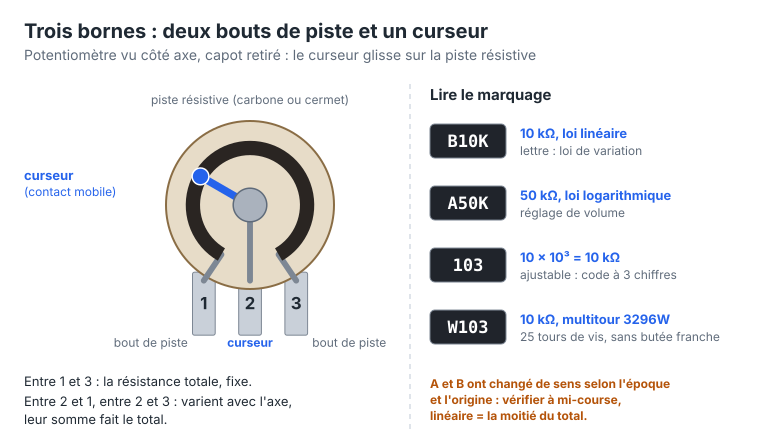
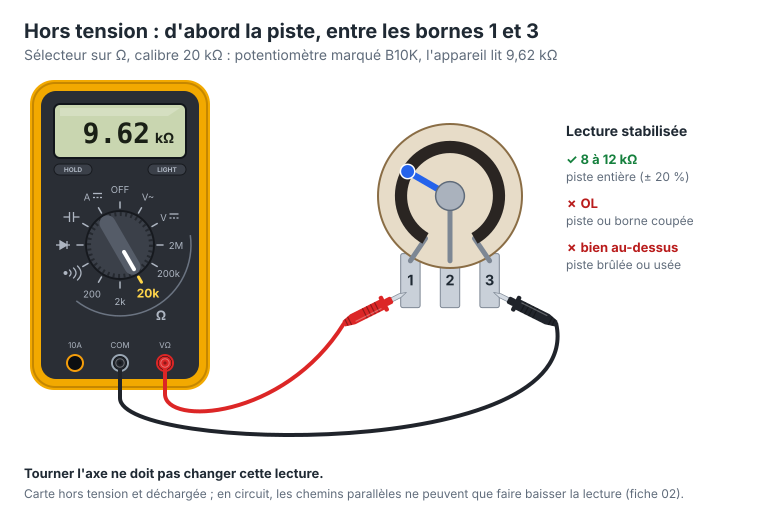
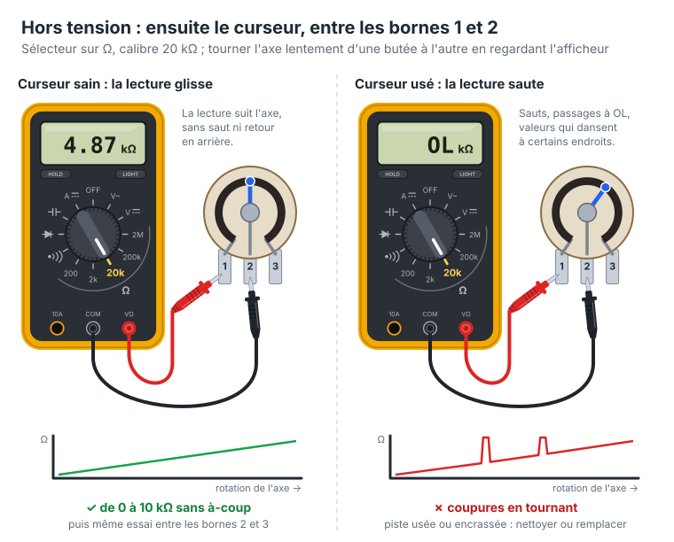
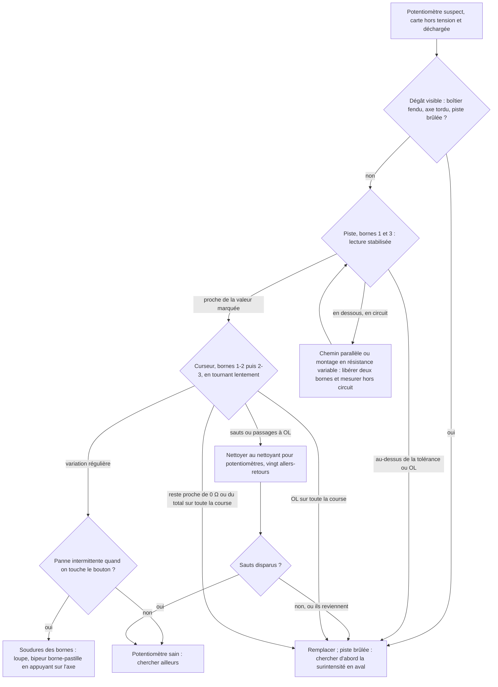

# 11 Potentiomètre

Savoir si un potentiomètre ou un ajustable est sain, encrassé, usé ou coupé, sans se laisser tromper par son câblage, et le remplacer sans dérégler la carte.

## En bref

Un potentiomètre est une résistance à trois bornes : une **piste** fixe entre les bornes extrêmes, et un **curseur** mobile qui frotte dessus. C'est ce contact frottant qui tombe en panne : il s'encrasse, s'oxyde ou use la piste, et la lecture **saute** quand on tourne l'axe (crachements d'un réglage de volume, réglage instable). La piste elle-même se comporte comme une résistance (fiche [10](../10_resistance/README.md)) : elle s'ouvre ou dérive vers le haut. Deux mesures à l'ohmmètre, hors tension, tranchent : la piste entre les bornes extrêmes, puis le curseur en tournant lentement l'axe.

> **Sécurité** : mesures hors tension → carte débranchée, piles retirées, condensateurs déchargés et vérifiés au voltmètre ; mesures sous tension → alimentation limitée en courant, 50 V continu (25 V alternatif) au plus partout sur la carte (fiche [00](../00_securite/README.md)). Tourner un ajustable sous tension se fait avec un tournevis isolé, et seulement après avoir repéré sa position : un réglage de tension de sortie ou de limitation de courant déplacé au hasard peut détruire ce que la carte alimente.

## Identifier le composant

| Type | Aspect | Où on le trouve |
| --- | --- | --- |
| Potentiomètre rotatif de façade | boîtier rond ou carré, axe à bouton, 3 bornes (6 pour un modèle double, stéréo) | volume, tonalité, consigne réglée par l'utilisateur |
| Potentiomètre à glissière | boîtier long, curseur à tirette | tables de mixage, égaliseurs |
| Ajustable monotour | petit boîtier ouvert ou capoté, fente de tournevis, environ trois quarts de tour | réglages d'usine : tension de sortie, seuil, contraste |
| Ajustable multitour | boîtier rectangulaire bleu, vis de réglage en laiton sur le dessus ou le côté, souvent 15 à 25 tours | réglages fins : référence de tension, étalonnage |
| Potentiomètre avec interrupteur | rotatif avec un clic en début de course et deux bornes de plus à l'arrière | marche-arrêt couplé au volume |

Un **codeur rotatif** ressemble à un potentiomètre de façade mais tourne sans butée, souvent avec des crans : ce n'est pas une résistance et cette fiche ne s'applique pas.

### Bornes et marquage

- **Les trois bornes** : la piste entre les bornes 1 et 3, le curseur sur la borne 2, presque toujours celle du milieu. Dans le doute, la mesure le dit : la paire de bornes dont la lecture **ne change pas** quand on tourne l'axe est la piste ; la troisième borne est le curseur.
- **La valeur** est celle de la piste entière, en clair (10K) ou en code à 3 chiffres comme une résistance CMS (103 = 10 kΩ, 502 = 5 kΩ, 104 = 100 kΩ).
- **La lettre** désigne la loi de variation, et elle n'est pas normalisée : sur les pièces asiatiques et américaines, B = linéaire et A = logarithmique (volume) ; sur les pièces européennes, A = linéaire et le logarithmique porte B ou C. Trancher par la mesure : curseur à mi-course, un modèle linéaire lit à peu près la moitié de la valeur totale entre le curseur et chaque bout ; un modèle logarithmique en est très loin (souvent autour de 10 % d'un côté).
- **Ajustable multitour** : la vis fait de nombreux tours d'un bout à l'autre de la piste (25 sur un Bourns 3296), et le curseur **débraye** en fin de course au lieu de buter. On ne sent donc pas la fin de course : seule la mesure dit où est le curseur.

### Les deux montages

- **Diviseur de tension** : les bornes 1 et 3 entre deux tensions, le curseur prélève une tension intermédiaire (volume, consigne, contraste). Le curseur ne débite presque rien.
- **Résistance variable** (rhéostat) : le curseur et un seul bout de piste sont utilisés ; l'autre bout est le plus souvent **relié au curseur** sur la carte. Tout le courant traverse le contact du curseur : c'est le montage qui brûle une piste.

Repérer le montage avant de mesurer en circuit : en résistance variable, la lecture entre les bornes 1 et 3 change avec l'axe, et c'est normal.

## Modes de défaillance

Classés du plus fréquent au plus rare (consensus des réparateurs, voir Sources ; aucune statistique publiée).

| Mode de défaillance | Fréquence | Cause typique | Ce que la panne implique ailleurs |
| --- | --- | --- | --- |
| Contact du curseur encrassé ou oxydé : la lecture saute | très fréquent | poussière, graisse durcie, oxydation ; potentiomètre resté des années sans bouger | rien ailleurs en général ; nettoyer suffit souvent |
| Piste usée par endroits | fréquent sur un réglage manipulé tous les jours | frottement du curseur : la zone la plus utilisée (bas du volume) s'use en premier | le nettoyage ne tient pas : remplacer |
| Soudures ou bornes fissurées | fréquent sur les potentiomètres de façade soudés sur la carte | efforts sur l'axe : chocs sur le bouton, écrou de façade absent ou desserré | panne intermittente quand on touche le bouton ; contrôler les soudures des connecteurs voisins |
| Piste brûlée près d'un bout | occasionnel | montage en résistance variable : courant excessif dans le curseur quand il arrive en bout de piste | le circuit en aval a demandé trop de courant : chercher pourquoi avant de remplacer |
| Ajustable déréglé ou instable | occasionnel | vibrations, vernis de blocage cassé, réglage retouché ; un ajustable n'est prévu que pour quelques centaines de manœuvres | tension de sortie, seuil ou courant de repos faux : tout ce qui dépend de ce réglage |
| Piste ou borne ouverte | rare | choc mécanique, rivet de borne desserti, corrosion | en diviseur, la tension du curseur se colle à l'un des bouts |
| Curseur qui ne touche plus | rare | ressort du curseur fatigué, axe forcé | circuit ouvert sur la borne 2 quelle que soit la position |

## Niveau 1 — Inspection par les sens

- **Vue** : boîtier fendu, axe tordu ou qui a du jeu, écrou de façade manquant, bornes qui bougent dans le boîtier ; trace brune sur la piste d'un ajustable ouvert ; vernis de blocage cassé sur la vis d'un ajustable (quelqu'un y a touché) ; liquide séché (boisson renversée sur une façade).
- **Toucher**, hors tension : la rotation doit être régulière, sans point dur ni zone sans frottement. Un axe qui tourne « dans le vide » ou qui accroche désigne la mécanique.
- **Ouïe**, sur un appareil audio en marche : crachements dans le haut-parleur **pendant** qu'on tourne le bouton, son qui disparaît à certains endroits de la course. C'est le symptôme le plus sûr d'un curseur encrassé ou d'une piste usée.
- **Appuyer latéralement sur l'axe** avec un doigt, appareil en marche : si le défaut apparaît ou disparaît, soupçonner les soudures des bornes avant le potentiomètre.

## Niveau 2 — Mesure hors circuit

Potentiomètre dessoudé, ou au moins deux de ses trois bornes libérées. Mêmes précautions que pour une résistance (fiche [10](../10_resistance/README.md), niveau 2) : cordons à retrancher sous 10 Ω, une seule pointe dans les doigts dès quelques dizaines de kΩ.

### 1. La piste, entre les bornes 1 et 3

Sélecteur sur **Ω**, calibre immédiatement supérieur à la valeur marquée, une pointe sur chaque borne extrême.

| Lecture | Verdict |
| --- | --- |
| Valeur marquée, à la tolérance près | piste entière |
| Au-dessus de la tolérance | piste brûlée ou usée |
| OL | piste ou borne coupée |
| Qui change quand on tourne l'axe | on ne mesure pas la piste : revoir le repérage des bornes |

La tolérance d'un potentiomètre est large : ± 20 % pour un modèle de façade au carbone, ± 10 % pour un ajustable multitour au cermet. Un 10 kΩ de façade qui lit 8,5 kΩ est sain.

### 2. Le curseur, entre les bornes 1 et 2 puis 2 et 3

1. Une pointe sur la borne 1, l'autre sur la borne 2. Des pinces libèrent les mains.
2. Tourner l'axe **lentement** d'une butée à l'autre en regardant l'afficheur.
3. Recommencer entre les bornes 2 et 3.

| Lecture pendant la rotation | Verdict |
| --- | --- |
| Monte ou descend régulièrement, sans retour en arrière | curseur sain |
| Sauts, passages à OL, valeurs qui dansent à certains endroits | contact encrassé ou piste usée : nettoyer, puis refaire l'essai |
| OL sur toute la course, piste bonne | curseur coupé : remplacer |
| Reste proche de 0 Ω ou du total sur toute la course | curseur qui ne suit plus l'axe (mécanique cassée) |

- **En butée**, la lecture ne tombe pas à 0 Ω : il reste une résistance de fin de course, de quelques ohms à quelques dizaines d'ohms selon le modèle. Ce n'est pas un défaut.
- **Contrôle de cohérence** : à n'importe quelle position, la lecture entre 1 et 2 plus la lecture entre 2 et 3 doit redonner la valeur de la piste, à la résistance de contact du curseur près.
- **Le multimètre numérique rafraîchit son afficheur deux à quatre fois par seconde** : tourner vite masque les coupures brèves. Tourner lentement, et insister sur la zone où le défaut se manifeste à l'usage.
- **Modèle double (stéréo)** : mesurer les deux pistes à la même position ; elles doivent donner des lectures voisines.
- **Interrupteur couplé** : bipeur entre ses deux bornes ; il doit sonner après le clic, et se taire avant.

### Nettoyer un contact encrassé

1. Hors tension. Pulvériser brièvement un **nettoyant pour potentiomètres** (nettoyant contact lubrifiant) par l'ouverture du boîtier, côté bornes.
2. Tourner l'axe d'une butée à l'autre une vingtaine de fois.
3. Laisser sécher, puis refaire la mesure du curseur.

- Éviter les dégrippants et les solvants qui dégraissent : la piste et l'axe ont besoin de leur lubrifiant, et certains solvants attaquent les pistes au carbone anciennes.
- Si les sauts reviennent au même endroit après nettoyage, la piste est usée : remplacer.
- Un ajustable étanche ne se nettoie pas : le remplacer.

## Niveau 3 — Mesure en circuit

### Hors tension

La règle de la fiche [02](../02_pieges_en_circuit/README.md) s'applique : les chemins parallèles ne peuvent que **faire baisser** une lecture d'ohmmètre.

| Lecture stabilisée, carte hors tension | Verdict |
| --- | --- |
| Piste (bornes 1–3) au-dessus de la valeur marquée plus la tolérance | piste coupée ou brûlée |
| Piste proche de la valeur marquée | probablement saine |
| Piste en dessous | rien de prouvé : chemin parallèle, ou montage en résistance variable (curseur relié à un bout) |
| Curseur (bornes 1–2) : sauts ou OL en tournant l'axe | contact défectueux : un chemin parallèle ne crée pas de coupures |
| Curseur : variation régulière, mais course réduite | probablement sain, la carte est en parallèle |

Le test du curseur reste donc utilisable en circuit : on ne juge pas la valeur, on cherche les **coupures**.

### Sous tension : la tension du curseur

En montage diviseur, carte sur alimentation limitée en courant, sélecteur sur **V continu**, pointe noire à la masse :

1. Mesurer la tension sur la borne 1, puis sur la borne 3 : ce sont les deux limites.
2. Pointe rouge sur la borne 2. Tourner l'axe lentement d'une butée à l'autre.

| Tension du curseur | Ce qu'elle dit |
| --- | --- |
| Varie régulièrement d'une limite à l'autre | potentiomètre sain : chercher en aval |
| Saute ou décroche à certains endroits | contact du curseur |
| Reste collée à la tension d'un bout, quelle que soit la position | l'autre bout de la piste est ouvert (borne, soudure ou piste), ou le curseur est décollé de la piste ou resté en butée : test du curseur hors tension |
| Reste fixe entre les deux limites, quelle que soit la position | curseur qui ne suit plus l'axe, ou décollé de la piste (la lecture suit alors le circuit en aval) : test du curseur hors tension |
| Aucune tension sur les bornes 1 et 3 | le potentiomètre n'est pas alimenté : chercher en amont |

Sur un **ajustable**, ne pas tourner pour « voir » : mesurer d'abord la grandeur qu'il règle (tension de sortie, courant de repos) et la comparer à la valeur attendue. Si un réglage est nécessaire, repérer la position de départ (trait de feutre sur un monotour, nombre de tours compté sur un multitour) et procéder par petites retouches en surveillant la mesure.

### Du symptôme au potentiomètre suspect

| Symptôme | À contrôler en premier | Pourquoi |
| --- | --- | --- |
| Crachements en tournant le volume | curseur du potentiomètre de volume | contact encrassé ou piste usée |
| Un canal muet ou plus faible à certaines positions | piste correspondante du potentiomètre double | piste usée ; comparer avec l'autre canal |
| Réglage qui « saute » d'une valeur à l'autre | curseur | coupures de contact |
| Tension de sortie instable, sensible aux chocs | ajustable de réglage, ses soudures | contact du curseur ou soudure fissurée |
| Réglage sans effet sur une moitié de la course | piste | piste ouverte ou brûlée à cet endroit |
| Défaut qui apparaît en appuyant sur le bouton | soudures des bornes | efforts mécaniques sur l'axe |

## Niveau 4 — Méthodes avancées

- **Oscilloscope sur le curseur** : potentiomètre en diviseur entre une tension continue et la masse (quelques volts d'une alimentation limitée), sonde sur le curseur, base de temps lente. Tourner l'axe : la trace doit être une rampe lisse. Les coupures brèves, invisibles au multimètre, apparaissent comme des pointes (page [i2](../i2_oscilloscope/README.md)).
- **Multimètre à aiguille ou bargraphe** : l'aiguille et le bargraphe d'un multimètre numérique suivent les variations rapides mieux que les chiffres.
- **Variation de résistance de contact** : la fiche technique d'un ajustable borne les sauts de résistance du curseur pendant la rotation (de l'ordre de 1 à 3 % de la valeur totale, ou 3 Ω). Un ajustable au cermet traversé par un courant très faible, quelques dizaines de microampères, montre davantage ce bruit de contact : c'est une limite du composant, pas une panne.
- **Mesure de la loi de variation** : relever la résistance entre curseur et bout de piste tous les quarts de course et comparer à la courbe de la fiche technique, pour identifier un modèle sans marquage avant de commander son remplaçant.

## Arbre de décision

## Remplacer le composant

| Critère | Règle |
| --- | --- |
| Valeur | identique |
| Loi de variation | identique : un linéaire à la place d'un logarithmique rend un volume inutilisable (tout se joue sur le début de la course). Vérifier par la mesure à mi-course, pas par la lettre |
| Puissance | identique ou supérieure. Un potentiomètre de façade de 9 mm ne dissipe que quelques dizaines de milliwatts ; un ajustable multitour, 0,5 W |
| Technologie | carbone pour un réglage manipulé souvent (des milliers de manœuvres), cermet pour un ajustable (quelques centaines) ; ne pas monter un ajustable là où l'utilisateur tourne tous les jours |
| Mécanique | diamètre, longueur et forme de l'axe, filetage, entraxe et disposition des bornes, ergot anti-rotation ; pour un ajustable : même empreinte, vis au même endroit (dessus ou côté), même nombre de tours |
| Brochage | vérifier quelle borne est le curseur sur la pièce neuve : il n'est pas toujours au milieu sur les ajustables |
| Interrupteur, modèle double | identiques |

**Pour remplacer un ajustable**, le dessouder **sans toucher à sa vis**, puis mesurer hors circuit la résistance entre son curseur et chaque bout (en circuit, ces valeurs sont faussées par les chemins parallèles, fiche [02](../02_pieges_en_circuit/README.md)), la noter, et régler la pièce neuve sur ces valeurs **avant** de la souder. Si l'ancien est trop abîmé pour être mesuré, partir de la position qui donne la plus faible grandeur réglée (tension de sortie la plus basse, d'après le schéma), charge débranchée si possible : la mi-course peut démarrer un régulateur au-dessus de sa consigne, et la limite de courant ne protège pas d'une surtension. Après remontage, reprendre le réglage sous tension, sur alimentation limitée, en suivant la grandeur réglée, puis bloquer la vis d'une goutte de vernis.

Avant de remettre sous tension un appareil dont le potentiomètre avait une piste brûlée : la cause de la surintensité est trouvée et réparée.

## Aide-mémoire d'établi

- Trois bornes : piste entre 1 et 3, curseur sur 2. La paire dont la lecture ne bouge pas avec l'axe est la piste.
- La panne courante est le contact du curseur, pas la piste.
- Mesure 1 : piste, à ± 10 ou 20 % de la valeur marquée. Au-dessus ou OL : remplacer.
- Mesure 2 : curseur, en tournant **lentement**. On cherche les sauts et les OL, pas une valeur.
- En circuit, les chemins parallèles ne créent pas de coupures : le test du curseur reste valable.
- Sous tension, en diviseur : la tension du curseur doit glisser d'une limite à l'autre.
- Crachements : nettoyant pour potentiomètres, vingt allers-retours ; s'ils reviennent, piste usée.
- Ajustable : repérer la position, dessouder sans toucher la vis, mesurer hors circuit, prérégler le neuf.
- La lettre A ou B ne prouve pas la loi : mesurer à mi-course.
- Piste brûlée = symptôme : chercher la surintensité en aval.

## Mini-glossaire

- **Piste** : élément résistif fixe, en carbone, en cermet (céramique et métal) ou en plastique conducteur.
- **Curseur** : contact mobile qui frotte sur la piste.
- **Loi de variation** : relation entre la position de l'axe et la résistance ; linéaire, ou logarithmique pour suivre la sensibilité de l'oreille.
- **Ajustable** (*trimmer*) : potentiomètre de réglage au tournevis, prévu pour être réglé une fois.
- **Résistance de fin de course** : résistance qui reste entre le curseur et la borne quand l'axe est en butée.
- **Montage diviseur, montage en résistance variable** (rhéostat) : trois bornes utilisées, ou deux seulement.

## Sources

Les faits ci-dessous sont reformulés ; les fréquences de panne sont un classement qualitatif, pas une statistique.

- Bourns, *3296 – 3/8" Square Trimpot Trimming Potentiometer*, fiche technique : ajustable multitour au cermet, 25 tours, curseur qui débraye en fin de course, tolérance ± 10 %, 0,5 W à 70 °C, endurance de 200 cycles, résistance minimale et variation de résistance de contact. <https://www.bourns.com/docs/product-datasheets/3296.pdf>
- Bourns, *3386 – 3/8" Square Trimpot Trimming Potentiometer*, fiche technique : ajustable monotour, tolérance ± 10 %, variation de résistance de contact de 2 % ou 3 Ω. <https://www.bourns.com/docs/product-datasheets/3386.pdf>
- Alps Alpine, *RK09L Series* (copie hébergée par un distributeur) : potentiomètre de façade au carbone, tolérance ± 20 %, 0,05 W, endurance de 15 000 cycles, résistance résiduelle en fin de course, code de valeur à 3 chiffres. <https://tencell.com/product_images/Datasheets/RK09L%20Series%20Datasheet.pdf>
- Bourns, *Trimpot Trimming Potentiometers – Application notes* (copie hébergée par un distributeur) : le bruit de contact d'un ajustable au cermet se remarque surtout en résistance variable à très faible courant. <https://www.meditronik.com.pl/doc/bourns/app_trim.pdf>
- EEPower, *Potentiometer Taper* : lois de variation et lettres qui les désignent selon l'origine des pièces. <https://eepower.com/resistor-guide/resistor-types/potentiometer-taper/>
- Wikipédia (en anglais), *Potentiometer* : codes de loi non normalisés (A et B inversés entre conventions), définition du pourcentage d'une loi logarithmique à mi-course. <https://en.wikipedia.org/wiki/Potentiometer>
- Renesas, *General Digitally Controlled Potentiometers*, note d'application R14AN0002, § 3.2 : montage en résistance variable avec le curseur relié à un bout de piste. <https://www.renesas.com/sg/en/document/apn/r14an0002-general-digitally-controlled-potentiometers>
- Industrial Monitor Direct, *Troubleshooting Erratic Potentiometer Readings* : causes de lectures erratiques (curseur encrassé, piste usée ou brûlée par surcharge, ressort du curseur fatigué), méthode de contrôle à l'ohmmètre en tournant l'axe, somme des deux demi-lectures. <https://industrialmonitordirect.com/blogs/knowledgebase/troubleshooting-erratic-potentiometer-readings-in-industrial-applications>
- CAIG Laboratories, base de connaissances DeoxIT : certains solvants emportent une partie du carbone des pistes anciennes ; préférer un nettoyant lubrifiant sans solvant. <https://store.caig.com/s.nl/ctype.KB/it.I/id.1809/KB.215/.f>
- J. Szekeres (université de Pittsburgh), *Contact cleaners* : un dégrippant emporte les lubrifiants dont un potentiomètre a besoin. <https://sites.pitt.edu/~szekeres/cleaner.htm>
