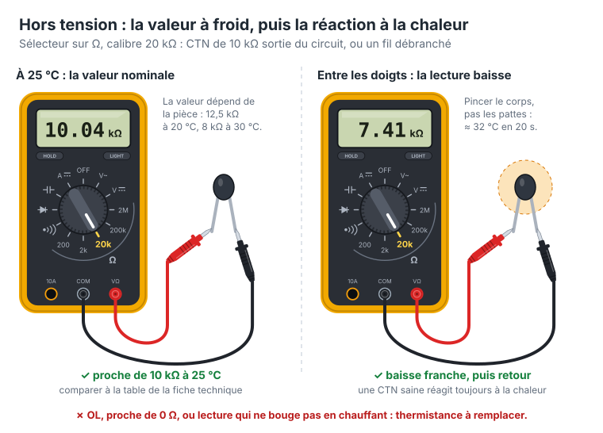
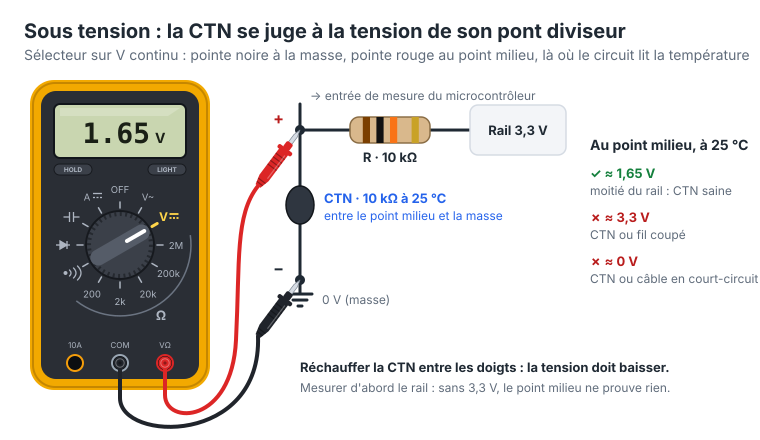
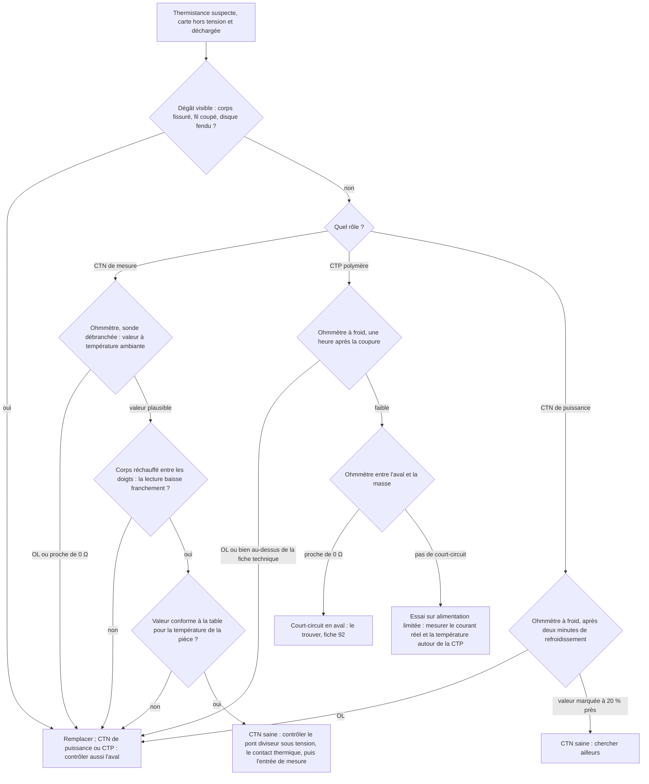

# 12 Thermistance CTN/CTP

Savoir si une thermistance réagit encore à la température comme elle le doit, qu'elle serve à mesurer, à limiter un courant d'appel ou à protéger un rail.

## En bref

Une thermistance est une résistance dont la valeur dépend fortement de la température. Celle d'une **CTN** (coefficient de température négatif) baisse quand elle chauffe ; celle d'une **CTP** (coefficient de température positif) monte, brutalement au-delà d'un seuil. On les rencontre dans trois rôles : **capteur de température** (CTN de mesure), **limiteur de courant d'appel** (CTN de puissance), **fusible réarmable** (CTP polymère). Une thermistance ne se juge donc pas sur une seule lecture : on mesure sa valeur à température ambiante, **puis on la chauffe** et on vérifie que la lecture part dans le bon sens.

> **Sécurité** : mesures hors tension → carte débranchée, piles retirées, condensateurs déchargés et vérifiés au voltmètre ; mesures sous tension → alimentation limitée en courant, 50 V continu (25 V alternatif) au plus partout sur la carte (fiche [00](../00_securite/README.md)). Une CTN de puissance en service et une CTP qui a basculé sont **brûlantes** : ne pas les toucher sous tension ni juste après la coupure. La CTN d'un pack de batteries au lithium est une sécurité : ne jamais la remplacer par une résistance fixe pour « faire charger » le pack. Les CTN et CTP placées du côté secteur d'une alimentation sont hors du périmètre de ces fiches.

## Identifier le composant

| Type | Aspect | Où on la trouve | Valeur à 25 °C |
| --- | --- | --- | --- |
| CTN de mesure | perle d'époxy ou de verre sur deux fils fins, boîtier CMS sans marquage, ou sonde au bout d'un câble | contre un radiateur, une batterie, une tête d'imprimante 3D, dans un pack de batteries (troisième contact) | souvent 10 kΩ ; de quelques ohms à quelques centaines de kΩ |
| CTN de puissance | disque noir ou vert de 5 à 20 mm, pattes épaisses | en série avec l'entrée d'une alimentation, avant les gros condensateurs | de 1 à quelques dizaines d'ohms |
| CTP polymère (fusible réarmable) | pastille jaune ou orangée à pattes, ou boîtier CMS ; repère F ou PTC sur la carte | entrée USB, sortie d'alimentation, pack de batteries | d'une fraction d'ohm à quelques ohms |
| CTP céramique | disque ou pastille, parfois dans un boîtier plastique | démagnétisation des anciens téléviseurs, éléments chauffants autorégulés, protection de surintensité | selon l'usage |

- **Marquage** : une CTN de mesure porte rarement plus qu'un code à 3 chiffres (103 = 10 kΩ à 25 °C), souvent rien. Une CTN de puissance porte sa résistance à 25 °C et le diamètre du disque (marquage courant du type 5D-11 : 5 Ω, disque de 11 mm). Une CTP polymère porte un code du fabricant lié à son courant de maintien.
- **Sur la carte**, une CMS sans marquage reliée à une entrée de mesure et à une résistance fixe de valeur ronde est probablement une CTN : le repère de sérigraphie (RT, TH, NTC) et le schéma tranchent.
- **Deux grandeurs** définissent une CTN de mesure : sa résistance à 25 °C (R25) et son coefficient **B**, en kelvins, qui fixe la pente de la courbe. Deux CTN de 10 kΩ de B différents donnent la même lecture à 25 °C et des lectures différentes ailleurs.

### Valeurs repères d'une CTN de 10 kΩ

Valeurs calculées pour B ≈ 3950 K, arrondies ; la table de la fiche technique de la pièce fait foi, surtout loin de 25 °C.

| Température | Résistance |
| --- | --- |
| 0 °C | ≈ 33 kΩ |
| 20 °C | ≈ 12,5 kΩ |
| 25 °C | 10 kΩ |
| 30 °C | ≈ 8 kΩ |
| 37 °C | ≈ 6 kΩ |
| 50 °C | ≈ 3,6 kΩ |
| 100 °C | ≈ 0,7 kΩ |

Règle pratique : autour de 25 °C, une CTN perd environ **4 % de sa valeur par degré**. Un écart de 20 % entre la lecture et la valeur nominale peut donc n'être que 5 °C d'écart sur la température de la pièce.

## Modes de défaillance

Classés du plus fréquent au plus rare (classement qualitatif d'après les sources citées ; aucune statistique publiée n'a été vérifiée).

| Mode de défaillance | Fréquence | Cause typique | Ce que la panne implique ailleurs |
| --- | --- | --- | --- |
| CTN de mesure ouverte | fréquent | fil de sonde coupé ou arraché, patte cassée, corps fissuré par une contrainte mécanique, connecteur débranché | le circuit lit une température extrême, le plus souvent très basse, et se met en défaut ou refuse de démarrer |
| CTP polymère qui a basculé | fréquent | elle a joué son rôle : court-circuit ou surcharge en aval | **le défaut est en aval** : le chercher ; la CTP se réarme seule une fois refroidie |
| CTN de puissance fissurée ou ouverte | occasionnel | surcharge, allumages répétés à chaud, choc | appareil totalement mort ; contrôler ce qui suit (pont redresseur, condensateurs, transistor de découpage) |
| CTN de mesure qui a dérivé | occasionnel | vieillissement à chaud, humidité sous l'enrobage, surchauffe au soudage ; la résistance dérive le plus souvent vers le haut | température lue fausse de quelques degrés : régulation décalée, sécurité qui déclenche trop tôt ou trop tard, sans message d'erreur |
| CTN de mesure en court-circuit ou très basse | rare | humidité ou corrosion dans la sonde, câble écrasé, surchauffe | le circuit lit une température très haute : arrêt de sécurité, ventilateur à fond |
| CTP polymère fatiguée | occasionnel | basculements répétés ou prolongés : la résistance à froid reste plus élevée qu'à l'état neuf | chute de tension sur le rail, déclenchements pour un courant normal |
| Mauvais contact thermique | occasionnel | CTN décollée de la pièce qu'elle surveille, pâte thermique absente | la CTN est saine mais mesure l'air : réaction lente, surchauffe non détectée |

## Niveau 1 — Inspection par les sens

- **Vue** : perle fissurée ou éclatée, fils de sonde coupés, pincés ou dessoudés, connecteur de sonde débranché ; disque de CTN de puissance fendu, écaillé ou noirci ; CTP polymère gonflée, brunie ou décollée ; CTN qui ne touche plus la pièce qu'elle surveille.
- **Toucher**, hors tension et après refroidissement : fils de sonde qui bougent dans la perle, CTN CMS fissurée qui se décolle.
- **Chaleur**, sans toucher : une CTP polymère brûlante sur une carte alimentée signale qu'elle a basculé, donc un courant excessif en aval. Une CTN de puissance chaude en fonctionnement est normale : c'est en chauffant qu'elle laisse passer le courant.
- **Indices de l'appareil** : message d'erreur de température, température affichée absurde (−40 °C, 150 °C), ventilateur à fond dès le démarrage, chargeur qui refuse de charger. Ils désignent le circuit de mesure avant tout autre.

## Niveau 2 — Mesure hors circuit

### CTN de mesure : à froid, puis au chaud

1. Thermistance sortie du circuit, ou un de ses fils débranché (une sonde se débranche à son connecteur).
2. Sélecteur sur **Ω**, calibre immédiatement supérieur à la valeur nominale. Tenir les pointes par des pinces : une CTN de 10 kΩ est assez élevée pour que les doigts faussent la lecture (fiche [10](../10_resistance/README.md), niveau 2).
3. Lire la valeur à température ambiante et la comparer au tableau ci-dessus ou à la fiche technique, **pour la température de la pièce**.
4. Pincer le **corps** entre deux doigts, sans toucher les pattes : la lecture doit baisser franchement en quelques secondes, puis remonter quand on relâche.

| Lecture | Verdict |
| --- | --- |
| Valeur attendue pour la température de la pièce, baisse franche en chauffant | CTN saine |
| OL | CTN ou fil coupé |
| Proche de 0 Ω | CTN ou câble en court-circuit |
| Valeur plausible mais qui ne bouge pas en chauffant | ce n'est pas une CTN, ou elle est détruite |
| Valeur éloignée de la table de plus que la tolérance, à température connue | dérive : remplacer |
| Lecture qui saute quand on bouge les fils | fil cassé dans la gaine ou soudure fissurée |

- La tolérance d'une CTN de mesure est de l'ordre de ± 1 à ± 5 % à 25 °C. Faute de thermomètre de référence, on ne peut pas juger une dérive de quelques pour cent : le test de la chaleur prouve seulement que la CTN vit.
- Pour chauffer davantage : air chaud tenu à distance, jamais la flamme ni la panne du fer sur le corps.
- Le courant de mesure de l'ohmmètre est assez faible pour ne pas échauffer la CTN.

### CTN de puissance

Sélecteur sur Ω, plus petit calibre, résistance des cordons retranchée (fiche [01](../01_multimetre/README.md)).

| Lecture à froid | Verdict |
| --- | --- |
| Valeur marquée, à ± 20 % près, qui baisse en la réchauffant | saine |
| OL | ouverte (disque fissuré) : remplacer |
| Bien en dessous de la valeur marquée alors qu'elle est froide | attendre : elle met une à deux minutes à refroidir après la coupure ; si la lecture reste basse, remplacer |

### CTP polymère (fusible réarmable)

Sélecteur sur Ω, plus petit calibre, ou bipeur.

| Lecture à froid | Verdict |
| --- | --- |
| D'une fraction d'ohm à quelques ohms, dans la plage de la fiche technique | saine |
| OL | détruite : remplacer |
| Nettement au-dessus de la plage de la fiche technique, une heure après la coupure | fatiguée : remplacer |

Après un basculement, la résistance d'une CTP polymère ne revient pas tout de suite à sa valeur d'origine : les fabricants la spécifient **une heure après** le déclenchement. Ne pas condamner une CTP mesurée tiède. Les petits calibres pour tensions élevées lisent normalement plusieurs dizaines d'ohms : la fiche technique tranche.

## Niveau 3 — Mesure en circuit

### Hors tension

La règle de la fiche [02](../02_pieges_en_circuit/README.md) s'applique : les chemins parallèles ne peuvent que **faire baisser** une lecture d'ohmmètre.

| Lecture stabilisée, carte hors tension | Verdict |
| --- | --- |
| Au-dessus de la valeur attendue à cette température, ou OL | thermistance ouverte ou dérivée vers le haut |
| Proche de la valeur attendue, et qui baisse en chauffant la CTN | probablement saine |
| En dessous de la valeur attendue | rien de prouvé : débrancher la sonde ou lever une patte |
| CTP polymère ou CTN de puissance : proche de 0 Ω | saine ; OL : ouverte |

Une sonde au bout d'un câble se mesure sans rien dessouder : débrancher son connecteur et mesurer côté sonde.

### Sous tension : la tension du pont diviseur

Une CTN de mesure est presque toujours montée en **pont diviseur** avec une résistance fixe ; le point milieu part vers l'entrée de mesure d'un microcontrôleur ou d'un comparateur. Carte sur alimentation limitée en courant, sélecteur sur **V continu**, pointe noire à la masse :

1. Mesurer le rail qui alimente le pont : sans lui, le point milieu ne prouve rien.
2. Pointe rouge au point milieu.

Montage de la figure (résistance fixe vers le rail, CTN vers la masse, les deux de 10 kΩ, rail de 3,3 V) :

| Tension au point milieu | Ce qu'elle dit |
| --- | --- |
| Environ la moitié du rail (1,65 V) à 25 °C | CTN saine ; elle doit baisser quand on réchauffe la CTN |
| Égale au rail (3,3 V) | CTN, fil ou connecteur ouvert |
| Proche de 0 V | CTN ou câble en court-circuit, ou résistance fixe ouverte |
| Fixe, quelle que soit la température de la CTN | CTN détruite, ou mauvais point de mesure |

Repères pour ce montage : ≈ 2,5 V à 0 °C, ≈ 1,8 V à 20 °C, 1,65 V à 25 °C, ≈ 1,2 V à 37 °C, ≈ 0,9 V à 50 °C.

- **Montage inverse** (CTN vers le rail, résistance fixe vers la masse) : tout s'inverse. La tension monte quand la CTN chauffe, une CTN ouverte donne 0 V et une CTN en court-circuit donne la tension du rail.
- **Tension juste mais température affichée fausse** : le défaut est après le point milieu (entrée de mesure, logiciel), pas dans la CTN.
- **Pack de batteries** : la CTN est entre le contact de température (souvent repéré T) et le négatif du pack. Elle se mesure à l'ohmmètre, pack débranché du chargeur.

### Sous tension : CTP polymère et CTN de puissance

Sélecteur sur V continu, une pointe de chaque côté du composant, carte en fonctionnement :

| Composant | Lecture aux bornes | Ce qu'elle dit |
| --- | --- | --- |
| CTP polymère | quelques millivolts à quelques dixièmes de volt | elle conduit : chercher ailleurs |
| CTP polymère | presque toute la tension du rail, composant brûlant | elle a basculé : court-circuit ou surcharge en aval |
| CTN de puissance | une fraction de volt après quelques secondes | elle a chauffé et conduit : normal |
| CTN de puissance | toute la tension d'entrée, rien en aval | ouverte |

Une CTP qui a basculé reste dans cet état tant que la tension est présente : un faible courant la maintient chaude. **Couper l'alimentation**, chercher le défaut en aval (ohmmètre entre l'aval et la masse, fiche [13](../13_fusible/README.md), puis fiche 92), laisser refroidir, puis remettre sous tension avec une limite de courant réglée juste au-dessus de la consommation attendue.

### Du symptôme à la thermistance suspecte

| Symptôme | À contrôler en premier | Pourquoi |
| --- | --- | --- |
| Erreur de température, température affichée absurde | CTN de mesure, son câble, son connecteur | ouverte ou en court-circuit |
| Chargeur qui refuse de charger un pack | CTN du pack (contact T), résistance fixe du pont | le chargeur lit une température hors plage |
| Ventilateur à fond en permanence, ou jamais | CTN de mesure et son contact thermique | lecture fausse ou CTN décollée |
| Régulation de température décalée de quelques degrés | dérive de la CTN, mauvaise pièce de rechange (B différent) | courbe fausse sans défaut franc |
| Port USB ou sortie sans tension, composant brûlant à l'entrée | CTP polymère, puis ce qu'elle alimente | elle a basculé sur un défaut en aval |
| Rail qui s'effondre dès que la charge augmente | CTP polymère fatiguée, ou placée près d'une source de chaleur | son courant de maintien baisse quand elle est chaude |
| Appareil totalement mort, pas de court-circuit | CTN de puissance à l'entrée | disque fissuré, circuit ouvert |
| Fusible d'entrée qui fond à l'allumage, surtout après une coupure brève | CTN de puissance | rallumée chaude, elle ne limite plus le courant d'appel |

## Niveau 4 — Méthodes avancées

- **Point de référence à 0 °C** : CTN dans un sachet étanche, plongée dans un mélange d'eau et de glace pilée bien remué. La lecture se compare à la valeur à 0 °C de la fiche technique (de l'ordre de 33 kΩ pour une CTN de 10 kΩ). Avec la lecture à température ambiante mesurée par un thermomètre, on a deux points.
- **Retrouver le coefficient B d'une CTN inconnue** à partir de deux points (températures en kelvins) : B = ln(R1 / R2) / (1/T1 − 1/T2). C'est le moyen d'identifier une CTN sans marquage, encore en état, avant de commander sa remplaçante.
- **Auto-échauffement** : une CTN parcourue par un courant s'échauffe et lit plus chaud que la réalité. La fiche technique donne un facteur de dissipation en milliwatts par degré (quelques mW/°C pour une perle à pattes, dans l'air calme). Un pont diviseur dont la résistance fixe a été remplacée par une valeur beaucoup plus faible fausse la mesure de cette manière.
- **Résistance fixe à la place de la CTN** : pour savoir si le reste de la chaîne de mesure fonctionne, brancher provisoirement une résistance fixe égale à R25 ; l'appareil doit afficher environ 25 °C. Essai bref, sous surveillance, **jamais** sur un pack de batteries en charge ni sur un élément chauffant en service : la protection thermique est alors neutralisée.
- **Caméra thermique** : une CTP polymère qui a basculé et le composant en court-circuit qu'elle alimente ressortent immédiatement (fiche 03).
- **Courant de maintien selon la température** : une CTP polymère prévue pour 0,25 A à 23 °C ne tient plus qu'une fraction de ce courant à 85 °C. Avant de la condamner, mesurer la température autour d'elle et le courant réel du rail.

## Arbre de décision

## Remplacer le composant

| Composant | Règle |
| --- | --- |
| CTN de mesure | même résistance à 25 °C **et même coefficient B**, tolérances au moins aussi serrées. Une CTN de même R25 mais de B différent donne une température juste à 25 °C et fausse ailleurs |
| CTN de mesure, montage | même boîtier et même contact thermique : recoller, remettre la pâte thermique ou la vis d'origine. La longueur du câble d'une sonde de 10 kΩ ne change rien |
| CTN de puissance | même résistance à 25 °C, courant permanent maximal au moins égal, même diamètre de disque (il fixe l'énergie absorbée à l'allumage). Ne jamais en monter deux en parallèle pour « doubler » le courant, ni la remplacer par un fil |
| CTP polymère | même courant de maintien, tension maximale au moins égale à celle du circuit, courant de défaut maximal au moins égal. Le courant de déclenchement vaut environ deux fois le courant de maintien : un calibre plus fort ne protège plus |
| CTP polymère, interdits | jamais pontée par un fil, jamais remplacée par un fusible de calibre supérieur |
| CTP céramique | référence d'origine : sa courbe dépend de sa composition |
| Soudage | bref, pattes tenues par une pince : la chaleur excessive du fer fait dériver une CTN |

Avant de remettre sous tension : pour une CTP ou une CTN de puissance, le défaut en aval est trouvé et réparé ; pour une CTN de mesure, vérifier la température affichée à l'ambiante puis en réchauffant la sonde.

## Aide-mémoire d'établi

- CTN : la résistance baisse quand ça chauffe. CTP : elle monte, d'un coup.
- Deux gestes : valeur à l'ambiante, puis chauffer entre les doigts. La lecture doit bouger.
- CTN de 10 kΩ : 12,5 kΩ à 20 °C, 10 kΩ à 25 °C, 8 kΩ à 30 °C ; environ −4 % par degré.
- OL ou 0 Ω : remplacer. Lecture qui ne bouge pas en chauffant : remplacer.
- Sous tension : point milieu du pont à mi-rail à 25 °C (deux fois 10 kΩ) ; au rail ou à 0 V = CTN ouverte ou en court-circuit, selon le montage.
- Mesurer le rail du pont avant de juger le point milieu.
- CTP polymère brûlante = court-circuit en aval ; couper, chercher, laisser refroidir.
- CTP polymère : la juger à froid, une heure après la coupure.
- CTN de puissance chaude en marche : normal ; ouverte : appareil mort.
- Remplacement d'une CTN de mesure : même R25 et même B. Jamais de résistance fixe sur une batterie.

## Mini-glossaire

- **CTN, CTP** : thermistance à coefficient de température négatif, positif (en anglais NTC, PTC).
- **R25** : résistance à 25 °C, valeur nominale d'une thermistance.
- **Coefficient B** : constante, en kelvins, qui décrit la pente de la courbe d'une CTN entre deux températures (B25/85 : entre 25 et 85 °C).
- **Courant de maintien** : courant qu'une CTP polymère conduit indéfiniment sans basculer ; **courant de déclenchement** : courant à partir duquel elle bascule à coup sûr.
- **Limiteur de courant d'appel** : CTN de puissance en série avec une alimentation, résistante à froid pour freiner la charge des condensateurs, puis presque transparente une fois chaude.
- **Facteur de dissipation** : puissance qui élève la thermistance de 1 °C au-dessus de l'ambiante.

## Sources

Les faits ci-dessous sont reformulés ; les fréquences de panne sont un classement qualitatif, pas une statistique.

- Vishay, *NTCLE100E3 – NTC Thermistors, Radial Leaded*, document 29049 : gamme de R25, tolérances sur R25 et sur B, valeur de B et résistance à 0 °C d'une CTN de 10 kΩ, facteur de dissipation. <https://www.vishay.com/docs/29049/ntcle100.pdf>
- TDK Electronics (EPCOS), *NTC Inrush Current Limiters – General technical information* : sensibilité d'une CTN (quelques pour cent par kelvin), facteur de dissipation dans l'air calme, vieillissement irréversible qui augmente le plus souvent la résistance. <https://www.tdk-electronics.tdk.com/download/186018/d80caa7d75198765c2534bc19da9b73d/pdf-general-technical-information.pdf>
- TDK Electronics (EPCOS), *NTC Thermistors for Inrush Current Limiting*, note d'application : chute de la résistance à chaud, temps de refroidissement de 30 secondes à 2 minutes, critères de choix (R25, courant maximal, capacité commutée), rôle du diamètre, interdiction du montage en parallèle. <https://www.tdk-electronics.tdk.com/download/2982800/f5be4fca9d1f66204de9cf37891e5265/ntc-thermistors-icl-an.pdf>
- Vishay Ametherm, *SL12 – Inrush Current Limiters*, document 24504 : tolérance de ± 20 % sur R25, résistance résiduelle et température du corps au courant maximal. <https://www.vishay.com/docs/24504/sl12.pdf>
- Bourns, *MF-RM Series – PTC Resettable Fuses*, fiche technique (copie hébergée par un distributeur) : courants de maintien et de déclenchement, tension et courant maximaux, résistance initiale et résistance une heure après déclenchement, baisse du courant de maintien avec la température. <https://static.chipdip.ru/lib/417/DOC013417683.pdf>
- Analog Technologies, *Common Failures and Causes for NTC Thermistor* : coupures, dérives et courts-circuits d'une CTN et leurs causes (contraintes mécaniques, humidité, chaleur de reprise, surcharge). <https://www.analogtechnologies.com/white-paper/2015/1010/656.htm>
- Wikipédia (en anglais), *Resettable fuse* : maintien de l'état basculé par un faible courant, réarmement après coupure et refroidissement, résistance plus élevée après un déclenchement. <https://en.wikipedia.org/wiki/Resettable_fuse>
- Wikipédia (en anglais), *Thermistor* : loi à coefficient B et son domaine de validité, CTP céramique au titanate de baryum et ses usages. <https://en.wikipedia.org/wiki/Thermistor>
