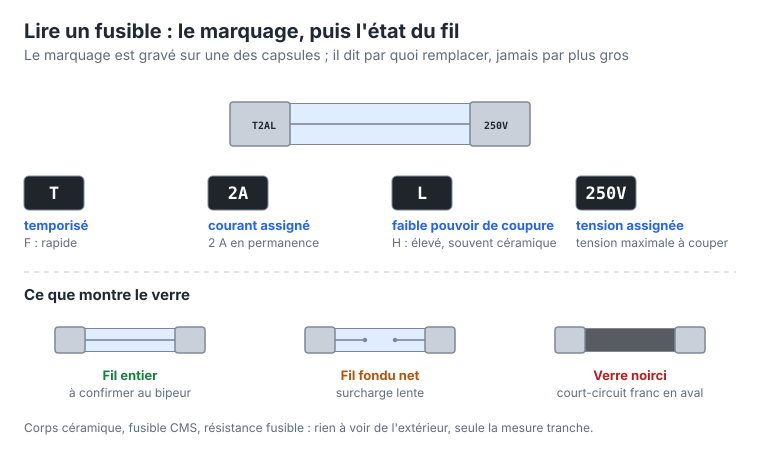
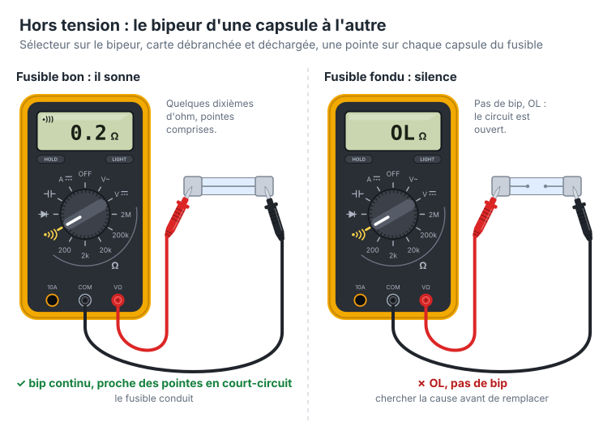
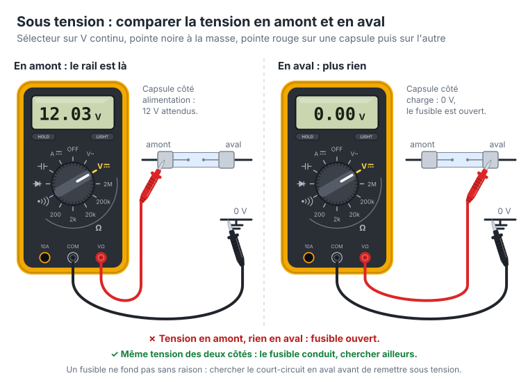
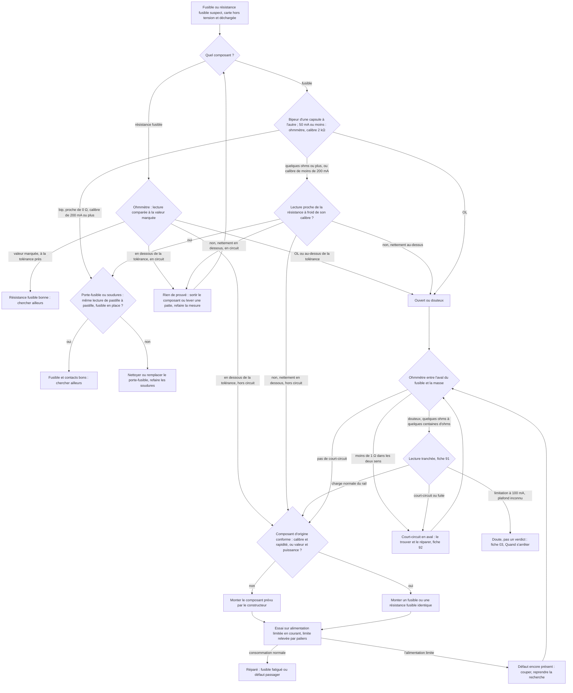

# 13 Résistance fusible et fusible

Savoir si un fusible ou une résistance fusible est ouvert, comprendre pourquoi, et le remplacer sans affaiblir la protection.

## En bref

Un fusible est le maillon volontairement faible d'un circuit : un fil calibré qui fond quand le courant dépasse ce que le circuit supporte. Il n'a que deux états, **il conduit ou il est ouvert**, et le bipeur tranche en quelques secondes (sauf pour les très petits calibres, qui se lisent à l'ohmmètre). La difficulté n'est pas la mesure : c'est la suite. Un fusible fondu est presque toujours la **conséquence** d'un défaut en aval (un composant en court-circuit, une surcharge) ; le remplacer sans chercher ce défaut fait fondre le suivant, ou pire. La résistance fusible joue le même rôle sous l'apparence d'une résistance ordinaire.

> **Sécurité** : mesures hors tension → carte débranchée, piles retirées, condensateurs déchargés et vérifiés au voltmètre ; mesures sous tension → alimentation limitée en courant, 50 V continu (25 V alternatif) au plus partout sur la carte (fiche [00](../00_securite/README.md)). **Ne jamais remplacer un fusible par un calibre supérieur, ni le ponter** avec un fil ou du papier d'aluminium : le maillon faible devient alors une piste, un composant ou le câble, et le défaut se termine en incendie. Le fusible d'entrée secteur d'un appareil est hors du périmètre de ces fiches : s'il a fondu, l'appareil se confie à un professionnel.

## Identifier le composant

| Type | Aspect | Où on le trouve |
| --- | --- | --- |
| Fusible cartouche en verre | tube de verre, deux capsules métalliques, fil visible ; le plus courant mesure 5 × 20 mm | porte-fusible ou clips sur la carte, entrée d'alimentation |
| Fusible cartouche céramique | même format, corps opaque blanc ou beige, souvent rempli de sable | là où le courant de court-circuit peut être élevé |
| Fusible à pattes radiales ou axiales | petit cylindre ou boîtier moulé soudé sur la carte | cartes compactes, entrées et sorties basse tension |
| Fusible CMS | boîtier de résistance CMS (1206, 0603), une lettre ou un chiffre pour marquage ; repère **F** sur la carte | entrée USB, rails d'une carte dense |
| Fusible automobile à lame | boîtier plastique coloré, deux lames, calibre en chiffres sur le dessus | véhicules, équipements 12 V et 24 V |
| Résistance fusible | ressemble à une résistance à couches, vernis gris ou mat ininflammable, faible valeur | en série à l'entrée d'un rail |
| Fusible thermique | petit cylindre métallique axial, marqué d'une température | collé contre un transformateur, une résistance chauffante, un moteur |
| Fusible réarmable (CTP polymère) | pastille jaune ou boîtier CMS | entrée USB, batteries : voir fiche [12](../12_thermistance/README.md) |

### Lire le marquage et l'état du fil

Le marquage est gravé sur une capsule. Exemple : **T2AL250V**.

| Élément | Signification |
| --- | --- |
| Lettre de rapidité | FF très rapide, F rapide, M semi-temporisé, T temporisé, TT très temporisé. Un fusible temporisé laisse passer une pointe de courant brève (mise sous tension, démarrage d'un moteur) sans fondre |
| Courant assigné | courant que le fusible conduit en permanence ; en mA ou en A |
| Pouvoir de coupure | L : faible (quelques dizaines d'ampères), fil visible dans un tube de verre ; H : élevé (1 500 A), élément caché, corps céramique ou verre rempli |
| Tension assignée | tension maximale que le fusible sait couper une fois fondu |

- **Fusible CMS** : le marquage est un code du fabricant (une lettre par calibre), à lire dans sa fiche technique ; à défaut, le schéma ou la valeur d'une carte identique.
- **Fusible à lame** : la couleur donne le calibre. Violet 3 A, beige 5 A, rouge 10 A, bleu 15 A, jaune 20 A ; tension assignée 32 V.
- **Résistance fusible** : même code de couleurs qu'une résistance (fiche [10](../10_resistance/README.md)), avec chez certains fabricants une bague supplémentaire. Le schéma ou la position (en série, tout de suite après le connecteur d'alimentation) la désigne plus sûrement que son aspect.

Ce que montre le verre renseigne sur la cause :

| Aspect | Ce qu'il indique |
| --- | --- |
| Fil entier | probablement bon, **à confirmer au bipeur** : un fil peut être rompu sous une capsule sans que rien ne se voie |
| Fil fondu net, verre clair | surcharge : un courant un peu trop fort pendant longtemps |
| Verre noirci ou métallisé | court-circuit franc : le fil s'est vaporisé |

Un corps céramique, un fusible CMS ou une résistance fusible ne montrent rien : seule la mesure tranche.

## Modes de défaillance

Classés du plus fréquent au plus rare (consensus des réparateurs, voir Sources ; aucune statistique publiée).

| Mode de défaillance | Fréquence | Cause typique | Ce que la panne implique ailleurs |
| --- | --- | --- | --- |
| Fondu sur un court-circuit en aval | très fréquent | semi-conducteur en court-circuit (diode, transistor, régulateur), condensateur en court-circuit, inversion de polarité | **le défaut est toujours là** : le trouver avant de remplacer |
| Fondu sur une surcharge | fréquent | charge trop forte, moteur bloqué, sortie en court-circuit momentané | supprimer la surcharge ; contrôler ce qui a chauffé |
| Résistance fusible ouverte | fréquent | elle a joué son rôle : surintensité en aval | même recherche que pour un fusible fondu |
| Fondu à la mise sous tension | occasionnel | fusible rapide monté à la place d'un temporisé, ou calibre trop juste pour l'appel de courant des condensateurs | vérifier le type et le calibre d'origine avant de soupçonner la carte |
| Ouvert par fatigue | occasionnel sur un appareil ancien | cycles thermiques répétés : le fil finit par casser sans défaut en aval, souvent sans trace visible | rien, mais cela se prouve : essai sur alimentation limitée |
| Mauvais contact du porte-fusible | occasionnel | clips détendus ou oxydés, soudures fissurées | panne intermittente, porte-fusible bruni par l'échauffement |
| Fusible thermique ouvert | occasionnel | surchauffe réelle (ventilation bouchée, thermostat collé), ou chaleur du fer à souder lors d'un remplacement | trouver la cause de la surchauffe |

Un fusible ne tombe **pas** en court-circuit. Le défaut inverse existe pourtant : un calibre trop fort ou un pont monté par un précédent dépanneur. Comparer le calibre monté à celui que la carte ou le schéma indique.

## Niveau 1 — Inspection par les sens

- **Vue** : état du fil et du verre (tableau ci-dessus) ; capsules oxydées ; porte-fusible bruni ou fondu ; fusible entouré de papier d'aluminium ou remplacé par un fil ; calibre différent de celui qui est sérigraphié sur la carte. Résistance fusible : vernis terni, fissuré ou noirci, mais souvent aucune trace.
- **Autour du fusible** : composant éclaté, piste brûlée, condensateur gonflé, odeur de brûlé. Le défaut qui a fait fondre le fusible laisse souvent une trace en aval.
- **Toucher**, hors tension : le fusible ne doit pas bouger dans ses clips.

## Niveau 2 — Mesure hors circuit

1. Carte débranchée et déchargée. Sortir le fusible de son porte-fusible si c'est possible.
2. Sélecteur sur le **bipeur**. Pour un calibre de 50 mA ou moins, sélecteur sur Ω, calibre 2 kΩ (ou automatique) : un fil aussi fin peut ne pas faire sonner l'appareil. Vérifier les cordons : pointes en court-circuit, l'appareil sonne (en Ω : quelques dixièmes d'ohm).
3. Une pointe sur chaque capsule.

| Lecture | Verdict |
| --- | --- |
| Bip continu, lecture proche de celle des pointes en court-circuit | fusible bon |
| OL, pas de bip | fusible ouvert (calibre de 50 mA ou moins : refaire la mesure en Ω, calibre 2 kΩ, avant de conclure) |
| De quelques ohms à quelques centaines d'ohms, bip ou non | comparer à la résistance à froid de son calibre (tableau ci-dessous, puis fiche technique) : à peu près égale, fusible bon ; nettement au-dessus, fusible douteux |
| Lecture qui saute quand on bouge le fusible | fil rompu qui se touche encore : fusible à remplacer |

**La résistance d'un fusible bon dépend de son calibre** : plus le courant assigné est faible, plus le fil est fin. Ordres de grandeur pour un fusible rapide de 5 × 20 mm :

| Courant assigné | Résistance à froid |
| --- | --- |
| 32 à 50 mA | de 15 Ω à plus de 250 Ω |
| 100 mA | environ 6 Ω |
| 200 mA | environ 1,7 Ω |
| 500 mA | environ 0,2 Ω |
| 1 A | environ 0,1 Ω |
| 5 A et plus | environ 0,01 Ω : indiscernable des cordons |

Un fusible de 100 mA qui lit 6 Ω est donc bon. Un fusible CMS de 1 A lit moins de 0,1 Ω.

- **Résistance fusible** : sélecteur sur Ω, lecture à comparer à la valeur marquée comme pour une résistance (fiche [10](../10_resistance/README.md), niveau 2). Une résistance fusible qui a joué son rôle lit OL ou une valeur au moins cent fois supérieure à la valeur marquée.
- **Fusible thermique** : il doit sonner à température ambiante. Ouvert, il ne se réarme pas.
- **Porte-fusible ou soudures** : fusible en place, une pointe sur chaque **pastille** côté soudure (pattes du porte-fusible, ou pastilles d'un fusible soudé ou CMS). Si le fusible seul sonne mais pas l'ensemble, le défaut est dans les clips ou les soudures.

## Niveau 3 — Mesure en circuit

### Hors tension

Le contrôle au bipeur reste valable fusible en place : un fusible bon de 200 mA ou plus court-circuite pratiquement tout ce qui est en parallèle avec lui. Pour un calibre plus petit, sa résistance à froid compte : comparer la lecture au tableau du niveau 2. Calibre de 50 mA ou moins : sélecteur sur Ω, calibre 2 kΩ, comme au niveau 2.

| Lecture stabilisée, carte hors tension | Verdict |
| --- | --- |
| Calibre de 200 mA ou plus : proche de 0 Ω, bip | fusible bon |
| Calibre de moins de 200 mA : la résistance à froid de son calibre (tableau du niveau 2) | fusible bon |
| Calibre de moins de 200 mA : nettement en dessous de la résistance à froid de son calibre | rien de prouvé : un chemin parallèle fait baisser la lecture ; sortir le fusible ou lever une patte |
| OL (lu en Ω pour un calibre de 50 mA ou moins) | fusible ouvert |
| Nettement au-dessus de la résistance à froid de son calibre, parfois un bip bref puis plus rien | fusible **ouvert ou dégradé** : le sortir et le mesurer seul. S'il est ouvert, la lecture était celle du reste de la carte (chemin parallèle, condensateur qui se charge, fiche [02](../02_pieges_en_circuit/README.md)) |

**Avant de remplacer un fusible ouvert**, chercher le défaut en aval, toujours hors tension :

1. Sélecteur sur Ω. Une pointe sur la capsule **côté charge**, l'autre à la masse.
2. Attendre que la lecture se stabilise (les condensateurs du rail se chargent).

| Lecture entre l'aval du fusible et la masse | Ce qu'elle dit |
| --- | --- |
| Moins de 1 Ω, stable, dans les deux sens | court-circuit franc sur le rail : le chercher (fiche [92](../92_court_circuit/README.md)) avant toute remise sous tension |
| Quelques ohms à quelques centaines d'ohms | douteux : comparer avec une carte saine ou un schéma qui explique la lecture ; sinon, injection à courant limité (fiche [91](../91_rails_alimentation/README.md), « Hors tension ») |
| Lecture qui monte puis se stabilise à une valeur élevée | pas de court-circuit franc : défaut intermittent, surcharge, ou fusible mort de fatigue |

Passer aussi le rail au mode diode dans les deux sens : une diode de protection ou un transistor en court-circuit lit 0 V dans les deux sens (fiche [01](../01_multimetre/README.md)).

### Sous tension : tension en amont et en aval

Carte alimentée, sélecteur sur **V continu**, pointe noire à la masse, pointe rouge sur une capsule puis sur l'autre :

| Amont | Aval | Verdict |
| --- | --- | --- |
| Tension du rail | même tension | le fusible conduit, sauf si le rail aval peut être alimenté par une autre source (seconde alimentation, pile, protection interne d'un circuit intégré) : dans ce cas, confirmer hors tension au bipeur ; sinon chercher plus loin |
| Tension du rail | 0 V, ou une tension résiduelle faible | fusible ouvert |
| 0 V | 0 V | l'alimentation n'arrive pas : chercher en amont |

Mesure directe **aux bornes** du fusible (une pointe sur chaque capsule), carte en fonctionnement :

| Lecture aux bornes | Ce qu'elle dit |
| --- | --- |
| Quelques millivolts à quelques dizaines de millivolts | fusible et contacts sains |
| 0,1 à 0,2 V sur un fusible de 1 A ou plus | fusible proche de son courant assigné, ou contact résistant |
| Jusqu'à 1 V et plus sur un fusible de 100 mA | peut être normal : le fil fin d'un petit calibre chute davantage |
| La tension du rail entière | fusible ouvert, la charge ramène l'aval à la masse |

Pour séparer le fusible de son porte-fusible : mesurer la chute entre la capsule et la patte du clip qui la tient. Un contact sain ne chute que quelques millivolts.

### Remettre sous tension après un fusible fondu

1. La cause est trouvée et réparée, ou la mesure hors tension ne montre pas de court-circuit.
2. Monter un fusible **identique** à celui d'origine.
3. Alimenter par une alimentation de laboratoire, limite de courant réglée juste au-dessus de la consommation attendue, puis relevée par paliers (fiche [00](../00_securite/README.md)).
4. Si l'alimentation passe en limitation, couper : le défaut est encore là. Ne pas « essayer » un deuxième fusible sur la source d'origine.

### Du symptôme au fusible suspect

| Symptôme | À contrôler en premier | Pourquoi |
| --- | --- | --- |
| Appareil totalement mort | fusible de l'entrée basse tension (après l'adaptateur ou la batterie), résistance fusible du rail principal | premier maillon de l'alimentation |
| Une seule fonction morte, le reste marche | fusible ou résistance fusible du rail correspondant | chaque rail peut avoir sa protection |
| Le fusible neuf fond aussitôt | court-circuit en aval | défaut toujours présent |
| Le fusible fond seulement à la mise sous tension | type du fusible (rapide au lieu de temporisé), condensateurs d'entrée | appel de courant |
| Le fusible fond après quelques minutes | surcharge, composant qui s'emballe en chauffant | courant un peu trop fort, longtemps |
| Panne intermittente, sensible aux chocs | porte-fusible, soudures | contact résistant |
| Port USB sans tension, le reste de la carte fonctionne | fusible CMS ou fusible réarmable du port | protection du port (fiche [12](../12_thermistance/README.md)) |

## Niveau 4 — Méthodes avancées

- **Mesurer le courant réel** : ampèremètre en série à la place du fusible, sur alimentation limitée, pour comparer la consommation au courant assigné. En service continu, un fusible est choisi pour ne conduire qu'environ les trois quarts de son courant assigné à 25 °C ; un courant mesuré au-dessus explique un fusible qui fatigue.
- **Estimer le courant sans ouvrir le circuit** : chute de tension aux bornes du fusible divisée par sa résistance à froid (mesurée ou lue dans la fiche technique). Le résultat est un **majorant** : près du courant assigné, la résistance du fil chaud vaut deux à plusieurs fois sa résistance à froid. L'ordre de grandeur suffit pour repérer une surcharge franche.
- **Caméra thermique ou doigt prudent** sur le rail alimenté à courant limité : le composant en court-circuit chauffe (page i8 et fiche [92](../92_court_circuit/README.md)).
- **Oscilloscope sur une résistance de mesure en série** : visualiser l'appel de courant à la mise sous tension, pour départager un fusible mal choisi d'un défaut réel. Résistance placée côté 0 V, pince sur l'extrémité reliée au − de l'alimentation et pointe sur l'autre, après le contrôle au voltmètre de la page i2 ; côté +, sonde différentielle : la pince de masse de l'oscilloscope est à la terre (page [i2](../i2_oscilloscope/README.md)).
- **Lire la courbe temps-courant** de la fiche technique : un fusible ne fond pas à son courant assigné. Selon la norme, il tient ce courant indéfiniment et ne fond en moins d'une heure qu'à partir d'une surcharge de plusieurs dizaines de pour cent ; une petite surcharge peut durer longtemps.

## Arbre de décision

## Remplacer le composant

| Critère | Règle |
| --- | --- |
| Courant assigné | **identique**. Jamais supérieur ; un calibre inférieur fondra sans raison |
| Rapidité | identique. À défaut, un fusible plus rapide protège au moins autant (il peut fondre à la mise sous tension) ; jamais un plus lent à la place d'un rapide |
| Tension assignée | égale ou supérieure à la tension du circuit |
| Continu ou alternatif | sur un circuit continu (batterie, rail), choisir un fusible dont la fiche technique donne une tension assignée en **continu** au moins égale à celle du circuit : l'arc est plus difficile à couper en continu, et la tenue en alternatif ne s'y transpose pas |
| Pouvoir de coupure | égal ou supérieur : un H remplace un L, pas l'inverse. Sur une batterie capable de débiter des centaines d'ampères, c'est le critère qui empêche le fusible d'exploser |
| Format | même taille, pour que les clips serrent et que les distances d'isolement soient conservées |
| Résistance fusible | uniquement par une résistance fusible ininflammable de même valeur et de même puissance, **pas plus puissante**. Jamais par une résistance ordinaire, qui peut s'enflammer au lieu de s'ouvrir |
| Fusible CMS | même boîtier, même courant, même rapidité, tension au moins égale. Jamais remplacé par un cavalier 0 Ω ou un point de soudure |
| Fusible thermique | même température, courant au moins égal. Tenir la patte avec une pince entre le corps et la soudure pour évacuer la chaleur du fer : il fond sinon pendant la pose |
| Fusible à lame | même couleur, même format |

Avant de remettre sous tension : la cause est trouvée, le fusible monté est celui que le constructeur a prévu, et le premier essai se fait sur alimentation limitée en courant.

## Aide-mémoire d'établi

- Bipeur d'une capsule à l'autre, fusible sorti : bip = bon, OL = ouvert (50 mA ou moins : en Ω).
- Un fil qui a l'air entier ne prouve rien : mesurer.
- Petit calibre : quelques ohms sont normaux (100 mA ≈ 6 Ω) ; 50 mA ou moins : de 15 Ω à plus de 250 Ω, bip incertain, lire en Ω.
- En circuit : 200 mA ou plus, proche de 0 Ω = bon ; calibre plus petit, sa résistance à froid = bon, en dessous = rien de prouvé ; nettement plus = ouvert ou dégradé.
- Sous tension : rail en amont, rien en aval = ouvert.
- Verre clair, fil fondu : surcharge. Verre noirci : court-circuit.
- Avant de remplacer : ohmmètre entre l'aval et la masse, puis recherche du court-circuit.
- Jamais plus gros, jamais ponté, jamais une résistance ordinaire à la place d'une résistance fusible.
- Même courant, même rapidité, tension et pouvoir de coupure au moins égaux, tenue en continu sur batterie.
- Premier essai sur alimentation limitée en courant.

## Mini-glossaire

- **Courant assigné** : courant que le fusible conduit en permanence sans fondre.
- **Tension assignée** : tension maximale que le fusible sait interrompre.
- **Pouvoir de coupure** : plus fort courant de court-circuit que le fusible sait interrompre sans éclater.
- **Temporisé** (T) : qui tolère une pointe de courant brève ; **rapide** (F) : qui fond vite, pour protéger des semi-conducteurs.
- **Résistance fusible** : résistance conçue pour s'ouvrir sans flamme en cas de surcharge.
- **Fusible thermique** : fusible qui s'ouvre définitivement au-delà d'une température, quel que soit le courant.

## Sources

Les faits ci-dessous sont reformulés ; les fréquences de panne sont un classement qualitatif, pas une statistique.

- Schurter, *Fuse link*, base de connaissances : lettres de rapidité FF à TT, pouvoirs de coupure H et L et aspect correspondant, pouvoir de coupure plus faible en continu qu'en alternatif. <https://www.schurter.com/en/knowledge/fuse-link>
- Schurter, *FSF 5 × 20*, fiche technique (copie hébergée par un distributeur) : chute de tension typique d'un fusible rapide selon le calibre. <https://www.enika.cz/data/files/produkty/komponenty/jisteni/FSF_5x20.pdf>
- Littelfuse, *217 Series, 5 × 20 mm, Fast-Acting Fuse*, fiche technique (copie hébergée par un distributeur) : résistance à froid et chute de tension maximale par calibre. <https://static.chipdip.ru/lib/071/DOC019071700.pdf>
- Littelfuse, *Fuseology Design Guide* : tension assignée au moins égale à celle du circuit, marge de courant en service continu, ouvertures intempestives sur appel de courant, conditions de mesure de la résistance à froid, courants d'essai des normes. <https://info.littelfuse.com/hubfs/Fuseology%20Design%20Guide.pdf>
- S. Goldwasser, *Sci.Electronics.Repair FAQ – Small appliances*, § 6.11 à 6.13 : contrôle à l'ohmmètre, lecture de l'aspect du fusible (fil rompu, verre noirci), fatigue d'un fusible d'apparence intacte, règles de remplacement, cause à chercher d'abord. <https://repairfaq.org/REPAIR/F_appfaq4.html>
- Littelfuse, *ATO Blade Fuses*, fiche technique (copie hébergée par un distributeur) : code de couleurs et tension assignée des fusibles à lame. <https://www.farnell.com/datasheets/82316.pdf>
- Vishay, *NFR25, NFR25H Fusible, Non-Flammable Resistors*, document 28737 : gamme de valeurs, vernis ininflammable, valeur multipliée par 100 au moins après fusion. <https://www.vishay.com/docs/28737/nfr25.pdf>
- KOA Speer, *RF – Fusible resistors*, fiche technique : revêtement ininflammable, fusion en moins d'une minute à la surcharge spécifiée. <https://www.koaspeer.com/pdfs/RF.pdf>
- Littelfuse, *466 Series, 1206 Very Fast-Acting Fuse*, fiche technique (copie hébergée par un distributeur) : marquage par lettre, résistance à froid, tension assignée. <https://datasheet.chipsmall.com/0466002-NRHF/567447.pdf>
- Littelfuse, *467 Series, 0603 Very Fast-Acting Fuse*, fiche technique (copie hébergée par un distributeur) : résistance à froid par calibre. <https://static.chipdip.ru/lib/298/DOC012298724.pdf>
- Therm-O-Disc, *Microtemp Thermal Cutoffs*, fiche technique (copie hébergée par un distributeur) : fusible thermique à usage unique, précautions de soudage. <https://www.farnell.com/datasheets/3689251.pdf>
