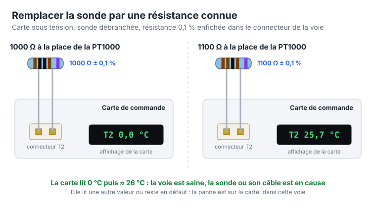
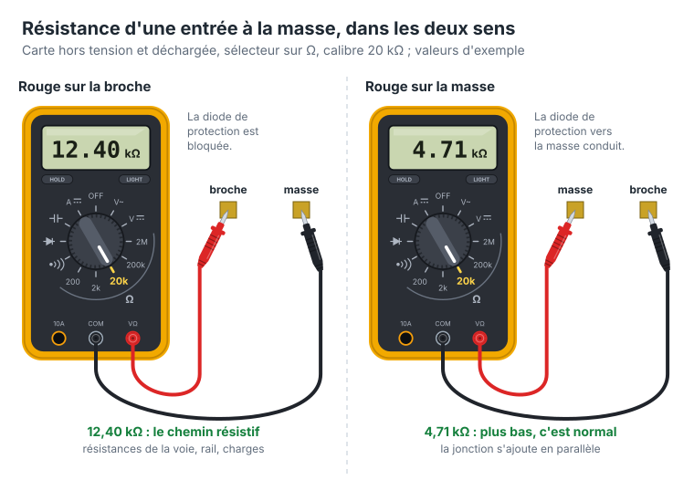
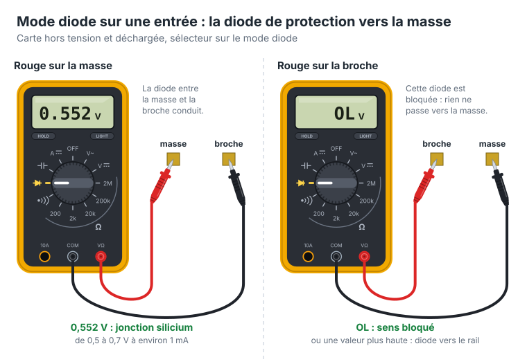
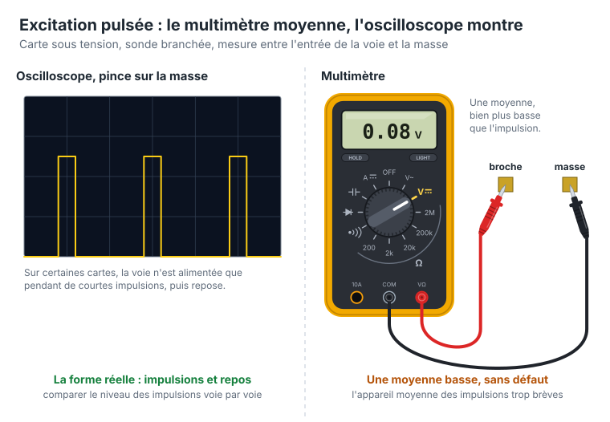
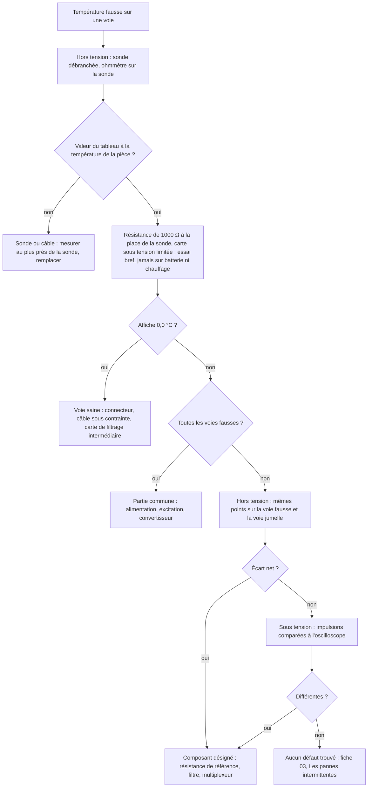

# 14 Sonde à résistance de platine (PT1000)

Savoir si une voie de mesure de température à sonde de platine lit faux à cause de la sonde, du câblage ou de l'électronique de la carte.

## En bref

Une sonde **PT1000** est une résistance de platine qui vaut 1000 Ω à 0 °C et gagne environ 3,9 Ω par degré. Quand une température lue est fausse, contrôler aussi le câble, le connecteur et la voie d'entrée de la carte, pas seulement la sonde. La mesure qui tranche : **remplacer la sonde par une résistance fixe connue** ; si la carte affiche la bonne température, la sonde, son câble ou une carte de filtrage intermédiaire est en cause, sinon la voie.

> **Sécurité** : mesures hors tension → carte débranchée, piles retirées, condensateurs déchargés et vérifiés au voltmètre ; mesures sous tension → alimentation limitée en courant, 50 V continu (25 V alternatif) au plus partout sur la carte (fiche [00](../00_securite/README.md)). Une sonde de température protège souvent quelque chose (batterie, élément chauffant, puissance) : la remplacer par une résistance fixe neutralise cette protection ; l'essai reste bref, sous surveillance, jamais sur un pack ou un chargeur de batteries, ni sur un élément chauffant en service.

## Identifier le composant

| Type | Aspect | Valeur à 0 °C |
| --- | --- | --- |
| PT1000 à couche mince | petite puce céramique à deux fils, CMS, ou au bout d'un câble dans un doigt de gant | 1000 Ω |
| PT100 | même aspect | 100 Ω : les résistances se divisent par dix, le courant de mesure monte à 0,3 à 1 mA, et la résistance des cordons compte dix fois plus (toujours la retrancher) |

- **Repère** : RTD, PT1000, Pt1000 sur la carte, le câble ou la sonde. Deux fils le plus souvent ; trois ou quatre fils compensent la résistance du câble.
- **Ne pas confondre avec une CTN** (fiche [12](../12_thermistance/README.md)) : une PT1000 **monte** quand elle chauffe, lentement et régulièrement (environ 0,4 % par degré) ; une CTN baisse, dix fois plus vite. Un capteur au silicium (famille KTY) monte aussi : sa valeur et sa fiche technique le distinguent.

### Valeurs repères d'une PT1000

Calculées avec l'équation de Callendar–Van Dusen et ses coefficients normalisés (A = 3,9083 × 10⁻³, B = −5,775 × 10⁻⁷, au-dessus de 0 °C), arrondies.

| Température | Résistance |
| --- | --- |
| 0 °C | 1000,0 Ω |
| 20 °C | 1077,9 Ω |
| 25 °C | 1097,3 Ω |
| 30 °C | 1116,7 Ω |
| 37 °C | 1143,8 Ω |
| 50 °C | 1194,0 Ω |
| 100 °C | 1385,1 Ω |

Règle pratique : **3,9 Ω par degré** autour de l'ambiante. Une erreur de 10 Ω sur la chaîne vaut donc une erreur d'environ 2,5 °C.

## Modes de défaillance

Classés du plus fréquent au plus rare. Ce classement est une **déduction de l'auteur** (pièces mécaniques et connecteurs exposés, électronique protégée, sonde stable selon sa fiche technique) : aucune source publiée de fréquence n'a été trouvée, et ce n'est pas une statistique.

| Mode de défaillance | Fréquence | Cause typique | Ce que la panne implique ailleurs |
| --- | --- | --- | --- |
| Câble ou connecteur ouvert, ou mauvais contact | fréquent | fil arraché, sertissage desserré, connecteur oxydé | température absurde ou instable ; la sonde est saine |
| Défaut de la voie d'entrée de la carte | occasionnel | résistance de référence dérivée, filtre ou multiplexeur endommagé, entrée du convertisseur détruite par une surtension | une seule voie fausse alors que la sonde mesure juste à l'ohmmètre |
| Sonde ouverte | occasionnel | choc, vibration, fil de puce rompu | température extrême, défaut de sonde |
| Sonde en court-circuit ou très basse | rare | humidité dans le doigt de gant, câble écrasé | température très basse ou défaut |
| Dérive de la sonde | rare | contrainte thermique prolongée ; une couche mince bien choisie reste stable à quelques dixièmes de degré | erreur de quelques degrés sans message |

## Niveau 1 — Inspection par les sens

- **Vue** : câble pincé, gaine fondue, connecteur oxydé ou mal enfoncé, doigt de gant tordu ; sur la carte, composant noirci près de l'entrée, vernis craquelé.
- **Indices de l'appareil** : une seule voie fausse quand les autres sont justes désigne la voie ou sa sonde ; toutes les voies fausses désignent ce qu'elles partagent (référence, alimentation, convertisseur).
- **Échanger deux sondes** entre deux voies, hors tension : si l'erreur suit la sonde, c'est la sonde ; si elle reste sur la voie, c'est la carte (fiche [93](../93_tracage_signal/README.md)).

## Niveau 2 — Mesure hors circuit

Sonde débranchée de la carte, sélecteur sur **Ω**, calibre 2 kΩ (ou le plus petit qui affiche 1 kΩ), résistance des cordons retranchée sous 10 Ω (fiche [01](../01_multimetre/README.md)).

| Lecture | Verdict |
| --- | --- |
| Valeur du tableau pour la température de la pièce, qui monte en serrant la sonde dans la main | sonde saine |
| OL | sonde ou câble ouvert : mesurer au plus près de la sonde pour séparer les deux |
| Nettement sous 1000 Ω à l'ambiante | court-circuit ou humidité |
| Lecture qui saute quand on bouge le câble | fil cassé dans la gaine |

Sur une sonde à trois ou quatre fils, les fils d'un même côté se lisent entre eux à quelques ohms : c'est la résistance du câble.

## Niveau 3 — Mesure en circuit

### Remplacer la sonde par une résistance fixe

Le moyen le plus rapide de séparer la sonde de la carte. Carte hors tension, sonde débranchée, une résistance à 0,1 % branchée à sa place, puis remise sous tension limitée en courant. Essai bref, sous surveillance, **jamais** sur un pack ou un chargeur de batteries, ni sur un élément chauffant en service : 0 °C affiché peut commander un chauffage à pleine puissance.

| Résistance | Température attendue |
| --- | --- |
| 1000 Ω | 0,0 °C |
| 1100 Ω | environ 25,7 °C |

- La carte affiche la valeur attendue (à quelques dixièmes près) : la voie est saine, le défaut est dans la sonde, son câble ou une carte de filtrage placée entre la sonde et le connecteur.
- La carte affiche une valeur fausse : le défaut est dans la voie de la carte. Continuer ci-dessous.

### Ohmmètre hors tension, dans les deux sens

Carte hors tension, sonde débranchée, mesure sur la **broche a** (celle qui part vers le convertisseur). Une entrée de convertisseur porte des diodes de protection : la lecture dépend du sens des pointes (fiche [02](../02_pieges_en_circuit/README.md)). Mesurer donc **dans les deux sens** et comparer avec une voie identique de la même carte ; les valeurs de la figure sont des exemples, seule la comparaison compte. Sur la broche b, la résistance de référence domine la lecture.

### Mode diode sur l'entrée

Carte hors tension, broche a. Pointe rouge sur la masse, noire sur la broche : la diode de protection basse de l'entrée conduit et affiche une signature de jonction silicium (0,5 à 0,7 V). Une résistance série de filtre ajoute sa chute à la lecture, qui peut alors dépasser 1 V : seule la comparaison avec la voie jumelle tranche. Dans l'autre sens : OL, ou une valeur plus haute.

| Lecture, rouge sur la masse | Verdict |
| --- | --- |
| Même signature que sur la voie saine | protection intacte |
| Près de 0 V dans les deux sens | entrée en court-circuit : composant de la voie détruit |
| OL là où la voie saine lit une signature | piste ou protection coupée |

### Sous tension : l'excitation pulsée

Certaines cartes n'alimentent la sonde que par impulsions (le schéma de la carte le dit ; aucune source ouverte ne le généralise). Le courant de mesure d'une PT1000 reste de l'ordre de 0,1 à 0,3 mA : 0,2 mA dans la sonde et la référence donnent des impulsions d'environ 0,4 V. Un multimètre sur V continu affiche alors une **moyenne**, bien plus basse que la tension pendant l'impulsion : 0,08 V ne prouve rien. Comparer avec la voie saine au même calibre, ou regarder les impulsions à l'oscilloscope (page [i2](../i2_oscilloscope/README.md)) : même hauteur, même largeur sur toutes les voies.

### Chercher le composant fautif de la voie

Une voie typique : la sonde en série avec une **résistance de référence** ; le convertisseur mesure la tension de chacune et la carte en fait le rapport (mesure ratiométrique). Le filtre et le multiplexeur mènent au convertisseur. Le schéma de la carte fait foi ; sans lui, suivre les pistes depuis le connecteur.

Hors tension, ohmmètre, **mêmes points sur les deux voies**, d'amont en aval. L'écart reste le même du connecteur jusqu'à la résistance de référence, mesurée sur ses terminaisons : c'est elle qui a dérivé (fiche [10](../10_resistance/README.md)). Mesurée sur les pastilles, la lecture inclurait les joints de brasure : une soudure fissurée donnerait le même écart. Inverser les pointes donne la même valeur : il n'y a pas de jonction dans ce chemin.

Une résistance de référence qui dérive fausse toute la voie : sur une mesure ratiométrique, une référence qui **monte** fait lire **froid**, une référence qui baisse fait lire chaud, environ 2,7 °C par pour cent autour de 20 °C. Une carte construite autrement peut inverser le sens : son schéma tranche.

### Mesurer sous un vernis de protection

Le vernis isole : une pointe posée dessus lit OL. Percer avec une aiguille fine jusqu'à la **terminaison** du composant, comme le veut la règle des pattes (fiche [02](../02_pieges_en_circuit/README.md)) ; faute de mieux la pastille, en sachant que la lecture inclut alors le joint (fiche [90](../90_inspection_visuelle/README.md)). Dégager localement selon la fiche technique du vernis, puis revernir après la réparation.

## Niveau 4 — Méthodes avancées

- **Point de référence à 0 °C** : sonde dans un sachet étanche, plongée dans un mélange d'eau et de glace pilée bien remué ; elle doit lire très près de 1000 Ω.
- **Auto-échauffement** : un courant de mesure trop fort chauffe la sonde (0,4 K par milliwatt à 0 °C selon la fiche M222, 0,15 K/mW dans l'eau glacée selon la PCB2225, davantage dans l'air calme) : une carte modifiée qui lit chaud de façon constante est suspecte.
- **Décade de résistances** : remplace les résistances fixes de la substitution et balaye toute la plage de la voie.
- **Oscilloscope** : compare forme et hauteur des impulsions d'excitation d'une voie à l'autre (page [i2](../i2_oscilloscope/README.md)).

## Arbre de décision

## Remplacer le composant

| Composant | Règle |
| --- | --- |
| Sonde | même élément (PT1000 ou PT100), même classe de tolérance, même nombre de fils, même montage mécanique |
| Résistance de référence | même valeur, **même tolérance et même coefficient de température** (0,1 % ou mieux) : une résistance ordinaire de 1 % peut fausser la voie d'environ 2,7 °C |
| Résistance CMS | même taille de boîtier, lue au pied à coulisse avant de commander |

Après réparation : substitution à 1000 Ω puis 1100 Ω, puis sonde remise et comparée à une voie saine à l'ambiante.

## Aide-mémoire d'établi

- PT1000 : 1000 Ω à 0 °C, ≈ 1078 Ω à 20 °C, ≈ 3,9 Ω par degré ; elle monte en chauffant.
- Une voie fausse : d'abord la sonde à l'ohmmètre, puis une résistance fixe à sa place.
- 1000 Ω → 0,0 °C ; 1100 Ω → ≈ 25,7 °C.
- Erreur qui suit la sonde : sonde. Erreur qui reste sur la voie : carte.
- Hors tension, mêmes points sur la voie fausse et la voie jumelle, du connecteur vers le convertisseur.
- Entrée de convertisseur : mesurer dans les deux sens, mode diode rouge sur la masse.
- Excitation pulsée : le voltmètre lit une moyenne ; comparer, ou oscilloscope.
- Référence de 0,1 % : remplacer à l'identique.
- Jamais de résistance fixe sur un pack, un chargeur ou un élément chauffant.

## Mini-glossaire

- **RTD** : détecteur de température à résistance (en anglais *resistance temperature detector*).
- **PT1000, PT100** : sonde de platine de 1000 Ω, de 100 Ω à 0 °C.
- **Résistance de référence** : résistance de précision en série avec la sonde ; la carte compare les deux.
- **Mesure ratiométrique** : la carte mesure un rapport de tensions, insensible à la valeur exacte du courant.
- **Multiplexeur** : commutateur qui relie tour à tour plusieurs voies à un seul convertisseur.
- **Excitation pulsée** : courant de mesure envoyé seulement pendant la conversion.

## Sources

- Yageo Nexensos, *M222 – Platinum temperature sensor*, fiche technique : élément conforme à DIN EN IEC 60751, coefficient de 3850 ppm/K, courant de mesure de 0,1 à 0,3 mA pour une Pt1000, auto-échauffement de 0,4 K/mW à 0 °C, courant de mesure d'une Pt100 de 0,3 à 1 mA, classes de tolérance. <https://content.kemet.com/datasheets/yageo_nexensos_m222_datasheet_en.pdf>
- Yageo Nexensos, *PCB2225*, fiche technique : même coefficient et même courant de mesure, auto-échauffement de 0,15 K/mW dans l'eau glacée, stabilité de 0,1 K après 1000 h à 150 °C. <https://content.kemet.com/datasheets/yageo_nexensos_pcb2225_datasheet_en.pdf>
- Texas Instruments, *A Basic Guide to RTD Measurements*, SBAA275A : équation de Callendar–Van Dusen et ses coefficients A et B, mesure ratiométrique avec une résistance de référence (une erreur sur la référence devient une erreur de gain), courant d'excitation limité pour l'auto-échauffement, coefficient d'auto-échauffement selon le milieu. <https://www.ti.com/lit/pdf/sbaa275>
- IEC 60751, *Industrial platinum resistance thermometers and platinum temperature sensors* : norme payante, consulter la norme ; aucune valeur n'en est citée directement.
- Les procédures de base viennent des fiches citées : [00](../00_securite/README.md), [01](../01_multimetre/README.md), [02](../02_pieges_en_circuit/README.md), [10](../10_resistance/README.md), [12](../12_thermistance/README.md), [93](../93_tracage_signal/README.md).
