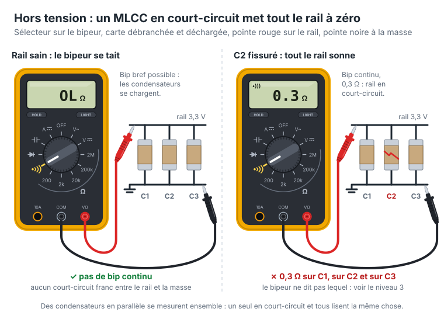
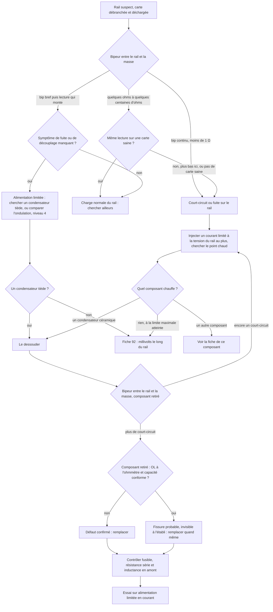
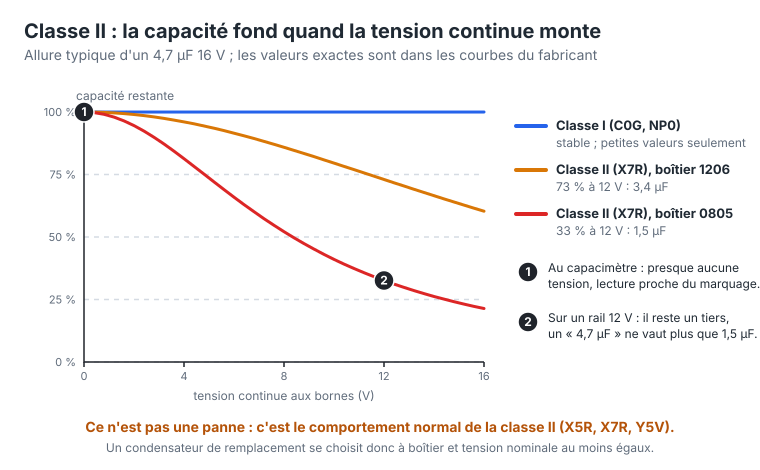

# 20 Condensateur céramique (MLCC)

Savoir si un condensateur céramique est en court-circuit, fuyant ou sain, le retrouver parmi ses voisins en parallèle, et le remplacer sans en fissurer un autre.

## En bref

Le condensateur céramique multicouche (MLCC, *multilayer ceramic capacitor*) est le composant le plus nombreux d'une carte : un petit pavé beige ou brun, sans marquage, posé entre chaque rail d'alimentation et la masse. Sa panne typique est mécanique : la céramique **se fissure** quand la carte fléchit, la fissure relie des électrodes internes, et le condensateur devient une **fuite puis un court-circuit** qui met tout le rail à la masse. Le bipeur, entre le rail et la masse, voit ce court-circuit en quelques secondes ; il ne dit pas lequel des condensateurs en parallèle est en cause. C'est la chaleur qui le désigne : un courant limité injecté dans le rail échauffe le coupable.

> **Sécurité** : mesures hors tension → carte débranchée, piles retirées, condensateurs déchargés et vérifiés au voltmètre ; mesures sous tension → alimentation limitée en courant, 50 V continu (25 V alternatif) au plus partout sur la carte (fiche [00](../00_securite/README.md)). Un condensateur céramique stocke peu d'énergie, mais il partage son rail avec des condensateurs bien plus gros : c'est le **rail** qu'on décharge. Un MLCC en court-circuit alimenté par une batterie ou une alimentation sans limite chauffe jusqu'à brûler la carte : **ne jamais remettre sous tension un rail en court-circuit sans limitation de courant**. Les condensateurs céramique en disque bleu ou orange marqués X1, Y1, Y2 ou d'une tension en kV sont côté secteur ou haute tension : hors du périmètre de ces fiches.

## Identifier le composant

| Type | Aspect | Où on le trouve |
| --- | --- | --- |
| MLCC CMS | pavé beige, brun ou gris, deux extrémités métallisées, **aucun marquage** ; repère **C** sur la carte | partout : découplage au pied de chaque circuit intégré, entrée et sortie des régulateurs, filtres |
| Céramique traversant en disque | pastille ocre ou brune, deux pattes, code à trois chiffres | cartes anciennes, antiparasitage, circuits d'accord |
| MLCC traversant | petite goutte jaune ou bleue, deux pattes, code à trois chiffres | découplage des cartes à composants traversants |
| Réseau de condensateurs CMS | pavé à quatre ou huit terminaisons | découplage de bus, cartes denses |

Le boîtier d'un MLCC CMS se nomme par ses dimensions en centièmes de pouce : un **0603** mesure 0,06 × 0,03 pouce, soit 1,6 × 0,8 mm.

### Lire la valeur

- **MLCC CMS** : rien n'est écrit dessus. La valeur se lit sur le schéma, sur une carte identique, ou se mesure composant dessoudé (niveau 2). La couleur ne renseigne pas de façon fiable.
- **Code à trois chiffres** (disque, MLCC traversant) : les deux premiers chiffres sont les chiffres significatifs, le troisième le nombre de zéros, **en picofarads**. Exemple de la figure : **104** = 10 suivi de 4 zéros = 100 000 pF = 100 nF = 0,1 µF. Un nombre à deux chiffres se lit directement : 47 = 47 pF.
- **Lettre de tolérance** après le code : J = ±5 %, K = ±10 %, M = ±20 %.
- **Tension** : souvent absente sur un disque basse tension ; quand elle est marquée, c'est la tension maximale de service.

### Classe I et classe II : deux comportements

| Classe | Diélectriques courants | Valeurs | Comportement |
| --- | --- | --- | --- |
| I | C0G (NP0) | de moins de 1 pF à quelques dizaines de nF | **stable** : ni la température, ni la tension, ni le temps ne changent sa capacité. Oscillateurs, filtres, quartz |
| II | X7R, X5R, Y5V, Z5U | de 1 nF à plus de 100 µF | forte capacité dans un petit volume, mais **la capacité dépend de la tension appliquée, de la température et de l'âge**. Découplage, filtrage d'alimentation |

Ce tableau évite de condamner un composant sain : un condensateur de classe II qui mesure moins que sa valeur nominale n'est pas forcément en panne (niveau 2 et « Remplacer le composant »).

## Modes de défaillance

Classés du plus fréquent au plus rare (consensus des réparateurs et notes de fabricants, voir Sources ; aucune statistique publiée).

| Mode de défaillance | Fréquence | Cause typique | Ce que la panne implique ailleurs |
| --- | --- | --- | --- |
| Court-circuit ou fuite sur fissure de flexion | très fréquent | carte tordue, chute, vis serrée de travers, carte détourée ou connecteur forcé ; boîtier long (1206 et plus) | le rail est à la masse : fusible, résistance série ou inductance en amont ont pu brûler (fiches [13](../13_fusible/README.md) et [10](../10_resistance/README.md)) ; le régulateur est en protection |
| Fissure de choc thermique | occasionnel | soudage ou dessoudage au fer sans préchauffage, panne posée sur la céramique | même effet, souvent après une réparation voisine |
| Court-circuit par surtension | occasionnel | tension supérieure à la tension de service : régulateur défaillant, transitoire, décharge électrostatique sur une entrée | chercher d'où est venue la surtension avant de remplacer |
| Perte de capacité ou circuit ouvert | rare | fissure qui coupe des électrodes sans les relier, terminaison décollée, soudure cassée | découplage manquant : régulateur instable, parasites, redémarrages |

Une fissure n'agit pas toujours tout de suite : le condensateur peut d'abord sembler sain, puis l'humidité et la tension font apparaître la fuite, et le court-circuit s'installe **des jours ou des semaines après le choc**.

## Niveau 1 — Inspection par les sens

- **À la loupe**, lumière rasante : trait fin en travers du corps, coin écaillé, terminaison décollée, tache brune ou vernis de la carte roussi autour d'un condensateur. La plupart des fissures de flexion sont **invisibles** : elles passent sous la terminaison, côté carte. Un MLCC d'aspect parfait n'est pas innocenté.
- **L'emplacement** oriente la recherche : contrôler d'abord les condensateurs proches d'une vis, d'un connecteur qu'on manipule, d'un bord détouré ou d'un angle de la carte, et les plus longs boîtiers.
- **L'historique** aussi : chute, torsion du boîtier, remontage récent, réparation au fer juste à côté.
- **Échauffement**, carte sur alimentation limitée en courant : un MLCC ne chauffe jamais en fonctionnement normal. Celui qui est tiède ou chaud est le coupable (méthode au niveau 3). Caméra thermique, alcool isopropylique qui s'évapore d'abord sur le point chaud, ou dos du doigt approché brièvement (risque de brûlure, jamais au contact prolongé).
- **Un sifflement** qui vient d'un condensateur n'est pas une panne : la céramique de classe II se déforme légèrement sous la tension (effet piézoélectrique) et « chante » quand le courant est haché à une fréquence audible.

## Niveau 2 — Mesure hors circuit

Condensateur entièrement dessoudé : sur un MLCC, chauffer une seule extrémité pour la soulever (fiche [02](../02_pieges_en_circuit/README.md)) risque de fissurer la céramique. Le dessouder à l'air chaud ou avec deux fers, sans faire levier, puis le poser sur un support isolant.

### À l'ohmmètre : l'isolement

1. Sélecteur sur **Ω**, calibre le plus élevé (2 MΩ).
2. Une pointe sur chaque terminaison, sans toucher le métal des pointes avec les doigts.
3. Attendre que la lecture se stabilise, puis lire.

| Lecture | Verdict |
| --- | --- |
| OL, tout de suite ou après une montée brève | isolement bon |
| Valeur **fixe**, de quelques ohms à quelques centaines de kΩ | fuite ou court-circuit : à remplacer |
| Proche de 0 Ω, bip continu au bipeur | court-circuit franc : à remplacer |
| Lecture qui change quand on appuie doucement sur le corps | fissure : à remplacer |

Pourquoi la lecture monte avant d'afficher OL : l'ohmmètre injecte un petit courant, qui charge le condensateur ; tant qu'il se charge, l'appareil croit voir une résistance (fiche [01](../01_multimetre/README.md), « Pourquoi un condensateur bipe puis se tait »). Sous 100 nF la charge dure moins que le temps d'affichage : OL apparaît d'emblée. Un céramique sain a une résistance d'isolement bien supérieure à ce qu'un multimètre sait mesurer : **toute valeur stable est un défaut**.

### Au capacimètre : la valeur

1. Sélecteur sur le **capacimètre**. Pour une valeur inférieure à 1 nF, appuyer sur **REL** pointes écartées : la capacité des cordons (quelques dizaines de pF) est retranchée.
2. Une pointe sur chaque terminaison ; un céramique n'a pas de polarité.
3. Comparer à la valeur attendue. Exemple : un disque **104K** vaut 100 nF à ±10 %, soit de 90 à 110 nF ; une lecture de 96 nF est bonne.

| Lecture | Verdict |
| --- | --- |
| Dans la tolérance | sain, si l'isolement est bon lui aussi |
| Classe II, un peu en dessous de la tolérance | plausible : la capacité d'une classe II baisse avec l'âge (environ 2,5 % chaque fois que l'âge est multiplié par dix pour un X7R, jusqu'à 7 % pour un Z5U). Douteux seulement si le circuit montre un symptôme |
| Classe II, entre les deux : nettement sous la tolérance, sans atteindre la moitié | douteux : comparer avec un condensateur neuf de même référence, remplacer au moindre symptôme |
| Classe I, juste hors tolérance | vérifier d'abord le capacimètre sur un condensateur neuf de même valeur : sur les petites valeurs, les cordons faussent la lecture |
| Nettement en dessous (la moitié ou moins), instable, ou classe I nettement hors tolérance | fissure qui a coupé des électrodes : à remplacer |
| Lecture impossible, « OL » ou dépassement | court-circuit ou fuite : revenir à l'ohmmètre |

Deux limites à connaître :

- **Le capacimètre mesure presque sans tension.** Il lit la capacité d'une classe II « à vide », proche du marquage ; en service, sous la tension du rail, la capacité réelle est plus faible (voir la figure de « Remplacer le composant »). Ce n'est pas une panne.
- **Une fissure peut ne rien montrer à l'établi.** Sous le volt que délivre le multimètre et sans contrainte mécanique, un condensateur fissuré lit parfois OL et la bonne capacité. Si l'emplacement et l'historique l'accusent, le remplacer : il coûte quelques centimes. L'essai d'isolement sous tension du niveau 4 lève le doute.

## Niveau 3 — Mesure en circuit

### Hors tension : le rail entier se mesure d'un coup

Les MLCC de découplage sont tous branchés de la même façon : une terminaison sur le rail, l'autre à la masse. Ils sont donc **en parallèle**, et les pointes posées sur l'un d'eux mesurent tout le rail : tous les condensateurs, plus tout ce que le rail alimente (fiche [02](../02_pieges_en_circuit/README.md)).

1. Carte débranchée, rail déchargé et vérifié au voltmètre.
2. Sélecteur sur le **bipeur**.
3. Pointe noire sur la masse, pointe rouge sur le rail (une terminaison de n'importe lequel de ses condensateurs).

| Lecture entre le rail et la masse | Verdict |
| --- | --- |
| Bip bref puis silence, lecture qui monte | pas de court-circuit franc : les condensateurs se chargent |
| Bip continu, moins de 1 Ω environ | **court-circuit franc** sur le rail : un condensateur, ou un autre composant du rail |
| Quelques ohms à quelques centaines d'ohms, stable | douteux : fuite, ou charge normale du rail. **Comparer** avec le même rail d'une carte saine ; le rail de cœur d'un processeur lit normalement quelques ohms (fiche [01](../01_multimetre/README.md)) |

Ce que cette mesure ne dit pas :

- **Lequel** des composants est en court-circuit : la lecture est la même sur C1, C2 et C3, à quelques centièmes d'ohm près que le multimètre ne distingue pas.
- Si c'est un condensateur : une diode de protection, un transistor ou un circuit intégré du même rail donne exactement la même lecture. Le condensateur céramique est le suspect le plus courant avec le condensateur tantale (fiche [23](../23_condensateur_tantale/README.md)), pas le seul.

Le capacimètre en circuit additionne tous les condensateurs du rail et ne renseigne pas sur l'un d'eux. L'ohmmètre ne voit pas non plus un MLCC ouvert : ses voisins le masquent.

### Sous tension : faire chauffer le coupable

Le court-circuit dissipe de la chaleur là où il se trouve, et seulement là. On lui fournit un courant **limité** et on cherche le point chaud.

1. Alimentation de laboratoire réglée sur la **tension nominale du rail, jamais au-dessus** (les circuits intégrés du rail la reçoivent aussi), limite de courant à 100 mA. Sortie coupée.
2. Brancher le + sur le rail, le − sur la masse de la carte, puis activer la sortie : l'alimentation passe en limitation (voyant CC) et la tension s'effondre.
3. Chercher le point chaud : caméra thermique, ou une goutte d'alcool isopropylique sur chaque suspect (elle s'évapore d'abord sur le coupable), ou le dos du doigt approché brièvement.
4. Rien ne chauffe : relever la limite par paliers (200 mA, 500 mA, 1 A) en restant sous ce que le rail fournit en service, et recommencer. S'arrêter au premier palier où un composant chauffe.
5. Couper la sortie, dessouder le composant désigné, puis refaire la mesure au bipeur : le court-circuit doit avoir disparu. S'il est toujours là, un second composant est en cause.

La méthode complète (injection sous tension réduite, suivi des millivolts le long du rail) est dans la fiche 92. Si le composant qui chauffe est un circuit intégré, c'est lui qui est en court-circuit, pas un condensateur.

**Rail qui porte des condensateurs tantale** (fiche [23](../23_condensateur_tantale/README.md)) : un tantale en court-circuit peut s'enflammer. Ne relever la limite que par paliers, lunettes de protection portées, sans se pencher au-dessus de la carte, de préférence avec une caméra thermique, et couper au premier échauffement.

Un MLCC **fuyant** (quelques dizaines d'ohms à quelques kΩ) ne fait pas tomber le rail : la carte fonctionne, mais consomme trop, la batterie se vide en veille, et le condensateur est tiède. La même recherche du point chaud, carte alimentée normalement sur alimentation limitée, le désigne.

### Du symptôme au condensateur suspect

| Symptôme | Condensateur à contrôler en premier | Pourquoi |
| --- | --- | --- |
| Appareil mort, rail à 0 V, alimentation en limitation | MLCC de découplage du rail, d'abord près des vis, connecteurs et bords | court-circuit franc sur fissure |
| Panne apparue après une chute ou un remontage | MLCC de grande taille, aux endroits où la carte a fléchi | fissure de flexion |
| Fusible ou résistance série qui brûle à nouveau | MLCC d'entrée, juste après le fusible | court-circuit en aval (fiche [13](../13_fusible/README.md)) |
| Batterie qui se vide appareil éteint, consommation de veille trop forte | MLCC resté alimenté en veille | fuite |
| Panne qui vient quand on appuie sur la carte ou quand elle chauffe | MLCC près du point d'appui | fissure qui s'ouvre et se referme |
| Régulateur instable après une réparation | condensateur de sortie remplacé par un boîtier plus petit ou une tension de service plus faible | capacité réelle trop basse sous tension (classe II) |
| Oscillateur à quartz décalé ou qui ne démarre pas | les deux petits condensateurs du quartz | classe I remplacée par une classe II, ou valeur fausse |

## Niveau 4 — Méthodes avancées

- **Essai d'isolement sous tension de service**, condensateur dessoudé : le multimètre teste l'isolement sous moins d'un volt, alors qu'une fissure fuit surtout sous la tension du rail. Mettre en série l'alimentation de laboratoire (tension du rail, **jamais plus que la tension de service du condensateur ni que 50 V**, limite 10 mA), une résistance de 1 kΩ et le condensateur ; mesurer en V continu aux bornes de la résistance. Lire après une minute : un céramique sain donne 0,0 mV, ou presque pour une forte valeur ; **1 mV correspond à 1 µA de fuite**. Dans le doute, comparer avec un condensateur neuf identique : une lecture nettement plus élevée que la sienne, ou qui augmente, condamne le condensateur. Le décharger ensuite dans la résistance.
- **Millivolts le long du rail** : avec le courant injecté du niveau 3, la chute de tension dans les pistes est la plus forte en direction du court-circuit. Un multimètre qui résout 0,01 mV suffit (fiche 92).
- **Pont LCR** : mesure la capacité à une fréquence et une tension définies, ainsi que les pertes ; certains appliquent une tension continue et montrent la capacité réelle d'une classe II en service (page i5).
- **Oscilloscope** : l'ondulation et les parasites sur un rail augmentent quand un condensateur de découplage est ouvert ; comparer avec une carte saine (page [i2](../i2_oscilloscope/README.md) et fiche 93).
- **Caméra thermique** : désigne le condensateur en court-circuit en quelques secondes, à courant bien plus faible que le doigt ou l'alcool.

## Arbre de décision

## Remplacer le composant

| Critère | Règle |
| --- | --- |
| Capacité | identique |
| Tension de service | égale ou supérieure à celle d'origine ; à défaut de la connaître, au moins deux fois la tension du rail |
| Classe | **une classe I (C0G, NP0) ne se remplace que par une classe I**. Une classe II se remplace par un diélectrique au moins aussi bon : X7R à la place de X5R, jamais Y5V ou Z5U à la place de X7R ou X5R |
| Boîtier | identique. **Jamais plus petit** pour une classe II : à capacité et tension nominales égales, un boîtier plus petit perd beaucoup plus de capacité sous tension |
| Emplacement exposé | près d'une vis ou d'un bord, préférer un modèle à terminaisons souples (*flexible termination*) de mêmes caractéristiques, s'il existe |

Pourquoi le boîtier compte : dans une classe II, la capacité **baisse quand la tension continue appliquée monte**, et d'autant plus que le boîtier est petit. Exemple mesuré (source Analog Devices) : un 4,7 µF 16 V X7R soumis à 12 V garde 73 % de sa capacité en boîtier 1206, soit 3,4 µF, mais seulement 33 % en boîtier 0805, soit 1,5 µF. Les deux portent la même valeur nominale et le même diélectrique ; seule la courbe du fabricant les distingue. Un régulateur calculé pour le premier peut devenir instable avec le second.

Précautions de soudage, pour ne pas fabriquer la panne suivante :

- Préchauffer la zone (air chaud, ou fer posé d'abord sur la pastille) : la céramique craint les écarts brusques de température.
- **La panne du fer touche la pastille et la soudure, jamais le corps** du condensateur.
- Peu de soudure : un bourrelet épais transmet davantage les efforts de la carte au composant.
- Ne pas tordre la carte, ne pas faire levier sur le composant ; revisser la carte à plat, sans la contraindre.
- Un condensateur de classe II fraîchement soudé mesure un peu plus que sa valeur de croisière : la chaleur a remis son vieillissement à zéro.

Avant de remettre sous tension : plus de court-circuit au bipeur entre le rail et la masse, le fusible, la résistance série et l'inductance en amont contrôlés, et le premier essai sur alimentation limitée en courant.

## Aide-mémoire d'établi

- Un MLCC CMS n'a pas de marquage : schéma, carte identique, ou mesure composant dessoudé.
- Code 104 = 10 suivi de 4 zéros, en pF = 100 nF. J ±5 %, K ±10 %, M ±20 %.
- Panne typique : fissure de flexion, donc fuite puis court-circuit ; près des vis, connecteurs, bords, gros boîtiers.
- Bipeur entre le rail et la masse : bip continu = court-circuit, sans dire lequel.
- Des condensateurs en parallèle lisent tous la même chose.
- Pour le désigner : courant limité, tension du rail au plus, et chercher le point chaud.
- Dessoudé : OL à l'ohmmètre, sinon défaut ; toute valeur stable est une fuite.
- Classe II : capacité plus faible sous tension et avec l'âge, ce n'est pas une panne.
- Remplacement : même capacité, même classe, tension au moins égale, boîtier jamais plus petit.
- Le fer sur la pastille, jamais sur la céramique ; ne pas tordre la carte.

## Mini-glossaire

- **MLCC** : condensateur céramique multicouche ; des dizaines à des centaines d'électrodes empilées dans un bloc de céramique.
- **Terminaison** : extrémité métallisée du composant, soudée à la carte, qui relie une électrode interne sur deux.
- **Classe I / classe II** : céramique stable de faible permittivité (C0G) / céramique de forte permittivité, dont la capacité varie (X7R, X5R, Y5V).
- **Polarisation continue** (*DC bias*) : tension continue appliquée au condensateur ; elle fait baisser la capacité d'une classe II.
- **Fissure de flexion** : fissure de la céramique provoquée par la flexion de la carte, partant du bord d'une terminaison.
- **Découplage** : condensateur placé entre un rail et la masse, au plus près d'un circuit intégré, pour lui fournir ses pointes de courant.
- **Résistance d'isolement** : résistance du diélectrique en continu ; très élevée sur un céramique sain.

## Sources

Les faits ci-dessous sont reformulés ; les fréquences de panne sont un classement qualitatif, pas une statistique.

- TDK, *Flex Crack Countermeasures in MLCCs*, guide de solutions : la flexion de la carte est une cause majeure de fissure, la céramique résiste mal à la traction, la fissure relie des électrodes opposées, le défaut peut commencer ouvert puis évoluer en court-circuit en service, risque d'échauffement et d'inflammation, situations à risque (détourage, vissage, flexion, chute, quantité de soudure). <https://product.tdk.com/en/techlibrary/solutionguide/mlcc_flex-crack.html>
- M. Fortunato (Maxim Integrated, aujourd'hui Analog Devices), *Temperature and Voltage Variation of Ceramic Capacitors, or Why Your 4.7µF Capacitor Becomes a 0.33µF Capacitor*, 2012 : capacité restante d'un 4,7 µF 16 V X7R sous 12 V selon le boîtier (0805 : 1,53 µF ; 1206 : 3,43 µF), la désignation X7R ou X5R ne dit rien de la tenue en tension, stabilité de la classe I. <https://www.analog.com/en/resources/technical-articles/temperature-and-voltage-variation-ceramic-capacitor.html>
- Murata, *The voltage characteristics of electrostatic capacitance* : baisse de capacité des céramiques à forte permittivité sous tension continue, quasi nulle pour le C0G. <https://article.murata.com/en-global/article/voltage-characteristics-of-electrostatic-capacitance>
- Murata, FAQ condensateurs céramique : la polarisation continue concerne les types à forte permittivité, pas les types à compensation de température. <https://www.murata.com/en-global/support/faqs/capacitor/ceramiccapacitor/char/0005>
- Wikipédia (en), *Ceramic capacitor* : classes I et II, code à trois chiffres et lettres de tolérance, vieillissement des classes II (environ 2,5 % par décade pour le X7R, jusqu'à 7 % pour le Z5U) et sa remise à zéro par chauffage, effet piézoélectrique (microphonie), fissuration par dilatation thermique ou contrainte mécanique, court-circuit interne à la cassure, effet de l'excès de soudure, terminaisons souples. <https://en.wikipedia.org/wiki/Ceramic_capacitor>
