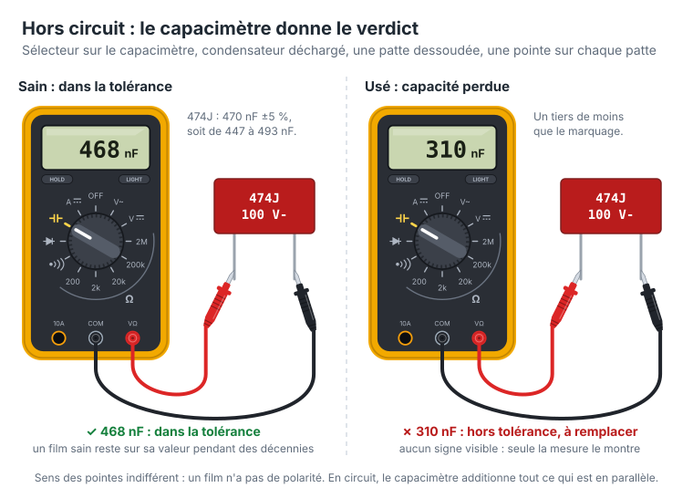
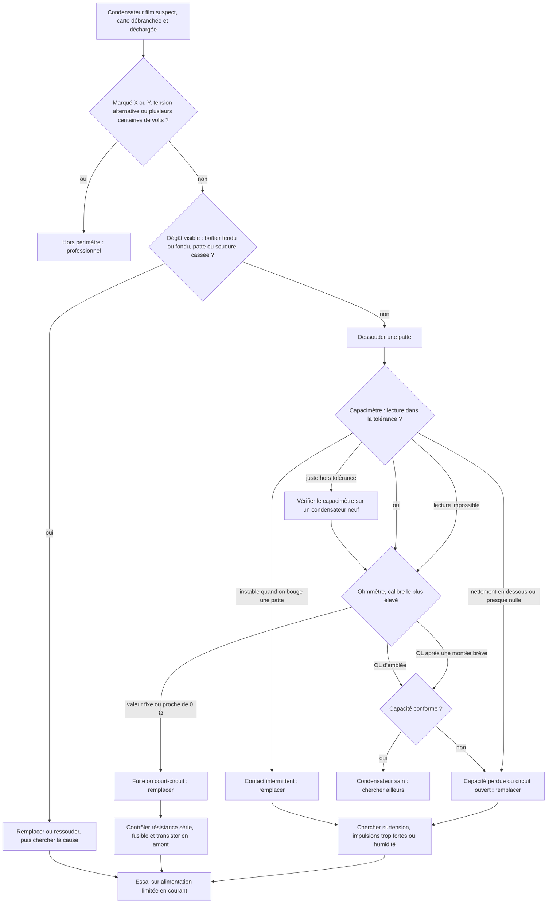

# 21 Condensateur film

Savoir si un condensateur film a gardé sa capacité et son isolement, sans accuser à tort l'un des composants les plus fiables d'une carte.

## En bref

Le condensateur film est fait de deux armatures séparées par un film plastique, enroulées ou empilées dans un boîtier rectangulaire ou sous un enrobage. Il n'a **pas de polarité** et vieillit très peu : en basse tension, c'est rarement lui le coupable, et il se contrôle après les condensateurs électrolytiques (fiche [22](../22_condensateur_electrolytique/README.md)) et céramique (fiche [20](../20_condensateur_ceramique/README.md)). Quand il tombe en panne, c'est le plus souvent **sans aucun signe visible** : sa capacité a baissé, ou une connexion interne s'est ouverte. Le **capacimètre**, une patte dessoudée, donne le verdict ; l'ohmmètre ne vérifie que l'isolement.

> **Sécurité** : mesures hors tension → carte débranchée, piles retirées, condensateurs déchargés et vérifiés au voltmètre ; mesures sous tension → alimentation limitée en courant, 50 V continu (25 V alternatif) au plus partout sur la carte (fiche [00](../00_securite/README.md)). Un condensateur film isole si bien qu'il **garde sa charge des heures, parfois des jours** : le décharger et le vérifier au voltmètre même sur un appareil éteint depuis longtemps. Un condensateur film marqué **X1, X2, Y1, Y2**, d'une tension suivie de **~** ou de **AC** (275 V~ par exemple), ou de plusieurs centaines de volts, est relié au secteur ou à une haute tension : **hors du périmètre de ces fiches**. C'est le cas du condensateur qui abaisse la tension du secteur dans une alimentation capacitive, sans transformateur : toute la carte est alors au potentiel du secteur.

## Identifier le composant

| Type | Aspect | Où on le trouve |
| --- | --- | --- |
| Boîtier rectangulaire | pavé de plastique rouge, bleu, jaune ou gris, deux pattes sous le boîtier, valeur écrite en clair | filtres, liaisons audio, temporisations, circuits d'impulsions |
| Enrobé (trempé) | goutte ou coussin brillant vert, brun ou rouge, deux pattes, code à trois chiffres | cartes à composants traversants, audio, usage général |
| Axial | cylindre, une patte à chaque bout | appareils anciens, filtres d'enceintes |
| CMS | pavé plus épais qu'un céramique, souvent marqué | cartes compactes, plus rare |

Repère **C** sur la carte, comme tous les condensateurs. Deux lettres donnent parfois la matière : **MKT** ou **MKS** pour le polyester (PET), **MKP** pour le polypropylène (PP) ; le **M** signifie film **métallisé**.

### Lire la valeur

- **En clair** : `0,47 µF`, suivi de la lettre de tolérance.
- **Code à trois chiffres**, comme sur un céramique : deux chiffres significatifs, puis le nombre de zéros, **en picofarads**. Exemple de la figure : **474** = 47 suivi de 4 zéros = 470 000 pF = 470 nF = 0,47 µF.
- **Notation avec lettre** : la lettre de l'unité remplace la virgule, qui s'efface trop facilement. `n47` = 0,47 nF ; `4n7` = 4,7 nF ; `47n` = 47 nF.
- **Lettre de tolérance** : J = ±5 %, K = ±10 %, M = ±20 %.
- **Tension** : c'est la tension maximale de service, en volts continus, sauf si elle est suivie de **~** ou de **AC** (tension alternative, voir l'encadré Sécurité).

### Film métallisé ou film et feuille : deux façons de tomber en panne

| Construction | Armatures | En cas de claquage du film |
| --- | --- | --- |
| Film **métallisé** (MKT, MKS, MKP) : le plus courant | couche de métal très mince déposée sur le film | **autocicatrisation** : le métal s'évapore autour du défaut, le court-circuit disparaît, un peu de capacité est perdue |
| Film **et feuille** (KT, KP, FKP) | feuilles de métal, bien plus épaisses | **court-circuit définitif** ; en échange, ce type supporte de fortes impulsions de courant |

## Modes de défaillance

Classés du plus fréquent au plus rare (consensus des réparateurs et notes de fabricants, voir Sources ; aucune statistique publiée). En basse tension, tous sont peu courants : le condensateur film a un taux de panne très bas et une durée de vie de plusieurs dizaines d'années.

| Mode de défaillance | Fréquence | Cause typique | Ce que la panne implique ailleurs |
| --- | --- | --- | --- |
| Perte de capacité (film métallisé) | occasionnel | autocicatrisations très nombreuses : surtensions répétées, humidité absorbée dans un climat humide | filtre décalé, temporisation trop courte, liaison qui coupe les graves ; chercher d'où viennent les surtensions |
| Circuit ouvert ou contact intermittent | occasionnel | impulsions de courant trop fortes, qui brûlent le contact entre les armatures et les pattes ; patte cassée au ras d'un gros boîtier qui vibre | signal coupé, panne qui va et vient quand on touche le composant |
| Court-circuit (film et feuille) | rare | surtension : ce type ne s'autocicatrise pas | le composant en amont a reçu tout le courant : résistance série, fusible, transistor de commande (fiches [10](../10_resistance/README.md) et [13](../13_fusible/README.md)) |
| Fuite | rare | humidité, enrobage fendu, condensateur très ancien | une tension continue passe là où elle devrait être bloquée : polarisation de l'étage suivant décalée |

L'autocicatrisation est une protection, pas une usure normale : quelques milliers de cicatrices retirent **moins de 1 %** de la capacité. Une perte importante, comme le tiers de la figure, demande des claquages incessants. C'est ce que subit un condensateur relié au secteur, où l'air emprisonné s'ionise à chaque alternance : il peut perdre une grande part de sa capacité en un ou deux ans. En basse tension, une telle perte est rare ; la trouver doit faire chercher une surtension ou de l'humidité.

## Niveau 1 — Inspection par les sens

- **À l'œil** : boîtier fendu, gonflé ou fondu, enrobage craquelé, trace brune, patte cassée au ras du boîtier, soudure fissurée en anneau autour d'une patte (les gros boîtiers sont lourds et travaillent sur leurs pattes).
- **Un condensateur film en panne a le plus souvent un aspect parfait** : ni la perte de capacité ni la connexion interne ouverte ne se voient. L'inspection n'innocente pas le composant ; seule la mesure le fait.
- **Au toucher**, appareil éteint et déchargé : un boîtier qui bouge sur ses pattes désigne une soudure ou une patte cassée.
- **Échauffement**, carte sur alimentation limitée en courant : un condensateur film ne chauffe pas en fonctionnement normal. Un boîtier tiède signale une fuite ou des impulsions de courant trop fortes pour lui.

## Niveau 2 — Mesure hors circuit

Condensateur déchargé, **une patte dessoudée** et écartée de la carte (fiche [02](../02_pieges_en_circuit/README.md)). Le sens des pointes est indifférent : un condensateur film n'a pas de polarité.

### Au capacimètre : la valeur

C'est la mesure qui compte, puisque la panne la plus courante est une capacité perdue.

1. Sélecteur sur le **capacimètre**. Pour une valeur inférieure à 1 nF, appuyer sur **REL** pointes écartées : la capacité des cordons est retranchée.
2. Une pointe sur chaque patte, sans toucher le métal des pointes avec les doigts.
3. Attendre la stabilisation, puis comparer au marquage. Exemple : **474J** vaut 470 nF à ±5 %, soit de 447 à 493 nF.

| Lecture | Verdict |
| --- | --- |
| Dans la tolérance (468 nF pour un 474J) | sain, si l'isolement est bon lui aussi |
| Juste en dehors de la tolérance | douteux : vérifier la précision du capacimètre sur un condensateur neuf de valeur voisine avant de conclure |
| Nettement en dessous (310 nF pour un 474J) | capacité perdue : à remplacer, et chercher la cause |
| Presque nulle, quelques pF | circuit ouvert : connexion interne ou patte coupée |
| Instable, qui change quand on bouge une patte | contact intermittent : à remplacer |
| Lecture impossible, « OL » ou dépassement | court-circuit ou fuite : passer à l'ohmmètre |

Pourquoi cette mesure est fiable ici : le capacimètre charge le condensateur avec un courant connu et chronomètre la montée de la tension (fiche [01](../01_multimetre/README.md)). Contrairement à un céramique de classe II, un film garde la même capacité quelle que soit la tension appliquée et ne vieillit presque pas : **la lecture se compare directement au marquage**, sans marge à ajouter.

### À l'ohmmètre : l'isolement

1. Sélecteur sur **Ω**, calibre le plus élevé (2 MΩ).
2. Une pointe sur chaque patte, sans toucher le métal des pointes avec les doigts : la peau conduit assez pour fausser la lecture sur ce calibre.
3. Attendre que la lecture se stabilise, puis lire.

| Lecture | Verdict |
| --- | --- |
| Montée brève, puis OL | isolement bon |
| OL d'emblée, petite valeur (moins de 100 nF environ) | normal : la charge dure moins que le temps d'affichage |
| OL d'emblée, grosse valeur (1 µF et plus) | soupçon de circuit ouvert : le confirmer au capacimètre |
| Valeur **fixe**, quelle qu'elle soit | fuite : à remplacer |
| Proche de 0 Ω, bip continu au bipeur | court-circuit : à remplacer |

L'ohmmètre injecte un petit courant qui charge le condensateur ; pendant cette charge, il affiche une résistance qui monte (fiche [01](../01_multimetre/README.md), « Pourquoi un condensateur bipe puis se tait »). La résistance d'isolement d'un film sain dépasse de très loin ce qu'un multimètre sait mesurer : **toute valeur stable est un défaut**. À l'inverse, OL ne prouve pas que le condensateur est bon : un film ouvert ou vidé d'un tiers de sa capacité affiche OL lui aussi.

## Niveau 3 — Mesure en circuit

### Hors tension

Un condensateur film est rarement branché entre un rail et la masse : il est le plus souvent **en série dans le trajet d'un signal** (liaison entre deux étages) ou dans un réseau avec des résistances (filtre, temporisation). Les pointes posées sur ses pattes mesurent donc aussi tout ce qui relie ses deux côtés (fiche [02](../02_pieges_en_circuit/README.md)).

| Mesure, composant en place | Ce qu'elle permet de dire |
| --- | --- |
| Bipeur : bip continu, moins de 1 Ω environ | court-circuit, du condensateur ou d'un composant en parallèle : lever une patte pour trancher |
| Ohmmètre : valeur stable | rien sur le condensateur : c'est le chemin parallèle qui est lu |
| Capacimètre : nettement **moins** que le marquage | capacité perdue ou circuit ouvert probables : les condensateurs en parallèle ne peuvent qu'ajouter de la capacité. À confirmer une patte levée |
| Capacimètre : valeur conforme ou supérieure, ou lecture instable | rien de sûr : les résistances en parallèle faussent la mesure, d'autres condensateurs s'additionnent |

Les pattes d'un condensateur film traversant sont accessibles : au moindre doute, **dessouder une patte** et revenir au niveau 2.

### Sous tension

Carte sur alimentation limitée en courant, sélecteur sur **V continu**, pointe noire à la masse.

1. Repérer le rôle du condensateur. En **liaison**, il laisse passer le signal alternatif et bloque la tension continue : ses deux pattes sont normalement à des tensions continues différentes.
2. Mesurer la tension continue de chaque côté, par rapport à la masse.
3. Comparer la tension du côté aval à celle attendue (schéma, ou même point d'une carte saine).

| Lecture | Verdict |
| --- | --- |
| Deux tensions continues différentes, côté aval conforme | le condensateur bloque le continu : pas de fuite |
| Même tension continue des deux côtés, alors qu'elles devraient différer | court-circuit ou forte fuite : lever une patte et mesurer |
| Côté aval décalé, et qui revient à la normale quand on lève une patte du condensateur | fuite : à remplacer |
| Tensions continues correctes, mais signal absent en aval | circuit ouvert possible : à confirmer au capacimètre, ou à l'oscilloscope (niveau 4) |

Le voltmètre en continu ne voit ni la capacité perdue ni le circuit ouvert : il ne contrôle que l'isolement.

### Du symptôme au condensateur suspect

| Symptôme | Condensateur à contrôler en premier | Pourquoi |
| --- | --- | --- |
| Son sans graves, ou très faible sur une voie | condensateur de liaison de cette voie | capacité perdue ou circuit ouvert |
| Ronflement, distorsion, étage qui chauffe | condensateur de liaison en amont de l'étage | fuite : du continu atteint l'entrée |
| Temporisation ou fréquence d'oscillateur décalée | condensateur du réseau résistance et condensateur | capacité perdue |
| Filtre d'enceinte : un haut-parleur muet ou étouffé | condensateur en série avec ce haut-parleur | circuit ouvert ou capacité perdue |
| Transistor de commutation qui claque à répétition | condensateur d'amortissement à ses bornes | circuit ouvert : les surtensions ne sont plus absorbées |
| Panne intermittente quand on tapote la carte | gros boîtier film et ses soudures | patte ou soudure cassée, contact interne |
| Appareil qui s'allume faiblement ou plus du tout, alimenté directement par le secteur sans transformateur | condensateur d'alimentation capacitive | **hors périmètre** : carte au potentiel du secteur, à confier à un professionnel |

## Niveau 4 — Méthodes avancées

- **Pont LCR** : mesure la capacité et le facteur de pertes à une fréquence choisie. Un film sain a des pertes très faibles ; des pertes en hausse trahissent un contact d'extrémité dégradé avant que la capacité ne bouge (page i5).
- **Essai d'isolement sous tension de service**, condensateur dessoudé : même montage que pour le céramique (fiche [20](../20_condensateur_ceramique/README.md), niveau 4), alimentation de laboratoire limitée à 10 mA, résistance de 1 kΩ en série, **jamais plus que la tension de service du condensateur ni que 50 V**. Après la charge, 1 mV aux bornes de la résistance correspond à 1 µA de fuite ; un film sain donne 0,0 mV. Le décharger ensuite dans la résistance.
- **Oscilloscope** : comparer le signal de part et d'autre d'un condensateur de liaison. Signal présent en amont et absent ou très affaibli en aval : condensateur ouvert ou capacité perdue (page [i2](../i2_oscilloscope/README.md) et fiche 93).
- **Substitution** : souder provisoirement un condensateur neuf de même valeur à la place du suspect, une patte de l'ancien levée. Le symptôme disparaît : le diagnostic est fait.

## Arbre de décision

## Remplacer le composant

| Critère | Règle |
| --- | --- |
| Capacité | identique, tolérance égale ou plus serrée |
| Tension de service | égale ou supérieure à celle d'origine |
| Tension alternative | un condensateur marqué en volts alternatifs ne se remplace jamais par un modèle marqué seulement en continu |
| Matière | la même si elle est connue : polypropylène (MKP, KP) dans les circuits d'impulsions et de précision, polyester (MKT, MKS) pour l'usage général. Un polypropylène peut remplacer un polyester si le boîtier tient à l'emplacement ; l'inverse n'est pas sûr |
| Construction | un film et feuille (KP, FKP) placé dans un circuit d'impulsions ne se remplace pas par un film métallisé : celui-ci ne supporte pas les mêmes pointes de courant |
| Entraxe des pattes | identique : des pattes écartées de force cassent au ras du boîtier |
| Classe X ou Y | hors périmètre ; ces condensateurs de sécurité ne se remplacent que par la même classe, par un professionnel |

Précautions de soudage :

- **Souder vite** : le film plastique craint la chaleur, surtout le polypropylène, donné pour 105 °C au plus. Fer bien chaud, quelques secondes par patte, sans insister.
- Aucun sens de montage à respecter.
- Plaquer le boîtier sur la carte et, s'il est gros, le coller ou le brider comme à l'origine : ses pattes ne doivent pas porter les vibrations.

Avant de remettre sous tension : cause de la panne traitée (surtension, impulsions, humidité), résistance série, fusible et transistor en amont contrôlés, et le premier essai sur alimentation limitée en courant.

## Aide-mémoire d'établi

- Pas de polarité : il se monte et se mesure dans les deux sens.
- 474 = 47 suivi de 4 zéros, en pF = 470 nF. `47n` = 47 nF, `4n7` = 4,7 nF. J ±5 %, K ±10 %, M ±20 %.
- Très fiable en basse tension : contrôler d'abord les électrolytiques et les céramiques.
- En panne, il a presque toujours un aspect parfait.
- Verdict au capacimètre, une patte dessoudée : la lecture se compare directement au marquage.
- Ohmmètre : montée puis OL ; toute valeur stable est une fuite. OL ne prouve pas qu'il est bon.
- En circuit, une capacité nettement trop faible accuse le condensateur ; une capacité conforme ne prouve rien.
- Il garde sa charge très longtemps : décharger et vérifier au voltmètre.
- Marqué X2, Y2, ~ ou AC : secteur, hors périmètre.
- Remplacement : même capacité, tension au moins égale, même matière, même entraxe ; souder vite.

## Mini-glossaire

- **Film métallisé** : film plastique sur lequel l'armature est déposée en couche de métal très mince.
- **Film et feuille** : film plastique intercalé entre des feuilles de métal ; pas d'autocicatrisation, forte tenue aux impulsions.
- **Autocicatrisation** : après un claquage, le métal s'évapore autour du défaut et l'isole ; le condensateur continue de fonctionner avec un peu moins de capacité.
- **Polyester (PET)** et **polypropylène (PP)** : les deux films les plus courants ; le polypropylène a moins de pertes et supporte mieux les impulsions.
- **Contact d'extrémité** : couche de métal projetée sur les deux faces du bobinage, qui relie les armatures aux pattes ; c'est elle qui brûle sous des impulsions de courant trop fortes.
- **Condensateur de liaison** : condensateur en série dans le trajet d'un signal, qui laisse passer l'alternatif et bloque le continu.
- **Classe X, classe Y** : condensateurs de sécurité pour l'antiparasitage sur le secteur ; hors périmètre.
- **Alimentation capacitive** : alimentation sans transformateur où un condensateur film limite le courant pris au secteur ; aucune isolation, hors périmètre.

## Sources

Les faits ci-dessous sont reformulés ; les fréquences de panne sont un classement qualitatif, pas une statistique.

- Wikipédia (en), *Film capacitor* : autocicatrisation du film métallisé et perte de capacité très faible (bien moins de 1 % pour plusieurs milliers de défauts), absence d'autocicatrisation et court-circuit définitif du type film et feuille, contacts d'extrémité brûlés par les impulsions de courant, perte de capacité des condensateurs reliés au secteur par ionisation de l'air en un ou deux ans, effet de l'humidité, absence de polarité, désignations MKT, MKS, MKP, KT, KP, températures maximales du polyester et du polypropylène, constante de temps d'isolement de 1 000 à 1 000 000 de secondes, taux de panne très bas et durée de vie de plusieurs dizaines d'années, notation n47, 4n7, 47n. <https://en.wikipedia.org/wiki/Film_capacitor>
- Wikipédia (en), *Capacitor*, section sur le marquage : code à trois chiffres en picofarads, lettres de tolérance J, K, M, tension de service. <https://en.wikipedia.org/wiki/Capacitor>
- Wikipédia (en), *RKM code* : la lettre de l'unité remplace le séparateur décimal. <https://en.wikipedia.org/wiki/RKM_code>
- Wikipédia (en), *Capacitive power supply* : alimentation sans transformateur, absence d'isolation galvanique et risque de choc électrique sur la sortie. <https://en.wikipedia.org/wiki/Capacitive_power_supply>
