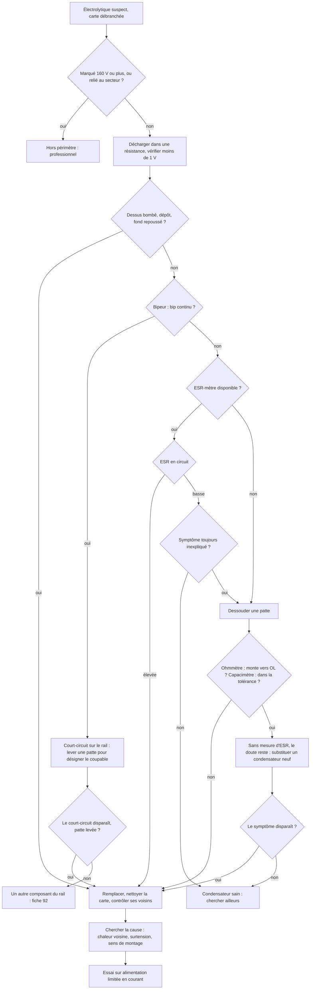

# 22 Condensateur électrolytique aluminium

Reconnaître un condensateur électrolytique usé, y compris quand il a encore bonne mine et presque toute sa capacité : c'est sa résistance série (ESR) qui le trahit en premier.

## En bref

Le condensateur électrolytique aluminium loge une forte capacité dans un petit boîtier cylindrique, grâce à un électrolyte **liquide**. C'est aussi ce qui le condamne : l'électrolyte s'évapore lentement, d'autant plus vite qu'il fait chaud. C'est le composant qui s'use le plus vite sur une carte, et le **premier à contrôler** dans une alimentation en panne. Il est **polarisé** : monté à l'envers, il chauffe, gonfle et peut s'ouvrir brutalement. En vieillissant, sa **résistance série (ESR) monte bien avant que sa capacité ne baisse** : un capacimètre, ou l'ohmmètre, peut donc déclarer bon un condensateur qui ne filtre plus rien. L'œil trouve les cas flagrants (dessus bombé, dépôt), l'**ESR-mètre** trouve les autres.

> **Sécurité** : mesures hors tension → carte débranchée, piles retirées, condensateurs déchargés et vérifiés au voltmètre ; mesures sous tension → alimentation limitée en courant, 50 V continu (25 V alternatif) au plus partout sur la carte (fiche [00](../00_securite/README.md)). C'est le condensateur qui stocke le plus d'énergie sur une carte : **le décharger dans une résistance** (100 Ω à 1 kΩ, 2 à 5 W), jamais avec un tournevis, puis vérifier au voltmètre qu'il reste moins de 1 V. **La tension remonte toute seule** après une décharge trop brève (absorption diélectrique) : vérifier une seconde fois avant de toucher. Un condensateur marqué **160 V et plus** (souvent 200, 400 ou 450 V) est le réservoir d'une alimentation reliée au secteur : il garde une charge dangereuse appareil débranché, **hors du périmètre de ces fiches**. Ne jamais se pencher au-dessus d'un électrolytique sous tension : son évent peut s'ouvrir en projetant de l'électrolyte.

## Identifier le composant

| Type | Aspect | Où on le trouve |
| --- | --- | --- |
| Radial traversant | cylindre gainé de plastique, deux pattes du même côté, bande claire à signes − sur le côté | partout : filtrage d'alimentation, découplage, liaison audio |
| Axial | cylindre couché, une patte à chaque bout | appareils anciens |
| CMS | boîtier d'aluminium nu sur une embase carrée en plastique, secteur ou barre de couleur sur le dessus | cartes compactes |
| Bipolaire (non polarisé) | même cylindre, sans repère de polarité | filtres d'enceintes, circuits où la tension change de sens |

Repère **C** sur la carte. Le dessus des boîtiers porte souvent des entailles : c'est l'**évent de sécurité**, une zone amincie prévue pour s'ouvrir si la pression interne monte. Sur les petits boîtiers, il peut être sur le fond.

### Lire la valeur

- **Capacité** : en clair, en microfarads (`470 µF`). Tolérance courante : ±20 % (lettre M).
- **Tension** : tension maximale de service, en volts continus.
- **Température** : 85 °C ou 105 °C le plus souvent. C'est la température à laquelle la durée de vie annoncée est garantie, pas une simple limite.

### Repérer la polarité

- **Radial** : la bande imprimée sur le côté du boîtier, avec ses signes −, longe la patte **négative**. Sur un composant neuf, la patte négative est aussi la plus courte.
- **CMS** : le secteur ou la barre de couleur sur le dessus du boîtier est du côté **négatif**.
- **Piège** : sur un condensateur tantale, et sur un condensateur polymère en boîtier **rectangulaire** moulé (aluminium ou tantale), le repère désigne le **positif** (fiche [23](../23_condensateur_tantale/README.md)). Un condensateur polymère **cylindrique** garde son repère côté **négatif**, comme un électrolytique ordinaire. Vérifier la famille et la forme du composant, et la sérigraphie de la carte, avant de se fier à une bande.

Pourquoi le sens compte : la couche d'oxyde qui sert d'isolant ne tient qu'**1 à 1,5 V** à l'envers. Au-delà, le condensateur conduit, chauffe et produit du gaz : l'évent s'ouvre, ou le condensateur se met en court-circuit.

## Modes de défaillance

Classés du plus fréquent au plus rare (consensus des réparateurs et notes de fabricants, voir Sources ; aucune statistique publiée).

| Mode de défaillance | Fréquence | Cause typique | Ce que la panne implique ailleurs |
| --- | --- | --- | --- |
| ESR en hausse, puis capacité en baisse (dessèchement) | très fréquent | évaporation de l'électrolyte : âge, chaleur ambiante, échauffement interne dû au courant d'ondulation | rail mal filtré : ondulation, ronflement, redémarrages, régulateur ou transistor de découpage surmené ; les condensateurs voisins de même âge sont dans le même état |
| Gonflement, évent ouvert, fuite d'électrolyte | fréquent | surchauffe, surtension, montage à l'envers, électrolyte défectueux des séries de 1999 à 2007 | électrolyte répandu sur la carte, à nettoyer ; chercher la cause de la surchauffe ou de la surtension |
| Court-circuit | occasionnel | surtension, tension inverse | fusible ou résistance fusible ouverts, régulateur en limitation (fiche [13](../13_fusible/README.md)) |
| Courant de fuite élevé | occasionnel | longue période sans tension (la couche d'oxyde s'est dégradée), surtension | le condensateur chauffe, un rail faible en courant s'effondre |
| Circuit ouvert | rare | patte corrodée par l'électrolyte, connexion interne coupée | plus aucun filtrage : même effet qu'un condensateur complètement sec |

Fin de vie, selon les fabricants : une capacité qui a perdu **plus de 30 %**, ou une ESR **multipliée par plus de 3**. La chaleur commande tout : **chaque 10 °C de plus divise la durée de vie par deux**. Un condensateur donné pour 2 000 heures à 105 °C dure environ 15 ans à 45 °C ; le même, collé à un radiateur ou à un régulateur, meurt le premier.

Pourquoi l'usure s'emballe : l'ESR transforme le courant d'ondulation en chaleur à l'intérieur du boîtier (P = I² × ESR). Plus d'ESR, c'est plus de chaleur, donc plus d'évaporation, donc encore plus d'ESR.

## Niveau 1 — Inspection par les sens

Carte hors tension et déchargée. Comparer chaque condensateur à ses voisins de même modèle.

- **À l'œil** : dessus **bombé** ou évent fendu, **dépôt brun ou roux** sur le dessus ou au pied, **fond repoussé** (le bouchon de caoutchouc sort, le boîtier penche ou se soulève), gaine plastique rétractée ou brunie par la chaleur, piste et pattes voisines corrodées.
- **Ne pas confondre** : une colle brune ou noire est souvent posée au pied des gros condensateurs pour les tenir. Ce n'est pas de l'électrolyte.
- **Un aspect normal n'innocente pas** : un condensateur dont l'ESR a monté ne montre le plus souvent rien.
- **Repérer les mal placés** : ceux qui touchent un radiateur, un régulateur ou une résistance de puissance vieillissent les premiers.
- **Échauffement**, carte sur alimentation limitée en courant, sans se pencher au-dessus : un électrolytique nettement plus chaud que ses voisins, loin de toute source de chaleur, a une ESR ou une fuite excessive, ou est monté à l'envers. Couper et mesurer.

## Niveau 2 — Mesure hors circuit

Condensateur déchargé, **une patte dessoudée** ou composant retiré (fiche [02](../02_pieges_en_circuit/README.md)). Sur un composant polarisé, **pointe rouge sur le +, pointe noire sur le −**.

### À l'ohmmètre : se charge-t-il ?

1. Sélecteur sur **Ω**, calibre 200 kΩ.
2. Pointe rouge sur la patte positive, pointe noire sur la patte négative (côté de la bande).
3. Observer la lecture pendant plusieurs secondes.

| Lecture | Verdict |
| --- | --- |
| Part de bas, puis grimpe régulièrement vers OL | il se charge : ni coupé, ni en court-circuit. **Son ESR reste inconnue** |
| OL d'emblée, sur une valeur de 10 µF ou plus (en dessous, la charge est trop brève pour être vue) | plus de capacité : desséché ou circuit ouvert, à remplacer |
| Valeur basse qui ne monte pas | fuite ou court-circuit : à remplacer |
| Proche de 0 Ω, bip continu au bipeur | court-circuit : à remplacer |

L'ohmmètre injecte un petit courant qui charge le condensateur ; la tension monte, et l'appareil l'affiche comme une résistance qui grimpe (fiche [01](../01_multimetre/README.md), « Pourquoi un condensateur bipe puis se tait »). Plus la capacité est grande, plus la montée est lente. Pour recommencer, décharger d'abord le condensateur. Ce test est un tri grossier : **il laisse passer un condensateur usé**.

### Au capacimètre : la valeur

1. Condensateur déchargé, sélecteur sur le **capacimètre**.
2. Pointe rouge sur le +, pointe noire sur le −. Attendre : sur une forte valeur, la mesure prend plusieurs secondes.
3. Comparer au marquage. Exemple : 470 µF à ±20 %, soit de 376 à 564 µF.

| Lecture | Verdict |
| --- | --- |
| Dans la tolérance | capacité correcte. **Cela ne prouve pas qu'il est bon** : mesurer l'ESR |
| Sous la tolérance, sans atteindre 30 % de perte (de 330 à 376 µF pour un 470 µF) | douteux : mesurer l'ESR |
| Plus de 30 % sous le marquage (moins de 330 µF pour un 470 µF) | en fin de vie : à remplacer |
| Presque nulle | desséché ou circuit ouvert : à remplacer |
| Très supérieure au marquage, instable, ou lecture impossible | fuite ou court-circuit probables : vérifier à l'ohmmètre |

Le capacimètre du multimètre charge le condensateur avec un courant connu et chronomètre la montée de la tension : il **ne dit rien de l'ESR** (fiche [01](../01_multimetre/README.md)). Or l'ESR peut avoir beaucoup monté sans que la capacité ait bougé. Une capacité conforme ne clôt donc jamais le diagnostic d'un électrolytique.

### À l'ESR-mètre : le verdict

L'ESR-mètre est un petit appareil dédié (fiche 03). Il envoie dans le condensateur des impulsions de courant trop brèves pour le charger, des dizaines de milliers de fois par seconde, et mesure la tension qu'elles produisent : celle-ci ne dépend que de la résistance série.

1. **Décharger le condensateur** et le vérifier au voltmètre : une tension résiduelle peut détruire l'ESR-mètre.
2. Une pince ou une pointe sur chaque patte ; le sens est indifférent sur la plupart des appareils.
3. Lire l'ESR et la comparer à celle d'un **condensateur neuf identique** (même capacité, même tension, même série), ou à la valeur de sa fiche technique.

| Lecture | Verdict |
| --- | --- |
| Voisine de celle du condensateur neuf (0,09 Ω dans l'exemple) | sain, si le bipeur ne signale pas de court-circuit |
| Plus de 3 fois celle du neuf | en fin de vie : à remplacer |
| Plusieurs ohms sur un condensateur de filtrage (4,7 Ω dans l'exemple) | usé : à remplacer |
| Très basse, et bip continu au bipeur | court-circuit : l'ESR-mètre ne le distingue pas d'un bon condensateur |

Limites : l'ESR-mètre ne mesure pas la capacité, et un condensateur dont l'ESR ne devient excessive qu'à chaud peut passer le test à froid.

## Niveau 3 — Mesure en circuit

### Hors tension

Carte débranchée, condensateurs déchargés et vérifiés.

| Mesure, composant en place | Ce qu'elle permet de dire |
| --- | --- |
| **ESR-mètre** : ESR élevée | condensateur usé : rien, en parallèle, ne peut faire monter la lecture. C'est la mesure en circuit la plus utile |
| ESR-mètre : ESR basse | bon signe, sans certitude : un autre condensateur ou une faible résistance en parallèle abaisse la lecture. Au moindre doute, lever une patte |
| Bipeur : bip continu qui ne cesse pas | court-circuit sur le rail : le condensateur, ou n'importe quel composant branché sur le même rail (fiche 92) |
| Bipeur : bip bref, puis silence | normal : le condensateur se charge (fiche [01](../01_multimetre/README.md)) |
| Ohmmètre ou capacimètre | rien de sûr : tout le rail est mesuré en même temps, les condensateurs en parallèle s'additionnent (fiche [02](../02_pieges_en_circuit/README.md)) |

Pourquoi l'ESR-mètre fonctionne en circuit : sa tension de mesure est trop faible pour faire conduire les jonctions des diodes, des transistors et des circuits intégrés. Ils restent invisibles ; seuls comptent les chemins de faible résistance.

### Sous tension

Carte sur alimentation limitée en courant, sélecteur sur **V continu**, pointe noire à la masse, pointe rouge sur la patte positive du condensateur de filtrage.

| Lecture | Verdict |
| --- | --- |
| Tension conforme et stable | pas de conclusion : le voltmètre affiche une moyenne, l'ondulation lui échappe |
| Tension moyenne trop basse (10,3 V au lieu de 11,8 V dans l'exemple de la figure) | condensateur de filtrage suspect, ou charge trop forte : mesurer l'ESR hors tension |
| Tension qui s'effondre ou hésite dès que la carte consomme | condensateur de filtrage ou de sortie suspect |
| Tension supérieure à la tension de service marquée sur le condensateur | couper : la surtension détruit le condensateur ; chercher sa cause en amont |

L'exemple de la figure est une carte alimentée par un adaptateur basse tension **alternatif** (25 V~ au plus), qui porte son propre redresseur. L'ondulation à 100 Hz ne s'observe qu'avec cet adaptateur : ne le brancher qu'après avoir vérifié, au bipeur puis sur l'alimentation limitée en courant, que le rail n'est pas en court-circuit (fiche [00](../00_securite/README.md)). Sur une alimentation de laboratoire, qui fournit du continu, il n'y a pas d'ondulation à 100 Hz : le même défaut se montre par une tension qui s'effondre dès que la carte consomme.

Le voltmètre en continu ne rafraîchit son affichage que deux ou trois fois par seconde et moyenne tout ce qui bouge plus vite (fiche [01](../01_multimetre/README.md)). Le mode V alternatif donne au mieux un ordre de grandeur de l'ondulation, selon l'appareil ; seul l'oscilloscope la montre (niveau 4).

### Du symptôme au condensateur suspect

| Symptôme | Condensateur à contrôler en premier | Pourquoi |
| --- | --- | --- |
| Appareil qui ne démarre qu'après plusieurs essais, ou seulement une fois chaud | condensateurs de sortie de l'alimentation ; petit condensateur de démarrage du circuit de commande (au primaire d'un bloc secteur : **hors périmètre**) | ESR trop élevée à froid |
| Ronflement dans le son, barres ou ondulations à l'image | condensateur de filtrage principal, côté basse tension (côté secteur : **hors périmètre**) | ondulation du rail |
| Redémarrages, blocages aléatoires | condensateurs de découplage du rail logique | creux de tension |
| Alimentation qui siffle, tension de sortie instable | condensateurs de sortie du régulateur à découpage | ESR élevée : la régulation devient instable |
| Régulateur ou transistor qui chauffe anormalement | condensateur d'entrée et de sortie de ce régulateur | ondulation excessive à absorber |
| Condensateurs bombés en série sur une carte de 1999 à 2007 | tous ceux de la même marque et de la même série | électrolyte défectueux |
| Bloc secteur ou appareil à alimentation intégrée en panne | gros condensateur 400 V du primaire | **hors périmètre** : à confier à un professionnel |

## Niveau 4 — Méthodes avancées

- **Oscilloscope** : sonde sur le rail, couplage alternatif. C'est la mesure directe de l'ondulation de la figure ci-dessus ; la comparer à celle d'une carte saine ou à la valeur de la fiche technique du régulateur (fiches 03 et 91).
- **Pont LCR** : capacité et ESR à une fréquence choisie, à comparer aux valeurs de la fiche technique (fiche 03).
- **Courant de fuite sous tension de service**, condensateur dessoudé : même montage que pour le céramique (fiche [20](../20_condensateur_ceramique/README.md), niveau 4), alimentation de laboratoire limitée à 10 mA, résistance de 1 kΩ en série, **+ de l'alimentation vers le + du condensateur**, jamais plus que la tension de service ni que 50 V. 1 mV aux bornes de la résistance correspond à 1 µA. Limite habituelle après 2 à 5 minutes : 0,01 × C (µF) × U (V) + 3 µA, soit environ **120 µA** (120 mV) pour un 470 µF 25 V. Une fuite qui reste bien au-dessus, ou qui augmente : à remplacer. Décharger ensuite dans la résistance.
- **Condensateur resté des années sans tension** : sa couche d'oxyde a pu se dégrader et sa fuite est élevée à la première mise sous tension. Le même montage, laissé une heure à la tension de service, la reforme. Les condensateurs récents n'en ont en général pas besoin.
- **Substitution** : souder provisoirement un condensateur neuf, de même capacité et de tension au moins égale, à la place du suspect. Le symptôme disparaît : le diagnostic est fait.

## Arbre de décision

## Remplacer le composant

| Critère | Règle |
| --- | --- |
| Capacité | identique |
| Tension de service | égale ou supérieure à celle d'origine |
| Température | égale ou supérieure : un 105 °C remplace un 85 °C, jamais l'inverse |
| ESR | dans une alimentation à découpage, une série à faible ESR, comme l'original : un modèle d'usage général y chauffe et s'use vite |
| Dimensions | diamètre, hauteur et entraxe des pattes compatibles avec l'emplacement |
| Polarisé ou bipolaire | un bipolaire ne se remplace que par un bipolaire |
| Voisins | les condensateurs de même série et de même âge, soumis à la même chaleur, sont à remplacer en même temps |

Précautions de soudage :

- **Relever le sens avant de dessouder** : photo de la carte, repère du − de l'ancien condensateur. Remonter le neuf dans le même sens, bande du même côté, et **vérifier deux fois**.
- Nettoyer l'électrolyte répandu (alcool isopropylique, brosse) : il corrode les pistes et les pattes voisines.
- Ne pas plier les pattes au ras du boîtier, ne pas tirer dessus : le bouchon doit rester étanche.
- Ne pas plaquer le condensateur neuf contre une source de chaleur si la longueur des pattes permet de l'en écarter.

Avant de remettre sous tension : sens de montage vérifié une dernière fois, cause de la panne traitée (chaleur, surtension), fusible et régulateur en amont contrôlés, premier essai sur alimentation limitée en courant, sans se pencher au-dessus de la carte.

## Aide-mémoire d'établi

- Premier suspect d'une alimentation en panne : il s'use par évaporation, plus vite au chaud (durée de vie divisée par deux tous les 10 °C).
- Polarisé : bande à signes − et patte courte = négatif. Sur un tantale, le repère est le positif.
- Le décharger dans une résistance, vérifier moins de 1 V ; la tension peut remonter, vérifier deux fois.
- Dessus bombé, dépôt brun, fond repoussé : à remplacer. Aspect normal : rien n'est prouvé.
- L'ESR monte avant que la capacité ne baisse : ohmmètre et capacimètre laissent passer un condensateur usé.
- ESR-mètre, en circuit, hors tension et déchargé : une ESR élevée condamne, une ESR basse ne prouve pas tout.
- Fin de vie : capacité −30 % ou ESR × 3 par rapport au neuf.
- Le voltmètre en continu ne voit pas l'ondulation.
- Marqué 160 V et plus : secteur, hors périmètre.
- Remplacement : même capacité, tension et température au moins égales, faible ESR en découpage, sens vérifié deux fois.

## Mini-glossaire

- **Électrolyte** : liquide conducteur qui imbibe le papier placé entre les deux feuilles d'aluminium ; il forme la véritable armature négative.
- **Couche d'oxyde** : isolant très mince formé sur la feuille d'aluminium positive ; c'est le diélectrique. Elle ne tient que dans un sens.
- **ESR** (résistance série équivalente) : résistance que le condensateur présente en série avec sa capacité ; elle transforme le courant d'ondulation en chaleur.
- **Ondulation** : variation résiduelle de la tension d'un rail continu, au rythme des recharges du condensateur de filtrage.
- **Courant d'ondulation** : courant alternatif qui traverse le condensateur de filtrage à chaque recharge et à chaque décharge.
- **Évent** : zone amincie du boîtier ou du bouchon, prévue pour s'ouvrir avant que la pression interne ne fasse éclater le condensateur.
- **Absorption diélectrique** : une partie de la charge reste piégée dans le diélectrique et fait remonter la tension après une décharge brève.
- **Reformage** : remise sous tension progressive d'un condensateur longtemps stocké, pour reconstituer sa couche d'oxyde.
- **Bipolaire** : condensateur électrolytique à deux feuilles oxydées, qui accepte une tension dans les deux sens.

## Sources

Les faits ci-dessous sont reformulés ; les fréquences de panne sont un classement qualitatif, pas une statistique.

- Wikipédia (en), *Aluminum electrolytic capacitor* : électrolyte liquide et évaporation, critères de fin de vie (capacité −30 %, ESR ou impédance × 3), durée de vie divisée par deux tous les 10 °C et exemple de 2 000 heures à 105 °C, repérage du négatif (bande latérale, patte plus courte, demi-cercle ou barre sur le dessus des CMS), tenue en tension inverse de 1 à 1,5 V et dégagement de gaz, évent de sécurité, courant de fuite (0,01 × C × U + 3 µA après 2 ou 5 minutes), reformage à la tension de service à travers 1 kΩ pendant une heure, absorption diélectrique de 10 à 15 %, échauffement interne par le courant d'ondulation dans l'ESR, condensateurs bipolaires. <https://en.wikipedia.org/wiki/Aluminum_electrolytic_capacitor>
- Wikipédia (en), *Polymer capacitor*, « Polarity marking » : repère du côté positif sur les condensateurs polymère rectangulaires (tantale ou aluminium), du côté négatif sur les modèles cylindriques. <https://en.wikipedia.org/wiki/Polymer_capacitor>
- Wikipédia (en), *Capacitor plague* : séries à électrolyte défectueux de 1999 à 2007, dessus bombé, dépôt brun ou roux, bouchon repoussé, colle de maintien à ne pas confondre avec de l'électrolyte. <https://en.wikipedia.org/wiki/Capacitor_plague>
- Wikipédia (en), *ESR meter* : impulsions de courant trop brèves pour charger le condensateur, tension trop faible pour faire conduire les jonctions (mesure en circuit), appareil vulnérable à un condensateur chargé, court-circuit lu comme une ESR idéale, pas de mesure de capacité, ESR excessive à chaud seulement. <https://en.wikipedia.org/wiki/ESR_meter>
- Wikipédia (en), *Equivalent series resistance* : l'ESR des électrolytiques augmente avec l'âge et la chaleur, jusqu'à la panne du circuit, alors que la capacité mesurée peut rester correcte. <https://en.wikipedia.org/wiki/Equivalent_series_resistance>
- Samuel M. Goldwasser, *Capacitor Testing, Safe Discharging and Other Related Information* : test à l'ohmmètre, ESR comme meilleur indicateur d'un électrolytique usé, lecture faussement bonne en circuit avec une faible résistance en parallèle, décharge dans une résistance et jamais au tournevis. <https://www.repairfaq.org/sam/captest.htm>
