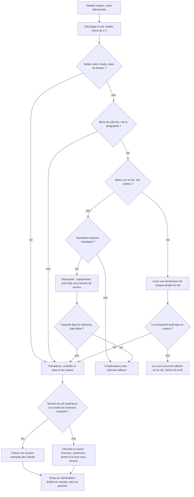

# 23 Condensateur tantale

Reconnaître un condensateur tantale en court-circuit, lire sa polarité sans la confondre avec celle d'un électrolytique aluminium, et le remplacer sans préparer la panne suivante.

## En bref

Le condensateur tantale loge une forte capacité dans un très petit boîtier, avec un électrolyte **solide** : rien ne s'évapore, il ne s'use pas comme l'électrolytique aluminium (fiche [22](../22_condensateur_electrolytique/README.md)). Sa panne est brutale : il se met en **court-circuit**, le plus souvent **à la mise sous tension**, après une surtension, une pointe de courant ou un montage à l'envers. Si rien ne limite le courant du rail, il s'emballe, chauffe et peut **s'enflammer**. Deux pièges : son repère désigne le **positif**, à l'inverse de l'électrolytique aluminium, et sa tension marquée n'est pas sa tension d'emploi (la moitié seulement pour le type courant). Le bipeur suffit à trouver un tantale claqué ; le difficile est de ne pas remonter le neuf à l'envers.

> **Sécurité** : mesures hors tension → carte débranchée, piles retirées, condensateurs déchargés et vérifiés au voltmètre ; mesures sous tension → alimentation limitée en courant, 50 V continu (25 V alternatif) au plus partout sur la carte (fiche [00](../00_securite/README.md)). Un tantale en court-circuit ou monté à l'envers **chauffe en quelques instants et peut s'enflammer** en projetant des fragments brûlants : toujours limiter le courant, ne jamais se pencher au-dessus de la carte sous tension, porter des lunettes de protection, couper dès qu'un composant fume. Sur un rail qui porte des tantales, ne relever la limite de courant que par paliers, et couper au premier échauffement (niveau 3).

## Identifier le composant

| Type | Aspect | Où on le trouve |
| --- | --- | --- |
| CMS moulé | petit pavé jaune, orange ou noir, une barre à une extrémité, deux terminaisons métalliques repliées sous le boîtier | découplage et filtrage des rails sur les cartes compactes |
| Goutte (traversant) | perle de résine en forme de goutte, souvent jaune, orange ou bleue, deux pattes du même côté | appareils plus anciens, cartes analogiques |

Repère **C** sur la carte, comme tous les condensateurs. Deux technologies partagent ces boîtiers : l'électrolyte solide au **dioxyde de manganèse**, et l'électrolyte **polymère**. Rien ne les distingue à l'œil : c'est la référence du composant, ou le schéma, qui le dit.

### Lire la valeur

- **Code à trois chiffres**, en picofarads : deux chiffres, puis le nombre de zéros. `476` = 47 suivi de 6 zéros = 47 000 000 pF = **47 µF** ; `105` = 1 µF.
- **Valeur en clair**, la lettre µ à la place de la virgule : `47µ` = 47 µF, `4µ7` = 4,7 µF, `µ47` = 0,47 µF.
- **Tension** : tension maximale de service, en volts continus (`16V`). Une lettre de tolérance peut suivre la capacité (`105K` : 1 µF à ±10 %), comme sur les condensateurs céramique (fiche [20](../20_condensateur_ceramique/README.md)).
- Un marquage illisible ou réduit à un code de fabricant : se reporter au schéma ou à la référence du composant.

### Repérer la polarité

- **CMS** : la barre imprimée à une extrémité du boîtier est du côté **positif**.
- **Goutte** : le signe **+**, ou une barre, est du côté de la patte **positive**.
- **Piège** : sur un électrolytique aluminium CMS, le repère (secteur ou barre de couleur) désigne le **négatif** (fiche [22](../22_condensateur_electrolytique/README.md)). Les deux familles se côtoient sur les mêmes cartes : identifier la famille avant de se fier à un repère, et se fier au signe + de la sérigraphie de la carte quand il existe.

Pourquoi le sens compte : la couche d'oxyde qui sert d'isolant ne tient que dans un sens. À l'envers, un tantale ne supporte que **10 % de sa tension marquée, sans dépasser 1 V**, et seulement pour de brefs instants (à 25 °C ; moins encore à chaud). Monté à l'envers sur un rail de 3,3 V ou plus, il dépasse largement cette limite.

## Modes de défaillance

Classés du plus fréquent au plus rare (consensus des réparateurs et notes de fabricants, voir Sources ; aucune statistique publiée).

| Mode de défaillance | Fréquence | Cause typique | Ce que la panne implique ailleurs |
| --- | --- | --- | --- |
| Court-circuit | fréquent | surtension, pointe de courant à la mise sous tension sur un rail qui ne limite pas le courant, tension inverse, tension d'emploi trop proche de la tension marquée | rail en court-circuit : fusible ou résistance fusible ouverts, régulateur en limitation ou détruit (fiche [13](../13_fusible/README.md)) ; sans limitation, boîtier brûlé, piste et composants voisins noircis |
| Courant de fuite élevé | occasionnel | début du même défaut : la couche d'oxyde se dégrade localement | le condensateur chauffe, un rail faible en courant s'effondre ; le défaut peut basculer en court-circuit |
| Circuit ouvert | rare | composant brûlé après un court-circuit, soudure rompue | plus de découplage : rail bruité, comme avec un condensateur absent |

Pourquoi la panne est brutale : la couche d'oxyde est extrêmement mince. Un point faible de cette couche laisse passer un courant qui l'échauffe ; dans un circuit capable de fournir beaucoup de courant, la fuite passe de quelques nanoampères à plusieurs ampères en quelques millisecondes. C'est l'emballement thermique : le composant chauffe jusqu'à brûler. Le moment le plus risqué est la **mise sous tension**, quand le rail monte d'un coup et que le condensateur appelle une pointe de courant.

C'est pour cela que les fabricants demandent de la marge : pas plus de **50 % de la tension marquée** pour un tantale au dioxyde de manganèse (avec, à l'origine, une résistance série de 3 Ω par volt pour limiter le courant), pas plus de **80 %** pour un tantale polymère.

Exemple : un tantale marqué 16 V convient à un rail de 5 V (moins de 8 V). Sur un rail de 12 V, il est trop près de sa limite : s'il a claqué là, le remplacer par un modèle de tension supérieure (voir « Remplacer le composant »).

## Niveau 1 — Inspection par les sens

Carte hors tension et déchargée.

- **À l'œil** : boîtier **noirci, fendu ou éclaté**, cratère, résine boursouflée, trace de brûlure sur la carte autour du composant, piste décolorée. Un tantale qui a brûlé se voit presque toujours.
- **Un aspect normal n'innocente pas** : un tantale en court-circuit dont le courant a été limité (fusible, régulateur protégé) reste intact en apparence.
- **Sens de montage** : comparer la barre du composant au signe + de la sérigraphie. Un tantale monté à l'envers après une réparation est une cause classique.
- **À l'odeur** : odeur de brûlé localisée.
- **Échauffement**, carte sur alimentation limitée en courant, **sans se pencher au-dessus** : un tantale ne chauffe pas en fonctionnement normal. Celui qui est tiède ou chaud est en fuite ou en court-circuit : couper tout de suite.

## Niveau 2 — Mesure hors circuit

Condensateur déchargé, **dessoudé ou une terminaison levée** (fiche [02](../02_pieges_en_circuit/README.md)). Composant polarisé : **pointe rouge sur le + (côté de la barre), pointe noire sur le −**.

### Au bipeur : est-il en court-circuit ?

1. Sélecteur sur le **bipeur**.
2. Pointe rouge sur le côté positif (la barre), pointe noire sur le côté négatif.
3. Écouter, puis lire l'afficheur.

| Lecture | Verdict |
| --- | --- |
| Bip bref ou aucun bip, puis OL | pas de court-circuit. Reste à contrôler la capacité et, au moindre doute, la fuite (niveau 4) |
| Bip continu, quelques dixièmes d'ohm ou quelques ohms (0,4 Ω dans l'exemple) | court-circuit : à remplacer |
| Valeur basse et stable à l'ohmmètre (quelques ohms à quelques kilohms), sans montée | fuite : à remplacer |

Le bip bref est normal : le multimètre charge le condensateur, qui se comporte un instant comme un fil (fiche [01](../01_multimetre/README.md), « Pourquoi un condensateur bipe puis se tait »). Limite : le bipeur et l'ohmmètre travaillent sous une tension très faible ; une fuite qui n'apparaît qu'à la tension de service leur échappe.

### Au capacimètre : la valeur

1. Condensateur déchargé, sélecteur sur le **capacimètre**.
2. Pointe rouge sur le +, pointe noire sur le −.
3. Comparer au marquage. Exemple : 47 µF à ±20 % (lettre M), soit de 37,6 à 56,4 µF.

| Lecture | Verdict |
| --- | --- |
| Dans la tolérance | capacité correcte, et pas de court-circuit franc |
| Très supérieure au marquage, instable, ou lecture impossible | fuite ou court-circuit probables : vérifier au bipeur et à l'ohmmètre |
| Presque nulle | circuit ouvert : à remplacer |

Le capacimètre charge le condensateur avec un courant connu et chronomètre la montée de la tension (fiche [01](../01_multimetre/README.md)) : une fuite détourne ce courant et fausse la lecture vers le haut.

## Niveau 3 — Mesure en circuit

### Hors tension

Carte débranchée, condensateurs déchargés et vérifiés.

| Mesure, composant en place | Ce qu'elle permet de dire |
| --- | --- |
| Bipeur entre le rail et la masse : bip continu | court-circuit sur le rail : le tantale est le premier suspect, avec les condensateurs céramique (fiche [20](../20_condensateur_ceramique/README.md)), mais tout composant branché sur ce rail donne la même lecture |
| Bipeur : bip bref, puis silence | normal : les condensateurs du rail se chargent |
| Ohmmètre ou capacimètre | rien de sûr : tout le rail est mesuré en même temps (fiche [02](../02_pieges_en_circuit/README.md)) |

Pour désigner le coupable : **lever une terminaison** de chaque tantale du rail, l'un après l'autre, et refaire le test au bipeur sur le composant et sur le rail. Le rail qui cesse de biper désigne le condensateur qu'on vient d'isoler.

### Sous tension

Carte sur alimentation limitée en courant, **limite basse** (100 mA pour commencer), sans se pencher au-dessus.

| Observation | Verdict |
| --- | --- |
| L'alimentation passe en limitation de courant, la tension du rail reste proche de 0 V | court-circuit sur le rail : couper, chercher hors tension |
| Un tantale tiédit ou chauffe | c'est lui : couper tout de suite et le remplacer |
| Tension du rail conforme, aucun échauffement | pas de court-circuit ; un tantale ouvert ne se voit pas au voltmètre |
| Tension du rail supérieure à la moitié de la tension marquée sur le tantale (plus de 8 V pour un 16 V au dioxyde de manganèse) | marge insuffisante : cause probable de la panne, à corriger au remplacement |

La recherche du point chaud est décrite dans la fiche [20](../20_condensateur_ceramique/README.md) (« Sous tension : faire chauffer le coupable ») et dans la fiche 92. Avec des tantales sur le rail, **ne relever la limite de courant que par paliers, lunettes de protection portées, sans se pencher au-dessus de la carte, et couper au premier échauffement** : un tantale en court-circuit qui reçoit plusieurs ampères peut s'enflammer. Préférer la caméra thermique, qui le désigne à très faible courant, ou lever les terminaisons une à une hors tension.

### Du symptôme au condensateur suspect

| Symptôme | Condensateur à contrôler en premier | Pourquoi |
| --- | --- | --- |
| Appareil mort, fusible ouvert ou alimentation en limitation | tantales de découplage du rail en court-circuit | court-circuit franc |
| Panne survenue à la mise sous tension, ou au branchement d'une alimentation | tantale d'entrée, le plus proche du connecteur d'alimentation | pointe de courant et surtension à la mise sous tension |
| Composant brûlé, trace noire sur la carte | le tantale lui-même, puis la piste et les composants voisins | emballement thermique |
| Panne juste après une réparation ou un remplacement de condensateur | le tantale neuf | monté à l'envers, repère confondu avec celui d'un aluminium |
| Appareil alimenté à l'envers ou par un adaptateur de tension trop élevée | tous les tantales du rail d'entrée | tension inverse ou surtension |

## Niveau 4 — Méthodes avancées

- **Courant de fuite sous tension de service**, condensateur dessoudé : même montage que pour le céramique (fiche [20](../20_condensateur_ceramique/README.md), niveau 4), alimentation de laboratoire limitée à 10 mA, résistance de 1 kΩ en série, **+ de l'alimentation vers le + du condensateur**, sans dépasser la tension à laquelle le condensateur travaille sur la carte, ni 50 V. 1 mV aux bornes de la résistance correspond à 1 µA. Comparer à la fiche technique ou à un condensateur neuf identique ; une fuite qui augmente au lieu de diminuer : couper, à remplacer. Décharger ensuite dans la résistance.
- **Caméra thermique** : désigne le tantale en fuite ou en court-circuit à très faible courant, bien avant qu'il ne brûle (page i8).
- **Millivolts le long du rail** : avec un faible courant injecté, la chute de tension dans les pistes désigne la direction du court-circuit (fiche 92).
- **Pont LCR ou ESR-mètre** : capacité et résistance série à comparer à la fiche technique (page i5). Un tantale en court-circuit lit une ESR très basse : l'ESR-mètre ne le distingue pas d'un bon condensateur (fiche [22](../22_condensateur_electrolytique/README.md)).

## Arbre de décision

## Remplacer le composant

| Critère | Règle |
| --- | --- |
| Capacité | identique |
| Tension marquée | égale ou supérieure à celle d'origine, et **au moins le double de la tension du rail** pour un tantale au dioxyde de manganèse (au moins 1,25 fois pour un polymère) |
| Technologie | même famille que l'original (dioxyde de manganèse ou polymère), d'après la référence |
| Boîtier | mêmes dimensions de pastilles ; une tension supérieure peut imposer un boîtier plus gros, à vérifier avant de commander |
| Polarité | barre du composant du côté du + de la sérigraphie |

Précautions de soudage :

- **Relever le sens avant de dessouder** : photo de la carte, position de la barre. Si l'ancien composant a brûlé et que la sérigraphie est illisible, retrouver le sens sur le schéma ou en suivant les pistes : sur un rail positif, le côté négatif d'un condensateur de découplage va à la masse.
- Nettoyer les résidus de brûlure et contrôler la piste : une piste carbonisée conduit ou se coupe.
- Vérifier deux fois le sens du composant neuf : **la barre est le +**, à l'inverse d'un électrolytique aluminium.

Avant de remettre sous tension : sens vérifié une dernière fois, bipeur silencieux entre le rail et la masse, fusible et régulateur en amont contrôlés, cause de la panne traitée (tension du rail, adaptateur, inversion), premier essai sur alimentation limitée en courant, sans se pencher au-dessus de la carte.

## Aide-mémoire d'établi

- Panne typique : court-circuit franc, souvent à la mise sous tension. Pas d'usure lente comme l'aluminium.
- La barre, ou le signe +, désigne le **positif** : l'inverse d'un électrolytique aluminium.
- À l'envers : 10 % de la tension marquée, 1 V au plus, brièvement. Un montage à l'envers le détruit.
- Tension d'emploi : la moitié de la tension marquée (dioxyde de manganèse), 80 % (polymère).
- Bipeur, composant isolé : bip continu = à remplacer ; bip bref puis silence = pas de court-circuit.
- En circuit, le bip continu désigne tout le rail : lever les terminaisons une à une.
- Sous tension : limite de courant basse, ne pas se pencher, couper dès qu'un composant chauffe ou fume.
- Un tantale chaud est un tantale en panne.
- Remplacement : même capacité, tension marquée au moins double de celle du rail, sens vérifié deux fois.

## Mini-glossaire

- **Tantale** : métal dont la poudre frittée forme l'armature positive (anode) du condensateur ; sa très grande surface donne une forte capacité dans un petit volume.
- **Couche d'oxyde** : isolant très mince formé sur le tantale ; c'est le diélectrique. Elle ne tient que dans un sens.
- **Électrolyte solide** : matériau conducteur (dioxyde de manganèse ou polymère) qui forme l'armature négative ; il ne s'évapore pas.
- **Emballement thermique** : un défaut local chauffe, ce qui augmente le courant, ce qui chauffe davantage, jusqu'à la destruction.
- **Marge en tension** (*derating*) : écart volontaire entre la tension d'emploi et la tension marquée.
- **Courant de fuite** : faible courant continu qui traverse le diélectrique sous tension.
- **Tension inverse** : tension appliquée à l'envers, + sur le côté négatif.
- **CMS** : composant monté en surface, soudé sur des pastilles sans traverser la carte.

## Sources

Les faits ci-dessous sont reformulés ; les fréquences de panne sont un classement qualitatif, pas une statistique.

- Wikipédia (en), *Tantalum capacitor* : électrolyte solide au dioxyde de manganèse ou polymère, court-circuit comme panne la plus courante, emballement thermique quand le courant n'est pas limité et risque d'inflammation, panne la plus probable à la mise sous tension, défaut local du diélectrique (cristallisation de champ) avec une fuite passant de nanoampères à des ampères en quelques millisecondes dans un circuit à faible impédance, marge en tension de 50 % avec résistance série de 3 Ω par volt (dioxyde de manganèse) et de 20 % (polymère), repérage du positif par une barre ou un signe +, à l'inverse des électrolytiques aluminium CMS, limites de tension inverse (10 % de la tension nominale et 1 V au plus à 25 °C, 3 % et 0,5 V à 85 °C, 1 % et 0,1 V à 125 °C, pour de brèves excursions), marquages (code à trois chiffres en picofarads, `105K`, `4µ7`). <https://en.wikipedia.org/wiki/Tantalum_capacitor>
- Wikipédia (en), *ESR meter* : un condensateur en court-circuit est lu comme une ESR idéale. <https://en.wikipedia.org/wiki/ESR_meter>
- Samuel M. Goldwasser, *Capacitor Testing, Safe Discharging and Other Related Information* : test à l'ohmmètre et au bipeur, lecture en circuit faussée par les composants en parallèle, décharge dans une résistance. <https://www.repairfaq.org/sam/captest.htm>
