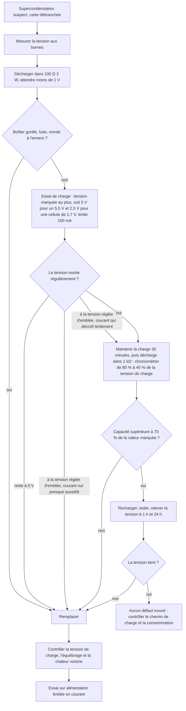

# 24 Supercondensateur

Décharger sans danger un supercondensateur, qui reste chargé des semaines, puis mesurer au chronomètre ce que le multimètre ne sait pas lire : sa capacité et son autodécharge.

## En bref

Le supercondensateur stocke **des milliers de fois plus** de charge qu'un condensateur ordinaire : sa capacité se compte en **farads**. Sur une carte, il sert de petite réserve d'énergie : il garde l'heure ou les réglages pendant une coupure, à la place d'une pile. Il vieillit comme l'électrolytique aluminium (fiche [22](../22_condensateur_electrolytique/README.md)) : avec la chaleur et les années, sa **capacité baisse** et sa **résistance interne monte**, et la sauvegarde tient de moins en moins longtemps. Trois pièges : il **reste chargé des semaines** après le débranchement, sa décharge prend **des minutes**, et le multimètre le lit mal (le bipeur le prend pour un court-circuit, le capacimètre ne sait pas lire un farad). Tout se mesure donc avec un voltmètre, une résistance et un chronomètre.

> **Sécurité** : mesures hors tension → carte débranchée, piles retirées, condensateurs déchargés et vérifiés au voltmètre ; mesures sous tension → alimentation limitée en courant, 50 V continu (25 V alternatif) au plus partout sur la carte (fiche [00](../00_securite/README.md)). Un supercondensateur de 1 F chargé à 5,5 V contient 15 J, autant qu'un très gros condensateur de filtrage : un court-circuit par une pointe ou un outil fait un arc et peut arracher une pastille. **Toujours le décharger dans une résistance, jamais par un tournevis ou un fil**, et vérifier au voltmètre avant chaque mesure. Ne jamais dépasser sa tension marquée ni le brancher à l'envers. Les grosses cellules (des centaines de farads et plus) et leurs modules peuvent fournir des courants de l'ordre du millier d'ampères : ils sortent du périmètre de cette fiche.

## Identifier le composant

| Type | Aspect | Où on le trouve |
| --- | --- | --- |
| Petit modèle de sauvegarde, 5,5 V | boîtier court et large à deux pattes, ou forme de pile bouton épaisse soudée sur la carte ; marqué en farads (0,1 F à quelques farads) | maintien de l'heure et des réglages pendant une coupure |
| Cellule cylindrique, 2,5 à 2,7 V | ressemble à un électrolytique aluminium, mais marquée en farads | réserve d'énergie plus importante, souvent plusieurs cellules en série |

Repère **C** sur la carte, comme tous les condensateurs. Une cellule ne supporte que **2,5 à 2,7 V**. Un modèle marqué 5,5 V contient donc **deux cellules en série** dans le même boîtier ; quand la carte utilise des cellules séparées en série, des résistances d'équilibrage (une en parallèle sur chaque cellule) ou un circuit dédié répartissent la tension entre elles.

### Lire la valeur

La capacité et la tension maximale sont écrites en clair : `1F 5.5V` se lit 1 farad, 5,5 V au plus. C'est l'unité qui le distingue d'un électrolytique : des **farads (F)**, pas des microfarads (µF). 1 F vaut 1 000 000 µF.

### Repérer la polarité

Le supercondensateur est **polarisé**. Sur la gaine, la **barre marquée de signes −** désigne la patte **négative**, comme sur un électrolytique aluminium traversant. Sans repère lisible, se fier à la sérigraphie de la carte et à la fiche technique du composant. Une charge à l'envers ne le détruit normalement pas d'un coup, mais elle réduit sa capacité.

## Modes de défaillance

Classés du plus fréquent au plus rare (consensus des réparateurs et notes de fabricants, voir Sources ; aucune statistique publiée).

| Mode de défaillance | Fréquence | Cause typique | Ce que la panne implique ailleurs |
| --- | --- | --- | --- |
| Capacité en baisse, résistance interne en hausse (usure) | fréquent | chaleur et âge : la durée de vie double à peu près chaque fois que la température baisse de 10 °C | la sauvegarde tient de moins en moins longtemps ; chercher une source de chaleur voisine |
| Autodécharge excessive | occasionnel | vieillissement, surtension passée | la sauvegarde se vide en heures au lieu de semaines |
| Court-circuit ou dégagement de gaz | rare | tension supérieure à la tension marquée, cellules en série mal équilibrées | contrôler la tension du rail de charge et les résistances d'équilibrage |
| Capacité réduite après inversion | rare | composant monté à l'envers lors d'une réparation | contrôler le sens de montage |

Fin de vie, par convention : **30 % de capacité perdus** ou **résistance interne multipliée par 4** par rapport à la fiche technique.

## Niveau 1 — Inspection par les sens

- **À l'œil** : boîtier gonflé, gaine fendue, dépôt ou trace de liquide au pied du composant, corrosion des pistes voisines.
- **Sens de montage** : comparer la barre − du composant à la sérigraphie, surtout après une réparation.
- **Voisinage** : un supercondensateur collé à un régulateur ou à une résistance qui chauffe vieillit plus vite.
- **Un aspect normal n'innocente pas** : l'usure ne se voit pas. Seule la mesure tranche.

## Niveau 2 — Mesure hors circuit

Carte débranchée. Composant polarisé : **pointe rouge sur le +, pointe noire sur le −**.

### Avant tout : décharger, et attendre

La méthode de la fiche [00](../00_securite/README.md) s'applique, mais la durée change d'échelle : *5 × R × C* ne vaut plus quelques secondes.

1. Sélecteur sur **volts continus**, mesurer la tension aux bornes.
2. Brancher une résistance de **100 Ω 2 W** entre les deux pattes, tenue par des pinces crocodile.
3. **Laisser la résistance en place** et suivre la tension au voltmètre.
4. Attendre que la tension passe sous 1 V avant toute mesure à l'ohmmètre ; revérifier avant chaque mesure.

![À gauche, un supercondensateur 1 F 5,5 V avec une résistance de 100 Ω 2 W branchée entre ses deux pattes ; un multimètre sur volts continus, pointe rouge sur la patte positive et pointe noire sur la patte négative, lit 0,04 V : on peut mesurer. À droite, la courbe de la tension pendant la décharge : partie de 5,5 V, elle passe sous 1 V après 3 minutes et atteint 0,04 V après 8 minutes. Au départ, 55 mA et 0,3 W dans la résistance ; un condensateur de 1 000 µF se vide dans la même résistance en 0,5 seconde](decharge-sur-resistance.svg)

Exemple : 1 F chargé à 5,5 V dans 100 Ω. Au départ, 55 mA et 0,3 W dans la résistance. *R × C* vaut 100 s : la tension passe sous 1 V après 3 minutes environ et sous 1 % (0,04 V) après *5 × R × C* = 500 s, soit 8 minutes. Le même calcul pour un 1 000 µF donne 0,5 s : c'est tout l'écart entre les deux composants.

### Pourquoi le bipeur et le capacimètre se trompent

| Mode | Ce qu'on observe | Pourquoi |
| --- | --- | --- |
| Bipeur | bip continu pendant de longues secondes, parfois des minutes, comme sur un court-circuit | le courant de test (0,2 à 1 mA, fiche [01](../01_multimetre/README.md)) ne fait monter la tension d'un condensateur de 1 F que de 1 mV par seconde au plus : elle reste longtemps sous le seuil du bip |
| Ohmmètre | valeur très basse qui monte très lentement | même raison : le multimètre charge le condensateur, il ne mesure pas une résistance |
| Capacimètre | `OL`, ou une valeur sans rapport | sa plus grande gamme s'arrête souvent entre 100 µF et quelques dizaines de mF |

**Un bip continu ne prouve donc pas un court-circuit.** C'est l'essai de charge qui tranche.

### Essai de charge sur alimentation limitée

1. Régler l'alimentation de laboratoire **à la tension marquée au plus** (5 V pour un modèle 5,5 V) et la limite de courant à **100 mA**. Sortie coupée.
2. Brancher le + de l'alimentation sur le + du composant, le − sur le −, puis activer la sortie.
3. Observer : l'alimentation passe en limitation de courant, la tension monte régulièrement (environ 0,1 V par seconde pour 1 F sous 100 mA, soit 5 V en 50 s environ ; durée ≈ *C × U / I*), puis le courant retombe vers zéro.

| Lecture | Verdict |
| --- | --- |
| La tension monte régulièrement, dans la durée prévue, puis le courant retombe | il se charge : poursuivre avec les deux mesures suivantes |
| La tension reste proche de 0 V, l'alimentation reste en limitation de courant | court-circuit : à remplacer |
| La tension est tout de suite à la valeur réglée **et le courant tombe à zéro en une ou deux secondes** | capacité presque nulle ou circuit ouvert : à remplacer |
| Le courant ne retombe pas après plusieurs minutes | fuite : confirmer par la mesure d'autodécharge |

Un modèle de sauvegarde à forte résistance interne peut ne jamais faire passer l'alimentation en limitation : c'est alors le **courant** qu'on lit. Sur un composant sain, il reste sous la limite et décroît lentement ; sur un composant ouvert, il est nul presque aussitôt.

### Mesurer la capacité au chronomètre

1. Charger à la tension de l'essai précédent (5 V pour un modèle 5,5 V, 2,5 V pour une cellule de 2,7 V) et **maintenir cette tension 30 minutes** : après une charge trop brève, la tension retombe toute seule et fausse la mesure. Débrancher ensuite l'alimentation.
2. Brancher une résistance de **1 kΩ** entre les deux pattes, voltmètre aux bornes.
3. Démarrer le chronomètre quand la tension passe par **4 V**, l'arrêter à **2 V**.
4. Calculer : **C = durée / (0,69 × R)**, durée en secondes, R en ohms, C en farads.

| Lecture (modèle 1 F, 1 kΩ) | Verdict |
| --- | --- |
| Environ 693 s (11 min 33 s), soit 1 F | sain |
| Moins de 485 s (8 min 5 s), soit moins de 0,7 F | fin de vie : à remplacer |
| 347 s (5 min 47 s), soit 0,5 F | usé : à remplacer |

Pourquoi 0,69 : dans une résistance, la tension d'un condensateur est divisée par deux toutes les *0,69 × R × C* secondes, quel que soit le point de départ. Mesurer entre 4 V et 2 V évite d'avoir à déclencher le chronomètre à l'instant exact du branchement. Pour une autre tension, chronométrer de 80 % à 40 % de la tension de charge : de 2 V à 1 V pour une cellule chargée à 2,5 V.

Limite : la résistance interne du supercondensateur s'ajoute à la résistance de 1 kΩ, donc la méthode surestime un peu la capacité. Elle suffit pour repérer une perte de 30 %. Sur un modèle à forte résistance interne (celui qui ne fait pas passer l'alimentation en limitation pendant l'essai de charge), le résultat n'est qu'une **borne haute** : une capacité déjà trop faible condamne le composant, une capacité correcte ne prouve rien.

### Mesurer l'autodécharge

1. Charger à la tension de l'essai de charge (tension marquée au plus), l'y maintenir 30 minutes au moins, puis débrancher : **rien** ne reste branché aux bornes.
2. Relever la tension après 1 heure, 24 heures, puis une semaine.

| Lecture | Verdict |
| --- | --- |
| La tension baisse lentement, sur des semaines (ordre de grandeur : de 5,5 V à 3 V en 600 heures) | sain |
| La tension s'effondre en quelques heures | autodécharge excessive : à remplacer |

Cette lenteur est aussi le piège de sécurité : une carte débranchée depuis des semaines peut encore porter un supercondensateur chargé.

## Niveau 3 — Mesure en circuit

### Hors tension

- **Mesurer d'abord la tension** aux bornes, sélecteur sur volts continus : c'est la seule mesure fiable carte éteinte, et elle dit s'il faut décharger.
- **Bipeur et ohmmètre** : inutilisables sur le composant en place, pour la raison vue au niveau 2 ; en plus, le reste du circuit est en parallèle (fiche [02](../02_pieges_en_circuit/README.md)).
- **Chemin de charge** : le supercondensateur est en général chargé à travers une résistance et une diode. Une fois le composant déchargé, contrôler la résistance à l'ohmmètre (fiche [10](../10_resistance/README.md)) et la diode en mode diode (fiche [01](../01_multimetre/README.md)).

### Sous tension

Carte sur alimentation limitée en courant.

1. Sélecteur sur **volts continus**, pointe noire sur la masse, pointe rouge sur le + du supercondensateur.
2. Laisser la carte alimentée quelques minutes, lire la tension.
3. Couper l'alimentation et suivre la tension.

| Lecture | Verdict |
| --- | --- |
| Tension proche de celle du rail qui le charge, puis baisse lente après la coupure | normal |
| Tension qui dépasse la tension marquée | surtension : chercher la panne sur le rail de charge avant de remplacer |
| 0 V ou presque, carte alimentée | chemin de charge ouvert (résistance, diode) ou supercondensateur en court-circuit |
| Tension normale, mais qui s'effondre en quelques secondes après la coupure | capacité perdue, ou un circuit voisin consomme trop sur la sauvegarde |
| Cellules en série : tensions très inégales d'une cellule à l'autre | équilibrage défaillant ou cellule usée |

Une carte qui vient d'être branchée avec un supercondensateur vide consomme davantage pendant quelques dizaines de secondes à quelques minutes : c'est sa charge, pas une panne.

### Du symptôme au condensateur suspect

| Symptôme | Piste |
| --- | --- |
| L'heure ou les réglages se perdent après une coupure courte | capacité en baisse ou autodécharge : mesures du niveau 2 |
| L'heure se perd dès la moindre coupure | chemin de charge ouvert, court-circuit, ou capacité nulle |
| La sauvegarde tient, mais l'appareil redémarre lors d'un appel de courant | résistance interne en hausse : niveau 4 |
| Composant gonflé ou trace de liquide | surtension ou fin de vie : remplacer et contrôler la tension de charge |

## Niveau 4 — Méthodes avancées

- **Décharge à courant constant** (méthode normalisée, CEI 62391) : avec une charge électronique, décharger à courant constant et chronométrer le passage de 80 % à 40 % de la tension nominale ; **C = I × durée / écart de tension**. Pour un modèle de sauvegarde, le courant est de 1 mA par farad.
- **Résistance interne en continu** : au branchement d'une charge, la tension chute d'un coup avant de descendre régulièrement. Cette marche, divisée par le courant, donne la résistance interne ; la comparer à la fiche technique (fin de vie : quatre fois la valeur d'origine).
- **ESR-mètre ou pont LCR à 1 kHz** (fiche 03) : la valeur lue en alternatif est nettement plus faible que la résistance interne en continu. La comparer à la valeur à 1 kHz de la fiche technique, pas à la valeur en continu.

## Arbre de décision

## Remplacer le composant

| Critère | Règle |
| --- | --- |
| Capacité | identique ; plus grande, la sauvegarde dure plus longtemps mais la charge aussi |
| Tension marquée | égale ou supérieure, jamais inférieure |
| Type et boîtier | même type (sauvegarde ou puissance), même empreinte, hauteur compatible avec le boîtier de l'appareil |
| Polarité | barre − du côté repéré sur la sérigraphie |
| Cellules en série | remplacer toutes les cellules de la série ensemble et contrôler les résistances d'équilibrage |

Précautions de soudage :

- Décharger l'ancien composant **avant** de le dessouder : la panne du fer ou une goutte de soudure peut le court-circuiter.
- Vérifier au voltmètre que le composant neuf est déchargé avant de le souder.
- Respecter le temps et la température de soudage de la fiche technique.

Avant de remettre sous tension :

- Contrôler le sens de montage.
- Vérifier que la tension du rail de charge ne dépasse pas la tension marquée.
- Alimenter sur alimentation limitée en courant (fiche [00](../00_securite/README.md)) et suivre la tension aux bornes : elle doit monter, puis se stabiliser sous la tension marquée.

## Aide-mémoire d'établi

- Un supercondensateur **reste chargé des semaines** : toujours mesurer la tension avant de toucher.
- Décharge dans **100 Ω 2 W**, résistance laissée en place : 3 minutes pour passer sous 1 V (1 F), jamais de tournevis.
- **Bip continu ≠ court-circuit** : le bipeur ne sait pas charger un farad.
- Le capacimètre du multimètre **ne lit pas les farads**.
- Capacité : décharge dans 1 kΩ, chronométrer de 4 V à 2 V, **C = durée / (0,69 × R)**.
- Fin de vie : **−30 % de capacité** ou résistance interne **× 4**.
- Barre marquée − sur la gaine = **négatif**.
- Une cellule tient 2,5 à 2,7 V : un 5,5 V contient deux cellules en série.
- Jamais plus que la tension marquée, jamais à l'envers.

## Mini-glossaire

- **Farad (F)** : unité de capacité. 1 F vaut 1 000 000 µF.
- **Supercondensateur** : condensateur à double couche électrochimique ; la charge se range à la surface d'électrodes très poreuses, au contact d'un électrolyte.
- **Cellule** : élément de base, limité à 2,5 à 2,7 V ; on en met plusieurs en série pour tenir une tension plus élevée.
- **Équilibrage** : répartition de la tension entre des cellules en série, par des résistances en parallèle ou un circuit dédié.
- **Autodécharge** : baisse lente de la tension d'un condensateur chargé et laissé seul.
- **Résistance interne** : résistance en série avec la capacité ; elle fait chuter la tension dès qu'un courant est demandé.
- **Constante de temps** (*R × C*) : durée caractéristique d'une charge ou d'une décharge dans une résistance ; après cinq constantes de temps, il reste moins de 1 % de la tension.
- **Limitation de courant** : mode d'une alimentation de laboratoire qui plafonne le courant fourni et laisse la tension baisser.

## Sources

Les faits ci-dessous sont reformulés ; les fréquences de panne sont un classement qualitatif, pas une statistique.

- Wikipédia (en), *Supercapacitor* : cellules limitées à 2,5 à 2,7 V, mise en série avec équilibrage passif (résistances en parallèle) ou actif, surtension menant à un dégagement de gaz ou à un court-circuit, autodécharge d'un modèle double cellule de 5,5 V à 3 V en 600 heures, fin de vie à 30 % de capacité perdus ou résistance interne multipliée par 4, durée de vie doublée pour 10 °C de moins, barre sur la gaine repérant le négatif, charge inverse réduisant la capacité sans défaillance catastrophique en général, énergie *½ × C × V²*, courants de crête de l'ordre de 1 000 A pour les cellules de plus de 1 000 F, mesure de la capacité par décharge à courant constant de 80 % à 40 % de la tension nominale après 30 minutes de charge à la tension nominale (CEI 62391, 1 mA par farad pour la classe sauvegarde), relaxation de la tension après une charge, ESR à 1 kHz nettement plus faible que la résistance interne en continu. <https://en.wikipedia.org/wiki/Supercapacitor>
- Samuel M. Goldwasser, *Capacitor Testing, Safe Discharging and Other Related Information* : décharge dans une résistance plutôt que par un court-circuit, test à l'ohmmètre faussé par la charge du condensateur. <https://www.repairfaq.org/sam/captest.htm>
