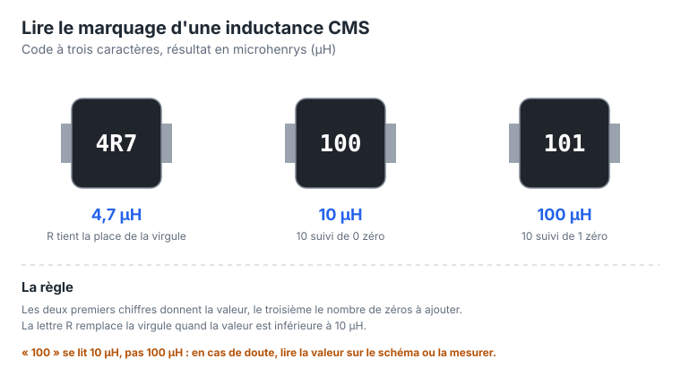
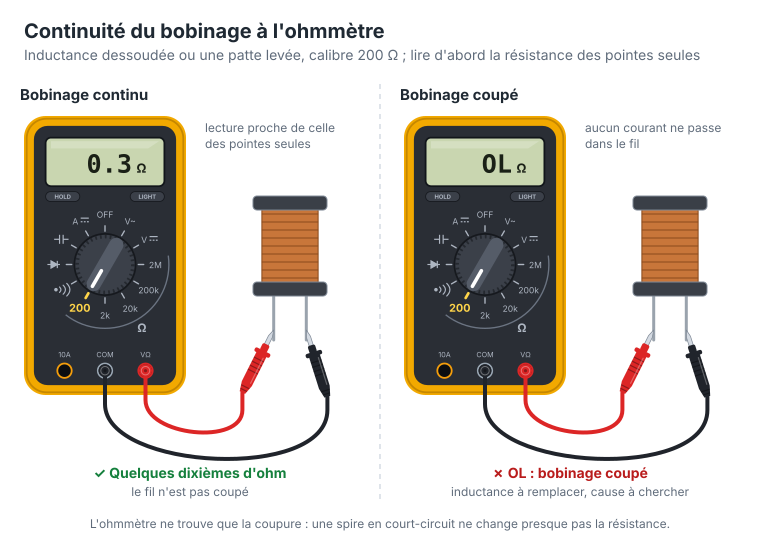
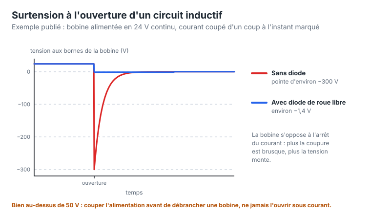
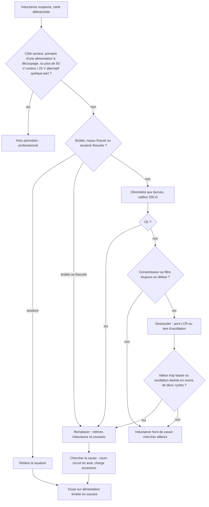

# 30 Inductance

Fiche de dépannage de l'inductance (bobine, self) et de la perle de ferrite : la reconnaître, savoir comment elle tombe en panne, la contrôler et la remplacer.

## En bref

Une inductance est un **fil bobiné**, le plus souvent autour d'un noyau magnétique. Elle tombe **rarement** en panne, et sa panne type est la **coupure** du fil après une surintensité : l'ohmmètre la trouve en quelques secondes. Sa panne sournoise est la **spire en court-circuit**, que ni l'œil ni l'ohmmètre ne voient. Une coupure par surintensité a une **cause en amont ou en aval** : chercher ce qui a fait passer trop de courant avant de remplacer.

> **Sécurité** : mesures hors tension → carte débranchée, piles retirées, condensateurs déchargés et vérifiés au voltmètre ; mesures sous tension → alimentation limitée en courant, 50 V continu (25 V alternatif) au plus partout sur la carte (fiche [00](../00_securite/README.md)). **Ne jamais débrancher ni dessouder une bobine parcourue par un courant** : elle s'oppose à l'arrêt du courant et produit une pointe de tension bien supérieure à celle de l'alimentation (exemple publié : environ 300 V aux bornes d'une bobine alimentée en 24 V). Couper l'alimentation d'abord. Une inductance placée côté secteur, ou au primaire d'une alimentation à découpage, est **hors du périmètre de ces fiches** : elle relève d'un professionnel.

## Identifier le composant

| Type | Aspect | Où on le trouve |
| --- | --- | --- |
| Inductance de puissance CMS | Bloc carré gris ou noir, souvent marqué de trois caractères, deux larges plages de soudure | Convertisseurs à découpage (abaisseur, élévateur) |
| Inductance bobinée traversante | Fil de cuivre émaillé visible sur un noyau en forme de bobine (« tambour ») ou de tore | Filtres d'alimentation, convertisseurs |
| Inductance axiale | Petit cylindre à deux pattes dans l'axe, proche d'une résistance | Filtrage, faibles courants |
| Inductance puce | Petit pavé CMS sans marquage, semblable à un condensateur céramique | Filtrage, circuits radio |
| Perle de ferrite | Petit pavé CMS sombre, ou manchon de ferrite enfilé sur un fil | En série sur un rail ou un signal, pour absorber les parasites haute fréquence |

Repère **L** sur la carte, souvent **FB** pour une perle de ferrite (usage courant des cartes, sans norme citée ici).

Une perle de ferrite n'est pas une inductance de stockage : c'est un filtre qui transforme les parasites haute fréquence en chaleur. Elle se contrôle pourtant de la même façon : en continu, c'est un fil.

### Lire la valeur

Les inductances CMS portent souvent un code à trois caractères, en **microhenrys (µH)** : les deux premiers chiffres donnent la valeur, le troisième le nombre de zéros. La lettre **R** tient la place de la virgule.

Beaucoup d'inductances puce et de perles ne portent aucun marquage : la valeur se lit sur le schéma, ou se mesure au pont LCR (niveau 4).

## Modes de défaillance

Classés du plus fréquent au plus rare (consensus des réparateurs et notes de fabricants, voir Sources ; aucune statistique publiée).

| Mode de défaillance | Fréquence | Cause typique | Ce que la panne implique ailleurs |
| --- | --- | --- | --- |
| Bobinage coupé (circuit ouvert) | occasionnel | Surintensité : le fil ou la perle chauffe au-delà de son courant nominal et se coupe | Chercher ce qui a tiré le courant : composant en court-circuit en aval, charge excessive |
| Soudure fissurée | occasionnel | Composant lourd, vibrations, cycles de chauffe | Panne intermittente ; contrôler les soudures des autres composants lourds |
| Spires en court-circuit | rare | Isolant du fil détruit par une surintensité ou un échauffement | L'inductance baisse et les pertes montent ; finit souvent en coupure si la surintensité continue |
| Noyau fissuré ou cassé | rare | Choc, chute, contrainte mécanique | Inductance modifiée ; chercher d'autres dégâts du même choc |

La **saturation** n'est pas une panne du composant : au-delà de son courant de saturation, l'inductance chute et le courant monte brutalement. Elle apparaît après un remplacement par un modèle trop faible, ou quand la charge tire trop de courant.

## Niveau 1 — Inspection par les sens

Carte hors tension et déchargée.

- **À l'œil** : boîtier ou vernis bruni, fil noirci, noyau de ferrite fissuré ou ébréché, soudure fissurée en anneau autour d'une patte (à la loupe, surtout sur les composants lourds).
- **Ne pas confondre** : une inductance axiale ressemble à une résistance, une inductance puce à un condensateur céramique. Le repère **L** ou **FB** de la carte tranche.
- **Bruit** : un sifflement léger existe sur des cartes saines, par exemple une alimentation à découpage peu chargée. Un bruit nouveau ou changé n'est qu'un indice, jamais une preuve.
- **Échauffement** : une inductance brûlante après une panne signale une surintensité. La cause est ailleurs.

Un aspect normal ne prouve rien : une spire en court-circuit ne se voit pas.

## Niveau 2 — Mesure hors circuit

### À l'ohmmètre : continuité du bobinage

1. Dessouder l'inductance, ou lever une patte.
2. Multimètre sur le calibre **200 Ω**. Mettre les deux pointes en court-circuit et noter la lecture : c'est la résistance des cordons (fiche [10](../10_resistance/README.md)).
3. Poser une pointe sur chaque patte.

| Lecture | Verdict |
| --- | --- |
| Proche de la lecture des cordons seuls (inductance de puissance, perle de ferrite) | Bobinage continu. Rien n'est prouvé sur les spires |
| Faible et stable, jusqu'à quelques dizaines d'ohms sur une inductance de forte valeur en fil fin (ordre de grandeur de cette fiche) | Bobinage continu. Comparer à la fiche technique ; rien n'est prouvé sur les spires |
| OL | Bobinage coupé : inductance à remplacer, cause à chercher |
| Lecture instable quand on bouge une patte | Fil cassé à la sortie du bobinage, ou soudure interne défaite |

L'ohmmètre **ne trouve que la coupure**. Une note d'application de Sencore donne l'ordre de grandeur : sur une bobine de 500 spires et 10 Ω, une spire en court-circuit ne change la résistance que de 0,02 Ω. La résistance d'une inductance de puissance se compte en dizaines de milliohms (26,5 à 54 mΩ sur deux exemples de Würth) : la comparer à la fiche technique demande une mesure 4 fils (fiche [10](../10_resistance/README.md)).

## Niveau 3 — Mesure en circuit

### Hors tension

| Mesure, composant en place | Ce qu'elle permet de dire |
| --- | --- |
| Ohmmètre aux bornes : OL | Bobinage coupé. C'est la seule lecture en circuit qui condamne à coup sûr |
| Ohmmètre aux bornes : proche de zéro | Bobinage continu, ou court-circuité par un autre chemin : rien n'est prouvé |

### Sous tension

Alimentation limitée en courant. Multimètre sur **V continu**, pointe noire à la masse, pointe rouge successivement de chaque côté de l'inductance.

| Lecture | Verdict |
| --- | --- |
| Même tension continue des deux côtés | Le courant continu passe : bobinage continu |
| Tension d'un côté, rien ou presque de l'autre | Bobinage coupé, ou court-circuit en aval qui écrase le rail : couper et contrôler hors tension |

En continu, une inductance est un fil : la tension moyenne à ses bornes est presque nulle. Cette lecture ne dit rien d'une spire en court-circuit.

### Du symptôme à l'inductance suspecte

| Symptôme | Inductance à contrôler en premier | Pourquoi |
| --- | --- | --- |
| Un rail présent en amont d'un filtre, absent en aval | Inductance ou perle de ferrite en série sur ce rail | Une surintensité l'a coupée |
| Panne intermittente, sensible aux chocs ou à la chaleur | Les inductances les plus lourdes | Soudures fissurées aux pattes |
| Inductance de convertisseur très chaude | Inductance de stockage du convertisseur | Courant au-delà du courant nominal, ou saturation : vérifier la charge et la référence montée |

## Niveau 4 — Méthodes avancées

- **Pont LCR** (page i5) : mesurer l'inductance hors circuit, à la fréquence de test indiquée par la fiche technique, et la comparer à la valeur marquée ou à un composant identique reconnu bon. Une valeur nettement trop basse désigne des spires en court-circuit ou un noyau fissuré.
- **Test d'oscillation** à l'oscilloscope (page [i2](../i2_oscilloscope/README.md)), composant dessoudé : brancher un condensateur de 0,001 à 1 µF en parallèle sur le bobinage, l'exciter par une impulsion de quelques volts (générateur de fonctions ; 5 V au plus, choix de cette fiche) et observer l'oscillation amortie. La masse du générateur et la pince de masse de l'oscilloscope vont sur la **même** extrémité du bobinage (page i2, section Pince de masse et terre). Un bobinage sain oscille plusieurs cycles ; une spire en court-circuit absorbe l'énergie et l'oscillation s'éteint en moins de deux cycles.

- **Limites du test d'oscillation** : il ne vaut pas pour les noyaux en tôles de fer, qui amortissent comme une spire en court-circuit ; sous 10 µH, seule la comparaison avec un composant identique reconnu bon a un sens ; un bobinage de deux ou trois spires ne se teste pas ainsi ; il peut laisser passer une coupure, d'où l'ohmmètre d'abord.
- **Substitution** : dans le doute, monter une inductance neuve de mêmes caractéristiques reste le test le plus sûr.

La surtension à l'ouverture se voit aussi à l'oscilloscope. La courbe ci-dessous reprend l'exemple publié d'une bobine en 24 V : elle explique pourquoi une bobine commandée par un transistor porte une diode de roue libre, et pourquoi on ne débranche jamais une bobine sous courant.

## Arbre de décision

## Remplacer le composant

| Critère | Règle |
| --- | --- |
| Inductance | Identique à l'origine |
| Courant de saturation | Au moins égal à l'origine |
| Courant nominal (échauffement) | Au moins égal à l'origine |
| Résistance du bobinage | Au plus égale à l'origine |
| Blindage | Un modèle blindé se remplace par un modèle blindé |
| Boîtier | Même empreinte, même hauteur disponible |
| Perle de ferrite | Même impédance, lue sur la fiche technique, et courant nominal au moins égal |

Ces règles sont une synthèse de cette fiche, déduite des définitions des fabricants. Les courants annoncés ne se comparent pas directement d'un fabricant à l'autre : le courant de saturation est donné pour une chute d'inductance de 10, 20 ou 30 % selon la marque, le courant nominal pour un échauffement fixé par chacune. Lire les conditions dans la fiche technique.

Précautions de soudage :

- Une inductance de puissance est massive : préchauffer, ou utiliser une panne large, pour ne pas laisser une soudure froide.
- Ne pas forcer sur le noyau de ferrite : il casse comme de la céramique.
- Remplacer une inductance par un simple fil n'est admis que le temps d'un essai, sur une inductance de filtrage en sortie, où seul le filtrage se dégrade. Jamais sur l'inductance de stockage d'un convertisseur (conclusion de cette fiche : sans elle, plus rien ne limite le courant du transistor).

Avant de remettre sous tension : mesurer la résistance du rail en aval par rapport à la masse, puis alimenter en limitant le courant. Une inductance neuve qui se coupe à nouveau confirme que la cause n'a pas été trouvée.

## Aide-mémoire d'établi

- Panne rare ; la panne type est la coupure après une surintensité.
- Ohmmètre, calibre 200 Ω : OL = coupée. Une lecture proche de zéro ne prouve rien sur les spires.
- Une spire en court-circuit ne se voit ni à l'œil ni à l'ohmmètre : pont LCR ou test d'oscillation, composant dessoudé.
- Sous tension, en continu : même tension des deux côtés = bobinage continu.
- Inductance coupée par surintensité : chercher le court-circuit ou la surcharge en aval avant de remplacer.
- Marquage CMS en µH : 4R7 = 4,7 µH, 100 = 10 µH, 101 = 100 µH.
- Remplacement : même inductance, courants au moins égaux, résistance au plus égale, blindé pour blindé.
- Ne jamais ouvrir un circuit inductif sous courant : pointe de tension bien au-dessus de 50 V.
- Côté secteur ou primaire d'une alimentation à découpage : hors périmètre.

## Mini-glossaire

- **Inductance** : composant qui s'oppose aux variations du courant qui le traverse ; sa valeur s'exprime en henrys (H), le plus souvent en microhenrys (µH).
- **Perle de ferrite** : filtre qui laisse passer le courant continu et transforme les parasites haute fréquence en chaleur.
- **Résistance du bobinage (DCR)** : résistance en continu du fil de l'inductance.
- **Courant de saturation** : courant au-delà duquel la perméabilité du noyau s'effondre ; l'inductance chute.
- **Courant nominal** : courant qui provoque l'échauffement maximal admis par le fabricant.
- **Spire en court-circuit** : deux tours de fil voisins qui se touchent, isolant détruit ; la boucle fermée absorbe l'énergie et la transforme en chaleur.
- **Blindage** : noyau qui referme le champ magnétique sur lui-même pour ne pas perturber les composants voisins.
- **Diode de roue libre** : diode placée en parallèle sur une bobine pour laisser le courant s'éteindre sans surtension à la coupure.
- **Test d'oscillation** : contrôle d'un bobinage par l'amortissement de son oscillation avec un condensateur.

## Sources

Les faits ci-dessous sont reformulés ; les fréquences de panne sont un classement qualitatif, pas une statistique.

- TDK, *Inductors/Coils FAQ: Part Markings* (copie publiée sur le forum Digi-Key) : code à trois caractères en microhenrys, R à la place de la virgule, exemples 4R7, 100 et 101. <https://forum.digikey.com/t/tdk-inductors-coils-faq-part-markings/4332>
- Wikipédia (en), *Inductor* : types de noyau, inductances blindées, saturation (l'inductance chute et le courant monte), spire en court-circuit comparable au secondaire en court-circuit d'un transformateur, tension induite opposée à la variation du courant. <https://en.wikipedia.org/wiki/Inductor>
- Wikipédia (en), *Ferrite bead* : filtre passe-bas à pertes, énergie haute fréquence dissipée en chaleur. <https://en.wikipedia.org/wiki/Ferrite_bead>
- Wikipédia (en), *Flyback diode* : surtension à l'ouverture d'un circuit inductif, exemple d'une bobine en 24 V continu (environ −300 V sans diode, environ −1,4 V avec), rôle de la diode de roue libre. <https://en.wikipedia.org/wiki/Flyback_diode>
- Wikipédia (en), *Electromagnetically induced acoustic noise* : bruit audible des composants magnétiques en fonctionnement normal. <https://en.wikipedia.org/wiki/Coil_whine>
- Sencore, *Tech Tip 147, How To Find Defective Coils With The LC102 AUTO-Z* : trois pannes d'une bobine (coupure, court-circuit franc, spires en court-circuit), exemple de la bobine de 500 spires et 10 Ω, spire en court-circuit qui absorbe l'énergie, limites du test d'oscillation (noyaux en tôles, inductances sous 10 µH). <https://xdevs.com/doc/Sencore/Sencore_Tech_Tips/TT147p%20-%20How%20To%20Find%20Defective%20Coils%20With%20The%20LC102%20AUTO-Z.pdf>
- Murata, *Chip inductor FAQ, failure mode* : une surintensité coupe le bobinage, ou détruit l'isolant entre spires (l'inductance se dégrade) avant la coupure. <https://www.murata.com/en-eu/support/faqs/inductor/chip/qlty/0001>
- Murata, *What is inrush current?* : une perle de ferrite surchauffe au-delà de son courant nominal, jusqu'à la coupure. <https://article.murata.com/article/what-is-inrush-current>
- Power Systems Design, *Power Supply Failure Survey, Part III* (enquête d'opinion auprès de professionnels) : les noyaux de ferrite se fissurent sous les chocs. <https://www.powersystemsdesign.com/power-supply-failure-survey-part-iii/18>
- Samuel M. Goldwasser, *Notes on the Troubleshooting and Repair of Small Switchmode Power Supplies* : les inductances de filtrage tombent rarement en panne, soudures fissurées aux pattes des composants lourds, pontage d'une inductance de filtrage de sortie le temps d'un essai, sifflement de certaines inductances à faible charge. <https://www.repairfaq.org/sam/smpsfaq.htm>
- Samuel M. Goldwasser, *Testing of Flyback (LOPT) Transformers* : spires en court-circuit invisibles à l'ohmmètre et à l'œil, test d'oscillation (condensateur de 0,001 à 1 µF, impulsion, plusieurs cycles pour un bobinage sain, moins de deux pour un bobinage en défaut, bobinages de deux ou trois spires à éviter, coupures non détectées). <https://www.repairfaq.org/sam/flytest.htm>
- Würth Elektronik, *ANP096* : courant de saturation défini par une chute d'inductance, courant nominal défini par l'échauffement, résistances de bobinage de 26,5 et 54 mΩ, courants non comparables directement entre fabricants. <https://www.we-online.com/components/media/o393343v410%20ANP096%20EN.pdf>
- passive-components.eu, *Inductor Saturation Current Explained* : critères de chute de 10, 20 ou 30 % selon les fabricants. <https://passive-components.eu/inductor-saturation-current-explained>
