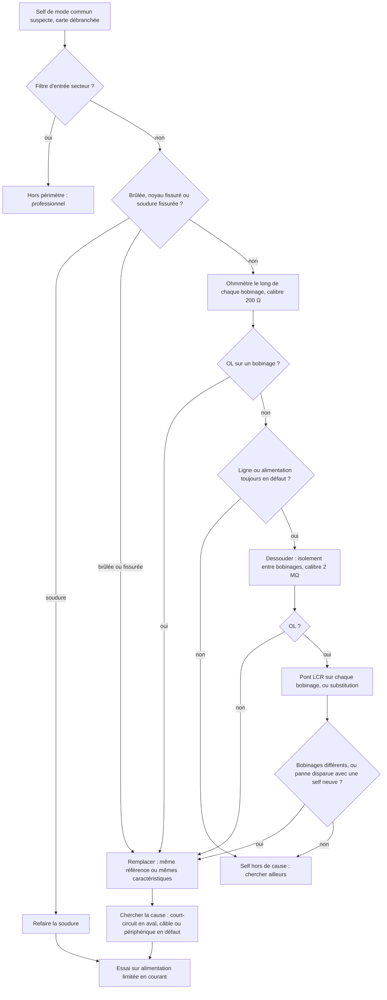

# 31 Self de mode commun

Fiche de dépannage de la self de mode commun (filtre de mode commun) : la reconnaître, savoir comment elle tombe en panne, la contrôler et la remplacer.

## En bref

Une self de mode commun porte **deux bobinages sur un même noyau**, un par fil d'une paire (les deux fils d'une liaison USB ou CAN, le plus et le moins d'une alimentation). Elle laisse passer le courant utile, qui va par un fil et revient par l'autre, et freine les parasites qui circulent dans le même sens sur les deux fils. Elle tombe **rarement** en panne. En continu, chaque bobinage n'est qu'un **fil en série** sur sa ligne : le contrôle se résume à deux mesures à l'ohmmètre, la **continuité de chaque bobinage** et l'**isolement entre les deux**.

> **Sécurité** : mesures hors tension → carte débranchée, piles retirées, condensateurs déchargés et vérifiés au voltmètre ; mesures sous tension → alimentation limitée en courant, 50 V continu (25 V alternatif) au plus partout sur la carte (fiche [00](../00_securite/README.md)). Une self de mode commun d'alimentation est une bobine : **ne jamais la débrancher ni la dessouder sous courant** (fiche [30](../30_inductance/README.md)). La self de mode commun du **filtre d'entrée secteur** d'une alimentation est reliée au réseau : elle est **hors du périmètre de ces fiches** et relève d'un professionnel.

## Identifier le composant

| Type | Aspect | Où on le trouve |
| --- | --- | --- |
| Self de mode commun de ligne de données | Petit pavé CMS à **quatre plots**, souvent sans marquage | Sur une paire de signaux, près du connecteur : USB, HDMI, Ethernet, CAN |
| Self de mode commun d'alimentation continue | Tore ou bloc portant **deux bobinages** de fil plus gros, quatre pattes | À l'entrée d'alimentation continue d'une carte, à l'entrée ou à la sortie d'un convertisseur |
| Self de mode commun de filtre secteur | Tore ou bloc à deux bobinages bien séparés, près de l'arrivée secteur et du fusible | Entrée d'une alimentation secteur : **hors périmètre** |

Sur le schéma, le symbole montre deux bobinages face à face, séparés par le noyau, avec un **point** à la même extrémité de chacun. Les points indiquent le sens de couplage : placés du même côté, ils désignent une self de mode commun.

Le repère de la carte varie d'un fabricant à l'autre (L, FL, T…) : c'est le symbole du schéma, ou les quatre plots sur une paire de pistes, qui identifie le composant (constat de cette fiche, sans norme citée).

### Lire la valeur

La plupart des modèles CMS ne portent aucun marquage : la référence se lit sur le schéma ou la nomenclature. Les caractéristiques utiles sont sur la fiche technique.

| Exemple (fiches techniques, voir Sources) | Impédance ou inductance | Courant nominal | Résistance d'un bobinage |
| --- | --- | --- | --- |
| Ligne USB 2.0 (Würth WE-CNSW 744230900) | 90 Ω à 100 MHz | 550 mA | 0,145 Ω au plus |
| Ligne CAN (Würth WE-CNSW 744234510) | non donnée à 100 MHz | 400 mA | 1,1 Ω au plus |
| Alimentation continue (Murata DLW5BTM101SQ2L) | 100 Ω à 100 MHz | 6 A | 13 mΩ au plus |

Une self de ligne de données s'exprime en **impédance à 100 MHz** (en ohms), une self d'alimentation souvent en **inductance** (en millihenrys). L'impédance annoncée ne se mesure pas à l'ohmmètre : en continu, on ne lit que la résistance du fil.

## Modes de défaillance

Aucune source ouverte ne classe les pannes des selfs de mode commun. Le tableau ci-dessous transpose celles des inductances (fiche [30](../30_inductance/README.md)), puisque le composant est fait de deux bobinages sur un noyau : c'est une déduction de cette fiche, pas une statistique.

| Mode de défaillance | Fréquence | Cause typique | Ce que la panne implique ailleurs |
| --- | --- | --- | --- |
| Bobinage coupé (circuit ouvert) | occasionnel | Surintensité : le fil chauffe au-delà de son courant nominal et se coupe | La ligne est interrompue ; chercher ce qui a tiré le courant (court-circuit en aval, câble ou périphérique en défaut) |
| Soudure fissurée | occasionnel | Composant lourd (tore d'alimentation), vibrations, efforts sur un connecteur voisin | Panne intermittente ; contrôler les soudures du connecteur |
| Isolant détruit entre les deux bobinages | rare | Surintensité ou échauffement | Les deux lignes de la paire se retrouvent reliées : contrôler les composants de part et d'autre |
| Noyau fissuré ou cassé | rare | Choc, chute | Le filtrage se dégrade sans autre symptôme ; chercher d'autres dégâts du même choc |

Les selfs de mode commun des filtres d'alimentation sont décrites comme très fiables par Goldwasser (voir Sources) : la soupçonner en dernier, après le connecteur, le fusible et les composants de protection de la ligne.

## Niveau 1 — Inspection par les sens

Carte hors tension et déchargée.

- **À l'œil** : boîtier bruni ou fendu, fil noirci sur un tore, noyau fissuré, soudure fissurée en anneau autour d'une patte, plot décollé près d'un connecteur qui a forcé.
- **Ne pas confondre** : une self de mode commun CMS a **quatre plots** et se trouve à cheval sur les deux pistes d'une paire ; une inductance simple ou une perle de ferrite n'a que deux plots sur une seule piste.
- **Échauffement** : une self d'alimentation brûlante après une panne signale une surintensité. La cause est ailleurs.

Un aspect normal ne prouve rien.

## Niveau 2 — Mesure hors circuit

Le brochage varie d'un modèle à l'autre : commencer par repérer, à l'ohmmètre, les deux plots de chaque bobinage (ceux entre lesquels la résistance est faible).

1. Dessouder la self.
2. Multimètre sur le calibre **200 Ω**. Mettre les deux pointes en court-circuit et noter la lecture : c'est la résistance des cordons (fiche [10](../10_resistance/README.md)).
3. **Continuité** : une pointe sur chaque plot du même bobinage. Refaire sur l'autre bobinage.
4. **Isolement** : multimètre sur le calibre **2 MΩ**, une pointe sur un plot de chaque bobinage, sans toucher les pointes avec les doigts.

| Mesure | Lecture | Verdict |
| --- | --- | --- |
| Le long d'un bobinage | Faible : de quelques milliohms à quelques ohms selon le modèle | Bobinage continu |
| Le long d'un bobinage | OL | Bobinage coupé : self à remplacer, cause à chercher |
| Entre les deux bobinages | OL | Bobinages isolés |
| Entre les deux bobinages | Toute autre lecture | Isolant détruit : self à remplacer |

Les deux bobinages sont identiques (le contrôle de fabrication cité en source vérifie un rapport de 1 pour 1 et la même limite de résistance sur chacun) : deux lectures de continuité nettement différentes sont un indice de défaut. Aucune source ne chiffre l'écart admis ; c'est une comparaison, pas un seuil.

L'ohmmètre **ne trouve que la coupure et le défaut d'isolement**. Il ne dit rien d'une spire en court-circuit ni d'un noyau fissuré.

## Niveau 3 — Mesure en circuit

### Hors tension

| Mesure, composant en place | Ce qu'elle permet de dire |
| --- | --- |
| Ohmmètre le long d'un bobinage : OL | Bobinage coupé. C'est la seule lecture en circuit qui condamne à coup sûr |
| Ohmmètre le long d'un bobinage : faible | Bobinage continu, ou contourné par un autre chemin : rien n'est prouvé |
| Ohmmètre entre les deux bobinages | Ne prouve rien en circuit : les deux lignes sont reliées par le reste de la carte (terminaison, circuit intégré, charge). L'isolement se contrôle self dessoudée (raisonnement de cette fiche) |

### Sous tension

Alimentation limitée en courant. Multimètre sur **V continu**, pointe noire à la masse, pointe rouge successivement à l'entrée puis à la sortie de **chaque** bobinage.

| Lecture | Verdict |
| --- | --- |
| Même tension continue à l'entrée et à la sortie, sur les deux bobinages | Le courant continu passe : bobinages continus |
| Tension à l'entrée d'un bobinage, rien ou presque à sa sortie | Bobinage coupé, ou court-circuit en aval qui écrase la ligne : couper et contrôler hors tension |

Sur une paire de données, le voltmètre ne lit que la tension moyenne de chaque ligne : il confirme la continuité, pas la qualité du signal.

### Du symptôme à la self suspecte

Ces liens se déduisent de la structure du composant (chaque bobinage est en série sur sa ligne) ; aucune source ouverte ne les énonce tels quels.

| Symptôme | Self à contrôler | Pourquoi |
| --- | --- | --- |
| Une liaison (USB, CAN, Ethernet) muette alors que le connecteur et le câble sont bons | Self de mode commun de la paire, près du connecteur | Un bobinage coupé interrompt une des deux lignes |
| Alimentation continue présente au connecteur d'entrée, absente sur la carte | Self de mode commun d'entrée | Un bobinage coupé interrompt le plus ou le moins |
| Panne intermittente quand on bouge le connecteur ou le câble | Self proche du connecteur | Soudure fissurée |

## Niveau 4 — Méthodes avancées

- **Pont LCR** (page i5), self dessoudée : mesurer l'inductance de **chaque bobinage** et les comparer entre elles et à la fiche technique. Le contrôle de fabrication cité en source mesure la résistance de chaque bobinage séparément, le rapport de 1 pour 1 entre les deux, l'inductance d'un bobinage et la tenue en tension entre bobinages. Une inductance nettement plus basse sur un bobinage désigne des spires en court-circuit ou un noyau fissuré (fiche [30](../30_inductance/README.md)).
- **Oscilloscope** (page [i2](../i2_oscilloscope/README.md)) : comparer le signal de chaque ligne avant et après la self. Le signal utile doit sortir comme il entre. Un signal présent d'un côté et absent de l'autre confirme la coupure.
- **Pontage le temps d'un essai** : remplacer chaque bobinage par un fil court, sur une self en basse tension seulement. Si la panne disparaît, la self était en cause. Goldwasser le décrit pour les selfs de filtre d'entrée, où seul le filtrage des parasites se dégrade ; l'étendre aux lignes de données et aux entrées en basse tension est une déduction de cette fiche. La carte pontée n'est plus filtrée : remonter une self avant de la rendre.
- **Substitution** : dans le doute, monter une self neuve de même référence reste le test le plus sûr.

## Arbre de décision

## Remplacer le composant

| Critère | Règle |
| --- | --- |
| Référence | Identique à l'origine de préférence |
| Impédance de mode commun (ou inductance) | Identique à l'origine, à la même fréquence |
| Courant nominal | Au moins égal à l'origine |
| Résistance des bobinages | Au plus égale à l'origine |
| Tension nominale | Au moins égale à l'origine |
| Application | Même famille que l'origine : un modèle pour ligne de données rapide ne se remplace pas par un modèle d'alimentation, ni l'inverse |
| Boîtier | Même empreinte, même brochage |

Ces règles sont une synthèse de cette fiche, déduite des caractéristiques que publient les fabricants ; pour une ligne CAN, la spécification CiA 110 liste les mêmes paramètres (inductance de mode commun, inductance de fuite, courants, résistance par ligne).

Précautions de soudage :

- **Respecter l'orientation** de la self d'origine : la photographier avant de dessouder. Avec le couplage inversé (points du schéma de côtés opposés), le composant ne se comporte plus comme une self de mode commun.
- Chauffer les quatre plots ensemble (air chaud, ou apport de soudure sur chaque plot) : un petit boîtier CMS tiré d'un seul côté arrache ses pistes.
- Ne pas forcer sur le noyau de ferrite : il casse comme de la céramique.

Avant de remettre sous tension : vérifier à l'ohmmètre la continuité de chaque ligne à travers la self neuve et l'absence de court-circuit entre les deux lignes en aval, puis alimenter en limitant le courant. Une self neuve qui se coupe à nouveau confirme que la cause n'a pas été trouvée.

## Aide-mémoire d'établi

- Deux bobinages sur un noyau, un par fil de la paire ; quatre plots.
- Panne rare : la soupçonner après le connecteur, le câble et les protections.
- Ohmmètre, calibre 200 Ω, le long de chaque bobinage : faible = continu, OL = coupé.
- Ohmmètre, calibre 2 MΩ, entre les deux bobinages, self dessoudée : OL = isolés.
- Deux bobinages identiques : comparer les deux lectures.
- Sous tension, en continu : même tension à l'entrée et à la sortie de chaque bobinage.
- Self coupée : chercher la surintensité (court-circuit en aval, câble, périphérique) avant de remplacer.
- Remplacement : même référence, même orientation.
- Filtre d'entrée secteur : hors périmètre.

## Mini-glossaire

- **Mode commun** : parasite qui circule dans le même sens sur les deux fils d'une paire.
- **Mode différentiel** : courant utile, qui va par un fil et revient par l'autre.
- **Self de mode commun** : deux bobinages sur un même noyau, qui freinent le mode commun et laissent passer le mode différentiel.
- **Point (convention du point)** : marque du schéma qui indique le sens de couplage de chaque bobinage.
- **Impédance de mode commun** : opposition que la self présente aux parasites, donnée en ohms à une fréquence (souvent 100 MHz).
- **Résistance du bobinage (DCR)** : résistance en continu du fil d'un bobinage.
- **Isolement** : absence de liaison électrique entre les deux bobinages.

## Sources

Les faits ci-dessous sont reformulés ; les fréquences de panne sont un classement qualitatif, pas une statistique.

- Wikipédia (en), *Choke (electronics)*, section *Common-mode choke* : deux bobinages sur un même noyau, champs opposés qui s'annulent pour le courant différentiel, forte impédance pour le mode commun, usage sur les lignes d'alimentation. <https://en.wikipedia.org/wiki/Common-mode_choke>
- All About Circuits, *Common-Mode Chokes: From Working Principles to Important Performance Parameters* : principe, usage sur les interfaces rapides (USB, HDMI, Ethernet) et le filtrage des alimentations à découpage. <https://www.allaboutcircuits.com/technical-articles/common-mode-chokes-from-working-principles-to-important-performance-parameters/>
- Murata, *Basics of Noise Countermeasures, Lesson 13* : les points du symbole indiquent le sens de couplage ; du même côté, self de mode commun ; de côtés opposés, le composant n'en est pas une. <https://article.murata.com/article/basics-of-noise-countermeasures-lesson-13>
- Würth Elektronik, *WE-CNSW* (page de série et kit de conception) : applications USB 2.0, LAN, CAN ; 744230900 (90 Ω à 100 MHz, 550 mA, 0,145 Ω au plus) ; 744234510 (400 mA, 1,1 Ω au plus) ; tension nominale de 50 V sur la plupart des modèles. <https://www.we-online.com/catalog/en/WE-CNSW> et <https://www.we-online.com/catalog/en/DESIGNKIT_744230/>
- Murata DLW5BTM101SQ2L (page du distributeur Digi-Key) : 100 Ω à 100 MHz, 6 A, 13 mΩ au plus, 50 V continu. <https://www.digikey.com/en/products/detail/murata-electronics/DLW5BTM101SQ2L/5797612>
- Voltech, *Common Mode Chokes* (exemple de contrôle de fabrication) : résistance de chaque bobinage mesurée séparément avec la même limite, rapport de 1 pour 1, inductance d'un bobinage, tenue en tension entre bobinages. <https://www.voltech.com/applications/test-examples/common-mode-chokes>
- CAN in Automation, *CiA 110* : paramètres spécifiés pour une self de mode commun CAN (inductance de mode commun, inductance de fuite, courants, résistance par ligne). <https://www.can-cia.org/can-knowledge/cia-110-can-common-mode-choke>
- Murata, *Chip inductor FAQ, failure mode* : une surintensité coupe le bobinage ou détruit l'isolant du fil (énoncé pour les inductances puce en général). <https://www.murata.com/en-eu/support/faqs/inductor/chip/qlty/0001>
- Samuel M. Goldwasser, *Notes on the Troubleshooting and Repair of Small Switchmode Power Supplies* : inductances couplées très fiables ; une self de filtre d'entrée coupée peut être pontée le temps d'un essai, seul le filtrage des parasites est affecté. <https://www.repairfaq.org/sam/smpsfaq.htm>
