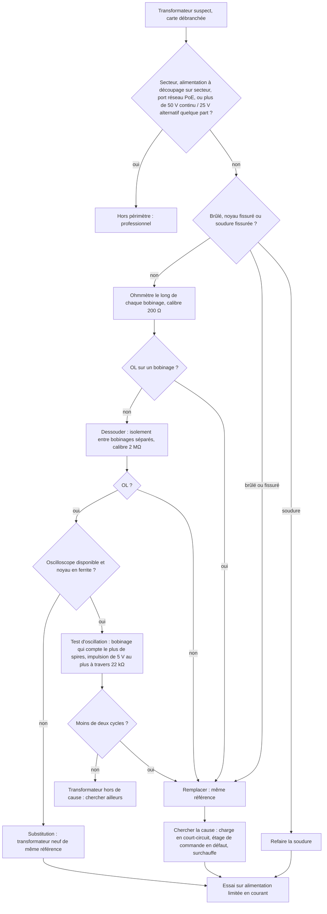

# 32 Transformateur

Fiche de dépannage du transformateur en basse tension (signal, audio, impulsions, réseau Ethernet) : le reconnaître, savoir comment il tombe en panne, le contrôler et le remplacer.

## En bref

Un transformateur porte **deux bobinages ou plus, isolés l'un de l'autre, sur un même noyau**. Il ne transmet que l'alternatif et change la tension selon le **rapport des nombres de spires**. Il tombe **rarement** en panne. À l'ohmmètre, chaque bobinage n'est qu'un fil : le contrôle de base vérifie la **continuité de chaque bobinage** et l'**isolement entre bobinages séparés**. Les spires en court-circuit échappent à l'ohmmètre : elles se cherchent au test d'oscillation sur un noyau en ferrite, par substitution sur un noyau en tôles (fiche [30](../30_inductance/README.md)).

> **Sécurité** : mesures hors tension → carte débranchée, piles retirées, condensateurs déchargés et vérifiés au voltmètre ; mesures sous tension → alimentation limitée en courant, 50 V continu (25 V alternatif) au plus partout sur la carte (fiche [00](../00_securite/README.md)). Un bobinage est une bobine : **ne jamais le débrancher ni le dessouder sous courant** (fiche [30](../30_inductance/README.md)). Un transformateur peut **élever** la tension : quelques volts sur le bobinage qui a le moins de spires donnent davantage sur l'autre. Sont **hors du périmètre de ces fiches** et relèvent d'un professionnel : le transformateur **secteur**, le transformateur d'une **alimentation à découpage** reliée au secteur, le transformateur de ligne ou de très haute tension, le transformateur d'un **port réseau PoE** (alimenté par le câble, ou qui alimente un appareil : jusqu'à 57 V continu, fiche 00), et tout transformateur dont un bobinage dépasse 50 V continu ou 25 V alternatif.

## Identifier le composant

| Type | Aspect | Où on le trouve |
| --- | --- | --- |
| Transformateur de réseau (Ethernet) | Bloc CMS à nombreuses broches, près du connecteur réseau | Entre le circuit d'interface et le connecteur ; souvent associé à une self de mode commun (fiche [31](../31_self_de_mode_commun/README.md)). Port PoE : **hors périmètre** |
| Transformateur audio | Bloc à pattes, souvent blindé, parfois à point milieu | Entrée ou sortie d'un étage audio |
| Petit transformateur d'impulsions ou de commande | Petit noyau de ferrite à quelques broches | Isolation d'un signal de commande ; dans une alimentation à découpage reliée au secteur : **hors périmètre** |
| Transformateur secteur ou d'alimentation à découpage | Noyau de tôles ou de ferrite, relié à l'arrivée secteur | Entrée d'une alimentation : **hors périmètre** |

Sur le schéma, le symbole montre deux bobinages face à face, séparés par le noyau. Un **point** près d'une extrémité de chaque bobinage marque les extrémités de même polarité. Le bobinage qui reçoit l'énergie est le **primaire**, celui qui la restitue le **secondaire**. Un **point milieu** est une prise au milieu d'un bobinage.

Le repère de la carte varie d'un fabricant à l'autre (T, TR, L…) : c'est le symbole du schéma qui identifie le composant (constat de cette fiche, sans norme citée).

### Lire la valeur

Un petit transformateur porte au mieux une référence : les caractéristiques se lisent sur la fiche technique.

| Exemple (fiches techniques, voir Sources) | Rapport | Inductance d'un bobinage | Résistance d'un bobinage | Tenue en tension entre primaire et secondaire |
| --- | --- | --- | --- | --- |
| Réseau, CMS (Coilcraft 1812TRX-S124R) | 1 : 1, point milieu de chaque côté | 120 µH au moins | 2,5 Ω au plus | 1 500 V efficaces, une minute |
| Réseau 10/100, deux voies (Bourns PT61018L) | 1 : 1, point milieu de chaque côté, à ±2 % | 350 µH au moins | 0,9 Ω au plus | 1 500 V alternatif |

- **Rapport** : noté primaire : secondaire. Il vaut le rapport des nombres de spires, donc le rapport des tensions ; le rapport des courants est l'inverse.
- **Rapport d'impédances** : certaines fiches techniques donnent les impédances de chaque côté et non les spires (le plus souvent en audio : constat de cette fiche). L'impédance ramenée au primaire vaut celle du secondaire multipliée par le carré du rapport des spires (primaire sur secondaire). Le rapport des spires est donc la **racine carrée** du rapport des impédances : 10 kΩ : 8 Ω donne un rapport d'impédances de 1 250, donc un rapport de spires d'environ 35.
- **CT** (*center tap*) sur une fiche technique : point milieu. « 1CT : 1CT » se lit rapport 1 pour 1 avec un point milieu de chaque côté.
- **Tenue en tension** : elle se contrôle en fabrication par un essai sous haute tension, pas à l'ohmmètre.

## Modes de défaillance

Les modes ci-dessous sont ceux que Goldwasser (voir Sources) énumère pour les transformateurs de ligne et d'alimentation à découpage, des composants hors périmètre ; les étendre aux petits transformateurs en basse tension, faits des mêmes éléments (fil émaillé, isolant, noyau), est une déduction de cette fiche. Les fréquences et les causes sont transposées de la fiche [30](../30_inductance/README.md) : c'est un classement qualitatif, pas une statistique.

| Mode de défaillance | Fréquence | Cause typique | Ce que la panne implique ailleurs |
| --- | --- | --- | --- |
| Bobinage coupé (circuit ouvert) | occasionnel | Surintensité, échauffement | Plus rien ne traverse ; chercher ce qui a tiré le courant (charge en court-circuit, étage de commande en défaut) |
| Spires en court-circuit | occasionnel | Isolant du fil dégradé par la chaleur | Le transformateur chauffe et charge l'étage qui l'attaque : contrôler cet étage |
| Soudure fissurée | occasionnel | Composant lourd, vibrations, efforts sur un connecteur voisin | Panne intermittente |
| Isolant détruit entre deux bobinages | rare | Échauffement, surtension | Les deux côtés ne sont plus isolés : contrôler les composants de part et d'autre |
| Noyau fissuré ou cassé | rare | Choc, chute | Les caractéristiques changent ; chercher d'autres dégâts du même choc |

Goldwasser note que les transformateurs à haute fréquence d'une alimentation à découpage tombent moins souvent en panne qu'on ne le craint, et que les petits transformateurs de contre-réaction posent rarement problème : soupçonner le transformateur après les composants qui l'entourent. La chaleur est l'ennemie de l'isolant : sa durée de vie est environ divisée par deux pour 7 à 10 °C de plus (ordre de grandeur publié pour les transformateurs de puissance).

## Niveau 1 — Inspection par les sens

Carte hors tension et déchargée.

- **À l'œil** : boîtier bruni, fendu ou boursouflé, vernis coulé, noyau fissuré, soudure fissurée en anneau autour d'une broche.
- **À l'odeur** : un bobinage qui a surchauffé sent le vernis brûlé.
- **Échauffement** : un transformateur brûlant en fonctionnement normal signale des spires en court-circuit ou une charge excessive ; un bobinage en court-circuit fait surchauffer le transformateur.

Un aspect normal ne prouve rien.

## Niveau 2 — Mesure hors circuit

### À l'ohmmètre : continuité et isolement

Commencer par repérer les bobinages sur le schéma ou la fiche technique. À défaut, l'ohmmètre aide à les retrouver : les broches entre lesquelles la résistance est faible appartiennent au même bobinage (un bobinage à point milieu en compte trois).

1. Dessouder le transformateur.
2. Multimètre sur le calibre **200 Ω**. Mettre les deux pointes en court-circuit et noter la lecture : c'est la résistance des cordons (fiche [10](../10_resistance/README.md)).
3. **Continuité** : une pointe sur chaque extrémité du même bobinage. Refaire sur chaque bobinage.
4. **Isolement** : multimètre sur le calibre **2 MΩ**, une pointe sur une broche de chaque bobinage séparé, sans toucher les pointes avec les doigts.

Ne pas tenir les broches en retirant les pointes : couper un courant dans un bobinage produit une pointe de tension (fiche [30](../30_inductance/README.md)).

| Mesure | Lecture | Verdict |
| --- | --- | --- |
| Le long d'un bobinage | Faible, une fois la lecture des cordons retranchée | Bobinage continu. Sous quelques ohms, le multimètre ne permet pas de comparer à la fiche technique (mesure 4 fils, fiche [30](../30_inductance/README.md)) : seul OL tranche |
| Le long d'un bobinage | OL | Bobinage coupé : transformateur à remplacer, cause à chercher |
| Le long d'un bobinage de plusieurs dizaines d'ohms | Très inférieure à la valeur publiée | Bobinage en partie court-circuité : à confirmer au test d'oscillation (noyau en ferrite) ou par substitution |
| Entre deux bobinages séparés | OL | Bobinages isolés |
| Entre deux bobinages séparés | Toute continuité | Défaut : transformateur à remplacer |

Un écart de 10 % sur la résistance d'un bobinage peut ne rien signifier (Goldwasser). L'ohmmètre **trouve la coupure et le court-circuit entre bobinages** ; les spires en court-circuit, même quelques-unes, ne se voient en général pas. Un OL entre bobinages ne garantit pas non plus la tenue en tension de la fiche technique : elle ne se vérifie que par un essai sous haute tension, qui met en jeu des tensions dangereuses et ne se fait pas ici.

### Rapport de transformation, en très basse tension

Cette mesure applique le principe « rapport des tensions = rapport des spires » ; aucune source ouverte ne décrit la procédure telle quelle, c'est une méthode de cette fiche. Elle vaut pour un transformateur **basse fréquence** (audio) : le voltmètre alternatif d'un multimètre n'est juste qu'en basse fréquence (45 à 500 Hz pour la précision annoncée du modèle cité en source). Pour un transformateur d'impulsions ou de réseau, la même comparaison se fait à l'oscilloscope (page [i2](../i2_oscilloscope/README.md)), à la fréquence de travail.

1. Transformateur dessoudé. Repérer le bobinage **qui compte le plus de spires** sur la fiche technique ; à défaut, prendre le plus résistant à l'ohmmètre (indice de cette fiche, pas une règle). C'est lui qui reçoit le générateur : le transformateur **abaisse** alors la tension, et aucun bobinage ne dépasse la tension injectée. Sur la figure, c'est le primaire.
2. Régler le générateur sur une sinusoïde de 100 Hz et le brancher sur ce bobinage. Sans fiche technique, partir du réglage minimal et mesurer au multimètre chaque autre bobinage avant de monter : si l'un d'eux lit plus que le bobinage alimenté, couper le générateur, c'est le côté qui compte le moins de spires, et changer de côté. Ne pas dépasser **1 V efficace**. Ne pas toucher les bobinages avec les doigts.
3. Multimètre sur **V alternatif**, une pointe sur chaque extrémité du bobinage alimenté : noter la tension réellement présente (elle peut être plus basse que le réglage du générateur).
4. Déplacer les pointes sur l'autre bobinage : noter la tension.
5. Diviser la première tension par la seconde et comparer au rapport **des spires** du schéma ou de la fiche technique (racine carrée du rapport d'impédances quand la fiche donne des impédances).

| Lecture | Verdict |
| --- | --- |
| Rapport conforme au schéma ou à la fiche technique | Bobinages cohérents ; ne prouve pas l'absence de spires en court-circuit |
| Aucune tension au secondaire | Bobinage coupé : reprendre le contrôle de continuité |
| Rapport nettement différent | Bobinage en défaut probable (déduction de cette fiche) : confirmer au test d'oscillation (noyau en ferrite) ou par substitution |

**Ne pas injecter du côté qui compte le moins de spires** : la tension est alors multipliée par le rapport. 1 V sur le côté 8 Ω d'un transformateur 10 kΩ : 8 Ω donne environ 35 V de l'autre côté, au-dessus de la limite de 25 V alternatif. **Rapport inconnu** : partir du réglage minimal du générateur et mesurer tous les bobinages avant d'augmenter ; ne jamais dépasser 25 V alternatif sur aucun bobinage.

## Niveau 3 — Mesure en circuit

### Hors tension

| Mesure, composant en place | Ce qu'elle permet de dire |
| --- | --- |
| Ohmmètre le long d'un bobinage : OL | Bobinage coupé. C'est la seule lecture en circuit qui condamne à coup sûr |
| Ohmmètre le long d'un bobinage : faible | Bobinage continu, ou contourné par un autre chemin : rien n'est prouvé |
| Ohmmètre entre deux bobinages | Ne prouve rien en circuit : le reste de la carte peut relier les deux côtés (sur un port réseau, les points milieux rejoignent des résistances et un condensateur de terminaison). L'isolement se contrôle transformateur dessoudé (raisonnement de cette fiche) |

### Sous tension

Uniquement sur une carte en basse tension, alimentation limitée en courant. Le voltmètre continu ne dit rien d'un transformateur, qui ne transmet que l'alternatif : la mesure se fait à l'oscilloscope (page [i2](../i2_oscilloscope/README.md)), en comparant le signal au primaire et au secondaire. La pince de masse reste sur le 0 V de la carte, **jamais sur une extrémité de bobinage** (page i2, section Pince de masse et terre) : chaque extrémité se mesure par rapport au 0 V, et la tension du bobinage est la différence de deux voies (A − B) ou se lit avec une sonde différentielle. Un bobinage isolé dont aucune extrémité n'est au 0 V de la carte (côté câble d'un port réseau) ne se mesure pas avec une sonde à pince de masse (déduction de cette fiche).

| Observation | Verdict |
| --- | --- |
| Signal au primaire, signal au secondaire dans le rapport attendu | Le transformateur transmet |
| Signal au primaire, rien au secondaire | Bobinage coupé, ou secondaire écrasé par une charge en court-circuit : couper et contrôler hors tension |
| Aucun signal au primaire | Chercher en amont : l'étage de commande, ou un primaire qui l'écrase |

Ces verdicts se déduisent du rôle du composant ; aucune source ouverte ne les énonce tels quels.

### Du symptôme au transformateur suspect

Ces liens se déduisent de la place du composant dans le circuit ; aucune source ouverte ne les énonce tels quels.

| Symptôme | Transformateur à contrôler | Pourquoi |
| --- | --- | --- |
| Port réseau muet alors que le câble et le connecteur sont bons | Transformateur de réseau, près du connecteur | Un bobinage coupé interrompt une paire |
| Voie audio muette ou très affaiblie après un étage isolé | Transformateur audio de la voie | Bobinage coupé ou spires en court-circuit |
| Transformateur brûlant, étage de commande en défaut à répétition | Transformateur attaqué par cet étage | Des spires en court-circuit le surchargent |

## Niveau 4 — Méthodes avancées

- **Test d'oscillation** (fiche [30](../30_inductance/README.md)), transformateur dessoudé : un condensateur en parallèle sur un bobinage, une impulsion, et l'oscilloscope montre l'oscillation. Exciter le bobinage **qui compte le plus de spires**, par une impulsion de **5 V au plus** (choix de cette fiche) à travers la **résistance en série de 22 kΩ** de la fiche 30, avec sa règle du condensateur, sans toucher les autres bobinages : excité par son petit bobinage, un transformateur multiplie l'impulsion par son rapport. Les limites sont celles de la fiche 30 : le test ne vaut pas pour un noyau en tôles de fer, cas possible d'un transformateur audio ; il reste alors la substitution. Un transformateur sain oscille pendant plusieurs cycles ; moins de deux cycles désigne des spires en court-circuit. Une spire en court-circuit **n'importe où** dans le transformateur amortit l'oscillation quel que soit le bobinage excité. Le test peut manquer un bobinage coupé : faire l'ohmmètre d'abord.
- **Pont LCR** (page i5) : comparer l'inductance de chaque bobinage au minimum de la fiche technique, dans les mêmes conditions de mesure. C'est un détecteur faible de spires en court-circuit : l'inductance d'un transformateur atteint peut rester proche de la normale.
- **Inductance de fuite** : mesurer l'inductance du primaire avec le secondaire en court-circuit donne à peu près l'inductance de fuite, à comparer à la fiche technique quand elle la donne (0,5 µH au plus sur l'exemple Bourns).
- **Essai de tenue en tension** entre bobinages : il met en jeu des tensions dangereuses. Il ne se fait pas dans le cadre de ces fiches.
- **Substitution** : dans le doute, monter un transformateur neuf de même référence reste le test le plus sûr.

## Arbre de décision

## Remplacer le composant

| Critère | Règle |
| --- | --- |
| Référence | Identique à l'origine : un transformateur est souvent propre à un appareil et ne se trouve parfois que chez son fabricant |
| Rapport et points milieux | Identiques à l'origine |
| Inductance des bobinages | Au moins celle de l'origine, dans les mêmes conditions de mesure |
| Résistance des bobinages | Au plus égale à l'origine |
| Tenue en tension entre bobinages | Au moins égale à l'origine |
| Application | Même usage que l'origine (pour un transformateur de réseau : même débit, même nombre de voies) |
| Boîtier | Même empreinte, même brochage, même plage de température |

Ces règles sont une synthèse de cette fiche, déduite des caractéristiques que publient les fabricants et des critères de choix cités en source pour les transformateurs de réseau. Recommandation de cette fiche, sans source citée : ne pas rebobiner soi-même un transformateur qui assure un isolement.

Précautions de soudage :

- **Respecter l'orientation** : repérer la broche 1 et photographier le transformateur avant de dessouder. Monté à l'envers, primaire et secondaire sont échangés.
- Chauffer toutes les broches ensemble (air chaud, ou apport de soudure sur chaque broche) : un boîtier tiré d'un seul côté arrache ses pistes.
- Ne pas forcer sur le noyau de ferrite : il casse comme de la céramique.

Avant de remettre sous tension : vérifier à l'ohmmètre la continuité de chaque bobinage neuf et l'absence de court-circuit sur la charge du secondaire, puis alimenter en limitant le courant. Un transformateur neuf qui chauffe ou se coupe à nouveau confirme que la cause n'a pas été trouvée.

## Aide-mémoire d'établi

- Deux bobinages ou plus, isolés, sur un même noyau ; ne transmet que l'alternatif.
- Rapport des tensions = rapport des spires ; le courant fait l'inverse.
- Panne rare : soupçonner d'abord les composants autour.
- Ohmmètre, calibre 200 Ω, le long de chaque bobinage : faible = continu, OL = coupé.
- Ohmmètre, calibre 2 MΩ, entre bobinages séparés, transformateur dessoudé : OL attendu, toute continuité = défaut.
- Spires en court-circuit : invisibles à l'ohmmètre ; test d'oscillation sur noyau en ferrite, substitution sinon (fiche 30).
- Rapport : 1 V efficace au plus, 100 Hz, sur le bobinage qui compte le plus de spires ; jamais plus de 25 V alternatif sur un bobinage.
- Fiche technique en impédances : rapport des spires = racine carrée.
- Oscilloscope en circuit : pince de masse sur le 0 V de la carte, jamais sur une extrémité de bobinage.
- Transformateur d'impulsions ou de réseau : oscilloscope, pas multimètre.
- Remplacement : même référence, même orientation.
- Secteur, alimentation à découpage, port PoE, haute tension : hors périmètre.

## Mini-glossaire

- **Primaire** : bobinage qui reçoit l'énergie.
- **Secondaire** : bobinage qui la restitue.
- **Rapport de transformation** : rapport des nombres de spires du primaire et du secondaire, égal au rapport des tensions.
- **Point milieu (CT)** : prise au milieu d'un bobinage.
- **Point (convention du point)** : marque du schéma qui désigne les extrémités de même polarité.
- **Inductance de fuite** : part de l'inductance due au couplage imparfait entre les bobinages.
- **Tenue en tension (isolement)** : tension que l'isolant supporte entre deux bobinages lors d'un essai de fabrication.
- **Résistance du bobinage (DCR)** : résistance en continu du fil d'un bobinage.
- **Test d'oscillation** (*ring test*) : essai qui révèle les spires en court-circuit par l'amortissement d'une oscillation.

## Sources

Les faits ci-dessous sont reformulés ; les fréquences de panne sont un classement qualitatif, pas une statistique.

- Wikipédia (en), *Transformer* : rapport des spires égal au rapport des tensions, rapport des courants inverse ; convention du point (polarité relative) ; impédance de charge ramenée au primaire égale à celle du secondaire multipliée par le carré du rapport des spires ; transformateur élévateur ; flux de fuite ; durée de vie de l'isolant environ divisée par deux pour 7 à 10 °C de plus. <https://en.wikipedia.org/wiki/Transformer>
- Samuel M. Goldwasser, *Notes on the Troubleshooting and Repair of Small Switchmode Power Supplies* : l'ohmmètre aide à retrouver les bobinages ; coupures faciles à trouver à l'ohmmètre, spires en court-circuit au test d'oscillation ; transformateurs à haute fréquence moins souvent en panne qu'on ne le craint, petits transformateurs de contre-réaction rarement en cause ; un bobinage en court-circuit fait surchauffer ; remplacement souvent disponible chez le seul fabricant d'origine. <https://www.repairfaq.org/sam/smpsfaq.htm>
- Samuel M. Goldwasser, *Testing of Flyback (LOPT) Transformers* : modes de défaillance (noyau fissuré, spires en court-circuit, bobinage coupé, isolant détruit) ; toute continuité entre bobinages séparés est un défaut ; l'ohmmètre montre les coupures, les courts-circuits entre bobinages et une résistance très réduite, un écart de 10 % peut ne rien signifier, les spires en court-circuit ne se voient en général pas ; test d'oscillation (condensateur de 0,001 à 1 µF, plusieurs cycles si sain, moins de deux sinon, une spire en court-circuit n'importe où amortit depuis n'importe quel bobinage, le test peut manquer une coupure). <https://www.repairfaq.org/sam/flytest.htm>
- Test & Measurement Tips, *What's a ring tester and why do you need one?* : l'inductance d'un transformateur à spire en court-circuit peut rester proche de celle d'un bon. <https://www.testandmeasurementtips.com/whats-a-ring-tester-and-why-do-you-need-one-faq/>
- Voltech, *Measuring Leakage Inductance* : inductance du primaire mesurée secondaire en court-circuit, proche de l'inductance de fuite ; fuite due au couplage imparfait. <https://www.voltech.com/support/technical-articles/measuring-leakage-inductance/>
- Fluke, *117 Electrician's Multimeter* (fiche technique, copie d'un revendeur) : précision en volts alternatifs spécifiée de 45 à 500 Hz, dégradée de 500 Hz à 1 kHz. <https://pdf.direnc.net/upload/fluke-117-true-rms-dijital-multimetre-pdf-datasheet.pdf>
- Coilcraft, *1812TRX* (fiche technique) : 1812TRX-S124R, rapport 1CT : 1CT, 120 µH au moins, 2,5 Ω au plus, tenue de 1 500 V efficaces une minute entre primaire et secondaire. <https://www.coilcraft.com/getmedia/a775ad5d-df75-4a65-939f-1b45403ec9fd/1812trx.pdf>
- Bourns, *PT61018L* (fiche technique, copie d'un distributeur) : deux voies 1CT : 1CT, rapport à ±2 %, 350 µH au moins, inductance de fuite 0,5 µH au plus, 0,9 Ω au plus, 1 500 V alternatif. <https://static.datasheets.com/doc/14871830-bourns-pt61018-1el-ds.pdf>
- Altium, *Bob Smith Termination: Is it Correct for Ethernet?* : transformateur et self de mode commun d'un port réseau ; points milieux reliés à des résistances de 75 Ω et à un condensateur. <https://resources.altium.com/p/bob-smith-termination-it-correct-ethernet>
- iNRCORE, *Ethernet Transformer Guide* : critères de choix (débit, tension d'isolement, nombre de voies, montage, plage de température). <https://inrcore.com/resources/application-notes/ethernet-transformer-guide/>
- TE Connectivity, *Verification and Diagnosis of Suspected Relay Failures* : l'essai de tenue en tension emploie des tensions dangereuses. <https://www.te.com/en/products/relays-and-contactors/relays/intersection/verification-diagnosis-suspected-relay-failures.html>
- IET Labs, *Bias Inductors* : ouvrir un circuit inductif peut induire une tension élevée et dangereuse. <https://it.ietlabs.com/pdf/application_notes/035009%207600%20Bias%20Inductors%20A5.pdf>
