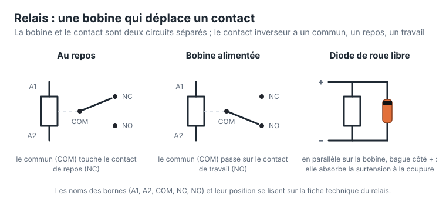
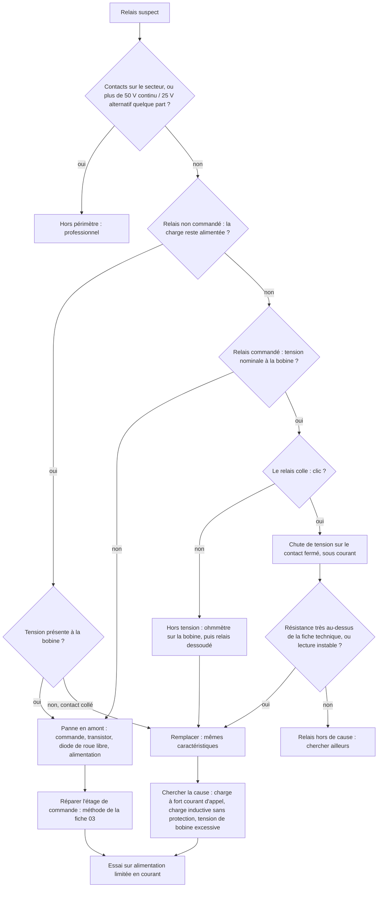

# 33 Relais

Fiche de dépannage du relais électromécanique en basse tension : le reconnaître, savoir comment il tombe en panne, contrôler sa bobine et ses contacts, et le remplacer.

## En bref

Un relais est un **interrupteur commandé par une bobine** : le courant dans la bobine attire une palette qui déplace un contact. La bobine et le contact sont deux circuits séparés. C'est une pièce mécanique qui s'use : il tombe **fréquemment** en panne, le plus souvent par ses **contacts** (usés, encrassés ou collés), plus rarement par sa bobine. Le contrôle se fait en deux temps : la **bobine** à l'ohmmètre et au voltmètre, le **contact** par sa chute de tension sous courant. Un clic ne prouve pas que le contact conduit.

> **Sécurité** : mesures hors tension → carte débranchée, piles retirées, condensateurs déchargés et vérifiés au voltmètre ; mesures sous tension → alimentation limitée en courant, 50 V continu (25 V alternatif) au plus partout sur la carte (fiche [00](../00_securite/README.md)). La bobine d'un relais est une bobine : **ne jamais la débrancher sous courant**, couper l'alimentation d'abord (fiche [30](../30_inductance/README.md)) ; un fabricant annonce 1 000 à 1 500 V à la coupure d'un relais 12 V sans protection. Un relais dont les **contacts commutent le secteur**, ou plus de 50 V continu ou 25 V alternatif, est **hors du périmètre de ces fiches**, même si sa bobine est en basse tension : la carte porte alors une tension dangereuse et relève d'un professionnel.

## Identifier le composant

| Type | Aspect | Où on le trouve |
| --- | --- | --- |
| Relais de puissance pour circuit imprimé | Boîtier plastique en forme de cube, 4 à 8 broches | Commutation d'une charge (moteur, lampe, résistance chauffante) |
| Relais de signal | Petit boîtier plat scellé | Commutation de signaux faibles (audio, mesure, téléphonie) |
| Relais bistable (à verrouillage) | Comme un relais de signal, une ou deux bobines | Garde sa position sans courant dans la bobine |
| Relais à lames souples (*reed*) | Petit boîtier allongé ; contact dans une ampoule de verre | Signaux faibles ; l'ampoule de verre craint les efforts mécaniques |

Le nombre de broches renseigne sur le contact : un simple interrupteur donne 4 broches (2 pour la bobine, 2 pour le contact), un inverseur 5, deux inverseurs 8.

- **COM** : commun. **NC** (*normally closed*) : contact de repos, fermé sans courant dans la bobine. **NO** (*normally open*) : contact de travail, fermé quand la bobine est alimentée.
- **Diode de roue libre** : montée en parallèle sur la bobine, elle absorbe la surtension à la coupure et protège le transistor de commande (fiche [30](../30_inductance/README.md)). Elle est sur la carte, ou parfois dans le relais : un relais à diode intégrée a alors **un sens de branchement**, et l'alimenter à l'envers le détruit.
- Le brochage n'est pas normalisé : la position des bornes se lit sur la fiche technique, ou sur le schéma souvent imprimé sur le boîtier.

### Lire la valeur

Le boîtier porte la référence, la tension de la bobine et le pouvoir de coupure des contacts. Le reste se lit sur la fiche technique.

| Exemple (fiches techniques, voir Sources) | Bobine | Colle au plus tard à | Retombe au plus tard à | Contact |
| --- | --- | --- | --- | --- |
| Puissance, 1 inverseur (Songle SRD-05VDC-SL-C) | 5 V, 70 Ω à ±10 %, 71,4 mA | 75 % de 5 V, soit 3,75 V | 10 % de 5 V, soit 0,5 V | 100 mΩ au plus, neuf ; 7 A sous 28 V continu, 10 A sous 125 V alternatif |
| Signal, 1 inverseur (Omron G5V-1, 5 V) | 5 V, 166,7 Ω à ±10 %, 30 mA | 80 % de 5 V, soit 4 V | 10 % de 5 V, soit 0,5 V | 100 mΩ au plus ; 1 A sous 24 V continu ; charge minimale 1 mA sous 5 V |

- La référence Songle se décode : `05VDC` tension de bobine, `S` boîtier scellé, `L` bobine de 0,36 W, `C` un contact inverseur.
- **Tension de collage** : tension à laquelle le relais doit avoir collé. **Tension de relâchement** : tension en dessous de laquelle il doit être retombé.
- **Charge minimale** : en dessous, un film à la surface du contact peut empêcher le passage du courant.
- **Durée de vie** : la mécanique dépasse de loin les contacts (exemple Songle : 10 millions de manœuvres à vide, 100 000 sous charge nominale).

## Modes de défaillance

Le classement est une synthèse de cette fiche, pas une statistique : les sources décrivent l'usure des contacts comme une panne courante et la casse mécanique comme peu courante, et les fiches techniques donnent aux contacts une durée de vie cent fois plus courte qu'à la mécanique.

| Mode de défaillance | Fréquence | Cause typique | Ce que la panne implique ailleurs |
| --- | --- | --- | --- |
| Contact usé ou encrassé (résistance élevée, coupures intermittentes) | fréquent | Arcs à chaque manœuvre, film d'oxyde ou de sulfure sur un contact qui commute de faibles signaux | La charge est mal alimentée ; vérifier qu'elle ne dépasse pas le pouvoir de coupure |
| Contact collé (soudé) | occasionnel | Courant d'appel d'une lampe, d'un moteur ou d'une charge capacitive ; arc d'une charge inductive | La charge reste alimentée en permanence ; chercher la charge qui a soudé le contact |
| Bobine coupée | occasionnel | Tension de bobine excessive, échauffement | Le relais ne colle plus ; contrôler la tension de commande |
| Soudure fissurée | occasionnel | Composant lourd, vibrations (déduction de cette fiche) | Panne intermittente |
| Casse mécanique | rare | Choc | Chercher d'autres dégâts du même choc |

Le relais n'est pas toujours le coupable : sans diode de roue libre en état, la surtension à la coupure détruit le **transistor de commande**, et le relais ne colle plus alors qu'il est sain.

## Niveau 1 — Inspection par les sens

- **À l'œil**, carte hors tension : boîtier bruni, fondu ou fendu, soudure fissurée en anneau autour d'une broche, pistes noircies près des contacts. Sous un capot transparent, des contacts noircis ou piqués (constat de cette fiche).
- **À l'oreille**, carte en basse tension sous tension : un relais commandé fait entendre un clic. Pas de clic : passer au contrôle de la bobine. **Un clic ne prouve pas que le contact conduit** : il dit seulement que la palette a bougé (conclusion de cette fiche, voir le contrôle du contact).
- **Bourdonnement** : un relais qui bourdonne signale une tension de bobine mal filtrée ; contrôler l'alimentation de la bobine.

## Niveau 2 — Mesure hors circuit

### La bobine à l'ohmmètre

1. Dessouder le relais et repérer les deux bornes de la bobine sur la fiche technique.
2. Multimètre sur le calibre **200 Ω** (ou 2 kΩ si la fiche technique annonce plus de 200 Ω), une pointe sur chaque borne de la bobine.
3. Comparer à la fiche technique, en tenant compte de la tolérance (±10 % sur les deux exemples).

Le courant de mesure d'un multimètre est trop faible pour produire une surtension gênante, mais ne pas tenir les bornes à pleines mains reste une bonne habitude (précaution de cette fiche).

| Lecture | Verdict |
| --- | --- |
| Dans la tolérance de la fiche technique | Bobine bonne |
| OL | Bobine coupée : relais à remplacer, cause à chercher |
| Très inférieure à la valeur publiée (quelques ohms) | Bobine en court-circuit probable : relais à remplacer |
| Hors tolérance sur un relais qui vient de fonctionner | Laisser refroidir une heure et mesurer à nouveau : une bobine chaude est plus résistante |

La figure du niveau 3 montre cette mesure à côté de la mesure de tension.

### Le contact par sa chute de tension

Un ohmmètre ne fait pas passer assez de courant pour juger un contact : un fabricant demande au moins 6 V et 100 mA, de préférence 12 V et 500 mA, et un auteur relève 0,6 Ω à l'ohmmètre sur un contact qui ne fait que 12 mΩ sous 1 A. La mesure sûre est la chute de tension sous courant.

1. Relais dessoudé. Alimenter la **bobine** à sa tension nominale par une alimentation limitée en courant (limite réglée un peu au-dessus du courant de la bobine : choix de cette fiche), **en respectant le sens** si le relais contient une diode. Le relais colle.
2. Faire passer un courant connu dans le **contact fermé** : une seconde source de 12 V et une résistance de 24 Ω en série donnent 0,5 A. La résistance dissipe 6 W : prendre un modèle de puissance de 10 W au moins, il chauffe. Rester sous le courant maximal du contact (1 A pour le relais de signal de l'exemple).
3. Multimètre sur **V continu**, une pointe sur chaque borne du contact fermé, au plus près du boîtier.
4. Diviser la tension lue par le courant : c'est la résistance du contact.
5. Pour finir : couper d'abord la **source du contact**, puis ramener à zéro l'alimentation de la bobine, et seulement ensuite débrancher. Couper la bobine en premier ferait ouvrir le contact sous 0,5 A : c'est l'user pendant qu'on le mesure (précaution de cette fiche).

Si le relais ne contient pas de diode, en monter une en parallèle sur la bobine pour l'essai, bague du côté du plus, comme sur la figure du symbole.

| Lecture | Verdict |
| --- | --- |
| Résistance sous la valeur de la fiche technique (100 mΩ sur les exemples) | Contact bon |
| Résistance nettement supérieure, ou lecture instable | Contact usé ou encrassé : relais à remplacer (déduction de cette fiche) |
| Tension de la source entière aux bornes du contact | Le contact ne se ferme pas : relais à remplacer |
| Bobine non alimentée, le contact de travail conduit encore | Contact collé : relais à remplacer, chercher la charge qui l'a soudé |

La valeur de la fiche technique vaut pour un contact **neuf** : le fabricant cité prévient qu'un contact qui a servi ne se mesure pas de façon fiable. Une lecture un peu au-dessus n'est donc pas un verdict ; une lecture dix fois au-dessus, ou instable, en est un (appréciation de cette fiche). Contrôler aussi le contact de repos, bobine non alimentée.

## Niveau 3 — Mesure en circuit

### Hors tension

| Mesure, composant en place | Ce qu'elle permet de dire |
| --- | --- |
| Ohmmètre sur la bobine : OL | Bobine coupée. C'est la seule lecture en circuit qui condamne à coup sûr |
| Ohmmètre sur la bobine : valeur de la fiche technique | Bobine probablement bonne |
| Ohmmètre sur la bobine : proche de 0 Ω | La bobine, ou la diode de roue libre montée en parallèle, est en court-circuit : dessouder pour trancher (déduction du schéma) |

### Sous tension

Uniquement sur une carte en basse tension, alimentation limitée en courant. Le fabricant cité commence par là : **mesurer la tension aux bornes de la bobine** quand le relais est commandé.

| Relais commandé | Verdict |
| --- | --- |
| Tension nominale à la bobine, le relais colle, la charge est alimentée | Relais hors de cause |
| Tension nominale à la bobine, pas de clic | Relais suspect : contrôler la bobine hors tension |
| Tension nominale à la bobine, clic, mais charge non alimentée | Contact suspect : mesurer la chute de tension entre ses bornes |
| Tension nulle ou sous la tension de collage | Panne en amont : commande, transistor, diode de roue libre en court-circuit, alimentation |
| Relais non commandé, charge alimentée quand même | Contact collé, ou transistor de commande en court-circuit : mesurer la tension de la bobine pour trancher |

Les deux premières mesures suivent la procédure du fabricant ; les verdicts « relais suspect » et « panne en amont » sont des déductions de cette fiche.

**Relais bistable** : sa bobine ne reçoit qu'une impulsion, puis le contact garde sa position sans courant. Une tension nulle à la bobine y est normale : ce tableau et l'arbre de décision ne s'appliquent pas tels quels. Suivre la fiche technique, ou observer l'impulsion à l'oscilloscope (déduction de cette fiche).

**Chute de tension du contact en place** : relais collé et charge alimentée, voltmètre continu entre les deux bornes du contact fermé. Un bon contact ne laisse que quelques dizaines de millivolts ; une tension notable signale un contact dégradé. Diviser par le courant de la charge quand il est connu.

### Du symptôme au relais suspect

Ces liens se déduisent du rôle du composant ; aucune source ouverte ne les énonce tels quels.

| Symptôme | Relais à contrôler | Pourquoi |
| --- | --- | --- |
| Charge jamais alimentée, clic audible | Relais de la charge | Contact usé ou encrassé |
| Charge alimentée en permanence | Relais de la charge | Contact collé |
| Fonctionnement intermittent, sensible aux chocs | Relais de la charge | Contact dégradé ou soudure fissurée |
| Pas de clic | Relais et son étage de commande | Bobine coupée, ou transistor de commande détruit |

## Niveau 4 — Méthodes avancées

- **Tensions de collage et de relâchement**, relais dessoudé, voltmètre sur la bobine, contact surveillé par sa chute de tension : monter lentement la tension de la bobine depuis zéro et noter celle où le contact bascule (elle doit être au plus celle de la fiche technique) ; repartir de la tension nominale, descendre lentement et noter celle où il retombe (elle doit être au moins celle de la fiche technique).
- **Oscilloscope** (page [i2](../i2_oscilloscope/README.md)) sur la bobine d'un relais en place, carte en basse tension. Sonde ×10, pointe sur la borne de la bobine **côté transistor**, pince de masse sur le 0 V de la carte, **jamais sur l'autre borne de la bobine** : elle est au plus de l'alimentation, et la pince le mettrait en court-circuit (page i2, section Pince de masse et terre). À la coupure, une diode de roue libre en état limite la pointe à une tension de diode (fiche [30](../30_inductance/README.md)). Une pointe élevée signale une diode absente ou coupée. La pointe peut dépasser les limites de la sonde et de ces fiches : ne faire cette mesure que si la diode a d'abord été contrôlée hors tension (précaution de cette fiche).
- **Essai de tenue en tension** entre bobine et contacts : il met en jeu des tensions dangereuses. Il ne se fait pas dans le cadre de ces fiches.
- **Substitution** : monter un relais neuf de même référence reste le test le plus sûr.

## Arbre de décision

## Remplacer le composant

| Critère | Règle |
| --- | --- |
| Tension de bobine | Identique à l'origine, et de même nature : une bobine pour continu ne s'alimente pas en alternatif |
| Résistance de bobine | Proche de l'origine : plus faible, elle demande plus de courant à l'étage de commande (70 Ω et 166,7 Ω pour les deux exemples en 5 V) |
| Contacts | Même forme (interrupteur, inverseur, nombre de circuits) |
| Pouvoir de coupure | Au moins égal à l'origine, **pour la nature de la charge** : le courant admis est plus faible en continu qu'en alternatif, et sur charge inductive que sur charge résistive |
| Charge minimale | Pour commuter de faibles signaux : un relais de signal, pas un relais de puissance |
| Boîtier | Même empreinte, même brochage, scellé si l'origine l'était |
| Diode intégrée | Comme l'origine ; respecter le sens de branchement |

Ces règles sont une synthèse de cette fiche, déduite des caractéristiques que publient les fabricants et de leurs précautions d'emploi.

Précautions de soudage :

- Photographier l'orientation avant de dessouder.
- Dégager chaque broche à la pompe ou à la tresse avant de tirer : un relais arraché emporte ses pastilles.
- Ne pas forcer sur un relais à lames souples : son ampoule de verre casse.

Avant de remettre sous tension : contrôler la diode de roue libre et le transistor de commande, vérifier que la charge n'est pas en court-circuit, puis alimenter en limitant le courant. Un contact neuf qui colle à nouveau confirme que la cause n'a pas été trouvée : charge à fort courant d'appel, ou charge inductive sans protection. Une diode simple en parallèle sur la bobine ralentit l'ouverture du contact (deux à cinq fois plus lente selon un fabricant) ; un autre fabricant lui préfère une diode en série avec une diode Zener. Ne pas modifier le montage d'origine sans le schéma.

## Aide-mémoire d'établi

- Bobine et contact : deux circuits séparés, deux contrôles.
- Les contacts lâchent avant la bobine.
- Bobine à l'ohmmètre : valeur de la fiche technique à ±10 % ; OL = coupée.
- Relais commandé : mesurer d'abord la tension à la bobine. Présente et pas de clic = relais ; absente = panne en amont.
- Un clic ne prouve pas que le contact conduit.
- Contact : chute de tension sous courant (12 V, 24 Ω, 0,5 A), pas l'ohmmètre. Neuf : 100 mΩ au plus sur les exemples.
- Contact collé : chercher le courant d'appel de la charge.
- Charge alimentée, relais non commandé : contact collé si la bobine est à 0 V, transistor de commande en court-circuit sinon.
- Ne jamais débrancher une bobine sous courant.
- Contacts sur le secteur : hors périmètre.

## Mini-glossaire

- **Bobine** : enroulement qui, parcouru par un courant, attire la palette.
- **Palette (armature)** : pièce mobile qui déplace le contact.
- **COM, NO, NC** : commun, contact de travail (ouvert au repos), contact de repos (fermé au repos).
- **Inverseur** : contact à trois bornes qui relie le commun au repos ou au travail.
- **Coller, relâcher** : passer en position de travail, revenir en position de repos.
- **Tension de collage, de relâchement** : tension de bobine à laquelle le relais doit avoir collé, être retombé.
- **Pouvoir de coupure** : courant et tension que le contact peut commuter.
- **Courant d'appel** : pointe de courant à la mise sous tension d'une charge (lampe froide, moteur, condensateur).
- **Diode de roue libre** : diode en parallèle sur la bobine, qui absorbe la surtension à la coupure.
- **Relais bistable** : relais qui garde sa position sans courant.
- **Relais à lames souples (*reed*)** : contact fait de deux lames magnétiques dans une ampoule de verre, entourée d'une bobine.

## Sources

Les faits ci-dessous sont reformulés ; les fréquences de panne sont un classement qualitatif, pas une statistique.

- Wikipédia (en), *Relay* : nombre de bornes selon la forme du contact (4, 5, 8) ; relais bistable ; relais à lames souples ; durée de vie électrique très inférieure à la durée de vie mécanique. <https://en.wikipedia.org/wiki/Relay>
- Wikipédia (en), *Reed switch* : ampoule de verre sensible aux efforts mécaniques ; relais à lames souples = interrupteur à lames dans une bobine. <https://en.wikipedia.org/wiki/Reed_switch>
- Songle, *SRD series* (fiche technique, copie d'un site tiers) : décodage de la référence ; bobine 5 V de 0,36 W, 70 Ω à ±10 %, 71,4 mA ; collage à 75 % au plus, relâchement à 10 % au moins ; résistance de contact initiale 100 mΩ au plus ; 10 A sous 125 V alternatif, 7 A sous 28 V continu ; 10 millions de manœuvres mécaniques, 100 000 électriques. <https://www.circuitbasics.com/wp-content/uploads/2015/11/SRD-05VDC-SL-C-Datasheet.pdf>
- Omron, *G5V-1* (fiche technique, copie d'un site tiers) : bobine 5 V, 166,7 Ω à ±10 %, 30 mA ; collage à 80 %, relâchement à 10 % au moins ; 1 A sous 24 V continu ; charge minimale 1 mA sous 5 V ; résistance de contact 100 mΩ au plus. <https://files.tapr.org/product_docs/TUC52/g5v-1.pdf>
- TE Connectivity, *Verification and Diagnosis of Suspected Relay Failures* : en circuit, mesurer d'abord la tension de la bobine ; bourdonnement et tension continue filtrée ; résistance de bobine à l'ohmmètre, bobine coupée, nouvelle mesure après une heure ; ne pas juger un contact à l'ohmmètre, au moins 6 V et 100 mA, de préférence 12 V et 500 mA ; résistance de contact par la chute de tension, valable pour un contact neuf ; mesure des tensions de collage et de relâchement ; l'essai de tenue en tension emploie des tensions dangereuses. <https://www.te.com/en/products/relays-and-contactors/relays/intersection/verification-diagnosis-suspected-relay-failures.html>
- TE Connectivity, *Relay Contact Life* : contacts collés ou soudés, érosion par l'arc, films sur les contacts à faible niveau, courants d'appel des lampes, moteurs et charges capacitives. <https://te.com/en/products/relays-and-contactors/relays/intersection/relay-contact-life.html>
- TE Connectivity, *Relay Coil Suppression with DC Relays* : 1 000 à 1 500 V à la coupure d'un relais 12 V sans protection ; une diode seule ralentit l'ouverture et peut favoriser le collage ; diode et diode Zener en série. <https://www.te.com/en/products/relays-and-contactors/relays/intersection/relay-coil-suppression-dc-relays.html>
- Control.com, *How to Troubleshoot Mechanical Relays* : OL = bobine coupée, quelques ohms = bobine en court-circuit probable ; chute de tension aux bornes du contact en circuit ; usure des contacts courante, casse mécanique peu courante ; tension de bobine excessive, cause courante. <https://control.com/technical-articles/How-to-Troubleshoot-Mechanical-Relays/>
- DigiKey TechForum, *Exploring Polarity with DC Industrial Control Relays* : un relais à diode intégrée a un sens de branchement ; l'inverser est destructeur. <https://forum.digikey.com/t/exploring-polarity-with-dc-industrial-control-relays-a-digikey-lab/70935>
- Panasonic Industry, *Cautions for use of relays* : tension de bobine nominale ; courants d'appel qui soudent les contacts ; charge minimale ; une diode allonge le relâchement de deux à cinq fois ; types scellés. <https://industry.panasonic.com/global/en/products/control/relay/cautions_use>
- Rod Elliott (ESP), *Relays, Selection and Usage* (parties 1 et 2) : la diode protège le transistor de commande et ralentit le relâchement ; 0,6 Ω à l'ohmmètre contre 12 mΩ sous 1 A ; pouvoir de coupure réduit en continu ; une bobine pour continu ne s'alimente pas en alternatif. <https://sound-au.com/articles/relays.htm> <https://sound-au.com/articles/relays2.htm>
