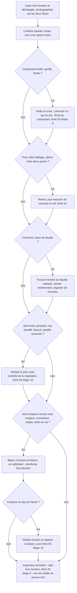

# 90 Inspection visuelle

Trouver à l'œil, à la loupe et au doigt les défauts qu'aucune mesure n'a encore désignés : joints de brasure, composants, connecteurs, corrosion, pistes, puis les contrôler en les sollicitant.

## En bref

L'inspection trouve une grande part des pannes sans aucune mesure (fiche [03](../03_methode/README.md), étape 4) : un joint fissuré, un condensateur gonflé, une trace de liquide, une piste coupée, un connecteur mal enfoncé. Elle se fait carte hors tension, sous une lumière rasante, à la loupe, sur les deux faces, en suivant un ordre pour ne rien sauter. Deux limites : un joint fissuré peut être invisible et lire 0 Ω au repos, et un indice désigne une **zone**, pas encore une cause. Un joint douteux se contrôle donc au bipeur en le sollicitant, et un composant brûlé fait chercher ce qui l'a tué.

> **Sécurité** : périmètre de la fiche [00](../00_securite/README.md) uniquement. Carte **hors tension et déchargée** (fiche [00](../00_securite/README.md), « Travailler hors tension ») : adaptateur, câble USB, câble réseau qui alimente la carte (PoE), piles et batteries débranchés ou retirés. On manipule la carte, on appuie sur les composants : bracelet antistatique relié à la terre, carte tenue par les bords. Un condensateur gonflé ou fendu, une batterie gonflée : ne pas les percer, ne pas les chauffer (fiche [00](../00_securite/README.md)). L'alcool isopropylique est **inflammable** : flacon refermé et éloigné, fer à souder posé loin, carte entièrement sèche avant toute mise sous tension.

## Les mots : brasage, brasure, joint

On dit couramment « soudure » ; en électronique, ce n'en est pas une.

- **Soudage** : les pièces assemblées fondent et se mêlent, comme en mécanique.
- **Brasage** : les pièces ne fondent pas ; un métal d'apport, qui fond plus bas qu'elles, les mouille et les relie. Sous 450 °C, c'est le **brasage tendre**, celui des cartes électroniques.
- **Brasure** : ce métal d'apport, un alliage à base d'étain. Ces fiches disent aussi « l'alliage ».
- **Joint de brasure**, ou **joint** : l'assemblage obtenu, entre une patte et sa pastille.

L'outil garde ses deux noms, fer à souder (le plus courant) ou fer à braser.

## Préparer l'inspection

- **Lumière** : une lampe orientable, tenue de côté, en lumière rasante. Une fissure, un pont fin, une pastille soulevée font une ombre ou un reflet qui n'apparaît qu'en tournant la carte sous la lampe.
- **Grossissement** : de 4 à 10 fois selon la taille des joints, le grossissement que retient la norme spatiale européenne de brasage manuel ; davantage, loupe forte ou microscope, pour trancher un défaut suspecté.
- **Les deux faces**, la carte à plat, et les côtés des composants hauts.
- **Photographier** avant de toucher (fiche [03](../03_methode/README.md), étape 3) : la photo agrandie montre ce que l'œil a manqué, et sert à comparer avec une carte saine ou une photo du même modèle.
- **Un ordre** : par zones, l'entrée d'alimentation d'abord, puis chaque régulateur, puis les composants qui chauffent ou portent du courant, les connecteurs, enfin le reste. Noter chaque indice sur la photo.

### Photographier pour suivre des broches

Pour savoir où va chaque broche d'un connecteur, la photo du dos de la carte remplace le schéma qu'on n'a pas.

1. **Choisir un repère visible des deux faces** : un trou de fixation, un coin coupé, une encoche. La pastille carrée de la broche 1, quand elle existe, la désigne directement côté joints ; côté composants, le boîtier du connecteur la cache souvent. Le dos est une image miroir : carte retournée comme une page, la gauche et la droite s'échangent ; retournée de haut en bas, le haut et le bas. Sans repère, on numérote le dos à l'envers.
2. **Photographier les deux faces**, l'appareil à plat au-dessus de la zone, toutes les broches dans le cadre et nettes, la lampe de côté pour que les joints et les pistes se détachent.
3. **Écrire les numéros des broches sur la photo du dos**, en partant du repère.
4. **Confirmer au bipeur la broche 1**, ou une broche d'extrémité, d'une face à l'autre, avant de suivre les pistes : elle valide toute la numérotation. Jamais la broche du milieu, qui garde sa place dans le miroir.

### Lire le marquage d'un circuit intégré

Le marquage d'un boîtier est une gravure peu profonde : de face, la lampe s'y reflète et l'efface. Tenir la lampe de côté et tourner la carte, ou la lampe, jusqu'à ce que les caractères ressortent ; photographier de près, puis agrandir.

- **La référence** n'est pas toujours écrite en entier : sur un petit boîtier, la place manque et le fabricant grave un **code abrégé**. La fiche technique du composant donne ce code. Exemple : le commutateur analogique TS3A5017 porte YA017 en boîtier TSSOP, SSOP, TVSOP ou VQFN, son nom complet en SOIC, et ZVL en UQFN : le code dépend aussi du boîtier.
- **Le logo** désigne le fabricant : le joindre au code abrégé dans la recherche de la fiche technique.
- **Les autres caractères** servent à la traçabilité : code de date (par exemple l'année puis la semaine), code de lot. Leur format change d'un fabricant à l'autre. Ils ne disent rien de la référence : ne pas les saisir dans la recherche. Attention, une référence longue peut continuer sur une deuxième ligne ou finir par un suffixe (grade, boîtier) : n'écarter que les caractères reconnus comme code de date ou de lot.
- **La broche 1** est repérée sur le boîtier, par un point ou une encoche ; le dessin du boîtier dans la fiche technique donne la numérotation.
- **Marquage effacé ou illisible** : sur un boîtier qui a chauffé, c'est un indice (« Les composants ») ; pour l'identifier, comparer avec un composant identique de la carte ou d'une carte du même modèle.

## Les joints de brasure

Un joint sain forme un **congé concave**, à la surface lisse, où l'on devine encore la forme de la patte. L'alliage s'étale en angle faible sur la patte comme sur la pastille : c'est la preuve qu'il les a **mouillées** toutes les deux.

L'aspect dépend de l'alliage. L'alliage étain-plomb donne un joint satiné à brillant ; l'alliage sans plomb, celui de presque toutes les cartes récentes, donne un joint satiné à mat, parfois légèrement granuleux, sans défaut pour autant. Juger donc un joint par comparaison avec ses voisins du même type, et d'abord sur la forme du congé et le mouillage. Les défauts à chercher :

- **Joint froid** : l'alliage n'a pas assez chauffé. Il paraît massif, plissé ou en tas, terne ou parfois brillant, avec une limite nette au lieu d'un congé qui se fond dans la patte. Le contact est mauvais et se fissure avec le temps.
- **Joint perturbé** : la patte a bougé pendant que l'alliage se figeait. Surface ridée ou fracturée, nettement plus rugueuse que celle des joints voisins.
- **Mal mouillé** : l'alliage reste en boule sur la patte ou sur la pastille sans s'étaler sur l'autre, avec un angle vif. Une pastille nue autour d'une patte brasée signe un contact incertain. Une variante, le **démouillage**, laisse une surface terne parsemée d'îlots d'alliage plus épais.
- **Trop peu d'alliage** : un congé creux qui ne couvre pas la pastille ; sur un trou traversant, l'alliage ne remonte pas dans le trou. Il tient, puis fissure sous les vibrations et les cycles de température. Pour comparer : sur un trou métallisé (carte double face), les normes de fabrication demandent en général un trou rempli au moins aux trois quarts ; un trou non métallisé (carte simple face) ne se remplit pas.
- **Pont** : de l'alliage relie deux joints ou deux broches voisines. C'est un court-circuit, à chercher surtout après une réparation et entre les broches fines d'un circuit intégré.
- **Bille d'alliage** ou éclaboussure : une petite boule collée par le flux, qui peut se déplacer et relier deux pistes.
- **Pastille soulevée** : décollée de la carte, souvent après le retrait d'un composant, fer trop chaud ou appliqué trop longtemps. La piste qui en part peut être rompue.
- **Joint fissuré**, souvent en anneau autour de la patte : sur les composants lourds, chauds ou soumis à des efforts (connecteurs, transformateurs, gros condensateurs, régulateurs sur radiateur). Fine, la fissure ne se voit qu'en lumière rasante, et parfois pas du tout.
- **Flux brûlé** : un résidu brun ou noir autour d'un joint trop chauffé. Il se nettoie à l'alcool isopropylique et une brosse ; il signale un joint à regarder de près.
- **Patte trop longue** : une patte coupée trop loin du joint peut toucher sa voisine ou un blindage.

Sur un composant monté en surface, la même lecture s'applique au congé entre la terminaison et la pastille : une terminaison à moitié décollée, un composant soulevé d'un côté (il se tient « debout » sur une seule pastille), un congé absent d'un côté.

Ces critères désignent un joint à refaire. Ceux qu'appliquent les fabricants pour accepter ou refuser une carte sont fixés par la norme IPC-A-610, selon trois classes de produits, de l'électronique courante (classe 1) au matériel dont l'arrêt n'est pas tolérable (classe 3).

### Contrôler un joint douteux

Mesurer un joint, c'est mesurer **à travers** lui : une pointe sur la patte, au-dessus du joint, l'autre sur la piste qui part de la pastille, au-delà, au premier point accessible (pastille suivante, via, cuivre dégagé du vernis) ; un grippe-fil tient cette pointe pendant qu'une main sollicite. Les deux pointes sur les deux pattes d'un composant mesurent le composant, pas ses joints.

1. Bipeur entre la patte et la piste, carte hors tension et déchargée.
2. **Solliciter pendant la mesure** : appuyer légèrement sur le composant avec un outil isolant, tapoter, faire bouger la patte. Un joint fissuré peut lire 0 Ω au repos et couper sous l'effort : le bip qui hache, ou le passage à OL, le désigne. Quand l'écran n'est pas visible, l'ohmmètre en mode MIN/MAX, si l'appareil l'a, garde la plus haute valeur lue pendant la sollicitation ; une coupure plus brève que son temps de réponse lui échappe.
3. Appuyer sans forcer : un effort trop fort fissure un joint sain ou un condensateur céramique (fiche [20](../20_condensateur_ceramique/README.md)).

Ce contrôle sert aux joints d'aspect correct mais suspects : panne intermittente, composant lourd ou chaud. Un joint visiblement défectueux se refait plutôt que de se discuter : l'ancien alliage retiré, la patte et la pastille propres, un joint neuf, puis le contrôle de la fiche [03](../03_methode/README.md), étape 10.

## Les composants

- **Condensateur électrolytique** : dessus bombé, fente de sécurité ouverte, électrolyte séché au pied, manchon rétracté (fiche [22](../22_condensateur_electrolytique/README.md)).
- **Condensateur tantale** : boîtier fendu ou noirci (fiche [23](../23_condensateur_tantale/README.md)). **Céramique** : fissure près d'une terminaison, souvent près d'une vis, d'un bord ou d'un connecteur (fiche [20](../20_condensateur_ceramique/README.md)).
- **Composant brûlé** : boîtier noirci, fendu, bombé, marquage effacé par la chaleur, carte brunie dessous. La carte brunie compte : l'époxy carbonisé conduit, il faut le gratter jusqu'à la matière saine (fiche [92](../92_court_circuit/README.md)).
- **Circuit intégré** : petit cratère ou point brillant sur le boîtier, boîtier fendu. Un cratère désigne la puce sans doute possible ; son absence ne prouve rien.
- **Résistance** : couleur d'anneaux virée au brun, corps craquelé (fiche [10](../10_resistance/README.md)).
- **Bobinage et transformateur** : vernis foncé, isolant fondu, odeur de brûlé (fiches [30](../30_inductance/README.md), [32](../32_transformateur/README.md)).
- **Fusible** : verre noirci ou fil fondu (fiche [13](../13_fusible/README.md)).

L'odeur aide aussi : une odeur de brûlé ou d'électrolyte (aigre, poisson) guide vers la zone, carte hors tension.

## Connecteurs, nappes, interrupteurs

- **Connecteur** : enfoncé à fond, verrouillé, dans le bon sens. Broches tordues, enfoncées, oxydées, contact noirci par un échauffement. Les joints des connecteurs, qui portent les efforts des câbles, sont les premiers à fissurer.
- **Nappe** : pas pliée à angle vif, pas pincée, contacts propres, bien insérée et verrouillée dans son connecteur.
- **Interrupteur, bouton, potentiomètre** : jeu mécanique, contact oxydé, joints fissurés sous l'effort (fiche [11](../11_potentiometre/README.md)).
- **Relais** : boîtier fondu, contact noirci visible à travers un boîtier transparent (fiche [33](../33_relais/README.md)).
- **Porte-fusible, borne, cosse** : pince détendue, trace d'échauffement.

Ne jamais débrancher ni rebrancher un connecteur ou une nappe sous tension (fiche [03](../03_methode/README.md), « Les pannes intermittentes »).

## Corrosion et liquide

Un dépôt vert, bleu ou blanc, une auréole, des broches ternies : un liquide est passé, ou la carte a vécu dans l'humidité. La corrosion ronge les pistes et les pattes, et ses résidus conduisent entre deux pistes voisines.

1. Remonter jusqu'à la source : boîtier, joint d'étanchéité, connecteur par où le liquide est entré.
2. Nettoyer à l'alcool isopropylique et une brosse douce, sous les composants autant que possible.
3. **Laisser sécher entièrement** avant toute mise sous tension : sous un boîtier, l'alcool et l'eau restent longtemps.
4. Regarder de nouveau : une piste ou une patte rongée sous le dépôt se voit souvent seulement après nettoyage.

Un nettoyage peut suffire à faire disparaître une panne intermittente due à des résidus ; il ne répare pas une piste ni une patte rongée.

## Pistes, vias, réparations antérieures

- **Piste coupée** : une fine interruption, souvent près d'un bord, d'une vis, d'un trou de fixation, ou sous un composant qui a chauffé. Une piste qui a servi de fusible : brunie, décollée, interrompue.
- **Via** : le trou métallisé qui passe d'une face à l'autre. Une trace de corrosion ou d'échauffement autour peut signaler une coupure à l'intérieur ; il se contrôle au bipeur d'une face à l'autre.
- **Carte fléchie ou fendue** : une fissure dans l'époxy coupe les pistes qui la traversent.
- **Réparation antérieure** : joints différents des autres, résidus de flux, fils ajoutés, composant d'une autre marque. La panne est souvent là, ou y revient.

Une piste suspecte se contrôle au bipeur d'un bout à l'autre, en la sollicitant comme un joint.

## Mesurer à travers un vernis de tropicalisation

![Coupe d'une carte recouverte de vernis de tropicalisation : un composant monté en surface sur deux pastilles, sous une couche de vernis. Une pointe-aiguille inclinée traverse le vernis jusqu'à la terminaison métallique du composant, carte hors tension et déchargée. Les règles : lampe UV-A si le vernis est fluorescent ; faute d'atteindre la terminaison, la pastille, mais la lecture inclut alors le joint ; dégager localement selon la fiche du vernis ; comparer à un composant identique ; jamais sur le corps ni près des broches à pas fin ; revernir au pinceau après la réparation et laisser sécher](mesure-sous-vernis.svg)

Certaines cartes sont couvertes d'un **vernis de tropicalisation**, une couche transparente de quelques dizaines de micromètres qui les protège de l'humidité. À ne pas confondre avec le vernis épargne, la couche colorée qui couvre les pistes. Il isole : une pointe posée dessus lit OL, sur un composant sain comme sur un composant coupé.

1. **Le repérer** : un aspect brillant ou satiné qui couvre aussi les joints, un bourrelet au pied des composants. Certains vernis sont fluorescents : une lampe UV-A les fait briller et montre où ils manquent ; ne jamais regarder la lampe ni la diriger vers les yeux. Tous ne le sont pas : l'absence de lueur ne prouve rien.
2. **Mesurer hors tension**, carte déchargée, avec une **pointe-aiguille** : la poser inclinée sur la **terminaison métallique** du composant et appuyer juste assez pour traverser le vernis. Jamais sur le corps du composant, qu'elle fissure ou qu'elle raye.
3. **Faute d'atteindre la terminaison**, piquer la pastille : la lecture inclut alors le joint de brasure (« Contrôler un joint douteux »). Une lecture trop haute peut venir du joint et ne condamne plus le composant (fiche [02](../02_pieges_en_circuit/README.md)).
4. **Une lecture OL ou instable** vient d'abord du vernis mal traversé : reprendre le contact, puis comparer avec un composant identique de la carte, mesuré aux mêmes points, avant de conclure.
5. **Jamais près des broches à pas fin** : la pointe glisse, tord une broche ou en relie deux. Y mesurer sur le point de test ou le composant voisin relié à la même piste.
6. **Dégager le vernis** pour refaire un joint se fait localement, par la méthode que donne la fiche technique du vernis : selon le produit, un décapant adapté, ou le fer à souder à travers la couche. Lire d'abord la fiche de données de sécurité du produit ; pièce aérée, fumées aspirées, décapant tenu loin du fer chaud. Sans ces fiches, se limiter à la pointe-aiguille.
7. **Après la réparation**, nettoyer puis **revernir** la zone dégagée et les points percés, au pinceau : un vernis ouvert laisse entrer l'humidité là où il manque. Laisser sécher le temps que donne la fiche du vernis (24 heures à l'air pour celui cité en source) avant toute mise sous tension.

Sous tension, la carte reste dans le périmètre de la fiche [00](../00_securite/README.md), sur une alimentation limitée en courant. La pointe-aiguille se pose carte hors tension, tenue par un support de sonde, puis on met sous tension ; couper l'alimentation avant de déplacer ou de retirer la pointe : une pointe qui glisse entre deux broches fait un court-circuit.

## Après l'inspection

- **Un indice désigne une zone, pas une cause** (fiche [03](../03_methode/README.md), étape 4) : une résistance brûlée a obéi à un courant trop fort, que quelque chose d'autre a laissé passer.
- **Rien de visible** ne prouve rien : un joint fissuré peut être invisible, un composant mort ne change pas forcément d'aspect. Passer aux rails hors tension (fiche [03](../03_methode/README.md), étape 5).
- **Panne intermittente** : provoquer la panne en sollicitant la zone, d'abord hors tension au bipeur, puis sous tension à courant limité (fiche [03](../03_methode/README.md), « Les pannes intermittentes »).

## Arbre de décision

## Aide-mémoire d'établi

1. Hors tension, déchargée, toutes les sources retirées ; bracelet antistatique.
2. Photographier les deux faces avant de toucher.
3. Lumière rasante, loupe de 4 à 10 fois, davantage pour trancher ; tourner la carte sous la lampe.
4. Par zones : entrée, régulateurs, composants de puissance, connecteurs, reste.
5. Joint sain : congé concave et lisse qui mouille patte et pastille ; mat sur une carte sans plomb, comparer aux voisins.
6. Défauts : froid, perturbé, mal mouillé, trop peu d'alliage, fissure, pastille soulevée (à refaire) ; pont, bille (à retirer) ; flux brûlé (nettoyer, regarder).
7. Joint d'aspect correct mais suspect : bipeur de la patte à la piste, en appuyant ou en tapotant avec un outil isolant ; ce qui lit 0 Ω au repos peut couper sous l'effort.
8. Composants : gonflé, fendu, noirci, cratère, carte brunie.
9. Liquide : source, nettoyage à l'alcool, séchage complet, regarder de nouveau.
10. Un indice désigne une zone, pas une cause ; rien de visible ne prouve rien.
11. Dos d'un connecteur : image miroir ; un repère visible des deux faces, la broche 1 ou une broche d'extrémité confirmée au bipeur.
12. Marquage : lumière rasante ; code abrégé à chercher dans la fiche technique ; date et lot ne disent rien de la référence.
13. Carte vernie : pointe-aiguille inclinée sur la terminaison, hors tension ; jamais sur le corps ni près du pas fin ; revernir après et laisser sécher.

## Sources

- ESA, *ECSS-Q-ST-70-08C, Manual soldering of high-reliability electrical connections* (6 mars 2009, remplacée depuis par ECSS-Q-ST-70-61C) : définitions (joint froid, perturbé, fissuré, démouillage, congé, mouillage), inspection de 4 à 10 fois, critères d'acceptation et de refus ; téléchargement libre sur <https://ecss.nl>.
- CNES, *RNC-ECSS-Q-70-08*, traduction française d'une édition antérieure de la même norme (brasure, brasage sans fusion des métaux de base, joint de brasure, fer à braser).
- IEC, *Electropedia*, vocabulaire électrotechnique international, entrées 851-11-01 à 851-11-04 (soudage, brasage, brasage fort, brasage tendre sous 450 °C) — <https://www.electropedia.org>
- Office québécois de la langue française, *Grand dictionnaire terminologique*, fiches « brasure » (le métal d'apport), « brasage tendre », « soudage » et « fer à souder » — <https://vitrinelinguistique.oqlf.gouv.qc.ca>
- IPC, sommaire d'*IPC-A-610J Acceptability of Electronic Assemblies* (critères visuels d'acceptation, défauts de brasage) — <https://www.ipc.org/TOC/IPC-A-610J_TOC.pdf> ; sommaire d'*IPC-7711/7721D Rework, Modification and Repair of Electronic Assemblies* (les trois classes de produits) — <https://www.ipc.org/TOC/IPC-7711D-7721D_TOC.pdf>. Les normes complètes sont payantes et n'ont pas été lues.
- NASA Workmanship Standards Program, *What's new in J-STD-001ES* (2013 ; remplissage vertical d'au moins 75 % d'un trou traversant) — <https://nepp.nasa.gov/files/24348/What%E2%80%99s%20new%20in%20J-STD-001ES%20032113.pdf>
- Adafruit, *Adafruit Guide To Excellent Soldering*, page *Common Problems* (joint perturbé, froid, surchauffé, mal mouillé, trop peu ou trop d'alliage, pattes non coupées, pont, pastille soulevée, éclaboussures) — <https://learn.adafruit.com/adafruit-guide-excellent-soldering/common-problems>
- EE Notebook, *Is This Connection Intermittent?* (contrôle de continuité en sollicitant la liaison, mode MIN/MAX, défauts liés à la température, nettoyage à l'alcool isopropylique) — <https://applied-ee.github.io/ee-notebook/docs/measurement/continuity-connections/intermittent-connection>
- Cadence, *What Could Cause a Solder Joint to Crack?* (causes mécaniques, thermiques et chimiques, défauts intermittents, remplissage insuffisant d'un trou traversant) — <https://resources.system-analysis.cadence.com/blog/what-could-cause-a-solder-joint-to-crack>
- Texas Instruments, *TS3A5017 Dual SP4T Analog Switch / Multiplexer / Demultiplexer*, SCDS188G (janvier 2005, révisée en janvier 2019, addendum de boîtiers du 5 mars 2026) : marquage par boîtier (YA017 ; TS3A5017 en SOIC ; ZVL en UQFN), mention d'un marquage supplémentaire (logo, code de lot), dessin des boîtiers vus de dessus — <https://www.ti.com/lit/gpn/ts3a5017>
- Texas Instruments (National Semiconductor), *Device Marking Conventions*, SNOA039C (mai 2004, révisée en juillet 2005) : contenu des lignes de marquage (logo, code de date fondé sur des périodes de six semaines, code de lot, référence), code abrégé des petits boîtiers faute de place, marquage précis donné par la fiche technique — <https://e2e.ti.com/cfs-file/__key/communityserver-discussions-components-files/14/device_2D00_marking_2D00_conventions_2D00_rev_2D00_c.pdf>
- MG Chemicals, *419D Liquid, Acrylic Conformal Coating*, fiche technique version 4.0 (31 juillet 2025) : vernis acrylique fluorescent sous UV-A, film de 25 à 75 µm, retrait par un décapant adapté ou brasage à travers la couche, retouche au pinceau, séchage de 24 heures à température ambiante, renvoi à la fiche de données de sécurité — <https://mgchemicals.com/downloads/tds/tds-419d-l.pdf>
- Les procédures de base viennent des fiches citées, qui portent leurs propres sources : [00](../00_securite/README.md) (travail hors tension, ESD), [03](../03_methode/README.md) (place de l'inspection, pannes intermittentes, contrôle de la réparation), [20](../20_condensateur_ceramique/README.md), [22](../22_condensateur_electrolytique/README.md) et [23](../23_condensateur_tantale/README.md) (indices propres aux condensateurs), [92](../92_court_circuit/README.md) (époxy carbonisé).
