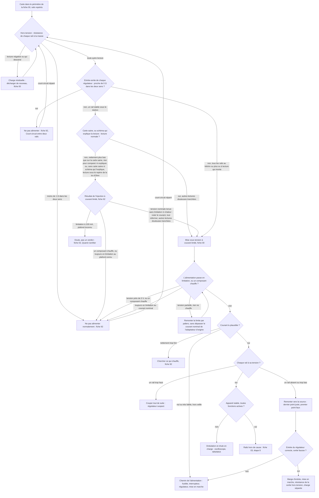

# 91 Contrôle des rails d'alimentation

Vérifier l'alimentation d'une carte avant tout le reste : la résistance de chaque rail hors tension, la première mise sous tension, les tensions, l'ondulation et le courant consommé.

## En bref

Un **rail** est un conducteur qui distribue une tension d'alimentation : l'entrée de la carte, puis la sortie de chaque régulateur (5 V, 3,3 V, etc.). Aucun signal n'est juste sur un rail faux : les rails se contrôlent donc en premier, dans l'ordre où le courant circule, de l'entrée vers les charges. Le contrôle a quatre temps : **résistance** à la masse hors tension, **mise sous tension** à courant limité, **tension** de chaque rail, puis **courant** consommé. Un rail en court-circuit se traite en fiche [92](../92_court_circuit/README.md) ; la place de ce contrôle dans la recherche de panne est donnée par la fiche [03](../03_methode/README.md).

> **Sécurité** : périmètre de la fiche [00](../00_securite/README.md) uniquement : 50 V continu (25 V alternatif) au plus, partout sur la carte, pas d'alimentation secteur intégrée. La carte s'alimente par une **alimentation de laboratoire limitée en courant**, jamais par son adaptateur ni par sa batterie tant que la panne n'est pas comprise. Un rail lu **trop haut** : couper tout de suite, la limite de courant ne protège pas d'une surtension. La mesure de courant a son propre piège (cordon rouge oublié dans la douille A) : fiche [01](../01_multimetre/README.md), « Piège du mode courant ».

## Repérer les rails

Avant de mesurer, dresser la liste des rails : c'est elle qui dit quoi lire et où.

1. **L'entrée** : connecteur d'alimentation, tension et polarité marquées sur l'appareil ou l'adaptateur.
2. **La protection** : fusible, diode série ou transistor de protection, interrupteur. Chacun coupe le rail en deux nœuds à mesurer séparément.
3. **Chaque régulateur** : sa référence, lue sur le boîtier, donne sa fiche technique, donc sa tension de sortie, son courant maximal et ses broches. Un régulateur linéaire a le plus souvent trois broches (entrée, sortie, masse ou broche de réglage ADJ), parfois une broche de mise en marche en plus ; un régulateur à découpage se reconnaît à l'inductance posée à côté de lui.
4. **La masse** : le point où poser la pointe noire. Une carte peut en avoir plusieurs, isolées l'une de l'autre (fiche [03](../03_methode/README.md), étape 3).

Où poser la pointe rouge : sur un point de test, sur la broche du régulateur, ou sur une borne du gros condensateur placé à son entrée ou à sa sortie. Ne pas piquer entre deux broches fines d'un circuit intégré alimenté (fiche [02](../02_pieges_en_circuit/README.md)).

Noter le tout dans un tableau, rempli au fil des mesures. Exemple pour une carte alimentée en 12 V :

| Rail | Point de mesure | Attendu | Résistance à la masse | Tension | Courant |
| --- | --- | --- | --- | --- | --- |
| Entrée | connecteur | 12 V | | | |
| Après fusible | fusible, côté charge | 12 V | | | |
| 5 V | sortie du régulateur U1 | 5 V | | | |
| 3,3 V | sortie du régulateur U2 | 3,3 V | | | |

## Hors tension : la résistance de chaque rail à la masse

C'est la mesure qui évite d'alimenter un court-circuit franc. Elle se fait **avant toute mise sous tension**, et de nouveau après chaque réparation.

Tous les composants branchés entre un rail et la masse sont **en parallèle** : les pointes posées n'importe où sur le rail mesurent le rail entier, c'est-à-dire tous ses condensateurs et tout ce qu'il alimente (fiche [02](../02_pieges_en_circuit/README.md)).

1. Carte débranchée, piles et batteries retirées, condensateurs déchargés et vérifiés au voltmètre (fiche [00](../00_securite/README.md)).
2. Bipeur d'abord, puis ohmmètre pour lire la valeur (fiche [01](../01_multimetre/README.md)). Pointe noire sur la masse, pointe rouge sur le rail ; sur un rail négatif, l'inverse, sinon les diodes de protection des circuits intégrés conduisent.
3. Mesurer chaque ligne du tableau, dans l'ordre où le courant circule. Un fusible ouvert ou une diode série cache un court-circuit placé derrière : mesurer **des deux côtés** de chaque protection (fiche [13](../13_fusible/README.md)).
4. Attendre que la lecture se stabilise : les condensateurs du rail se chargent sous le courant de test, la lecture monte pendant quelques secondes.
5. Sur une lecture basse, inverser les pointes : un vrai court-circuit lit la même valeur dans les deux sens, une jonction non. Après l'inversion, la lecture repart du début et peut être négative un instant, le temps que les condensateurs se rechargent dans l'autre sens.
6. Mesurer aussi la résistance entre l'**entrée et la sortie** de chaque régulateur. Proche de 0 Ω dans les deux sens : son élément de puissance est en court-circuit, la sortie recevrait la tension d'entrée (les deux rails lisent alors la même valeur à la masse). Ne pas alimenter (fiche [92](../92_court_circuit/README.md), « Court-circuit entre deux rails »). Exception : si les deux rails lisent eux-mêmes moins de 1 Ω à la masse, cette mesure ne prouve rien ; traiter d'abord le court-circuit à la masse (fiche 92), puis refaire cette mesure.

| Lecture entre le rail et la masse | Verdict | Suite |
| --- | --- | --- |
| Bip continu, moins de 1 Ω environ, dans les deux sens | **court-circuit franc** | ne pas alimenter la carte normalement ; fiche [92](../92_court_circuit/README.md) |
| Quelques ohms à quelques centaines d'ohms, stable | **douteux** : court-circuit résistif, fuite, ou charge normale du rail | comparer (ci-dessous) ; sans point de comparaison, injection à courant limité, fiche [92](../92_court_circuit/README.md) |
| Stable, de l'ordre du kilohm ou plus | normal le plus souvent (pont diviseur, LED, circuits au repos) | mise sous tension à courant limité |
| Lecture qui monte, puis valeur élevée ou OL | pas de court-circuit franc : les condensateurs se chargent | mise sous tension à courant limité |
| Lecture négative, ou qui descend, sans avoir inversé les pointes | charge résiduelle sur le rail | décharger de nouveau (fiche [00](../00_securite/README.md), « Décharger un condensateur ») |

**Trancher une lecture douteuse**, du plus sûr au moins sûr :

- **Carte saine identique**, ou voie identique de la même carte : même rail, même calibre, même sens des pointes. Une lecture nettement plus basse sur la carte en panne désigne le rail : injection à courant limité, fiche [92](../92_court_circuit/README.md), régulateurs sains entre entrée et sortie.
- **Schéma** : il montre ce qui est branché entre le rail et la masse. Une résistance de faible valeur, un bobinage (relais, moteur, inductance), une lampe à filament ou un élément chauffant branchés directement sur le rail font lire leur propre résistance, parfois quelques ohms : c'est normal.
- **Repère de la loi d'Ohm** : diviser la tension du rail par le courant maximal qu'il fournit (courant de l'adaptateur, ou courant maximal du régulateur). Exemple : 5 V et 1 A donnent 5 Ω. Les circuits intégrés ne conduisent presque pas sous la faible tension de l'ohmmètre : un rail sain lit en général **bien plus** que ce repère. Une lecture stable **en dessous**, dans les deux sens, sur un rail qui n'alimente ni bobinage, ni lampe, ni élément chauffant, est une anomalie. Au-dessus du repère, rien n'est prouvé : ce repère ne blanchit jamais un rail. Sans carte saine, ni schéma qui explique la lecture (bobinage, lampe, résistance de faible valeur), passer par l'injection à courant limité (fiche [03](../03_methode/README.md), étape 5).
- Le rail de cœur d'un processeur (autour de 1 V, plusieurs ampères) lit normalement quelques ohms, parfois moins : seule la comparaison avec une carte saine le juge.

**Mode diode**, en complément, sur un rail positif : pointe rouge sur le rail et noire à la masse, un rail sain lit OL ou une valeur qui monte (sur un rail de cœur sous 2 V, une valeur nettement plus haute que dans l'autre sens) ; pointes inversées, il lit une jonction, 0,3 à 0,7 V : ce sont les diodes de protection des circuits intégrés. Sur un rail négatif, les deux lectures s'échangent. Une lecture proche de 0 V **dans les deux sens** est un court-circuit (fiche [01](../01_multimetre/README.md)).

Ce que cette mesure ne dit pas : **lequel** des composants du rail est en cause. C'est l'objet de la fiche [92](../92_court_circuit/README.md).

## Première mise sous tension

Seulement si aucun rail ne lit un court-circuit franc, si aucun régulateur ne lit un court-circuit entre son entrée et sa sortie, et si chaque lecture douteuse a été tranchée. Le réglage de l'alimentation de laboratoire (tension à vide, limite de courant, voyants CV, tension constante, et CC, courant constant) est en fiche [00](../00_securite/README.md).

1. Tension réglée à la valeur nominale de l'entrée, jamais au-dessus. Limite de courant basse : 50 à 100 mA pour une petite carte logique, quelques centaines de mA pour une carte avec moteur, relais ou rétroéclairage.
2. Sortie coupée, brancher le moins en premier, vérifier la **polarité**, puis activer la sortie.
3. Regarder le courant pendant les premières secondes, une main prête à couper.

| Ce que montre l'alimentation | Lecture | Suite |
| --- | --- | --- |
| CC bref à l'allumage, puis CV | les condensateurs d'entrée se chargent : normal | continuer |
| CC, tension proche de 0 V | court-circuit | couper ; fiche [92](../92_court_circuit/README.md) |
| CC, tension partielle, rien ne chauffe | limite trop basse pour le démarrage (un régulateur à découpage sous-alimenté tire davantage et reste bloqué ainsi) | remonter la limite par paliers en surveillant la chaleur, sans dépasser le courant nominal de l'adaptateur d'origine ; toujours en limitation à ce courant : couper, fiche [92](../92_court_circuit/README.md) |
| CV, courant nul ou très faible | appareil en veille ou en attente de son bouton, sinon rien ne démarre | chercher sur le chemin de l'alimentation : fusible, interrupteur, régulateur, signal de mise en marche |
| CV, courant plausible et stable | la carte s'alimente | régler la limite juste au-dessus du courant lu ; contrôler les tensions |

Fumée, odeur de brûlé, composant qui chauffe : couper d'abord, chercher ensuite.

**Appareil à batterie** : retirer la batterie et alimenter par ses contacts, à sa tension nominale. Certains appareils refusent de démarrer sans la batterie ou sans le signal de sa sonde de température : un courant nul n'est alors pas une panne.

## Sous tension : la tension de chaque rail

Voltmètre continu, pointe noire fixée à la masse par un grippe-fil, une seule pointe tenue à la main (fiche [02](../02_pieges_en_circuit/README.md)). Mesurer chaque ligne du tableau, de l'entrée vers les charges.

**Tolérance** : un rail régulé se lit à **± 5 %** de sa valeur nominale dans la plupart des cas (4,75 à 5,25 V pour 5 V ; 3,14 à 3,46 V pour 3,3 V) ; la fiche technique du régulateur et celle des circuits alimentés donnent la valeur exacte. Mesurée plus tard sur l'adaptateur d'origine, une entrée non régulée (adaptateur à transformateur) peut lire nettement plus que sa tension marquée quand la carte consomme peu : c'est normal tant que la tension reste sous le maximum d'entrée du régulateur.

| Lecture | Causes à chercher |
| --- | --- |
| Rail absent, entrée du régulateur présente | signal de mise en marche (broche *enable*) absent ; court-circuit en sortie, à contrôler hors tension ; régulateur en panne |
| Rail absent, entrée absente aussi | remonter vers la source : fusible, interrupteur, connecteur, piste, diode de protection |
| Rail trop haut | **couper tout de suite** : régulateur en court-circuit entre entrée et sortie, ou boucle de régulation coupée ; ce que le rail alimente a pu être détruit |
| Rail trop bas | alimentation de laboratoire en limitation (voyant CC) ; entrée du régulateur trop basse ; surcharge en aval ; régulateur en limitation ou en protection thermique ; contact résistant sur le chemin |
| Rail qui monte et retombe sans cesse | régulateur qui démarre, se protège (surcharge, court-circuit, limite de l'alimentation trop basse) et recommence |
| Correct au repos, faux quand une fonction s'active | chute en charge : mesurer pendant que la fonction travaille (ci-dessous) |

**Remonter un rail absent ou trop bas.** Mesurer le même rail en remontant vers la source, point par point : la panne est entre le **dernier point juste** et le **premier point faux**. Deux lectures différentes aux deux bouts d'un conducteur désignent ce conducteur ou ce qui est en série : fusible, contact, piste, connecteur (fiche [02](../02_pieges_en_circuit/README.md), « Mesurer la chute de tension sous tension »).

**Entrée correcte, sortie fausse sur un régulateur** :

1. Vérifier la **marge d'entrée** d'un régulateur linéaire : son entrée doit dépasser sa sortie de sa tension de déchet, environ 2 V pour un 78xx, moins de 0,5 V pour la plupart des régulateurs à faible chute (LDO) récents. Le 1117, vendu comme LDO, demande pourtant environ 1,2 V : lire la fiche technique. En dessous, la sortie suit l'entrée et lit trop bas sans que le régulateur soit en panne.
2. Vérifier la broche de mise en marche, si le régulateur en a une : son niveau actif est dans la fiche technique.
3. Couper, puis mesurer la résistance de la sortie à la masse (section « Hors tension »).
4. Si un élément en série sépare le régulateur de ses charges (cavalier, résistance de 0 Ω, perle de ferrite, connecteur d'une carte fille), l'ouvrir hors tension et réalimenter : la sortie revient, la charge est en cause ; elle reste fausse, le régulateur ou ses composants proches sont en cause. Trois précautions :
   - **Avant de réalimenter**, vérifier sur le schéma, ou en suivant la piste, de quel côté de l'élément ouvert le régulateur prend son **retour de tension** (broche FB ou *sense*, pont diviseur). Du côté du régulateur (c'est toujours le cas d'un régulateur fixe à trois broches, qui le prend sur sa broche de sortie) : l'essai est possible. Du côté des charges : le régulateur ne voit plus sa sortie et la monte jusqu'à sa tension d'entrée, ce que les condensateurs de sortie ne supportent pas toujours. Dans ce cas, ou dans le doute, ne pas faire cet essai.
   - **À la mise sous tension** : voltmètre déjà posé sur la sortie du régulateur, limite de courant basse, couper dès que la sortie dépasse sa valeur nominale.
   - **L'inductance d'un régulateur à découpage** ne sert pas à cet essai : elle fait partie du régulateur, qui n'a plus de sortie sans elle. Elle ne s'ouvre jamais sous tension : le courant interrompu crée une pointe de tension sur le nœud de commutation.

**Ordre de démarrage.** Sur une carte à plusieurs régulateurs, l'un peut attendre le signal de l'autre pour démarrer. Un rail absent se cherche donc d'abord en amont : le premier rail absent dans l'ordre de démarrage est le suspect, les suivants ne font qu'obéir. En veille, seul le rail de veille est présent : c'est normal.

**Chute en charge.** Un rail peut être juste au repos et s'effondrer quand un moteur démarre, qu'un émetteur radio émet ou qu'un rétroéclairage s'allume. Mesurer **au plus près de la charge** pendant qu'elle travaille, avec le mode MIN/MAX du multimètre ; une chute plus brève qu'environ 100 ms, temps de réponse habituel de ce mode, lui échappe et se voit à l'oscilloscope (page [i2](../i2_oscilloscope/README.md)).

## L'ondulation

Un voltmètre continu affiche la **moyenne** du rail. Un rail qui lit 5,00 V peut porter une ondulation qui fait redémarrer un microcontrôleur ou ronfler un amplificateur.

- **Multimètre en V alternatif** sur le rail : indication grossière, valable pour une ondulation lente (100 Hz derrière un adaptateur à transformateur). Deux limites : la bande passante de l'appareil s'arrête entre quelques centaines de hertz et quelques dizaines de kilohertz, il ne voit donc pas l'ondulation d'un régulateur à découpage ; et certains appareils premier prix ne bloquent pas la composante continue dans ce mode et affichent alors une valeur fausse. Une lecture de plusieurs dizaines de millivolts ou plus est un indice ; une lecture nulle ne prouve rien.
- **Oscilloscope** : la mesure directe. Couplage alternatif, limite de bande à 20 MHz, sonde sur le condensateur de sortie avec la connexion de masse la plus courte possible (ressort de masse plutôt que pince longue, qui capte des parasites). Lire « Pince de masse et terre » de la page [i2](../i2_oscilloscope/README.md) avant de brancher la pince.
- **Juger** : comparer avec la fiche technique du régulateur ou avec une carte saine. Ordres de grandeur : quelques millivolts en sortie d'un régulateur linéaire, quelques dizaines de millivolts crête à crête en sortie d'un régulateur à découpage. Une ondulation plusieurs fois plus forte désigne les condensateurs du rail (fiches [22](../22_condensateur_electrolytique/README.md) et [20](../20_condensateur_ceramique/README.md)).

## Mesurer le courant

Le courant dit ce que la tension cache : une carte qui consomme deux fois trop a un défaut même si tous ses rails sont justes, une carte qui ne consomme rien n'a pas démarré.

Quatre moyens, du plus simple au plus délicat :

| Moyen | Ce qu'il mesure | Limite |
| --- | --- | --- |
| Afficheur de l'alimentation de laboratoire | courant total de la carte | résolution de 1 à 10 mA selon l'appareil |
| Chute de tension sur une résistance connue déjà en série sur la carte | courant d'une branche, sans rien ouvrir | il faut connaître la résistance |
| Résistance de mesure ajoutée en série | courant d'une branche | il faut ouvrir le circuit |
| Multimètre en ampèremètre, en série | courant d'une branche | il faut ouvrir le circuit ; chute de tension dans l'appareil ; piège de la douille A |

Une pince ampèremétrique à effet Hall mesure aussi un courant continu sans ouvrir le circuit, sur un fil que l'on peut entourer ; sa résolution, de l'ordre de 10 mA, la réserve aux courants forts (page i4).

**Chute de tension sur une résistance connue.** Voltmètre en mV continu aux bornes de la résistance, carte alimentée : *I = V / R*. Conviennent : une résistance de mesure de courant (shunt, souvent 0,01 à 1 Ω, valeur marquée), une résistance série de protection, un fusible dont on connaît la résistance à froid (fiche [13](../13_fusible/README.md) ; ordre de grandeur seulement, sa résistance augmente en chauffant). Exemple : 25,0 mV aux bornes d'un shunt de 0,1 Ω : 250 mA.

**Résistance de mesure ajoutée.** Hors tension, ouvrir le circuit (cavalier, fusible retiré, fil d'alimentation) et insérer une résistance à 1 % et lire la tension à ses bornes. Avec 1 Ω, **1 mV vaut 1 mA** ; avec 0,1 Ω, 1 mV vaut 10 mA. Choisir la valeur pour que la chute *R × I* au courant le plus fort attendu reste sous 2 à 5 % de la tension du rail : sur un rail de 5 V, 1 Ω jusqu'à 100 mA environ, 0,1 Ω jusqu'à 1 A environ. Puissance : au moins le double de *R × I²* (0,1 Ω à 1 A dissipe 0,1 W : prendre 0,25 W ou plus). La chute est connue et choisie, ce qui n'est pas le cas dans un ampèremètre.

**Multimètre en ampèremètre.**

1. Couper l'alimentation. Ouvrir le circuit à l'endroit où le courant doit être mesuré : le plus simple est entre l'alimentation de laboratoire et la carte ; sinon à la place d'un fusible, d'un cavalier ou d'une résistance de 0 Ω.
2. Cordon rouge dans la douille **A** (ou 10 A), sélecteur sur A continu, **calibre le plus fort d'abord**.
3. Brancher le multimètre **en série** : le courant entre par le cordon rouge et sort par le noir pour une lecture positive.
4. Rétablir l'alimentation, lire. Si la lecture le permet, couper, passer à la douille et au calibre mA, et recommencer.
5. Mesure finie : couper, refermer le circuit, et **remettre le cordon rouge dans la douille V/Ω** tout de suite.

Ses limites :

- **Jamais en parallèle** sur une source : en mode courant, le multimètre est un fil (fiche [01](../01_multimetre/README.md), « Piège du mode courant »). Encore moins sur une batterie, que rien ne limite.
- **Chute de tension dans l'appareil** : le shunt et le fusible font perdre de l'ordre de 1 à 2 mV par mA sur le calibre mA, soit 0,2 à 0,4 V à 200 mA, et environ 0,1 mV par µA sur le calibre µA. Une carte en 3,3 V peut redémarrer ou se figer à cause de la mesure. Remèdes : le calibre 10 A, dont le shunt est bien plus faible (au prix de la résolution), ou une résistance de mesure choisie.
- **Calibre 10 A** : souvent limité en durée (par exemple 10 A pendant 30 s), et sans fusible sur beaucoup d'appareils premier prix ; lire le marquage près de la douille.
- **Fusible grillé** : un ampèremètre qui lit zéro partout et une carte qui ne s'alimente plus à travers lui désignent le fusible de l'entrée courant (page [i1](../i1_multimetre/README.md)).
- **Courant de veille** : un changement automatique de calibre en cours de mesure modifie d'un coup la chute de tension dans l'appareil et peut faire redémarrer la carte ; fixer le calibre (touche RANGE). Un appareil qui consomme quelques microampères en veille tire bien plus au démarrage : le démarrer avec un fil en parallèle sur le multimètre, que l'on retire une fois la veille atteinte.

**À quoi comparer le courant lu** :

- la **fiche technique** de l'appareil ou de ses circuits principaux ;
- une **carte saine**, dans le même état (veille, repos, fonction active) ;
- le courant marqué sur l'**adaptateur** : c'est un maximum que l'adaptateur peut fournir, pas la consommation de la carte, qui est en général nettement plus faible.

| Courant lu | Lecture |
| --- | --- |
| Nettement trop fort, rails justes | un composant fuit ou travaille en défaut : chercher ce qui chauffe (fiche [92](../92_court_circuit/README.md), « Rail qui fuit ») |
| Trop fort, un rail trop bas | surcharge sur ce rail : résistance du rail hors tension, puis fiche [92](../92_court_circuit/README.md) |
| Nul ou très faible | rien ne démarre : chemin de l'alimentation, signal de mise en marche |
| Qui varie sans cesse | normal sur une carte active (émission radio, moteur, affichage) : lire les extrêmes en MIN/MAX ; anormal si la carte redémarre en boucle |
| En veille, plus fort que prévu | fuite sur un rail resté alimenté, ou appareil qui ne s'endort pas : mesurer rail par rail |

## Arbre de décision

## Aide-mémoire d'établi

1. Lister les rails : entrée, après chaque protection, sortie de chaque régulateur ; tension attendue de chacun.
2. Hors tension, carte déchargée : résistance de chaque rail à la masse, dans les deux sens. Moins de 1 Ω : ne pas alimenter, fiche 92. Entrée-sortie de chaque régulateur : jamais proche de 0 Ω.
3. Quelques ohms : comparer (carte saine, schéma qui explique la lecture). Nettement plus bas que sur la carte saine, rien pour comparer, ou, sans carte saine ni schéma qui l'explique, lecture sous la tension du rail divisée par son courant maximal : injection à courant limité, fiche 92, régulateurs sains entre entrée et sortie ; tout refermer avant la mise sous tension.
4. Alimentation de laboratoire, tension nominale, limite basse, polarité vérifiée, œil sur le courant.
5. Tensions de l'entrée vers les charges, pointe noire fixée à la masse : ± 5 % sur un rail régulé.
6. Rail trop haut : couper. Rail absent ou bas : remonter jusqu'au dernier point juste.
7. Régulateur : marge d'entrée, mise en marche, sortie en court-circuit, charge séparée (retour de tension vérifié d'abord).
8. Tension juste mais appareil instable : ondulation à l'oscilloscope, chute en charge en MIN/MAX.
9. Courant : afficheur de l'alimentation, ou millivolts sur une résistance connue (1 Ω : 1 mV = 1 mA ; chute sous 5 % du rail).
10. Ampèremètre : en série, calibre fort d'abord, cordon rouge remis en V/Ω aussitôt.

## Sources

- Texas Instruments, fiche technique *LM340, LM340A and LM7805 Family Wide VIN 1.5-A Fixed Voltage Regulators* (tension de déchet d'environ 2 V, tolérance de sortie) ; à chercher sous ce titre sur ti.com.
- Texas Instruments, fiche technique *LM1117 800-mA, Low-Dropout Linear Regulator* (tension de déchet d'environ 1,2 V à 800 mA) ; à chercher sous ce titre sur ti.com.
- Analog Devices, note d'application AN-1144, *Measuring Output Ripple and Switching Transients in Switching Regulators* (mesure de l'ondulation : connexion de masse courte, limite de bande) ; à chercher sous ce titre sur analog.com.
- Fluke, *ABCs of DMMs: Multimeter features and functions explained*, note d'application (mesure de courant en série, erreur du cordon laissé dans l'entrée courant, bande passante en alternatif) ; à chercher sous ce titre sur fluke.com.
- Fluke, manuel d'utilisation des multimètres *80 Series V*, caractéristiques (chute de tension en mesure de courant : 1,8 mV par mA sur l'entrée mA, 100 µV par µA sur l'entrée µA, 0,03 V par A sur l'entrée 10 A) ; à chercher sous ce titre sur fluke.com.
- EEVblog, projet *µCurrent* (chute de tension des multimètres en mesure de courant et son effet sur une carte basse tension) — <https://www.eevblog.com/projects/ucurrent/>
- Les procédures de base viennent des fiches citées, qui portent leurs propres sources : [00](../00_securite/README.md) (alimentation limitée en courant), [01](../01_multimetre/README.md) (modes du multimètre, piège du mode courant), [02](../02_pieges_en_circuit/README.md) (mesure en circuit, chute de tension), [03](../03_methode/README.md) (ordre des contrôles), [13](../13_fusible/README.md) (court-circuit caché derrière un fusible ouvert).
