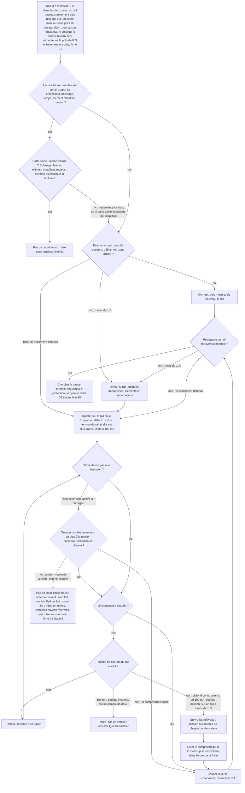

# 92 Recherche de court-circuit et injection de courant

Trouver le composant ou le défaut qui met un rail d'alimentation en court-circuit : diviser le rail, y injecter un courant limité, chercher le point chaud, puis suivre les millivolts.

## En bref

Un rail en court-circuit lit la **même** résistance partout : l'ohmmètre dit qu'il y a un défaut, pas où il est (fiche [91](../91_rails_alimentation/README.md)). Trois moyens le localisent, dans cet ordre. **Diviser** : ouvrir le rail en tronçons et voir de quel côté reste le défaut. **Injecter** : fournir au rail un courant limité par une alimentation de laboratoire ; le défaut dissipe de la chaleur là où il se trouve. **Suivre les millivolts** : ce même courant crée dans le cuivre une chute de tension minuscule, qui descend jusqu'au défaut. La place de cette recherche dans le dépannage est donnée par la fiche [03](../03_methode/README.md).

> **Sécurité** : périmètre de la fiche [00](../00_securite/README.md) uniquement. L'injection alimente **volontairement** un défaut : elle ne se fait qu'avec une **alimentation de laboratoire limitée en courant**, jamais avec une batterie, une pile ou un adaptateur, que rien ne limite. Tension réglée **au plus** à la tension nominale du rail : les circuits intégrés du rail la reçoivent aussi. Adaptateur, câble USB, câble réseau qui alimente la carte (PoE), piles et batteries débranchés ou retirés : l'alimentation de laboratoire est la seule source (fiche [00](../00_securite/README.md), « Travailler hors tension »). Un composant en défaut peut brûler la peau, se fendre ou s'enflammer (condensateur tantale, fiche [23](../23_condensateur_tantale/README.md)) : lunettes de protection, visage à l'écart de la carte, une main prête à couper. L'alcool isopropylique est **inflammable** : une goutte, sortie coupée, flacon refermé et éloigné, fer à souder posé loin, pas sur un composant déjà brûlant.

## Avant de chercher : est-ce bien un court-circuit ?

La mesure de départ est celle de la fiche [91](../91_rails_alimentation/README.md), « Hors tension » : moins de 1 Ω environ entre le rail et la masse, dans les deux sens des pointes. Un rail **douteux** (quelques ohms à quelques centaines d'ohms), nettement plus bas que sur une carte saine, ou sans carte saine ni schéma qui explique la lecture, se traite par la même injection, une fois vérifié qu'aucun régulateur relié à ce rail, celui qui le produit comme ceux qu'il alimente, ne lit près de 0 Ω entre son entrée et sa sortie (fiche 91, « Hors tension », point 6 : sinon l'injection porterait aussi l'autre rail à la tension injectée, au-dessus de sa tension nominale quand ce rail est l'entrée du régulateur), faite **avant** de diviser le rail et lue comme au point 5 de « Régler et monter par paliers ». Avant de dessouder quoi que ce soit, écarter les lectures basses qui sont **normales** :

- **Rail de cœur d'un processeur** (autour de 1 V, plusieurs ampères) : quelques ohms, parfois moins, sur une carte saine.
- **Bobinage, lampe à filament, élément chauffant, moteur** branchés directement sur le rail : l'ohmmètre lit leur résistance en continu, parfois moins de 1 Ω ; un schéma qui les montre branchés directement sur le rail explique la lecture (fiche 91).
- **Cordons du multimètre** : pointes en court-circuit, ils lisent déjà 0,1 à 0,5 Ω. Faire ce zéro avant de juger une lecture de 0,8 Ω (fiche [01](../01_multimetre/README.md)).
- **Mauvais nœud** : la pointe posée du côté de la masse d'une résistance de mesure de courant, ou sur une deuxième masse reliée à la première.

Un court-circuit vu **à travers** un autre composant change de valeur selon le point de mesure. Exemple : le transistor du bas d'un régulateur à découpage, en court-circuit, relie à la masse le nœud placé entre lui et l'inductance ; mesuré depuis la sortie du régulateur, le rail lit la résistance de l'inductance (quelques dizaines de milliohms à quelques ohms), ce qui ressemble à un condensateur de sortie en court-circuit. Mesurer **des deux côtés** de chaque composant en série. Une inductance de quelques dizaines de milliohms ne se distingue pas à l'ohmmètre : la lever d'un côté (section « Diviser le rail ») et mesurer chaque côté séparément.

## Les courts-circuits qui ne sont pas un composant

Un examen à la loupe, sous un bon éclairage, avant toute injection (fiche [03](../03_methode/README.md), étape 4). Chercher sur le trajet du rail :

- un **pont de soudure** entre deux broches ou deux pastilles, surtout après une réparation ;
- une **bille de soudure**, un copeau, un brin de fil, une vis ou une rondelle tombés sur la carte ;
- une **vis trop longue** ou une entretoise métallique qui touche une piste ; un blindage ou un radiateur déplacé ;
- une **broche tordue** dans un connecteur, un fil pincé au remontage, un isolant percé ;
- une trace de **liquide** ou de corrosion entre deux pistes ;
- une zone de carte **carbonisée** : l'époxy brûlé conduit. Remplacer le composant ne suffit pas, il faut gratter tout le noir jusqu'à la matière saine.

Si le court-circuit est apparu au remontage, démonter de nouveau et mesurer la carte seule, hors de son boîtier.

## Diviser le rail

Chaque division retire des suspects sans rien chauffer. Sur un rail seulement douteux, injecter d'abord (section suivante, point 5) : on ne lève un composant qu'une fois le défaut confirmé. Hors tension, entre deux mesures de la résistance du rail :

1. **Débrancher ce qui se débranche** : cartes filles, modules, nappes, écran, moteurs, câbles. Le court-circuit disparaît : il est dans ce qui vient d'être retiré.
2. **Ouvrir les éléments en série** prévus pour cela ou faciles à lever : cavalier, résistance de 0 Ω, perle de ferrite, inductance, fusible. Lever une seule extrémité suffit. Mesurer des deux côtés : le défaut est du côté qui lit encore le court-circuit.
3. **Séparer le régulateur de ses charges**, si un élément en série le permet : le défaut est dans le régulateur et ses composants proches, ou dans ce qu'il alimente.

Noter chaque élément ouvert, pour tout refermer ensuite. Ne pas remettre la carte sous tension par son entrée avec un élément en série ouvert sans avoir vérifié où le régulateur prend son retour de tension : privé de ce retour, il monte sa sortie jusqu'à sa tension d'entrée (fiche [91](../91_rails_alimentation/README.md), « Entrée correcte, sortie fausse sur un régulateur »). Couper une piste au scalpel est un dernier recours, à réparer ensuite par un fil soudé.

Le tronçon qui garde le défaut porte encore plusieurs composants en parallèle. C'est là que l'injection commence.

## Injecter un courant limité

Le principe : la puissance dissipée dans une résistance est *P = R × I²*. Le courant traverse le cuivre du rail, qui résiste très peu, et le défaut, qui résiste davantage : c'est le défaut qui chauffe.

**Où brancher.** Le + sur le rail, le − sur la masse de la carte ; sur un rail négatif, l'inverse. Au plus près du tronçon suspect et **en aval** du fusible et de la protection d'entrée, pour ne pas faire passer le courant par eux. Des grippe-fils sur un point de test ou sur les bornes d'un gros condensateur ; à défaut, deux fils soudés sur ses pastilles, de section adaptée au courant injecté (0,5 mm² jusqu'à quelques ampères). Des pointes tenues à la main glissent et font des étincelles.

**Régler et monter par paliers.**

1. Sortie coupée : tension à **1 V** environ, ou à la tension nominale du rail si elle est plus basse (0,8 V pour un rail de cœur de 0,8 V), limite de courant à **100 mA**. Le réglage de l'alimentation est en fiche [00](../00_securite/README.md), « L'alimentation de laboratoire limitée en courant ».
2. Activer la sortie. Sur un court-circuit franc, l'alimentation passe en limitation (voyant CC, courant constant) et la tension affichée tombe à quelques dizaines de millivolts.
3. Chercher le point chaud (ci-dessous).
4. Rien ne chauffe : relever la **limite de courant** par paliers (200 mA, 500 mA, 1 A, puis par paliers de 1 A si le plafond le permet), sans dépasser le plafond donné plus bas, en cherchant de nouveau à chaque palier. S'arrêter au premier palier où un composant chauffe. L'alimentation repasse en tension constante quand la limite est relevée : reprendre au point 5. Au plafond, toujours en limitation et rien ne chauffe : suivre les millivolts ; si le plafond est inconnu et le rail seulement douteux, c'est un doute, pas un verdict (« Le plafond des paliers », ci-dessous).
5. L'alimentation ne passe pas en limitation à cette tension de départ (voyant CV, tension constante, courant sous la limite) : pas de court-circuit franc à cette tension. Le défaut est résistif, dépend de la tension, ou n'existe pas. Monter la **tension** lentement, sans jamais dépasser la tension nominale du rail, en surveillant l'entrée du régulateur (section « Injecter sur la sortie d'un régulateur »). Trois issues, les mêmes qu'en fiche [03](../03_methode/README.md), étape 5 :
   - **l'alimentation passe en limitation en chemin** : ne pas monter davantage ; chercher le point chaud, puis relever la limite par paliers comme au point 4 ;
   - **un composant chauffe anormalement** : couper, c'est le suspect ;
   - **la tension nominale est atteinte, voyant CV, rien ne chauffe anormalement** : pas de court-circuit franc. Noter le courant lu. Nettement plus fort que ce que les circuits du rail consomment : section « Rail qui fuit ». Sinon : retirer les fils d'injection, refermer tout ce qui a été ouvert (section « Diviser le rail »), puis première mise sous tension (fiche [03](../03_methode/README.md), étape 6).
6. Couper la sortie avant de toucher, de dessouder ou de déplacer les fils.

**Le plafond des paliers** est défini en fiche [03](../03_methode/README.md), étape 5, avec ses cas particuliers. Référence du régulateur illisible ou fiche technique introuvable : s'arrêter à 100 mA. Sur un rail lu à moins de 1 Ω, suivre alors les millivolts à ce courant. Sur un rail seulement douteux, une limitation à 100 mA reste un doute, pas un verdict : ne rien dessouder sur cette seule lecture (fiche [03](../03_methode/README.md), « Quand s'arrêter »). Les pistes d'un rail sont dimensionnées pour son courant de service, pas davantage, et seulement le tronc : la branche qui mène au défaut peut être une piste fine, prévue pour quelques milliampères. Une piste qui fonce, fume ou se soulève : couper tout de suite.

Ordres de grandeur de la puissance dissipée dans le défaut :

| Résistance du défaut | À 100 mA | À 1 A |
| --- | --- | --- |
| 0,05 Ω (pont de soudure, composant fondu) | 0,5 mW | 50 mW |
| 0,5 Ω | 5 mW | 0,5 W |
| 5 Ω | 50 mW | 5 W ; sur un rail de 5 V ou moins, la tension nominale est atteinte avant |

Un défaut de quelques dizaines de milliohms ne dissipe que quelques dizaines de milliwatts, même à 1 A ; relié aux plans de cuivre, il s'échauffe à peine : la caméra thermique le voit parfois, le doigt et l'alcool rarement. C'est le cas où il faut suivre les millivolts.

**Chercher le point chaud**, du plus sûr au moins sûr (fiche [00](../00_securite/README.md), « La chaleur ») :

- **Caméra thermique** (page i8) : la carte entière d'un coup d'œil, sans contact. Limite : une surface métallique brillante (blindage, boîtier de condensateur, soudure) paraît plus froide qu'elle ne l'est.
- **Alcool isopropylique** : sortie coupée, une goutte étalée en film mince sur la zone suspecte, puis sortie activée. Le film s'évapore **d'abord** sur le composant qui chauffe.
- **Dos du doigt**, approché sans toucher, puis effleuré brièvement, en dernier, seulement à faible courant, et de préférence sortie coupée juste avant : un composant en défaut peut dépasser 100 °C.

Sur un court-circuit franc injecté à 1 V, si le composant qui chauffe est un circuit intégré, c'est lui qui est en court-circuit, pas un condensateur voisin. À la tension nominale du rail, un circuit intégré seulement tiède peut être normal (fiche [03](../03_methode/README.md), étape 5). Un composant en série sur le trajet du courant (perle de ferrite, inductance, diode) peut chauffer sans être en défaut : il porte simplement le courant injecté.

**Deux lectures qui ne sont pas un court-circuit** :

- limitation pendant un instant, puis la tension **monte** jusqu'à la consigne et le courant retombe : les condensateurs du rail se chargeaient ;
- la tension atteint la consigne et le courant reste faible : à cette tension, le rail ne conduit pas. Le défaut dépend de la tension (section « Rail qui fuit »), ou il n'y en a pas.

## Suivre les millivolts

Quand rien ne chauffe assez, le cuivre désigne le défaut. Le courant injecté va du point d'injection jusqu'au court-circuit, puis revient par la masse. Sur ce trajet, chaque millimètre de cuivre fait perdre un peu de tension. Au-delà du court-circuit, plus aucun courant ne circule : la tension ne change plus.

Conséquence : mesurée entre le rail et la masse, la tension est **la plus forte au point d'injection** et **la plus faible au court-circuit**.

1. Injecter un courant constant : alimentation en limitation (voyant CC), 500 mA à 1 A si le plafond du rail le permet. Plus le courant est fort, plus les écarts se lisent.
2. Multimètre en **mV continu**, sur son calibre le plus fin. Vérifier d'abord le zéro : pointes en court-circuit, il doit lire 0,0 ou 0,00 mV selon l'appareil.
3. Mesurer la tension **aux bornes de chaque condensateur** du rail, une pointe sur chaque pastille, toujours de la même façon. Noter chaque lecture sur un croquis de la carte.
4. Les lectures baissent en s'approchant du défaut. Le composant qui lit **le moins** est le court-circuit, ou son plus proche voisin.
5. Plusieurs composants lisent le même minimum : ils sont au bout de la même branche. Chercher le point chaud parmi eux, ou les dessouder un par un.

Ordres de grandeur. Une couche de cuivre de 35 µm d'épaisseur résiste à environ **0,5 mΩ par carré** : une piste dix fois plus longue que large fait 5 mΩ, quelle que soit sa taille. Une couche interne est souvent deux fois plus mince (17,5 µm, environ 1 mΩ par carré). Une piste de 0,25 mm de large et 25 mm de long compte 100 carrés, soit 50 mΩ : à 1 A, elle fait perdre 50 mV, ce que tout multimètre lit. Un plan d'alimentation, large, ne fait perdre que quelques dixièmes de millivolt d'un bord à l'autre : il faut alors un multimètre qui résout 0,01 mV, et la méthode atteint sa limite.

Pourquoi l'ohmmètre ne fait pas ce travail : ses cordons et le contact de ses pointes ajoutent quelques dixièmes d'ohm, bien plus que les milliohms à distinguer. En mesurant la tension avec le courant fourni par l'alimentation, la résistance des cordons du multimètre ne compte plus.

## Injecter sur la sortie d'un régulateur

Brancher l'alimentation de laboratoire sur un rail, c'est alimenter la **sortie** d'un régulateur dont l'entrée est à 0 V. Le courant peut alors **remonter** vers l'entrée par des chemins internes au régulateur (diode du transistor de puissance, jonctions parasites), que sa fiche technique décrit quand elle traite de la sortie plus haute que l'entrée.

- **Rail en court-circuit franc** : le rail reste à quelques dizaines de millivolts, bien en dessous du seuil d'une diode. Rien ne remonte. Sous 1 V environ, l'entrée ne monte qu'à quelques dixièmes de volt, trop peu pour alimenter le rail d'entrée : il ne remonte presque rien. Le risque commence quand la tension est montée vers la tension nominale.
- **Rail douteux, qui monte à sa tension nominale** : le courant remonte, charge les condensateurs d'entrée et alimente à moitié tout ce qui est branché sur le rail d'entrée. Deux conséquences : un composant peut chauffer **sur un autre rail** que celui que l'on teste ; et un régulateur linéaire de type 78xx peut être détruit si sa sortie dépasse son entrée de plusieurs volts alors que l'entrée est maintenue basse. Sa fiche technique le signale et prévoit une diode de protection de la sortie vers l'entrée, que toutes les cartes n'ont pas.

Ce qu'il faut faire quand le rail monte :

1. Mesurer la tension à l'**entrée** du régulateur pendant l'injection. Proche de la tension injectée : le courant remonte.
2. Garder la limite à 100 mA tant que le doute existe.
3. Séparer le régulateur du rail si un élément en série le permet (section « Diviser le rail »), puis injecter du côté des charges. Refermer avant toute remise sous tension par l'entrée.
4. Sinon, alimenter la carte par son **entrée normale**, à courant limité, comme en fiche [91](../91_rails_alimentation/README.md) : le régulateur travaille dans son sens.

## Rail qui fuit

Un rail peut lire quelques ohms à quelques centaines d'ohms, ou consommer trop sans tomber : un condensateur fuyant (fiche [20](../20_condensateur_ceramique/README.md)), une diode de protection abîmée, un circuit intégré en défaut. La carte fonctionne parfois, chauffe, ou vide sa batterie en veille.

- **Alimenter par l'entrée normale**, à courant limité, et chercher le point chaud, carte en marche puis en veille. Comparer avec une carte saine si possible : un régulateur ou un processeur tiède est normal.
- **Mesurer le courant rail par rail** (fiche [91](../91_rails_alimentation/README.md), « Mesurer le courant ») pour désigner le rail qui consomme trop, puis le diviser.
- **Injecter sur le rail séparé de son régulateur** (section « Diviser le rail ») **en montant la tension lentement** depuis 0 V, limite à 100 mA, et noter à quelle tension le courant apparaît. Un courant proportionnel à la tension dès les premiers dixièmes de volt est une fuite résistive. Un courant qui apparaît d'un coup au-dessus d'un seuil désigne une jonction : diode de protection, diode Zener ou circuit intégré.
- **Diode de protection contre les surtensions** (TVS) ou Zener : la fiche technique d'une TVS donne deux tensions. Jusqu'à sa tension de service (V_WM, notée V_R dans certaines fiches techniques), choisie au moins égale à la tension nominale du rail, elle ne laisse passer qu'un courant de fuite (I_R) : de l'ordre du microampère pour les modèles de plus de 10 V environ, jusqu'à plusieurs centaines de microampères pour les modèles de 5 V ; lire la fiche technique. Sa tension de claquage (V_BR), plus haute, est donnée à un courant de test de 1 ou 10 mA. Un courant nettement supérieur à I_R à la tension du rail la condamne. En circuit, les autres charges du rail masquent cette fuite : la mesurer diode levée d'une patte, cathode (côté de la barre) vers le + de l'alimentation, tension réglée au plus à V_WM, limite à 10 mA, à travers une résistance de 1 kΩ en série (1 mV à ses bornes vaut 1 µA ; montage de la fiche [20](../20_condensateur_ceramique/README.md), niveau 4). Branchée dans l'autre sens, une diode saine conduit et la lecture ne prouve rien ; un modèle bidirectionnel, sans barre, se mesure dans les deux sens. Une Zener est donnée par sa tension V_Z à un courant de test et par sa fuite I_R sous une tension de test plus basse que V_Z ; en dessous de 5 V environ, son coude est progressif et elle fuit déjà sous sa tension marquée : comparer à sa fiche technique. Une surtension l'a souvent tuée : chercher laquelle avant de la remplacer.

Un circuit intégré sain consomme aussi quand son rail monte : sans carte saine pour comparer, seul un courant nettement plus fort que ce que la fiche technique annonce, ou un point franchement chaud, fait un verdict.

## Court-circuit entre deux rails

Les deux rails lisent une résistance très faible **entre eux**, donc la même valeur à la masse, sans y lire moins de 1 Ω (sinon, traiter d'abord le court-circuit à la masse). Sous tension, le rail le plus bas monte vers le plus haut, ou les deux prennent une valeur intermédiaire.

- **Hors tension** : mesurer la résistance entre les deux rails, dans les deux sens.
- **Suspects** : un pont de soudure entre deux broches voisines, un régulateur en court-circuit entre entrée et sortie, un transistor de commutation en court-circuit, un circuit intégré relié aux deux rails.
- **Injection** : le + sur le rail de tension la plus haute, le − sur l'autre, limite à 100 mA, relevée ensuite par paliers comme au point 4 de « Régler et monter par paliers », sans dépasser le plus petit des plafonds des deux rails (fiche 03, étape 5). Commencer vers 0,5 V et ne jamais dépasser l'**écart** normal entre les deux rails (1,7 V entre un rail de 5 V et un rail de 3,3 V). La masse de la carte n'est alors reliée à aucune borne de l'alimentation : en montant, surveiller la tension de chaque rail par rapport à la masse. Aucun rail ne doit dépasser sa tension nominale par rapport à la masse, ni s'inverser (un rail positif qui devient négatif, un rail négatif qui devient positif) : une tension inverse, même de quelques dixièmes de volt, fait conduire les protections internes des circuits intégrés (leur limite absolue est souvent de −0,3 V) et prend les condensateurs polarisés à l'envers (fiche [23](../23_condensateur_tantale/README.md)). Entre deux rails positifs, c'est le plus bas qui peut s'inverser ; entre deux rails négatifs, le plus proche de 0 V (−5 V face à −12 V) ; entre un rail positif et un rail négatif (+12 V et −12 V), la masse reste entre les deux : aucun des deux ne s'inverse, mais l'un peut dépasser sa tension nominale (en valeur absolue) quand la masse se rapproche de l'autre ; l'écart normal est 24 V, et la montée s'arrête dès qu'un rail atteint sa tension nominale (12 V) par rapport à la masse. Dès qu'un rail atteint sa tension nominale ou change de signe : ne plus monter, couper. Chercher ensuite le point chaud et suivre les millivolts de la même façon.

Un rail lu trop haut a pu détruire ce qu'il alimente (fiche [91](../91_rails_alimentation/README.md)) : après la réparation, contrôler chaque circuit de ce rail.

## Quel composant dessouder en premier

Quand ni la chaleur ni les millivolts ne tranchent entre quelques composants voisins, les lever dans cet ordre, en mesurant le rail après chacun :

1. **Condensateur tantale** (fiche [23](../23_condensateur_tantale/README.md)) : il tombe en panne en court-circuit.
2. **Condensateur céramique** (fiche [20](../20_condensateur_ceramique/README.md)) : d'abord les plus gros, et ceux placés près des vis, des connecteurs et des bords, où la carte fléchit.
3. **Diode de protection** (TVS, Zener) et diode de roue libre.
4. **Transistor de puissance et régulateur**.
5. **Circuit intégré**, en dernier : le plus long à dessouder et le plus cher, sauf si c'est lui qui chauffe.

Un condensateur électrolytique aluminium se met rarement en court-circuit franc (fiche [22](../22_condensateur_electrolytique/README.md)).

Sur un composant à deux bornes, lever **une seule** borne suffit pour le sortir du rail. Mesurer ensuite le composant seul **et** le rail sans lui.

## Après avoir trouvé

1. **Vérifier** : composant retiré, la résistance du rail à la masse est redevenue normale (fiche [91](../91_rails_alimentation/README.md)). Toujours basse : un second défaut est présent, reprendre la recherche.
2. **Chercher la cause** avant de remplacer (fiche [03](../03_methode/README.md), étape 9) : surtension venue de l'entrée, inversion de polarité, régulateur en court-circuit entre entrée et sortie, flexion de la carte, liquide. Un composant de protection mort a souvent fait son travail.
3. **Contrôler ce qui alimente le rail** : fusible, diode série, régulateur. Le court-circuit a pu les abîmer (fiche [13](../13_fusible/README.md)).
4. **Remplacer** par un composant équivalent : même valeur, tension de service au moins égale (tantale : marge de la fiche [23](../23_condensateur_tantale/README.md)), même boîtier.
5. **Refermer** tout ce qui a été ouvert pour diviser le rail, retirer les fils d'injection.
6. **Remettre sous tension** par l'entrée normale, à courant limité, et contrôler chaque rail (fiche [91](../91_rails_alimentation/README.md)).

## Arbre de décision

## Aide-mémoire d'établi

1. Confirmer : moins de 1 Ω dans les deux sens, zéro des cordons fait. Cœur de processeur : comparer avec une carte saine avant de conclure ; bobinage, lampe, élément chauffant, moteur : carte saine ou schéma qui explique la lecture. Rail seulement douteux : régulateurs reliés au rail vérifiés entre entrée et sortie, puis injecter avant de diviser.
2. Loupe d'abord : pont de soudure, débris, vis, zone brûlée.
3. Diviser : modules débranchés, cavaliers, 0 Ω, ferrites et inductances levés d'un côté.
4. Injection : alimentation de laboratoire seulement, toute autre source débranchée, + sur le rail, 1 V, ou la tension du rail si elle est plus basse, limite à 100 mA.
5. Paliers de courant : 200 mA, 500 mA, 1 A, jamais au-dessus du plafond de la fiche 03, étape 5 ; inconnu : 100 mA, et sur un rail douteux une limitation à 100 mA reste un doute.
6. Jamais plus que la tension nominale du rail. Tantales : lunettes, visage à l'écart. Entre deux rails : + sur le plus haut, masse libre, départ vers 0,5 V, courant jamais au-dessus du plus petit plafond des deux rails, jamais plus que l'écart normal entre les deux rails, chaque rail surveillé par rapport à la masse ; couper dès qu'un rail atteint sa tension nominale ou change de signe.
7. Point chaud : caméra thermique, goutte d'alcool sortie coupée, dos du doigt en dernier.
8. Rien ne chauffe : millivolts aux bornes de chaque condensateur, le plus bas désigne le défaut.
9. Le rail monte à sa tension : surveiller l'entrée du régulateur, le courant remonte. Tension nominale atteinte sans limitation ni point chaud : pas de court-circuit franc ; fils d'injection retirés, tout refermer avant la mise sous tension.
10. Composant levé : rail mesuré de nouveau, cause cherchée, régulateur contrôlé.

## Sources

- Texas Instruments, fiche technique *LM340, LM340A and LM7805 Family Wide VIN 1.5-A Fixed Voltage Regulators*, section sur la mise en court-circuit de l'entrée du régulateur (sortie maintenue au-dessus de l'entrée, diode de protection de la sortie vers l'entrée) ; à chercher sous ce titre sur ti.com.
- Texas Instruments, fiche technique *LM317 3-Terminal Adjustable Regulator*, section sur les diodes de protection (décharge des condensateurs de sortie à travers le régulateur) ; à chercher sous ce titre sur ti.com.
- Analog Devices, *Basic Linear Design* (H. Zumbahlen, éd.), chapitre 12, « Printed Circuit Board Design Issues » (résistance du cuivre : environ 0,48 mΩ par carré pour 35 µm) ; à chercher sous ce titre sur analog.com.
- Littelfuse, fiche technique *SMAJ Series*, diodes de protection contre les surtensions (tension de service V_WM, notée V_R chez Littelfuse, tension de claquage V_BR à son courant de test, courant de fuite I_R selon le modèle) ; à chercher sous ce titre sur littelfuse.com.
- Keysight, *Understanding Constant Voltage and Constant Current Operation* (modes tension constante et courant constant d'une alimentation de laboratoire) ; à chercher sous ce titre sur keysight.com.
- EEVblog, forum, section *Repair* (pratique de l'injection de courant et du suivi des millivolts sur des cartes réelles) — <https://www.eevblog.com/forum/repair/>
- Les procédures de base viennent des fiches citées, qui portent leurs propres sources : [00](../00_securite/README.md) (alimentation limitée en courant, chaleur), [03](../03_methode/README.md) (plafond des paliers), [20](../20_condensateur_ceramique/README.md) et [23](../23_condensateur_tantale/README.md) (condensateurs en court-circuit), [91](../91_rails_alimentation/README.md) (résistance d'un rail à la masse).
