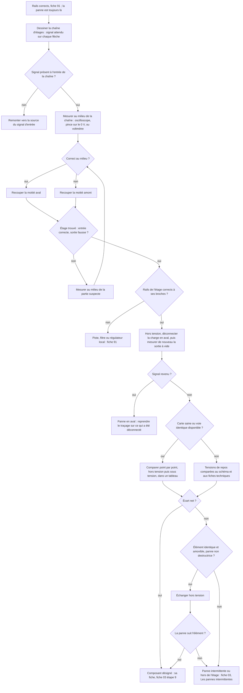

# 93 Traçage de signal et comparaison avec une carte saine

Réduire une panne à un étage puis à un composant : suivre le signal d'étage en étage, comparer chaque point avec une carte saine, échanger les éléments identiques.

## En bref

Rails corrects, panne toujours là (fiche [91](../91_rails_alimentation/README.md)) : la carte est une **chaîne d'étages**. On mesure ce qui entre et ce qui sort de chaque étage. Un étage dont l'entrée est correcte et la sortie fausse contient la panne, ou la subit d'un étage en aval qui charge sa sortie. Trois moyens, du plus direct au plus prudent : **suivre le signal** sous tension, **comparer** point par point avec une carte saine ou une voie identique, **échanger** deux éléments identiques et amovibles. La place de cette recherche dans le dépannage est l'étape 8 de la fiche [03](../03_methode/README.md).

> **Sécurité** : périmètre de la fiche [00](../00_securite/README.md) uniquement, 50 V continu (25 V alternatif) au plus partout sur la carte. Le traçage se fait **sous tension**, carte alimentée à courant limité comme en fiche [03](../03_methode/README.md), étape 6, rails déjà contrôlés. Une pointe fixée par un grippe-fil, une seule tenue à la main : une pointe qui glisse entre deux broches d'un circuit intégré détruit une carte alimentée (fiche [02](../02_pieges_en_circuit/README.md)). Pince de masse de l'oscilloscope sur le 0 V **seulement** : elle met à la terre le point où on la pose (page [i2](../i2_oscilloscope/README.md), « Pince de masse et terre »). Les comparaisons à l'ohmmètre et en mode diode se font **hors tension**, les deux cartes déchargées. Tout échange se fait hors tension, et jamais sur une panne destructrice.

## La chaîne d'étages

Avant de mesurer, dessiner la chaîne : un rectangle par étage, une flèche par signal, de l'entrée vers la sortie. Le schéma la donne ; sans schéma, les circuits intégrés et leurs fiches techniques la font deviner : préampli, filtre, ampli de puissance ; capteur, convertisseur, microcontrôleur, pilote, actionneur. Noter sur chaque flèche ce qu'on doit y trouver : forme, amplitude, fréquence, ou une tension continue.

- **Signal analogique** (audio, capteur) : une forme et une amplitude.
- **Signal logique** (horloge, bus, commande) : deux niveaux, proches de 0 V et du rail ; une horloge doit être présente et à la bonne fréquence.
- **Commande lente** (marche, réinitialisation, validation) : une tension continue, haute ou basse selon l'état attendu ; la fiche technique du circuit donne le niveau actif.

Une carte peut porter plusieurs chaînes : celle qui ne marche pas, désignée par le symptôme (fiche [03](../03_methode/README.md), étape 1), est la seule à suivre.

## Suivre le signal

1. **Fournir le signal d'entrée** que la carte attend en service normal : la source habituelle (micro, capteur, lecteur), ou la fonction de l'appareil qui le produit. Pas de signal à l'entrée : c'est la première panne à suivre, en remontant vers sa source.
2. **Partir du milieu** de la chaîne plutôt que d'un bout : chaque mesure élimine la moitié de ce qui reste. Signal correct au milieu : la panne est en aval ; absent ou faux : en amont.
3. **Recouper la moitié suspecte** de la même façon, jusqu'à un étage dont l'entrée est correcte et la sortie fausse.
4. Sur cet étage, mesurer **ses rails à ses broches mêmes**, pas seulement à la sortie du régulateur : une piste coupée ou un filtre ouvert peut le priver de son alimentation. Puis ses tensions continues de repos (polarisation), comparées au schéma ou à la carte saine.

**Avec l'oscilloscope** (page [i2](../i2_oscilloscope/README.md)) : pince de masse sur le 0 V de la carte, au plus près de l'étage mesuré, sonde sur le point. Le 0 V se vérifie sur le schéma : sur une sortie audio en pont, la borne « − » du haut-parleur n'est pas le 0 V. Il montre la forme, l'amplitude, la fréquence, les parasites. Garder les mêmes réglages d'un point au suivant, pour que les amplitudes se comparent d'un coup d'œil. Une sinusoïde écrêtée, déformée d'un seul côté ou plus faible que prévu désigne l'étage aussi bien qu'un signal absent.

**Au voltmètre**, sans oscilloscope : pointe noire sur le 0 V par un grippe-fil.

- En **continu**, il lit les niveaux logiques, les commandes lentes et les tensions de repos de chaque étage. Une horloge ou un signal logique rapide se lit comme sa **valeur moyenne** : à peu près la moitié du rail pour une horloge carrée. Présent, ce n'est pas une preuve qu'il est propre ; collé à 0 V ou au rail, il est absent.
- En **alternatif**, il lit un signal audio ou un autre signal alternatif lent, mais seulement dans sa bande passante (fiche [01](../01_multimetre/README.md), « Voltmètre ») : il ne voit ni la forme ni les parasites. Comparer des lectures, pas des valeurs absolues.

## Un étage qui charge sa sortie

Signal correct à l'entrée d'un étage et absent à sa sortie : l'étage peut être sain et sa sortie écrasée par l'étage suivant (entrée en court-circuit, condensateur de liaison fuyant, connecteur en court-circuit). Pour trancher :

1. Couper l'alimentation, décharger.
2. **Déconnecter la charge** : débrancher le câble ou le module en aval, ou lever une patte de l'élément de liaison (résistance, condensateur, cavalier), comme en fiche [02](../02_pieges_en_circuit/README.md), « Quand lever une patte ». Jamais un élément d'une boucle de contre-réaction ni du pont diviseur d'un régulateur : la sortie monterait au maximum.
3. Remettre sous tension à courant limité et mesurer de nouveau la sortie, à vide. Le signal revient : la panne est en aval, dans ce qui vient d'être déconnecté. Il reste absent : la panne est dans l'étage.

Une sortie à vide peut lire un peu plus haut qu'en service : comparer avec ce que la fiche technique donne à vide, ou avec la carte saine dans le même état. Refermer tout ce qui a été ouvert avant la remise en service.

## Comparer avec une carte saine

Une carte identique qui fonctionne, ou une **voie identique** de la même carte (voie gauche et voie droite d'un amplificateur, phases d'un régulateur, canaux d'un convertisseur), est le meilleur des schémas : les chemins parallèles qui faussent une mesure en circuit sont les mêmes des deux côtés, la comparaison les neutralise (fiche [02](../02_pieges_en_circuit/README.md), « Comparer avec une carte saine »).

**Les règles**, sans lesquelles deux lectures ne se comparent pas : mêmes points, même appareil, même calibre, même polarité des pointes. Hors tension, les deux cartes déchargées ; sous tension, dans le même état de fonctionnement (même mode, même signal d'entrée, même charge).

**Hors tension, en mode diode** : pointe rouge sur la masse, pointe noire sur chaque broche d'un circuit intégré, l'une après l'autre. Le multimètre mesure la diode de protection entre la broche et la masse, avec ce qui l'entoure : une signature par broche, de quelques centaines de millivolts en général. Refaire la série pointes inversées. Les résistances se comparent de la même façon, à l'ohmmètre. Une lecture en circuit ne vaut rien seule ; c'est l'**écart** entre les deux cartes qui compte.

**Sous tension** : tensions continues de chaque broche, puis formes d'onde aux mêmes points, mêmes réglages de l'oscilloscope.

**Un tableau** fait le travail : une ligne par point, une colonne par carte, une colonne pour l'écart.

| Point | Carte saine | Carte en panne | Écart |
| --- | --- | --- | --- |
| U3 broche 6, mode diode | 0,548 V | 0,012 V | net : broche reliée à la masse |
| U3 broche 7, mode diode | 0,551 V | 0,547 V | aucun |
| U3 broche 1, sous tension | 2,49 V | 2,51 V | aucun |

**Ce qui compte comme un écart.** Deux lectures à quelques pour cent l'une de l'autre sont identiques : tolérance des composants, contact des pointes. Un écart net désigne la zone à examiner : une lecture près de 0 contre une signature normale (court-circuit), OL contre une valeur (coupure), une valeur nettement différente dans les deux sens des pointes. Un écart isolé désigne un composant ou une broche ; tous les points d'un même étage décalés ensemble désignent ce qui leur est commun, souvent un rail ou une masse.

Sans carte saine ni voie identique, le schéma et les fiches techniques sont la seule référence : tensions de repos indiquées sur le schéma, niveaux de la fiche technique. Une broche en mode diode qui lit près de 0 V dans les deux sens reste suspecte seule, comme un rail (fiche [91](../91_rails_alimentation/README.md)).

## Échanger des éléments identiques

Échanger deux éléments, et voir si la panne les suit : si oui, l'élément est en cause. C'est la méthode la plus rapide, et la plus dangereuse pour la pièce saine.

- **Seulement** des éléments réellement identiques (même référence, même version, même configuration) et **amovibles** : modules, cartes filles, câbles, nappes, circuits intégrés sur support, relais enfichables. Retirer deux composants brasés pour les échanger n'est pas un échange, c'est une réparation : lever et mesurer chaque composant (fiche de sa famille) coûte moins cher.
- **Hors tension** pendant l'échange, toujours.
- **Jamais** sur une panne destructrice : un court-circuit, un rail trop haut, un composant qui chauffe détruirait la pièce saine (fiche [03](../03_methode/README.md), étape 8). Un fusible sain posé dans un circuit en court-circuit fond aussi.
- **Voies identiques** : échanger les entrées des voies gauche et droite (câbles, sources). La panne reste sur la même voie : elle est dans la carte, sur cette voie. Elle change de voie : elle est en amont, dans la source ou le câble.

## Cas pratique : sondes saines, défaut après les sondes

Une carte à quatre entrées de température affiche une valeur fausse sur la voie 3 seulement. Les quatre sondes, mesurées à l'ohmmètre, lisent la même valeur à l'ambiante, et échanger les sondes 2 et 3 laisse l'erreur sur la voie 3 : le défaut est sur la carte, après les sondes. Les quatre voies sont identiques : elles servent de référence les unes aux autres.

1. Même appareil, même calibre, même sens des pointes sur les quatre voies ; un tableau.
2. La tension à vide ne sépare pas les voies : quelques pour cent d'écart, rien de net.
3. Hors tension, l'ohmmètre et le mode diode désignent la voie 3 : 3,05 kΩ contre environ 12,4 kΩ, 0,214 V contre environ 0,55 V. Un chemin de fuite vers la masse sur cette entrée.
4. Suivre ce chemin composant par composant, du connecteur vers le convertisseur, toujours en comparant avec une voie saine. La démarche complète d'une voie de sonde de platine est en fiche [14](../14_sonde_platine/README.md).

## Arbre de décision

## Aide-mémoire d'établi

1. Rails contrôlés d'abord (fiche 91) ; carte alimentée à courant limité.
2. Dessiner la chaîne : un rectangle par étage, le signal attendu sur chaque flèche.
3. Signal d'entrée présent ? Sinon, remonter vers sa source.
4. Mesurer au milieu, puis recouper la moitié suspecte jusqu'à l'étage : entrée correcte, sortie fausse.
5. Oscilloscope : pince de masse sur le 0 V seulement, mêmes réglages d'un point à l'autre. Voltmètre : une pointe au grippe-fil.
6. Rails de l'étage mesurés à ses broches, puis tensions de repos.
7. Sortie absente : hors tension, déconnecter la charge, mesurer de nouveau à vide.
8. Carte saine ou voie identique : mêmes points, même appareil, même calibre, même polarité ; un tableau, l'écart net seul compte.
9. Mode diode hors tension, rouge sur la masse : une signature par broche ; près de 0 ou OL là où la carte saine lit une signature = court-circuit ou coupure.
10. Échange : identique, amovible, hors tension, jamais sur un court-circuit, un rail trop haut ou un composant qui chauffe.

## Sources

- All About Circuits, *Lessons in Electric Circuits*, volume V, chapitre 8, *Specific Troubleshooting Techniques* (mesure en entrée et en sortie de chaque étage, échange d'éléments identiques et ses risques, exemple des voies gauche et droite d'une chaîne stéréo) — <https://www.allaboutcircuits.com/textbook/reference/chpt-8/specific-troubleshooting-techniques/>
- Les procédures de base viennent des fiches citées, qui portent leurs propres sources : [00](../00_securite/README.md) (périmètre, alimentation limitée en courant), [01](../01_multimetre/README.md) (voltmètre, mode diode), [02](../02_pieges_en_circuit/README.md) (comparaison avec une carte saine, quand lever une patte), [03](../03_methode/README.md) (diviser pour régner, échange), [91](../91_rails_alimentation/README.md) (rails), page [i2](../i2_oscilloscope/README.md) (oscilloscope, pince de masse).
