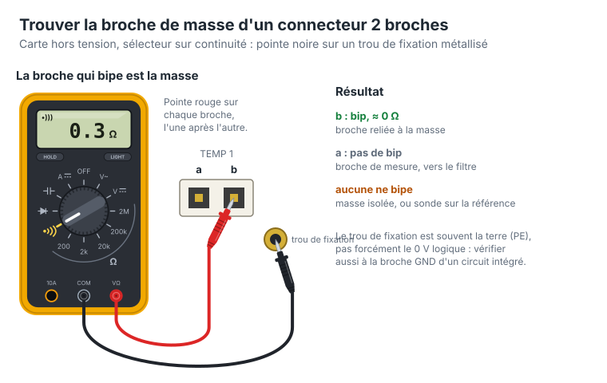
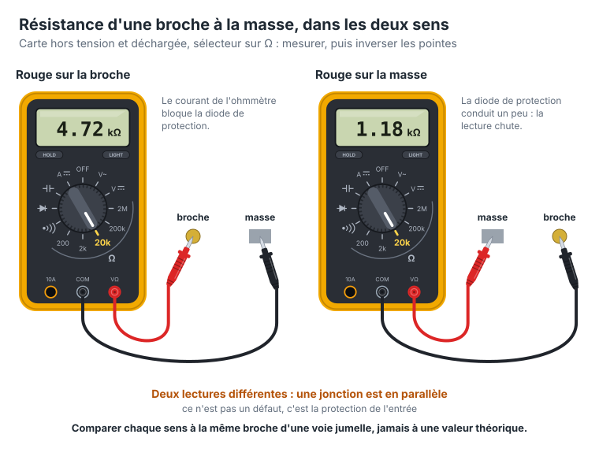
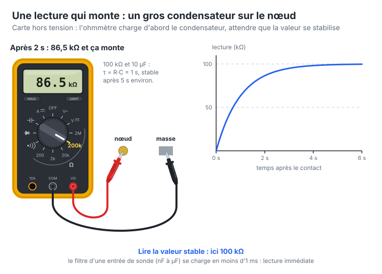
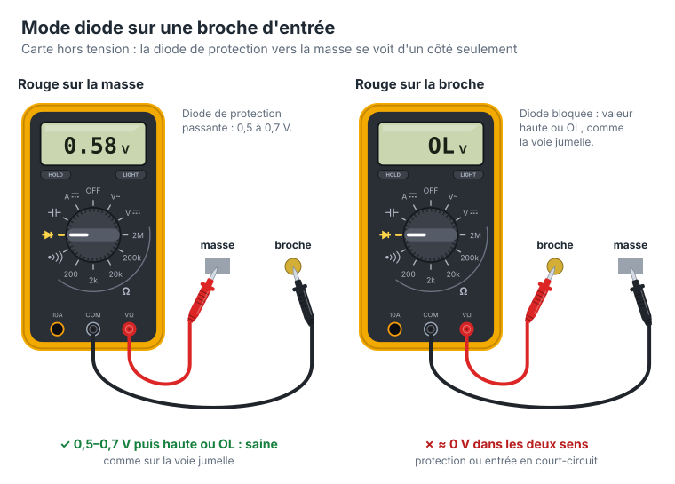
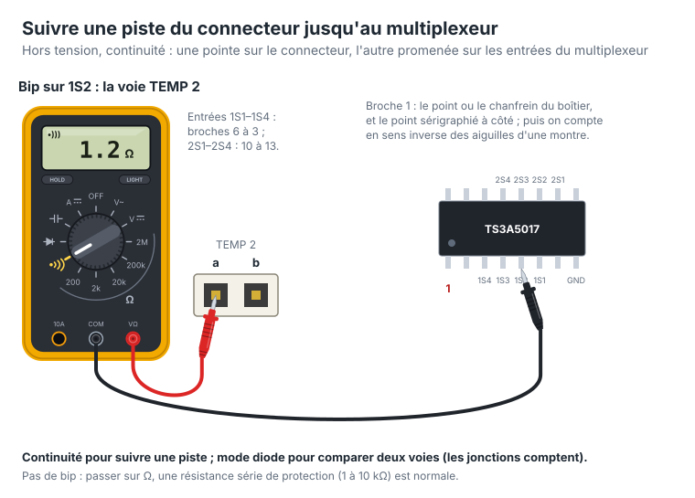

# 94 Voie d'entrée d'une sonde de température résistive

Diagnostiquer une voie qui lit une sonde PT1000 (ou toute sonde résistive) : séparer la sonde de la carte, puis suivre la voie jusqu'au convertisseur.

## En bref

Une carte annonce un « défaut sonde » alors que la sonde mesure bien hors circuit : la panne est **après la sonde**, dans la voie d'acquisition (connecteur, résistance de référence, filtre, multiplexeur, convertisseur du microcontrôleur). On le prouve en **remplaçant la sonde** par une résistance connue, puis on localise la panne en **comparant la voie suspecte à une voie jumelle** saine de la même carte.

> **Sécurité** : périmètre de la fiche [00](../00_securite/README.md), 50 V continu (25 V alternatif) au plus. Les mesures à l'ohmmètre, en mode diode et en continuité se font **hors tension**, carte déchargée. La substitution et l'observation à l'oscilloscope se font sous tension, alimentation limitée en courant, pince de masse sur le 0 V seulement (page [i2](../i2_oscilloscope/README.md)).

## La voie d'une PT1000

Une PT1000 vaut **1 000 Ω à 0 °C** et prend environ **3,85 Ω par °C** (norme IEC 60751, α = 0,00385). La carte la monte en général dans un **pont diviseur** avec une résistance de référence précise (souvent 1 kΩ à 0,1 %), ou l'alimente par une **source de courant** ; un condensateur filtre le point milieu, une diode ou un réseau protège l'entrée, un multiplexeur choisit la voie, le convertisseur du microcontrôleur lit la tension. Contrôler une PT1000 hors circuit : ohmmètre sur ses deux fils, environ 1 080 Ω à 20 °C (fiche [12](../12_thermistance/README.md) pour la méthode à froid et au chaud).

## 1. Remplacer la sonde par une résistance connue


Une boîte à décades, ou deux résistances fixes (1 kΩ et 1,1 kΩ), donnent une lecture attendue connue. Lecture juste : la sonde ou le câble est en cause. Lecture fausse ou défaut maintenu : la carte.

## 2. Repérer la masse du connecteur



Le trou de fixation est souvent relié à la terre de protection, pas au 0 V logique : confirmer sur la broche GND d'un circuit intégré de la voie (le multiplexeur, par exemple). Si aucune broche ne bipe, la sonde peut être montée entre l'entrée et une résistance de référence : c'est l'ohmmètre qui le montre (étape 3).

## 3. Mesurer chaque broche à la masse, hors tension



En circuit, l'ohmmètre voit tous les chemins en parallèle (fiche [02](../02_pieges_en_circuit/README.md)) : une diode de protection change la lecture selon le sens des pointes. Mesurer **dans les deux sens**, et comparer chaque sens à la même broche d'une voie jumelle, pas à une valeur théorique.



Sur un nœud filtré, la lecture **monte** pendant que l'ohmmètre charge le condensateur : attendre qu'elle se stabilise avant de la noter.

## 4. Contrôler la protection en mode diode



## 5. Suivre la piste jusqu'au multiplexeur



La continuité suit une piste ; le mode diode compare deux voies, parce qu'il voit aussi les jonctions. Un interrupteur du multiplexeur dégradé (résistance à l'état passant qui dérive, fuite) ne fausse qu'une voie : sondes saines, écart entre deux voies jumelles.

## 6. Observer l'excitation sous tension


Beaucoup de cartes n'alimentent la sonde que pendant la conversion, ou passent d'une voie à l'autre : le multimètre affiche une moyenne instable. L'oscilloscope montre le plateau de l'impulsion, à comparer au plateau de la voie jumelle.

## Figures pour un rapport de réparation

Chaque figure s'exporte en PNG, et se joint à la photo de terrain quand elle existe :

```bash
just figures-png 94_voie_temperature out/figures photos
```

La photo `photos/<nom-de-la-figure>.jpg` donne une planche `out/figures/<nom>-planche.png` : la photo à gauche, la figure à droite. Les photos et les exports restent hors du dépôt.

## Sources

- IEC 60751:2022, *Industrial platinum resistance thermometers and platinum temperature sensors* : 1 000 Ω à 0 °C, α = 0,00385 /°C.
- Texas Instruments, fiche technique TS3A5017 (SCDS221) : brochage TSSOP-16, 1S1–1S4 sur les broches 6 à 3, 2S1–2S4 sur les broches 10 à 13, GND broche 8.
