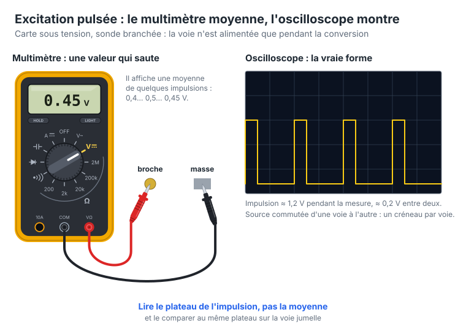
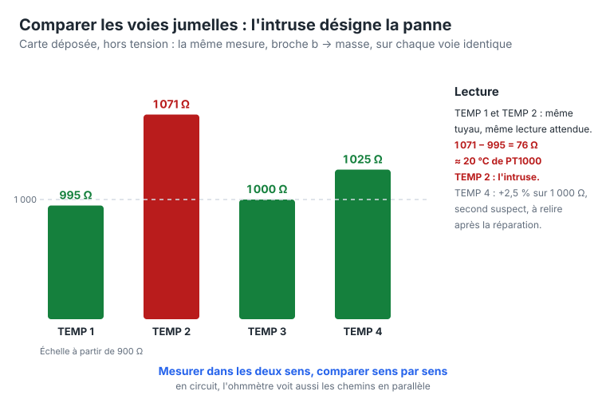
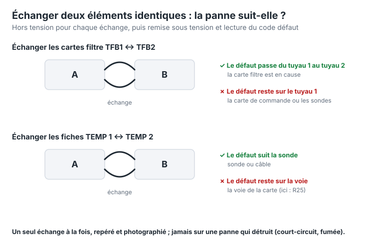
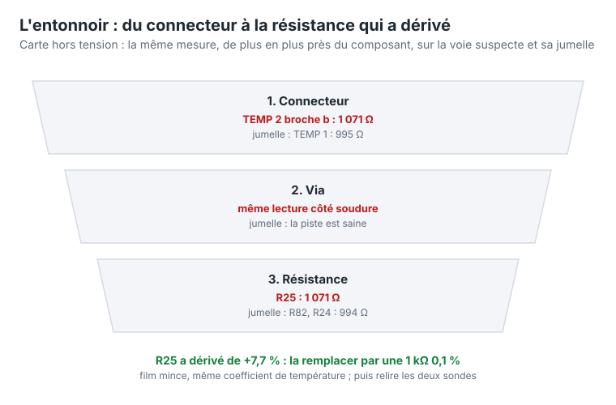
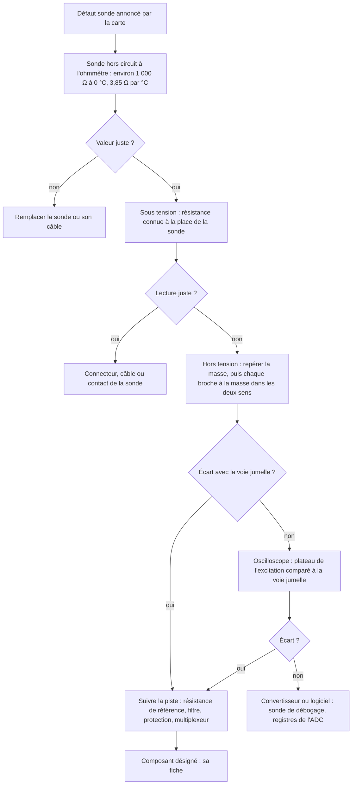

# 94 Voie d'entrée d'une sonde de température résistive

Diagnostiquer une voie qui lit une sonde PT1000 (ou toute sonde résistive) : séparer la sonde de la carte, puis suivre la voie jusqu'au convertisseur.

## En bref

Une carte annonce un « défaut sonde » alors que la sonde mesure bien hors circuit : la panne est **après la sonde**, dans la voie d'acquisition (connecteur, résistance de référence, filtre, multiplexeur, convertisseur du microcontrôleur). On le prouve en **remplaçant la sonde** par une résistance connue, puis on localise la panne en **comparant la voie suspecte à une voie jumelle** saine de la même carte.

> **Sécurité** : périmètre de la fiche [00](../00_securite/README.md), 50 V continu (25 V alternatif) au plus. Les mesures à l'ohmmètre, en mode diode et en continuité se font **hors tension**, carte déchargée. La substitution et l'observation à l'oscilloscope se font sous tension, alimentation limitée en courant, pince de masse sur le 0 V seulement (page [i2](../i2_oscilloscope/README.md)).

## La voie d'une PT1000

Une PT1000 vaut **1 000 Ω à 0 °C** et prend environ **3,85 Ω par °C** (norme IEC 60751, α = 0,00385). La carte la monte en général dans un **pont diviseur** avec une résistance de référence précise (souvent 1 kΩ à 0,1 %), ou l'alimente par une **source de courant** ; un condensateur filtre le point milieu, une diode ou un réseau protège l'entrée, un multiplexeur choisit la voie, le convertisseur du microcontrôleur lit la tension. Contrôler une PT1000 hors circuit : ohmmètre sur ses deux fils, environ 1 080 Ω à 20 °C (fiche [12](../12_thermistance/README.md) pour la méthode à froid et au chaud).

## 1. Remplacer la sonde par une résistance connue

Une boîte à décades, ou deux résistances fixes (1 kΩ et 1,1 kΩ), donnent une lecture attendue connue. Lecture juste : connecteur, câble ou contact de la sonde. Lecture fausse ou défaut maintenu : la carte. Essai bref, sous surveillance, élément chauffant débranché, **jamais** sur un pack ou un chargeur de batteries : la carte croit lire une température fixe et sa protection thermique est neutralisée pendant l'essai.

## 2. Repérer la masse du connecteur

Le trou de fixation est souvent relié à la terre de protection, pas au 0 V logique : confirmer sur la broche GND d'un circuit intégré de la voie (le multiplexeur, par exemple). Si aucune broche ne bipe, la masse logique peut être isolée du châssis, ou la sonde montée entre l'entrée et une résistance de référence : c'est l'ohmmètre qui le montre (étape 3).

## 3. Mesurer chaque broche à la masse, hors tension

En circuit, l'ohmmètre voit tous les chemins en parallèle (fiche [02](../02_pieges_en_circuit/README.md)) : une diode de protection change la lecture selon le sens des pointes. Mesurer **dans les deux sens**, et comparer chaque sens à la même broche d'une voie jumelle, pas à une valeur théorique.

Le filtre d'une entrée de sonde (quelques nanofarads à un microfarad) se charge en moins d'une milliseconde : la lecture est immédiate. Une lecture qui **monte** pendant des secondes signale un gros condensateur sur le nœud (τ = R·C) : attendre qu'elle se stabilise avant de la noter, et chercher ce condensateur s'il n'a rien à faire là.

## 4. Contrôler la protection en mode diode

## 5. Suivre la piste jusqu'au multiplexeur

La continuité suit une piste ; le mode diode compare deux voies, parce qu'il voit aussi les jonctions. Pas de bip : passer sur ohms, une résistance série de protection (1 à 10 kΩ) entre le connecteur et le multiplexeur est normale. Un interrupteur du multiplexeur dégradé (résistance à l'état passant qui dérive, fuite) ne fausse qu'une voie : sondes saines, écart entre deux voies jumelles.

## 6. Observer l'excitation sous tension

Beaucoup de cartes n'alimentent la sonde que pendant la conversion, ou commutent leur source de courant d'une voie à l'autre : le multimètre affiche une moyenne instable. Quand seul le multiplexeur commute, après le pont diviseur, la broche reste en continu. L'oscilloscope montre le plateau de l'impulsion, à comparer au plateau de la voie jumelle.

## 7. Comparer aux voies jumelles et localiser

Une carte qui lit plusieurs sondes identiques porte autant de voies identiques : chacune sert d'étalon aux autres. Noter la même mesure sur toutes les voies, dans le même sens, et chercher **l'intruse** plutôt qu'une valeur théorique. Deux voies qui doivent lire pareil (deux sondes d'un même tuyau, par exemple) et qui s'écartent désignent la panne, même quand chaque valeur paraît plausible.

Quand deux cartes ou deux fiches sont identiques, l'échange tranche sans instrument : un seul échange à la fois, hors tension, fiches repérées et photographiées avant. Jamais sur une panne destructrice (court-circuit, fumée) : on la déplacerait sur la carte saine.

Le schéma est une **hypothèse** reconstruite à l'ohmmètre, sans schéma constructeur : il suffit à chiffrer l'effet d'une dérive. Avec une source de courant, toute la dérive de la référence passe dans la lecture, à 3,85 Ω par °C. Avec un pont diviseur ratiométrique, le signe change mais l'ordre de grandeur reste.

Resserrer la même mesure, du connecteur vers le composant, en comparant toujours à la jumelle : l'étape où l'écart apparaît désigne le composant ou la piste. Une résistance de précision qui a dérivé se remplace par la même valeur, la même tolérance et le même coefficient de température (fiche [10](../10_resistance/README.md)).

## Arbre de décision

## Aide-mémoire d'établi

| Mesure | État | Lecture saine | Suspect |
| --- | --- | --- | --- |
| PT1000 hors circuit | hors tension | ≈ 1 000 Ω à 0 °C, + 3,85 Ω par °C | OL, ≈ 0 Ω, écart de plus de quelques degrés |
| Résistance connue à la place de la sonde | sous tension, essai bref, élément chauffant débranché | 1 000 Ω → 0 °C, 1 100 Ω → 26 °C | défaut maintenu : la carte |
| Broche → masse, deux sens | hors tension | même lecture que la voie jumelle | écart net avec la jumelle |
| Mode diode, rouge sur la masse | hors tension | 0,5 à 0,7 V | ≈ 0 V dans les deux sens |
| Plateau de l'excitation | sous tension, oscilloscope | même plateau que la voie jumelle | plateau absent ou décalé |
| Même mesure sur toutes les voies jumelles | hors tension | écarts de quelques ohms | une voie à part : 4 Ω ≈ 1 °C |

## Sources

- IEC 60751:2022, *Industrial platinum resistance thermometers and platinum temperature sensors* : 1 000 Ω à 0 °C, α = 0,00385 /°C.
- Texas Instruments, fiche technique TS3A5017 (SCDS221) : brochage TSSOP-16, 1S1–1S4 sur les broches 6 à 3, 2S1–2S4 sur les broches 10 à 13, GND broche 8.
