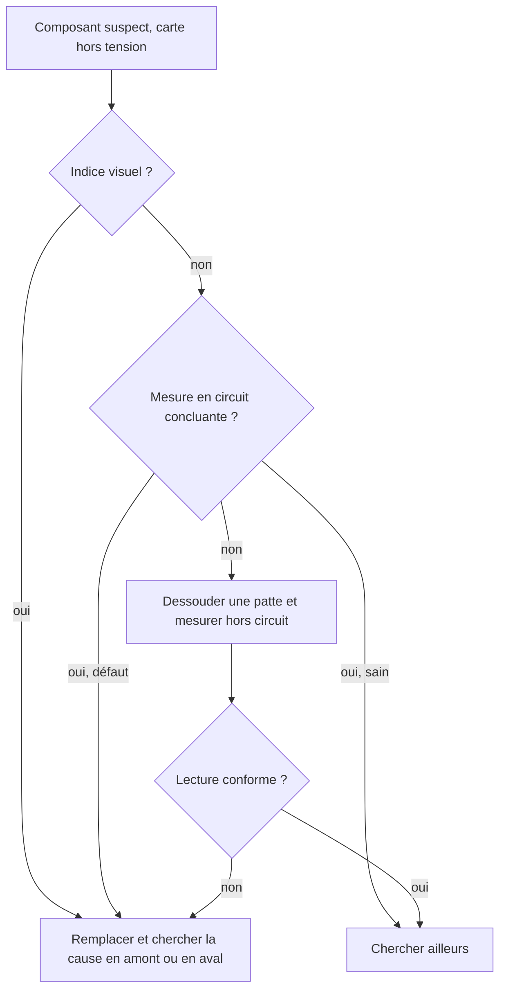

# Gabarit d'une fiche de dépannage

Copier ce fichier dans `troubleshooting/NN_composant/README.md`, remplacer chaque consigne en italique, garder l'ordre des sections et supprimer une section seulement si elle ne s'applique pas.

## En bref

*Trois lignes au plus : ce qui tombe le plus souvent en panne sur ce composant, et la mesure qui tranche dans la majorité des cas.*

> **Sécurité** : hors tension, condensateurs déchargés (fiche 00). *Ajouter ici le risque propre au composant, s'il en a un.*

## Identifier le composant

*Boîtiers courants, marquage (code couleur, code CMS, référence), brochage, et où trouver sa valeur quand le marquage est illisible.*

## Modes de défaillance

Classés du plus fréquent au plus rare (consensus des réparateurs, voir Sources).

| Mode de défaillance | Fréquence | Cause typique | Ce que la panne implique ailleurs |
| --- | --- | --- | --- |
| *ex. ouvert* | *très fréquent, fréquent, occasionnel ou rare* | *…* | *composant en amont ou en aval à vérifier* |

## Niveau 1 — Inspection visuelle

*Indices visibles à l'œil ou à la loupe, odeur, chauffe au toucher sous tension limitée.*

## Niveau 2 — Mesure hors circuit

*Mode du multimètre, calibre, lecture attendue pour un composant sain, lecture pour chaque mode de défaillance, et pourquoi l'appareil réagit ainsi (renvoi vers la fiche 01).*

## Niveau 3 — Mesure en circuit

*Ce qui reste concluant en circuit, ce qui ne l'est pas, les pièges propres au composant (renvoi vers la fiche 02), et quand dessouder.*

## Niveau 4 — Méthodes avancées

*Instrument, méthode, ce qu'elle apporte de plus qu'un multimètre (renvoi vers la fiche 03).*

## Arbre de décision

*Remplacer l'exemple par l'arbre du composant ; chaque feuille est un verdict ou une action.*

## Remplacer le composant

*Critères d'équivalence (valeur, tolérance, puissance, tension, type), pièges du remplacement, et ce qu'il faut vérifier avant de remettre sous tension.*

## Aide-mémoire d'établi

*Dix lignes au plus, imprimables.*

## Sources

*Une source par affirmation non évidente : fiche technique, note d'application, fil de forum. Pas de citation longue ; reformuler.*
