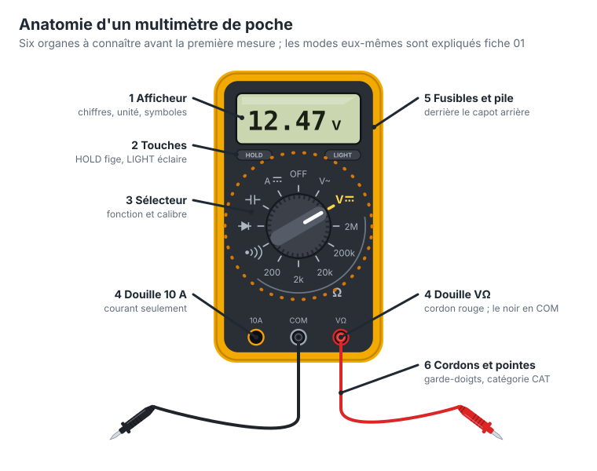
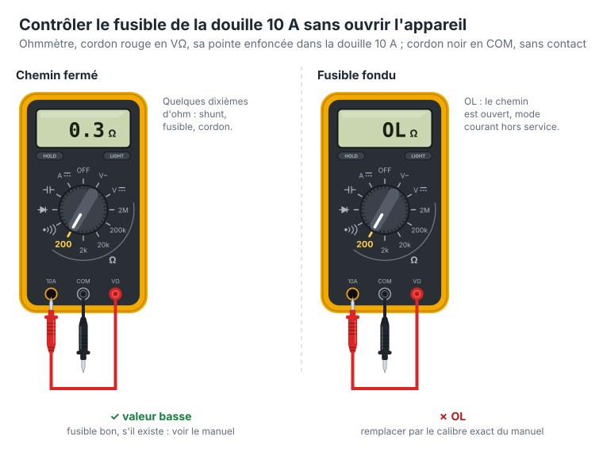

# i1 Le multimètre

L'appareil lui-même : de quoi il est fait, ce que disent ses caractéristiques, comment le choisir et le garder fiable. Ce que fait chaque mode est expliqué dans la fiche [01](../01_multimetre/README.md).

## En bref

Le multimètre numérique est le seul instrument indispensable pour toutes les fiches de dépannage. Un appareil de 4000 à 6000 points, à changement de calibre automatique et manuel, avec des **fusibles sur les entrées courant** et une catégorie de mesure certifiée, suffit pour les niveaux 1 à 3. Avant de se fier à une mesure : pile, cordons et fusibles contrôlés.

> **Sécurité** : les fiches de ce dépôt restent sous 50 V continu (25 V alternatif) partout sur la carte (fiche [00](../00_securite/README.md)). Le même multimètre servira tôt ou tard ailleurs : sa catégorie de mesure (CAT) et ses fusibles décident alors de ce qui se passe en cas d'erreur. Un cordon oublié dans la douille A transforme l'appareil en court-circuit (fiche [01](../01_multimetre/README.md), « Piège du mode courant »).

## Anatomie

1. **Afficheur** : les chiffres, l'unité et des symboles (AC, pile faible, bipeur, HOLD, REL). Sur un appareil à calibre automatique, l'unité et la virgule changent seules : toujours lire l'unité avant le nombre.
2. **Touches** : HOLD fige la lecture, LIGHT éclaire l'écran ; selon le modèle aussi RANGE (calibre manuel), REL (soustraire une valeur de référence, la résistance des cordons par exemple), SELECT (fonction secondaire d'une position du sélecteur), MIN/MAX.
3. **Sélecteur** : choisit la fonction (V, Ω, bipeur, diode, capacité, A) et, sur un appareil manuel, le calibre, c'est-à-dire la plus grande valeur affichable. Le changer pointes en l'air, jamais sous tension.
4. **Douilles** : COM reçoit toujours le cordon noir ; VΩ (souvent marquée V Ω ➝⊢ Hz) reçoit le rouge pour presque tout ; les douilles A et mA/µA ne servent qu'à la mesure de courant, et c'est par elles que passent les accidents.
5. **Fusibles et pile**, derrière le capot arrière : un fusible par entrée courant sur un bon appareil ; une pile de 9 V ou deux à trois piles AA ou AAA.
6. **Cordons et pointes** : gaine souple isolée, fiches banane à manchon, pointes avec **garde-doigts** et capuchons qui réduisent la partie métallique exposée. Les cordons ont leur propre catégorie de mesure, marquée sur la gaine ou la pointe.

## Caractéristiques

Comment lire la fiche technique d'un multimètre :

| Caractéristique | Ce qu'elle dit | Ordre de grandeur utile |
| --- | --- | --- |
| Nombre de points | La plus grande lecture affichable plus un : 6000 points affichent jusqu'à 5999, donc 5,999 V sur le calibre 6 V | 4000 à 6000 points ; 20 000 et plus pour l'établi |
| Précision | ± (% de la lecture + chiffres) : ± (0,5 % + 2) sur 5,000 V donne ± 0,027 V | 0,05 à 1 % en tension continue selon la gamme ; nettement moins bon en alternatif, en capacité et en courant |
| Impédance d'entrée | La résistance que le voltmètre met en parallèle sur ce qu'il mesure | 10 MΩ typiques en tension continue ; 1 MΩ sur certains premiers prix, qui fausse les mesures sur un diviseur de fortes valeurs |
| TRMS (valeur efficace vraie) | Calcule la vraie valeur efficace d'un signal alternatif de n'importe quelle forme | Sans TRMS, l'appareil n'est juste que pour une sinusoïde pure ; dans les deux cas, la bande passante reste limitée (souvent quelques centaines de Hz à quelques kHz) |
| Catégorie de mesure | Où l'appareil peut être branché sans danger, et la tension correspondante : CAT II 600 V, CAT III 1000 V… | Voir ci-dessous |
| Fusibles | Calibre et **pouvoir de coupure** de chaque entrée courant | Fusibles céramique à haut pouvoir de coupure (HPC, 10 kA ou plus) sur un bon appareil |

**Catégories de mesure** (CEI 61010-2-030, appliquée aux multimètres par la CEI 61010-2-033). La catégorie dit quelle surtension transitoire l'appareil encaisse sans exploser, selon l'endroit de l'installation :

- **CAT II** : appareils branchés sur une prise ;
- **CAT III** : installation fixe du bâtiment (tableau, câblage, prises elles-mêmes) ;
- **CAT IV** : origine de l'installation (compteur, branchement) ;
- circuits non reliés au secteur (cartes basse tension de ces fiches) : pas de catégorie requise, l'ancienne mention CAT I.

La catégorie va avec une tension : CAT III 600 V est plus sévère que CAT II 600 V. L'ensemble ne vaut que la plus faible des deux catégories, celle de l'appareil et celle des cordons. Une catégorie seulement imprimée sur le boîtier ne prouve rien : chercher la marque d'un laboratoire indépendant (UL, CSA, TÜV, VDE…). Les essais de démontage publiés montrent des appareils marqués CAT III sans fusible sur la douille 10 A ni protection de l'entrée.

## Types d'appareils

| Type | Pour | Contre |
| --- | --- | --- |
| Calibre manuel | Simple, réponse rapide, bon marché | Il faut choisir le calibre ; « 1 » ou OL quand il est trop petit |
| Calibre automatique | Rien à choisir, moins d'erreurs de lecture | Plus lent à se stabiliser ; la touche RANGE reste utile en circuit (fiche [02](../02_pieges_en_circuit/README.md)) |
| De poche | Portable, sur pile, assez précis pour le dépannage | De 2000 à 60 000 points selon la gamme ; pas de mesure 4 fils |
| De paillasse | 20 000 points et plus, mesure 4 fils (fiche [10](../10_resistance/README.md)), alimenté sur secteur | Encombrant, cher, pas pour une mesure dans un appareil ouvert ailleurs qu'à l'établi |

Les appareils à aiguille gardent un intérêt pour suivre une valeur qui varie, mais leur ohmmètre a souvent la polarité inversée (fiche [01](../01_multimetre/README.md)) : ces fiches supposent un appareil numérique.

## Choisir un multimètre

Pour suivre toutes les fiches, viser :

- 4000 points au moins, calibre automatique **avec** touche RANGE ;
- tension continue, alternative, résistance, bipeur, mode diode, **capacimètre** ;
- un mode diode dont la tension à vide **et** l'affichage dépassent 3 V, pour tester une LED bleue ou blanche (à vérifier avec l'exercice de la fiche [01](../01_multimetre/README.md)) ;
- des **fusibles sur toutes les entrées courant**, idéalement céramique à haut pouvoir de coupure ; refuser un appareil dont la douille 10 A n'est pas protégée ;
- une catégorie de mesure certifiée par un laboratoire, CAT III 600 V au moins si l'appareil doit un jour approcher le secteur, avec des cordons de même catégorie ;
- TRMS : utile, pas indispensable pour ces fiches ;
- un bipeur rapide (il sonne sans retard perceptible) et la touche REL.

Un premier prix reste utile comme second appareil : il sert à l'exercice de la fiche [01](../01_multimetre/README.md) et aux mesures simultanées (une tension et un courant), jamais sur le secteur.

## Entretien et contrôles

À faire avant une séance de dépannage, puis dès qu'une lecture paraît étrange :

- **Pile** : le symbole de pile faible annonce des lectures fausses avant que l'appareil ne s'éteigne ; la remplacer aussitôt. Retirer la pile d'un appareil rangé longtemps : une pile qui coule ronge les contacts.
- **Cordons** : gaine sans coupure ni partie fondue, fiches qui tiennent dans les douilles. Pointes court-circuitées en ohmmètre sur le plus petit calibre : quelques dixièmes d'ohm. Plier les cordons pendant la mesure : une lecture qui saute trahit un fil coupé dans la gaine. Remplacer un cordon abîmé, ne jamais le réparer au ruban adhésif.
- **Fusibles** : un fusible fondu ne se voit pas à l'usage, l'appareil affiche seulement 0 A en mode courant, même quand un courant circule. Le contrôler sans ouvrir l'appareil :

1. Sélecteur sur l'ohmmètre, cordon rouge dans VΩ, cordon noir retiré ou laissé sans contact.
2. Enfoncer la pointe rouge dans la douille 10 A : quelques dixièmes d'ohm (cordon, fusible et shunt en série) = chemin fermé ; OL = fusible fondu.
3. Recommencer dans la douille mA/µA, si l'appareil en a une, en calibre automatique ou sur le plus haut calibre : la valeur est plus haute, de quelques ohms à quelques kΩ selon l'appareil (résistances de protection en série) ; seul le manuel dit la valeur attendue.

Une valeur basse prouve que le chemin est fermé, **pas qu'un fusible existe** : sur un appareil dont la douille 10 A n'a pas de fusible (fréquent en premier prix, fiche [01](../01_multimetre/README.md)), la lecture est la même. Vérifier sa présence dans le manuel, ou sous le capot, appareil débranché de tout et pile retirée.

Certains manuels donnent une autre méthode (mode bipeur, ou valeur attendue précise) : le manuel prime. Un fusible fondu se remplace par le calibre, la tension et le **pouvoir de coupure** exacts du manuel, jamais par un fusible en verre ni par un fil : c'est lui qui empêche le court-circuit du « Piège du mode courant » de devenir un arc.

- **Après chaque mesure de courant** : cordon rouge remis dans VΩ, sélecteur sur OFF.
- **Contrôle de justesse** : comparer de temps en temps avec un second appareil ou une référence connue (pile neuve, résistance à 0,1 %) ; un écart qui grandit annonce une dérive ou un défaut.

## Sources

- CEI 61010-1, CEI 61010-2-030 et CEI 61010-2-033, règles de sécurité des appareils électriques de mesure et des multimètres portatifs (catégories de mesure, marquage, protection des entrées) : normes payantes, consulter la norme pour les valeurs d'essai.
- Fluke 87V, fiche produit (précision, nombre de points, catégories CAT III 1000 V et CAT IV 600 V, fusibles des entrées courant) — <https://www.fluke.com/en-us/product/electrical-testing/digital-multimeters/fluke-87v>
- HKJ (lygte-info.dk), *Multimeter and component testing* et ses tests d'appareils (mesures comparées, démontages, fusibles et protections d'entrée) — <https://lygte-info.dk/info/DMMComponentTesting%20UK.html>
- EEVblog forum, *Multimeters with low ohms function* (tensions de test relevées sur divers appareils) — <https://www.eevblog.com/forum/testgear/multimeters-with-low-ohms-function/>
- Fiche [01](../01_multimetre/README.md) : comportement de chaque mode, ordres de grandeur par classe d'appareil, exercice pour mesurer son propre multimètre.
