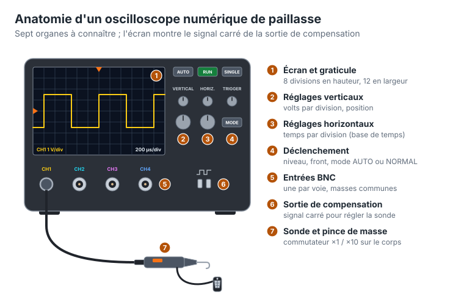
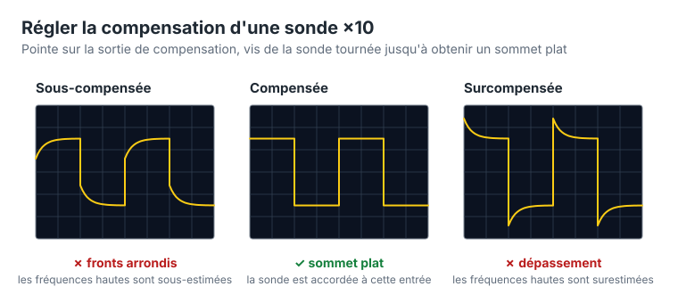

# i2 L'oscilloscope

L'appareil lui-même : ce qu'il montre de plus qu'un multimètre, de quoi il est fait, ce que disent ses caractéristiques, comment brancher sa sonde sans court-circuit et quand il vaut la dépense.

## En bref

L'oscilloscope trace une tension en fonction du temps : il montre ce que le multimètre moyenne (ondulation, parasites, signaux logiques, coupures brèves). Il n'est pas nécessaire aux niveaux 1 à 3 des fiches ; il sert au niveau 4. Un modèle de paillasse de 50 à 100 MHz avec ses sondes ×10 suffit pour ces fiches. Le point à ne jamais rater : **la pince de masse de la sonde est reliée à la terre**.

> **Sécurité** : les fiches de ce dépôt restent sous 50 V continu (25 V alternatif) partout sur la carte (fiche [00](../00_securite/README.md)). La pince de masse d'un oscilloscope de paillasse est reliée à la terre par le cordon secteur : posée ailleurs que sur le 0 V de la carte, elle fait un court-circuit (section [Pince de masse et terre](#pince-de-masse-et-terre)). Ne jamais supprimer la terre de l'oscilloscope. Un circuit relié au secteur ne se mesure pas avec une sonde passive et un oscilloscope de paillasse : hors périmètre de ces fiches.

## Ce qu'il apporte par rapport au multimètre

| Question | Multimètre | Oscilloscope |
| --- | --- | --- |
| Quelle est la valeur de cette tension continue ? | Oui, à mieux que 1 % (page [i1](../i1_multimetre/README.md)) | Oui, mais à quelques % seulement |
| La tension est-elle stable ou ondule-t-elle ? | Non : 2 à 3 mesures par seconde, tout ce qui bouge plus vite est moyenné (fiche [01](../01_multimetre/README.md)) | Oui : amplitude, fréquence et forme de l'ondulation |
| Y a-t-il un signal, et quelle est sa forme ? | Non | Oui : c'est sa raison d'être |
| Deux signaux arrivent-ils dans le bon ordre ? | Non | Oui, avec deux voies ou plus |
| Un événement bref et rare s'est-il produit ? | Non | Oui, avec le déclenchement en mode unique |
| Résistance, continuité, diode, capacité | Oui | Non |

L'oscilloscope ne remplace donc pas le multimètre : il mesure moins juste, seulement des tensions, et une de ses bornes est à la terre. Dans ces fiches, il sert à voir l'ondulation d'un rail (fiches [20](../20_condensateur_ceramique/README.md) et [22](../22_condensateur_electrolytique/README.md)), un signal de part et d'autre d'un condensateur de liaison (fiche [21](../21_condensateur_film/README.md)), les coupures d'une piste de potentiomètre (fiche [11](../11_potentiometre/README.md)) ou un appel de courant sur une résistance de mesure (fiche [13](../13_fusible/README.md)).

## Anatomie

1. **Écran et graticule** : la tension est en vertical, le temps en horizontal. Le quadrillage (graticule) donne l'échelle : 8 divisions en hauteur et 12 en largeur sur l'appareil pris en exemple, le nombre de divisions horizontales variant d'un modèle à l'autre. Une lecture se fait en comptant les divisions : 3 divisions à 2 V/div = 6 V.
2. **Réglages verticaux**, un jeu par voie : l'échelle en volts par division et la position verticale de la trace. Régler l'échelle pour que le signal occupe la plus grande partie de l'écran sans en sortir : c'est ainsi que le convertisseur est le mieux utilisé. Le menu de la voie donne le **couplage** (DC : tout le signal ; AC : la composante continue est retirée, pour voir une petite ondulation sur un rail ; GND : entrée déconnectée, trace à zéro), le **rapport de sonde** (×1, ×10) et la limitation de bande passante.
3. **Réglages horizontaux** : la base de temps en secondes par division, commune à toutes les voies, et la position horizontale.
4. **Déclenchement** (trigger) : choisit l'instant où le tracé commence, pour que l'image soit stable (section [Déclenchement](#déclenchement)).
5. **Entrées BNC**, une par voie, de couleur assortie à la trace. La partie extérieure de chaque BNC est la masse de l'appareil : sur un oscilloscope de paillasse, les masses de toutes les voies sont communes et reliées à la terre.
6. **Sortie de compensation** : un signal carré, en général à 1 kHz, et une borne de masse. Elle sert à régler la sonde, pas à étalonner l'appareil.
7. **Sonde et pince de masse** : la pointe (souvent coiffée d'un grippe-fil à crochet) prend le signal, la pince crocodile au bout d'un fil court prend la référence. Un commutateur ×1 / ×10 est sur le corps de la plupart des sondes livrées avec l'appareil.

La touche RUN/STOP fige l'image ; SINGLE prépare une capture unique ; AUTO laisse l'appareil choisir seul les échelles, utile pour trouver un signal, à corriger ensuite à la main.

## Caractéristiques

Comment lire la fiche technique d'un oscilloscope ; les ordres de grandeur sont ceux d'un appareil d'entrée de gamme (Rigol DS1000Z, voir Sources).

| Caractéristique | Ce qu'elle dit | Ordre de grandeur utile |
| --- | --- | --- |
| Bande passante | La fréquence à laquelle une sinusoïde est affichée avec 3 dB de moins, soit environ 30 % d'amplitude en moins. Bien avant cette fréquence, les fronts d'un signal carré sont déjà arrondis | 50 à 100 MHz. Règle : cinq fois la fréquence d'horloge la plus rapide pour un signal logique, trois fois la fréquence la plus haute pour un signal analogique |
| Temps de montée | Le front le plus raide que l'appareil peut afficher : environ 0,35 / bande passante | 3,5 ns à 100 MHz, 7 ns à 50 MHz |
| Fréquence d'échantillonnage | Le nombre de points mesurés par seconde. Elle se **partage entre les voies actives** et baisse quand la base de temps ralentit | 1 GSa/s sur une voie, 500 MSa/s sur deux, 250 MSa/s sur trois ou quatre. Règle : au moins 2,5 fois la bande passante |
| Profondeur mémoire | Le nombre de points d'une acquisition : mémoire = fréquence d'échantillonnage × durée affichée. Plus elle est grande, plus on garde de détail sur une capture longue | 6 à 24 millions de points selon le nombre de voies actives |
| Nombre de voies | Combien de signaux sont tracés ensemble, sur la même base de temps | 2 ou 4 |
| Résolution verticale | Le nombre de niveaux du convertisseur : 8 bits = 256 niveaux sur la hauteur de l'écran | 8 bits ; 10 ou 12 bits sur d'autres gammes |
| Précision verticale | L'erreur sur une tension lue à l'écran, en % de la pleine échelle | ± 3 % (± 4 % sous 10 mV/div) : pour une valeur continue juste, prendre le multimètre |
| Impédance d'entrée | Ce que l'entrée met en parallèle sur le circuit, sans sonde | 1 MΩ en parallèle avec 15 pF ; 10 MΩ avec une sonde ×10 |
| Tension maximale d'entrée | Ce que l'entrée BNC supporte, avec sa catégorie de mesure (page [i1](../i1_multimetre/README.md)) | 300 V efficaces en CAT I (circuits non reliés au secteur) sur l'appareil cité ; la sonde a sa propre limite |
| Limitation de bande passante | Un filtre commutable qui retire le bruit haute fréquence | 20 MHz : utile pour mesurer une ondulation, à couper pour regarder des fronts |

**Repliement** : un signal plus rapide que la moitié de la fréquence d'échantillonnage est affiché à une fréquence fausse, plus basse. Le risque apparaît surtout avec une base de temps lente, quand l'appareil réduit sa fréquence d'échantillonnage pour tenir dans sa mémoire. Un doute sur une fréquence affichée : accélérer la base de temps et regarder si la forme change.

## Sondes

La sonde fait partie de la mesure : elle charge le circuit et limite la bande passante.

| Position | Ce qu'elle fait | Quand l'utiliser |
| --- | --- | --- |
| ×10 | Divise le signal par dix ; résistance d'entrée de 10 MΩ et capacité d'une dizaine de pF : le circuit est peu chargé et la bande passante est large (150 MHz sur la sonde citée en Sources) | Par défaut, pour presque tout |
| ×1 | Transmet le signal tel quel ; 1 MΩ et plusieurs dizaines de pF (capacité du câble et de l'entrée) ; bande passante réduite (35 MHz annoncés sur la même sonde) | Petits signaux lents, sous 1 V crête à crête environ |

- **Rapport de sonde** : l'appareil doit connaître la position du commutateur (menu de la voie, « Probe » ou « Sonde »), sauf sonde à détection automatique. Sonde sur ×10 et voie réglée sur ×1 : toutes les tensions lues sont dix fois trop petites.
- **Charge capacitive** : à 1 MHz, 10 pF valent 16 kΩ et 50 pF valent 3 kΩ. Sur un nœud à haute impédance (oscillateur à quartz, diviseur de fortes valeurs), poser la sonde modifie le signal, parfois jusqu'à l'arrêter.
- **Fil de masse** : le garder aussi court que possible. Un fil long ajoute une inductance qui fait apparaître des oscillations et des dépassements sur les fronts, absents du circuit. Pour un rail d'alimentation à découpage ou un front rapide, remplacer le fil et sa pince par le ressort de masse livré avec la sonde, posé sur un point de masse voisin de la pointe.

### Compenser la sonde

Une sonde ×10 contient un condensateur ajustable, à accorder avec la capacité d'entrée de l'oscilloscope. Mal réglée, elle fausse les amplitudes et déforme les signaux.

1. Sonde sur ×10, rapport ×10 sur la voie, pointe sur la sortie de compensation, pince sur sa borne de masse.
2. Régler les échelles pour voir deux ou trois périodes du signal carré.
3. Tourner la vis d'ajustage de la sonde avec un tournevis **non métallique** (livré avec la sonde) jusqu'à obtenir des sommets plats.

À faire à la première utilisation, et chaque fois que la sonde passe sur un autre oscilloscope ; un contrôle prend dix secondes avant une mesure qui compte. La position ×1 n'a pas de réglage.

## Pince de masse et terre

Un oscilloscope de paillasse est relié à la terre par son cordon secteur, et la pince de masse de chaque sonde est reliée à son châssis. La pince n'est donc pas une « deuxième pointe » comme le cordon noir d'un multimètre : **elle met à la terre le point où on la pose**.

- **Carte dont le 0 V est déjà à la terre** (alimentation de laboratoire dont la borne − est reliée à la borne de terre, câble USB vers un ordinateur de bureau, autre appareil de mesure branché) : la pince ne peut aller **que** sur le 0 V. Posée sur le +12 V, sur la sortie d'un régulateur ou aux bornes d'une résistance de mesure placée côté +, elle court-circuite ce point au 0 V à travers la terre. Le courant n'est limité que par l'alimentation : avec une batterie ou une alimentation non limitée, le fil de la pince, une piste ou l'entrée de l'oscilloscope peuvent être détruits.
- **Carte flottante** (sur pile, sur batterie, sur adaptateur secteur isolé sans autre liaison) : la première pince peut se poser sur n'importe quel point, qui devient alors la référence, à la terre. Mais les masses de toutes les voies sont communes : une **seconde pince posée sur un autre point court-circuite ces deux points entre eux**.
- **Dans le doute**, vérifier avant de poser la pince : carte hors tension, continuité au multimètre entre la pince et le 0 V de la carte ; carte sous tension, voltmètre entre la pince et le point visé, en continu puis en alternatif. Une tension non nulle = ne pas poser la pince.

Mesurer une tension entre deux points dont aucun n'est le 0 V :

- **Deux voies et une soustraction** : une sonde sur chaque point, les deux pinces sur le 0 V, mêmes réglages sur les deux voies, puis fonction mathématique A − B. Suffisant en basse tension et basse fréquence.
- **Sonde différentielle** : deux pointes, aucune à la terre. C'est la solution prévue pour cet usage.
- **Oscilloscope à entrées isolées** (portable sur batterie dont les voies sont isolées entre elles et de la terre) : chaque voie a sa propre référence.
- **Alimenter la carte par une source flottante** (batterie, alimentation de laboratoire dont aucune borne n'est reliée à la terre), dans la limite des 50 V de ces fiches.

**Jamais** : couper ou neutraliser la terre de l'oscilloscope (adaptateur sans terre, broche coupée) pour « le rendre flottant ». Son châssis, ses BNC et tout ce qui y est relié se retrouvent au potentiel du point où la pince est posée.

**Oscilloscope USB** : sa masse est celle de l'ordinateur, par le câble USB. Elle est à la terre avec un ordinateur de bureau ou un portable sur un chargeur relié à la terre, et le court-circuit passe alors par l'ordinateur. Cette masse ne sert qu'à la mesure, ce n'est pas une terre de protection : ne jamais y appliquer de tension.

## Déclenchement

Sans déclenchement, chaque balayage commence à un instant quelconque et l'image défile. Le déclenchement fait commencer chaque tracé au même point du signal.

- **Source** : la voie qui sert de référence. Choisir celle qui porte le signal le plus lent ou le plus propre.
- **Niveau** : la tension que le signal doit franchir, repérée par un curseur au bord de l'écran. Placé au-dessus ou au-dessous du signal, il ne déclenche jamais.
- **Front** : montant ou descendant. Le déclenchement sur front est le plus courant ; les autres types (largeur d'impulsion, pente, bus série) servent à isoler un événement précis.
- **Mode** :
  - *Auto* : l'appareil trace même sans déclenchement. Pour chercher un signal ou regarder une tension continue ;
  - *Normal* : l'appareil ne trace que si la condition est remplie, et garde la dernière image. Pour un signal rare ;
  - *Single* (unique) : une seule acquisition, puis arrêt. Pour capturer une mise sous tension, un appel de courant, un parasite.
- **Holdoff** : un temps mort après chaque déclenchement, pendant lequel l'appareil ignore les fronts suivants. Stabilise un signal qui contient plusieurs fronts par période (trame, salve).

Image instable : vérifier dans l'ordre la source, le niveau (dans le signal ?), puis le mode.

## Types d'appareils

| Type | Pour | Contre |
| --- | --- | --- |
| Numérique de paillasse | Écran et boutons dédiés, 2 ou 4 voies, autonome ; le plus répandu | Masse à la terre ; encombrant |
| USB (boîtier relié à un ordinateur) | Compact, grand écran, captures faciles à enregistrer | Pas de boutons ; masse reliée à celle de l'ordinateur ; sans terre de protection |
| Portable à entrées isolées | Sur batterie, voies isolées entre elles et de la terre, catégorie de mesure élevée | Cher ; destiné au terrain et à l'industrie |

Ces fiches supposent un oscilloscope numérique à mémoire.

## Quand vaut-il la dépense ?

Pas avant d'avoir un bon multimètre (page [i1](../i1_multimetre/README.md)) et une alimentation limitée en courant (fiche [00](../00_securite/README.md)) : les niveaux 1 à 3 de toutes les fiches s'en passent. Il devient utile quand la panne est dans un **signal** et non dans une valeur : alimentation à découpage qui hoquette, ondulation d'un rail, oscillateur ou horloge à l'arrêt, bus qui ne répond pas, défaut intermittent.

Pour suivre le niveau 4 des fiches, viser :

- 2 voies au moins, 4 si le budget le permet (comparer une entrée, une sortie et une alimentation) ;
- 50 à 100 MHz de bande passante : selon la règle des cinq fois, de quoi regarder des signaux logiques de 10 à 20 MHz ;
- 1 GSa/s, en vérifiant la valeur **toutes voies actives** : au moins 2,5 fois la bande passante ;
- des sondes ×1 / ×10 livrées, avec ressort de masse et tournevis d'ajustage ;
- les modes de déclenchement Auto, Normal et Single, et le couplage AC ;
- une documentation complète du fabricant (manuel et fiche technique datés).

C'est la classe des Rigol DS1000Z et Siglent SDS1000X-E, cités en Sources.

## Erreurs courantes

- **Pince de masse posée ailleurs que sur le 0 V** d'une carte reliée à la terre, ou deux pinces sur deux points différents : court-circuit (section [Pince de masse et terre](#pince-de-masse-et-terre)).
- **Rapport de sonde faux** : commutateur sur ×10, voie sur ×1 (ou l'inverse) ; toutes les tensions sont fausses d'un facteur dix.
- **Sonde non compensée** : amplitudes fausses, fronts arrondis ou dépassements qui n'existent pas dans le circuit.
- **Fil de masse long sur un signal rapide** : oscillations sur les fronts, prises pour un défaut de la carte.
- **Couplage AC oublié** : la composante continue a disparu, un rail à 5 V paraît à 0 V. À l'inverse, en couplage DC, l'ondulation d'un rail est invisible à l'échelle du rail : passer en AC et descendre à quelques dizaines de mV/div.
- **Limitation de bande passante restée active** : les fronts paraissent lents.
- **Base de temps trop lente** : repliement, fréquence affichée fausse.
- **Niveau de déclenchement hors du signal** : image qui défile, ou écran figé sur une ancienne trace en mode Normal.
- **Lire une valeur continue à l'écran comme sur un multimètre** : la précision verticale est de quelques %.
- **Dépasser la tension maximale** de la sonde ou de l'entrée : sans objet sous 50 V, à vérifier avant tout autre usage.

## Sources

- Rigol, *DS1000Z Series Digital Oscilloscope*, fiche technique (bande passante, fréquence d'échantillonnage et profondeur mémoire selon le nombre de voies, 8 bits, précision du gain, impédance et tension maximale d'entrée, limitation à 20 MHz, plage de holdoff) — <https://cdn-aorpci9.actonsoftware.com/acton/cdna/1579/f-0504/1/9/MSO1000Z_Datasheet.pdf>
- Rigol, *DS1000Z User Guide* (mise à la terre par le cordon secteur et fil de masse de la sonde à la terre, catégorie de mesure I, compensation de la sonde au tournevis non métallique, signal de compensation impropre à l'étalonnage, rapport de sonde, modes Auto, Normal et Single, holdoff, 12 divisions horizontales, relation mémoire, fréquence d'échantillonnage et base de temps, opération A − B) — <https://www.rigol.com/dam/global/downloads/brochures/en/user-manual/oscillosopes/DS1000Z_UserGuide_EN.pdf>
- Rigol, *PVP2150 Passive Probe User's Guide*, 2016 (bande passante, résistance et capacité d'entrée en ×1 et en ×10, tension maximale, réglage de la compensation) — <https://cdn-aorpci9.actonsoftware.com/acton/cdna/1579/f-06be/1/0/PVP2150%20User%27s%20Guide.pdf>
- Keysight, *Evaluating Oscilloscope Bandwidths for Your Application*, note d'application 5989-5733EN (bande passante à −3 dB soit −30 % d'amplitude, règles des cinq fois et des trois fois, temps de montée 0,35 / bande passante) — <https://helpfiles.keysight.com/sp/PD1000A/Content/PD1500A%20DPT%20Tests/5989-5733EN.pdf>
- Rohde & Schwarz, *Oscilloscope buyer's guide* (fréquence d'échantillonnage d'au moins 2,5 fois la bande passante, bits du convertisseur, mémoire) — <https://www.rohde-schwarz.com/us/products/test-and-measurement/essentials-test-equipment/rs-essentials-digital-oscilloscopes/buyers-guide-oscilloscopes_256699.html>
- Rohde & Schwarz, *Understanding passive oscilloscope probes* (charge et bande passante comparées des sondes ×1 et ×10, usage du ×1 sous 1 V crête à crête, réglage du rapport de sonde) — <https://www.rohde-schwarz.com/us/products/test-and-measurement/essentials-test-equipment/rs-essentials-digital-oscilloscopes/understanding-passive-oscilloscope-probes_254518.html>
- Rohde & Schwarz, *Understanding probe compensation* (pourquoi et quand compenser, signal carré à 1 kHz, aspect des signaux sous-compensé et surcompensé) — <https://www.rohde-schwarz.com/us/products/test-and-measurement/essentials-test-equipment/rs-essentials-digital-oscilloscopes/understanding-probe-compensation_254520.html>
- Rohde & Schwarz, *Oscilloscope probe tips and how to use them* (inductance d'un fil de masse long, oscillations et dépassements, ressort de masse) — <https://www.rohde-schwarz.com/us/products/test-and-measurement/essentials-test-equipment/rs-essentials-digital-oscilloscopes/oscilloscope-probe-tips-and-how-to-use-them_257202.html>
- Rohde & Schwarz, *Understanding basic oscilloscope operation* (échelle verticale et usage du convertisseur, base de temps, déclenchement sur front, modes Auto et Normal) — <https://www.rohde-schwarz.com/us/products/test-and-measurement/essentials-test-equipment/rs-essentials-digital-oscilloscopes/understanding-basic-oscilloscope-operation_254512.html>
- Teledyne LeCroy, *Don't Probe HV with Single-ended Passive Probes* (pince de masse reliée à la terre par l'oscilloscope, court-circuit sur un point qui n'est pas à la terre, danger de couper la terre de l'appareil, sonde différentielle) — <https://www.teledynelecroy.com/oscilloscope/blog/dont-probe-hv-with-single-ended-passive-probes/>
- Pico Technology, *PicoScope 2000 Series User's Guide*, DO231-11, § 2.3 « Grounding » (masse reliée par le câble USB, sans terre de protection ; ne jamais appliquer de tension à la masse ; contrôle au voltmètre avant de la relier) — <https://www.picotech.com/download/manuals/picoscope-2000-series-quick-start-guide.pdf>
- Fluke, *190 Series III ScopeMeter*, fiche produit (entrées isolées entre elles et de la terre, références de masse différentes sans court-circuit ; un oscilloscope de paillasse ne mesure que par rapport à la terre) — <https://www.fluke.com/en-us/product/electrical-testing/portable-oscilloscopes/190-series-iii>
- Siglent, *SDS1000X-E Series*, fiche produit (2 ou 4 voies, 100 ou 200 MHz, 1 GSa/s) — <https://siglentna.com/digital-oscilloscopes/sds1000x-e-series-super-phosphor-oscilloscopes/>
- CEI 61010-2-030:2023, édition 3.0, fiche de la norme (appareils à circuits de mesure, catégories de mesure ; norme payante) — <https://webstore.iec.ch/en/publication/75915>
- CEI 61010-031:2022, édition 3.0, fiche de la norme (sécurité des sondes tenues à la main ; norme payante) — <https://webstore.iec.ch/en/publication/70272>
- Page [i1](../i1_multimetre/README.md) : catégories de mesure. Fiche [01](../01_multimetre/README.md) : ce que le multimètre moyenne.
